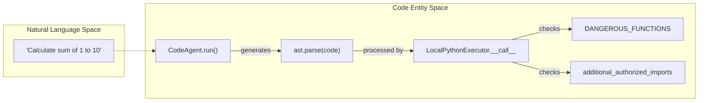
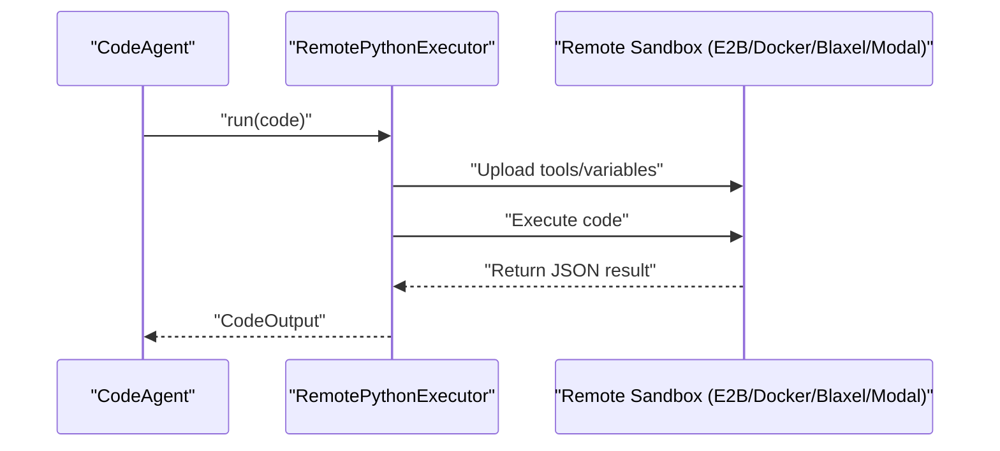

<!-- source: DeepWiki mcp.deepwiki.com · repo huggingface/smolagents · page 6 Code Execution & Security · fetched 2026-10-26 -->

# Code Execution & Security

<details>
<summary>Relevant source files</summary>

The following files were used as context for generating this wiki page:

- [README.md](README.md)
- [SECURITY.md](SECURITY.md)
- [docs/source/en/index.md](docs/source/en/index.md)
- [docs/source/en/reference/python_executors.md](docs/source/en/reference/python_executors.md)
- [docs/source/en/tutorials/secure_code_execution.md](docs/source/en/tutorials/secure_code_execution.md)
- [docs/source/ko/reference/agents.md](docs/source/ko/reference/agents.md)
- [examples/sandboxed_execution.py](examples/sandboxed_execution.py)

</details>


This document covers the code execution infrastructure in `smolagents` and the security mechanisms that protect against malicious or erroneous LLM-generated code. It explains the `PythonExecutor` interface, the AST-based `LocalPythonExecutor` with its five-layer security model, and the various remote sandbox options (`E2BExecutor`, `BlaxelExecutor`, `ModalExecutor`, `DockerExecutor`).

---

## The Execution Challenge

### Threat Model

When `CodeAgent` (see [CodeAgent](#3.2)) generates Python code to solve tasks, it creates an inherent security risk. The threat model encompasses several attack vectors:

| Attack Vector | Description | Risk Level |
|--------------|-------------|------------|
| **LLM Error** | Model unintentionally generates harmful commands (e.g., file deletion) while attempting to be helpful [docs/source/en/tutorials/secure_code_execution.md:33-33](). | Low but observed |
| **Supply Chain Attack** | Compromised or untrusted LLM generates malicious code [docs/source/en/tutorials/secure_code_execution.md:34-34](). | Extremely low with trusted models |
| **Prompt Injection** | Malicious website injects harmful instructions into agent memory via tools like `VisitWebpageTool` [docs/source/en/tutorials/secure_code_execution.md:35-35](). | Medium for web-browsing agents |
| **Public Agent Exploitation** | Adversarial inputs to publicly accessible agents designed to exploit execution capabilities [docs/source/en/tutorials/secure_code_execution.md:36-36](). | High for exposed agents |

Sources: [docs/source/en/tutorials/secure_code_execution.md:32-41]()

---

## PythonExecutor Interface

### Base Abstraction

All code execution in `smolagents` implements the `PythonExecutor` abstract class.

```mermaid
classDiagram
    class "PythonExecutor" {
        <<interface>>
        +__call__(code_action: str) CodeOutput
        +send_tools(tools: dict)
        +send_variables(variables: dict)
    }
    class "LocalPythonExecutor" {
        +additional_authorized_imports: list
        +__call__(code: str) CodeOutput
    }
    class "RemotePythonExecutor" {
        <<abstract>>
        +additional_imports: list
        +allow_pickle: bool
        +run_code_raise_errors(code: str) CodeOutput
    }
    class "CodeOutput" {
        +output: Any
        +logs: str
        +is_final_answer: bool
    }

    "PythonExecutor" <|-- "LocalPythonExecutor"
    "PythonExecutor" <|-- "RemotePythonExecutor"
    "RemotePythonExecutor" <|-- "E2BExecutor"
    "RemotePythonExecutor" <|-- "DockerExecutor"
    "RemotePythonExecutor" <|-- "BlaxelExecutor"
    "RemotePythonExecutor" <|-- "ModalExecutor"
    "PythonExecutor" ..> "CodeOutput" : "returns"
```

**Key Components:**

- **`PythonExecutor.__call__(code: str)`**: The primary entry point for executing a code string and returning a `CodeOutput` [docs/source/en/reference/python_executors.md:13-13]().
- **`CodeOutput.output`**: The final result of code execution, which can be an arbitrary Python object.
- **`CodeOutput.logs`**: Captured standard output (e.g., `print` statements) from the execution.
- **`CodeOutput.is_final_answer`**: A boolean flag indicating if the agent reached task completion via `final_answer()`.

Sources: [docs/source/en/reference/python_executors.md:13-38](), [docs/source/ko/reference/agents.md:56-75]()

---

## Local Execution: LocalPythonExecutor

### AST-Based Interpretation

`LocalPythonExecutor` executes code without using Python's `eval()` or `exec()` built-ins. Instead, it parses code into an Abstract Syntax Tree (AST) and evaluates nodes individually via an internal walker to ensure it only performs authorized operations [docs/source/en/tutorials/secure_code_execution.md:51-54]().



**Core Logic:** The executor traverses the AST and maps operations to safe implementations, blocking unauthorized imports like `os` or `sys` unless explicitly permitted in `additional_authorized_imports` [docs/source/en/tutorials/secure_code_execution.md:82-85]().

Sources: [docs/source/en/tutorials/secure_code_execution.md:51-60](), [docs/source/ko/reference/agents.md:60-63]()

### Five Security Layers

#### Layer 1: Import Whitelist
Imports are blocked by default. Users must explicitly authorize packages. Access to submodules must also be authorized or allowed via wildcards like `numpy.*` [docs/source/en/tutorials/secure_code_execution.md:55-57]().

#### Layer 2: Function Whitelist
Only safe functions or provided tools can be called. Access to potentially harmful submodules through authorized packages (e.g., `random._os`) is specifically blocked [docs/source/en/tutorials/secure_code_execution.md:88-91]().

#### Layer 3: Dunder Method Protection
Access to double-underscore (`__dunder__`) attributes is restricted to prevent common Python sandbox escape techniques.

#### Layer 4: Operation Count Limit
The total count of elementary operations processed is capped to prevent resource bloating and denial-of-service via generated code [docs/source/en/tutorials/secure_code_execution.md:58-58]().

#### Layer 5: Execution Timeout / Loop Limits
Infinite loops are interrupted after reaching a maximum number of iterations (e.g., 1,000,000 in `while` loops) [docs/source/en/tutorials/secure_code_execution.md:92-99]().

Sources: [docs/source/en/tutorials/secure_code_execution.md:51-99]()

For details, see [LocalPythonExecutor](#6.2).

---

## Remote Execution: RemotePythonExecutor

Remote executors provide true isolation by running code in separate environments such as containers or VMs. This is the recommended approach for production and handling untrusted code [SECURITY.md:21-21]().

### Sandbox Workflow

Remote executors manage the lifecycle of a remote environment, sending tools and variables before execution.



**Key Implementations:**
- **`E2BExecutor`**: Uses [E2B](https://e2b.dev/) sandboxes for secure, isolated execution [SECURITY.md:15-15]().
- **`DockerExecutor`**: Runs code in isolated Docker containers [SECURITY.md:19-19]().
- **`BlaxelExecutor`** & **`ModalExecutor`**: High-performance remote execution platforms integrated into `smolagents` [README.md:38-38](), [examples/sandboxed_execution.py:7-24]().

Sources: [docs/source/en/reference/python_executors.md:23-38](), [examples/sandboxed_execution.py:7-24](), [SECURITY.md:13-21]()

For details, see [Remote Executors](#6.3) and [Execution Environment Overview](#6.1).

---

## Security Model & Best Practices

The framework employs several layers of data protection during execution and serialization.

| Component | Role | Security Property |
|-----------|------|-------------------|
| `SafeSerializer` | Handles data transfer | JSON-safe by default; prevents arbitrary code execution unless `allow_pickle=True`. |
| `InterpreterError` | Error handling | Raised when AST evaluation hits a security violation or syntax error [docs/source/en/tutorials/secure_code_execution.md:90-91](). |
| `DANGEROUS_MODULES` | Import Filter | Internal list that blocks access to modules like `os`, `sys`, and `subprocess` by default. |

**Best Practices:**
1. **Prefer Remote Sandboxes**: Use E2B, Docker, Blaxel, or Modal for production environments to ensure environment isolation [SECURITY.md:21-21]().
2. **Restrict Imports**: Only authorize the specific submodules needed for the task (e.g., `numpy`, `pandas`) [docs/source/en/tutorials/secure_code_execution.md:66-67]().
3. **Monitor Resource Usage**: Use the built-in operation limits to prevent resource exhaustion from generated code [docs/source/en/tutorials/secure_code_execution.md:58-58]().

Sources: [docs/source/en/tutorials/secure_code_execution.md:104-110](), [SECURITY.md:1-23]()

For details, see [Security Model & Best Practices](#6.4).

---

