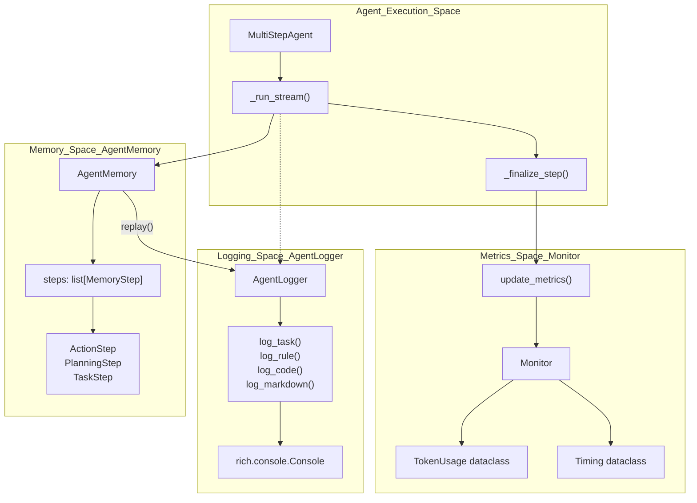
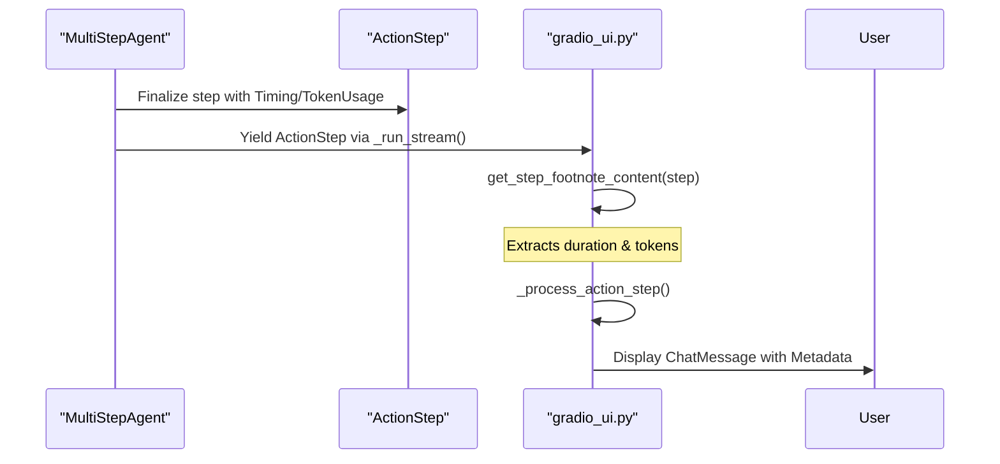

<!-- source: DeepWiki mcp.deepwiki.com · repo huggingface/smolagents · page 7 Monitoring & Observability · fetched 2026-10-26 -->

# Monitoring & Observability

<details>
<summary>Relevant source files</summary>

The following files were used as context for generating this wiki page:

- [examples/gradio_ui.py](examples/gradio_ui.py)
- [src/smolagents/gradio_ui.py](src/smolagents/gradio_ui.py)
- [src/smolagents/memory.py](src/smolagents/memory.py)
- [src/smolagents/monitoring.py](src/smolagents/monitoring.py)
- [tests/test_memory.py](tests/test_memory.py)
- [tests/test_monitoring.py](tests/test_monitoring.py)

</details>


This page provides an overview of the monitoring, logging, metrics, and execution inspection systems in `smolagents`. These systems enable comprehensive observability of agent behavior, performance tracking, and post-run analysis.

The monitoring infrastructure is implemented across `src/smolagents/monitoring.py` and `src/smolagents/memory.py`, and is integrated into every agent run to capture detailed execution data.

For detailed information on specific components:
- **[AgentLogger & LogLevel](#7.1)** — Structured logging with `Rich` console output and visualization tools.
- **[Monitor & Metrics](#7.2)** — Tracking of `TokenUsage`, `Timing`, and real-time performance feedback.
- **[OpenTelemetry Integration](#7.3)** — Distributed tracing with Arize Phoenix and OpenInference.
- **[Memory Inspection & Replay](#7.4)** — Step serialization, succinct summaries, and execution debugging.

---

## Architecture Overview

Every `MultiStepAgent` run produces three complementary streams of observability data:

1.  **Console output** — Real-time, human-readable logs emitted by `AgentLogger` [src/smolagents/monitoring.py:130-137]() with `Rich` formatting.
2.  **In-memory metrics** — Token counts and step durations tracked by `Monitor` [src/smolagents/monitoring.py:81-88]() and attached to each `MemoryStep`.
3.  **Structured memory** — Full execution history stored in `AgentMemory` [src/smolagents/memory.py:230-230]() for post-run inspection and replay.

### Monitoring System Architecture



**Sources:** [src/smolagents/monitoring.py:81-117](), [src/smolagents/monitoring.py:130-210](), [src/smolagents/memory.py:230-230]()

---

## Component Overview

### AgentLogger - Real-time Console Output
The `AgentLogger` class [src/smolagents/monitoring.py:130-137]() provides structured, level-filtered console output using the `Rich` library. Every agent utilizes this to display thoughts, tool calls, and observations.

**Key features:**
- **LogLevels**: `OFF`, `ERROR`, `INFO`, `DEBUG` [src/smolagents/monitoring.py:120-124]().
- **Formatting**: Specialized methods like `log_code` [src/smolagents/monitoring.py:174-188]() and `log_markdown` [src/smolagents/monitoring.py:152-172]().
- **Sanitization**: Uses `sanitize_for_rich` [src/smolagents/monitoring.py:30]() to prevent crashes from stray markup in tool outputs [src/smolagents/monitoring.py:201-208]().

### Monitor - Metrics Accumulation
The `Monitor` class [src/smolagents/monitoring.py:81-88]() tracks cumulative metrics across an agent run. It is updated via `update_metrics(step_log)` [src/smolagents/monitoring.py:100-117]().

**Key features:**
- **Token Tracking**: Aggregates `total_input_token_count` and `total_output_token_count` [src/smolagents/monitoring.py:86-87]().
- **Timing**: Records durations for every step in `step_durations` [src/smolagents/monitoring.py:83]().
- **Console Feedback**: Prints per-step duration and token usage summaries if verbosity allows [src/smolagents/monitoring.py:108-117]().

### AgentMemory - Execution History
The `AgentMemory` class [src/smolagents/memory.py:230-230]() stores the complete sequence of `MemoryStep` objects.

**Key features:**
- **Serialization**: `ActionStep.dict()` [src/smolagents/memory.py:66-90]() converts complex objects (like images and tool calls) into JSON-serializable formats using `make_json_serializable` [src/smolagents/memory.py:87]().
- **Replay**: `memory.replay(logger)` [src/smolagents/memory.py:255-265]() reconstructs the console view of a previous run.
- **Succinct View**: `get_succinct_steps()` [src/smolagents/memory.py:267-275]() provides a condensed version of the history for context window management.

---

## Data Structures

The system relies on specific dataclasses to pass observability data between components:

| Class | Purpose | Key Fields |
| :--- | :--- | :--- |
| `TokenUsage` | Model usage metrics | `input_tokens`, `output_tokens`, `total_tokens` [src/smolagents/monitoring.py:37-48]() |
| `Timing` | Execution duration | `start_time`, `end_time`, `duration` [src/smolagents/monitoring.py:58-69]() |
| `ActionStep` | Detailed step log | `tool_calls`, `observations`, `token_usage`, `timing` [src/smolagents/memory.py:51-64]() |

**Sources:** [src/smolagents/monitoring.py:37-78](), [src/smolagents/memory.py:51-90]()

---

## Integration with UI & Streaming

Monitoring data is not limited to the console. The `GradioUI` [examples/gradio_ui.py:16-16]() and `stream_to_gradio` utility [src/smolagents/gradio_ui.py:186-210]() consume these steps to provide visual feedback. It extracts duration and token usage using `get_step_footnote_content` [src/smolagents/gradio_ui.py:29-36]().

**UI Observability Flow**



**Sources:** [src/smolagents/gradio_ui.py:29-36](), [src/smolagents/gradio_ui.py:80-163](), [tests/test_monitoring.py:108-110]()

---

## Basic Usage

### Accessing Metrics Programmatically
After an agent run, metrics can be extracted from the `monitor` attribute:

```python
from smolagents import CodeAgent

agent = CodeAgent(tools=[], model=my_model)
agent.run("Calculate the fibonacci of 10")

# Access aggregated metrics
metrics = agent.monitor.get_total_token_counts()
print(f"Input: {metrics.input_tokens}, Output: {metrics.output_tokens}")

# Access per-step timing
for i, duration in enumerate(agent.monitor.step_durations):
    print(f"Step {i} took {duration:.2f}s")
```

**Sources:** [src/smolagents/monitoring.py:89-93](), [src/smolagents/monitoring.py:107-108](), [tests/test_monitoring.py:185-186]()

### Controlling Output Detail
The `verbosity_level` directly sets the `LogLevel` of the internal `AgentLogger`.

```python
from smolagents import CodeAgent, LogLevel

# Debug level shows full model inputs/outputs
agent = CodeAgent(tools=[], model=my_model, verbosity_level=LogLevel.DEBUG)
```

**Sources:** [src/smolagents/monitoring.py:120-124](), [src/smolagents/monitoring.py:131-136]()

---

