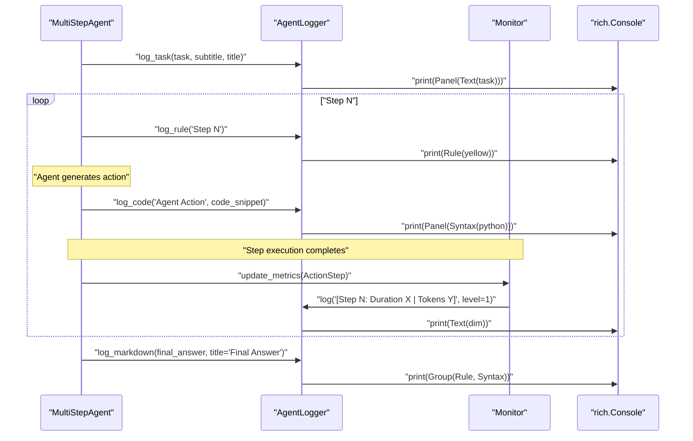

<!-- source: DeepWiki mcp.deepwiki.com · repo huggingface/smolagents · page 7.1 AgentLogger & LogLevel · fetched 2026-10-26 -->

# AgentLogger & LogLevel

<details>
<summary>Relevant source files</summary>

The following files were used as context for generating this wiki page:

- [src/smolagents/memory.py](src/smolagents/memory.py)
- [src/smolagents/monitoring.py](src/smolagents/monitoring.py)
- [tests/test_memory.py](tests/test_memory.py)

</details>


This page documents the `AgentLogger` class and the `LogLevel` enum, both defined in [src/smolagents/monitoring.py](). These are the primary interfaces for all console output produced during an agent run, utilizing the `rich` library for structured, human-readable terminal output.

---

## Overview

Every `MultiStepAgent` holds an `AgentLogger` instance. Throughout a run, the agent and its subsystems call methods on this logger to render execution steps, code blocks, and errors. The `LogLevel` enum gates which messages actually print, letting callers filter output from completely silent (`OFF`) to fully verbose (`DEBUG`).

**Key components covered:**
- **LogLevel**: An `IntEnum` for filtering verbosity.
- **AgentLogger**: The primary class for rendering `rich` components.
- **Sanitization**: The `sanitize_for_rich` utility for safe console printing.
- **Visualization**: Tools for rendering agent hierarchies and execution trees.

---

## LogLevel

`LogLevel` is an `IntEnum` defined at [src/smolagents/monitoring.py:120-124]().

| Name | Value | Meaning |
|------|-------|---------|
| `OFF` | `-1` | No output at all |
| `ERROR` | `0` | Only errors and forced output |
| `INFO` | `1` | Normal output — default for most agents |
| `DEBUG` | `2` | Detailed output including full message history |

Because `LogLevel` extends `IntEnum`, levels can be compared numerically. A message at level `n` is printed only if `n <= logger.level` [src/smolagents/monitoring.py:146-147](). The `verbosity_level` parameter on agent constructors maps directly to these values (e.g., `verbosity_level=1` sets the logger to `LogLevel.INFO`).

Sources: [src/smolagents/monitoring.py:120-124](), [src/smolagents/monitoring.py:146-147]()

---

## AgentLogger

`AgentLogger` is the central logging authority, wrapping a `rich.console.Console` instance [src/smolagents/monitoring.py:130-136]().

### Class Architecture

**AgentLogger and LogLevel Relationships**

```mermaid
classDiagram
    class "AgentLogger" as AgentLogger {
        +level: LogLevel
        +console: Console
        +log(*args, level) None
        +log_error(error_message) None
        +log_markdown(content, title, level, style) None
        +log_code(title, content, level) None
        +log_rule(title, level) None
        +log_task(content, subtitle, title, level) None
        +visualize_agent_tree(agent) None
    }

    class "LogLevel" as LogLevel {
        <<IntEnum>>
        OFF = -1
        ERROR = 0
        INFO = 1
        DEBUG = 2
    }

    class "Console" as Console {
        <<rich.console>>
        +print(*args, **kwargs)
    }

    AgentLogger --> LogLevel : "uses for filtering"
    AgentLogger --> Console : "delegates rendering to"
```

Sources: [src/smolagents/monitoring.py:120-147]()

### Sanitization for Rich

A critical utility used by `AgentLogger` is `sanitize_for_rich` [src/smolagents/utils.py:64-89](). It ensures that arbitrary data (like LLM outputs or tool logs) does not crash the `rich` parser or misinterpret square brackets as markup tags.

- **Bytes Handling**: Decodes `bytes`, `bytearray`, or `memoryview` using UTF-8 with replacement [src/smolagents/utils.py:75-76]().
- **Control Characters**: Replaces ASCII control characters (except `\n`, `\t`, `\r`) with hex escape sequences (e.g., `\x01`) [src/smolagents/utils.py:81-89]().
- **Markup Protection**: It is specifically used in `log_task` and `log_error` to prevent stray markup sequences from crashing Rich's parser [src/smolagents/monitoring.py:150](), [src/smolagents/monitoring.py:205-206]().

Sources: [src/smolagents/utils.py:64-89](), [src/smolagents/monitoring.py:150](), [src/smolagents/monitoring.py:205-206]()

---

## Output Methods

### Method Reference

| Method | Rich component(s) used | Primary Usage |
|--------|----------------------|---------------|
| `log()` | `Text` or `Renderable` | Base method for all logging [src/smolagents/monitoring.py:138-147]() |
| `log_error()` | `Text` (bold red) | Logging exceptions and `AgentError` [src/smolagents/monitoring.py:149-150]() |
| `log_markdown()` | `Syntax` (markdown) | Rendering plans and final answers [src/smolagents/monitoring.py:152-172]() |
| `log_code()` | `Panel` + `Syntax` (python) | Rendering `CodeAgent` actions [src/smolagents/monitoring.py:174-188]() |
| `log_rule()` | `Rule` (yellow) | Step boundaries in the ReAct loop [src/smolagents/monitoring.py:190-198]() |
| `log_task()` | `Panel` (yellow border) | Initializing a new `agent.run()` [src/smolagents/monitoring.py:200-218]() |

### visualize_agent_tree()

This method provides a structural overview of the agent and its capabilities [src/smolagents/monitoring.py:224-265](). It renders:
1. A `Tree` of tools and managed agents [src/smolagents/monitoring.py:246-258]().
2. A `Table` of authorized imports if the agent is a `CodeAgent` [src/smolagents/monitoring.py:236-243]().
3. The model ID and description [src/smolagents/monitoring.py:228-233]().

Sources: [src/smolagents/monitoring.py:138-265]()

---

## Data Flow: Logging Lifecycle

The following diagram illustrates how the `MultiStepAgent` interacts with `AgentLogger` and `Monitor` during a task execution.

**Logging and Metrics Data Flow**



Sources: [src/smolagents/monitoring.py:100-117](), [src/smolagents/monitoring.py:138-210]()

---

## AgentMemory and Replay

`AgentMemory` uses `AgentLogger` to reconstruct previous runs through the `replay()` method [src/smolagents/memory.py:220-222]().

- **Forced Output**: Replay calls typically use `level=LogLevel.INFO` or higher to ensure output is visible.
- **Detailed Replay**: If `detailed=True`, the logger uses `log_messages()` to dump the raw JSON representation of `model_input_messages` at `LogLevel.DEBUG` [src/smolagents/monitoring.py:220-222]().

### Error Logging
When an `AgentError` is raised, it automatically triggers a call to `logger.log_error(message)` during initialization [src/smolagents/utils.py:95-98](). This ensures that any exception in the agent framework (such as `AgentParsingError` or `AgentExecutionError`) is immediately logged to the console via the `AgentLogger`.

Sources: [src/smolagents/monitoring.py:220-222](), [src/smolagents/utils.py:92-99]()

---

## Implementation Details

### Console Configuration
By default, `AgentLogger` creates a `rich.console.Console` with `highlight=False` [src/smolagents/monitoring.py:134](). This prevents Rich's default regex-based highlighting from interfering with the specific syntax highlighting applied by `log_code` or `log_markdown`.

### Metrics Integration
The `Monitor` class uses the `AgentLogger` to print real-time performance data [src/smolagents/monitoring.py:81-85](). In `update_metrics`, it calculates the step duration and token usage (if available), formatting them into a dimmed string that is passed to `logger.log(..., level=1)` [src/smolagents/monitoring.py:100-117]().

Sources: [src/smolagents/monitoring.py:131-136](), [src/smolagents/monitoring.py:100-117]()

---

