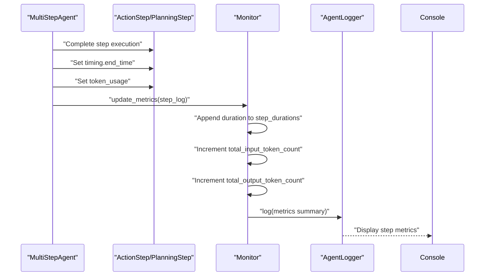

<!-- source: DeepWiki mcp.deepwiki.com · repo huggingface/smolagents · page 7.2 Monitor & Metrics · fetched 2026-10-26 -->

# Monitor & Metrics

<details>
<summary>Relevant source files</summary>

The following files were used as context for generating this wiki page:

- [examples/gradio_ui.py](examples/gradio_ui.py)
- [src/smolagents/gradio_ui.py](src/smolagents/gradio_ui.py)
- [src/smolagents/memory.py](src/smolagents/memory.py)
- [src/smolagents/monitoring.py](src/smolagents/monitoring.py)
- [tests/test_memory.py](tests/test_memory.py)
- [tests/test_monitoring.py](tests/test_monitoring.py)

</details>


This page documents the metrics tracking system in `smolagents`, which monitors token usage and execution timing throughout agent runs. The `Monitor` class aggregates metrics across all steps, while `TokenUsage` and `Timing` dataclasses capture step-level information.

For logging and console output, see [7.1 AgentLogger & LogLevel](). For distributed tracing with OpenTelemetry, see [7.3 OpenTelemetry Integration]().

## Overview

The monitoring system tracks two primary metrics:
- **Token usage**: Input and output tokens consumed by LLM calls.
- **Execution timing**: Duration of each step and overall runtime.

These metrics are collected at each step of the ReAct loop and aggregated in the `Monitor` instance attached to each agent. All metric data structures are JSON-serializable for persistence and analysis.

Sources: [src/smolagents/monitoring.py:1-118]()

## Core Data Structures

### TokenUsage Dataclass

The `TokenUsage` dataclass tracks token consumption for a single LLM call or aggregated across multiple calls.

Title: TokenUsage Structure
```mermaid
classDiagram
    class "TokenUsage" {
        +int input_tokens
        +int output_tokens
        +int total_tokens
        +__post_init__()
        +dict() dict
    }
    
    note for "TokenUsage" "total_tokens computed\nautomatically in __post_init__"
```

**Fields:**
- `input_tokens` (`int`): Number of tokens in the prompt/context [src/smolagents/monitoring.py:42-42]().
- `output_tokens` (`int`): Number of tokens generated by the model [src/smolagents/monitoring.py:43-43]().
- `total_tokens` (`int`): Sum of input and output tokens, calculated in `__post_init__` [src/smolagents/monitoring.py:44-47]().

**Methods:**
- `dict()`: Returns a dictionary representation including `input_tokens`, `output_tokens`, and `total_tokens` [src/smolagents/monitoring.py:49-54]().

Sources: [src/smolagents/monitoring.py:36-54]()

### Timing Dataclass

The `Timing` dataclass captures execution duration for a step or operation.

Title: Timing Structure
```mermaid
classDiagram
    class "Timing" {
        +float start_time
        +float|None end_time
        +duration property
        +dict() dict
        +__repr__() str
    }
    
    note for "Timing" "duration is None\nuntil end_time is set"
```

**Fields:**
- `start_time` (`float`): Unix timestamp when execution started [src/smolagents/monitoring.py:63-63]().
- `end_time` (`float | None`): Unix timestamp when execution completed [src/smolagents/monitoring.py:64-64]().

**Properties:**
- `duration`: Computed as `end_time - start_time`. Returns `None` if `end_time` is missing [src/smolagents/monitoring.py:66-68]().

**Methods:**
- `dict()`: Returns dictionary with `start_time`, `end_time`, and `duration` [src/smolagents/monitoring.py:70-75]().

Sources: [src/smolagents/monitoring.py:57-79]()

## The Monitor Class

The `Monitor` class aggregates metrics across all steps of an agent run, providing cumulative token counts and step durations.

Title: Monitor Integration
```mermaid
graph TB
    "Monitor"["Monitor"]
    "MultiStepAgent"["MultiStepAgent"]
    "ActionStep"["ActionStep"]
    "PlanningStep"["PlanningStep"]
    "AgentLogger"["AgentLogger"]
    
    "MultiStepAgent" -->|"has"| "Monitor"
    "MultiStepAgent" -->|"has"| "AgentLogger"
    "Monitor" -->|"logs to"| "AgentLogger"
    "Monitor" -->|"receives"| "ActionStep"
    "Monitor" -->|"receives"| "PlanningStep"
    
    "Monitor" -->|"tracks"| TokenCount["total_input_token_count<br/>total_output_token_count"]
    "Monitor" -->|"tracks"| StepDurations["step_durations: list[float]"]
```

### Initialization

The `Monitor` is initialized with a `tracked_model` and a `logger` [src/smolagents/monitoring.py:81-82](). It maintains the following state:
- `step_durations` (`list`): History of durations for each step [src/smolagents/monitoring.py:83-83]().
- `total_input_token_count` (`int`): Cumulative input tokens [src/smolagents/monitoring.py:86-86]().
- `total_output_token_count` (`int`): Cumulative output tokens [src/smolagents/monitoring.py:87-87]().

Sources: [src/smolagents/monitoring.py:81-88]()

### Tracking Metrics with update_metrics

The `update_metrics()` method is called after each step completes to update cumulative counts and provide console feedback.

Title: Metric Update Lifecycle


**Behavior:**
1. Appends the step's `duration` to `step_durations` [src/smolagents/monitoring.py:106-107]().
2. If `token_usage` is present in the step log, it increments `total_input_token_count` and `total_output_token_count` [src/smolagents/monitoring.py:110-115]().
3. Logs a formatted summary to the console at `level=1` (INFO) [src/smolagents/monitoring.py:117-117]().

**Console output format:**
`[Step 1: Duration 2.34 seconds | Input tokens: 1,234 | Output tokens: 567]` [src/smolagents/monitoring.py:108-116]().

Sources: [src/smolagents/monitoring.py:100-118]()

### Utility Methods

- `get_total_token_counts()`: Returns a `TokenUsage` object containing current cumulative counts [src/smolagents/monitoring.py:89-93]().
- `reset()`: Clears all tracked metrics and durations [src/smolagents/monitoring.py:95-98]().

Sources: [src/smolagents/monitoring.py:89-98]()

## Integration with Memory Steps

Metrics are embedded directly into `MemoryStep` subclasses, ensuring that every action or planning phase is recorded with its resource cost.

### ActionStep Metrics

The `ActionStep` dataclass includes:
- `timing` (`Timing`): Captures start and end times of the action [src/smolagents/memory.py:53-53]().
- `token_usage` (`TokenUsage | None`): Captured from the LLM response for that specific step [src/smolagents/memory.py:63-63]().

The `ActionStep.dict()` method ensures these are serialized using their respective `.dict()` methods or `asdict()` [src/smolagents/memory.py:66-90]().

Sources: [src/smolagents/memory.py:51-90]()

### PlanningStep Metrics

When planning is enabled, `PlanningStep` tracks its own overhead:
- `timing` (`Timing`): Duration of the planning generation [src/smolagents/memory.py:158-158]().
- `token_usage` (`TokenUsage | None`): Tokens used to generate the plan [src/smolagents/memory.py:159-159]().

Sources: [src/smolagents/memory.py:153-172]()

## UI Feedback

Metrics are surfaced in real-time within the Gradio interface through the `get_step_footnote_content` function. This utility generates a formatted HTML/Markdown string displaying the duration and token counts for each `ActionStep` or `PlanningStep` [src/smolagents/gradio_ui.py:29-36]().

Title: Gradio Metrics Display
```mermaid
graph LR
    "ActionStep"["ActionStep"] --> "get_step_footnote_content"["get_step_footnote_content"]
    "PlanningStep"["PlanningStep"] --> "get_step_footnote_content"["get_step_footnote_content"]
    "get_step_footnote_content" --> "FootnoteString"["'Input tokens: X | Output tokens: Y | Duration: Zs'"]
```

Sources: [src/smolagents/gradio_ui.py:29-36]()

## Testing and Validation

The monitoring system is validated through several test suites. For example, `test_action_step_dict` verifies that `TokenUsage` and `Timing` are correctly nested within serialized step data [tests/test_memory.py:52-118](). The `test_code_agent_metrics` test ensures that token counts are correctly aggregated in the `Monitor` after an agent run [tests/test_monitoring.py:176-187]().

Title: Memory to Metrics Association
```mermaid
graph LR
    "ActionStep"["ActionStep"] -->|"contains"| "Timing"["Timing"]
    "ActionStep"["ActionStep"] -->|"contains"| "TokenUsage"["TokenUsage"]
    "PlanningStep"["PlanningStep"] -->|"contains"| "Timing"["Timing"]
    "PlanningStep"["PlanningStep"] -->|"contains"| "TokenUsage"["TokenUsage"]
    "AgentMemory"["AgentMemory"] -->|"stores"| "ActionStep"["ActionStep"]
    "AgentMemory"["AgentMemory"] -->|"stores"| "PlanningStep"["PlanningStep"]
```

**Validation details:**
- **Metric Serialization**: `test_action_step_dict` confirms that `action_step_dict["token_usage"]` includes `total_tokens` calculated as the sum of input and output [tests/test_memory.py:89-90]().
- **Aggregation Logic**: `test_code_agent_metrics_max_steps` verifies that metrics are correctly tracked even when an agent reaches its `max_steps` limit [tests/test_monitoring.py:66-85]().
- **Timing Initialization**: `test_return_all_code_actions` demonstrates creating steps with manual `Timing` objects to simulate execution history [tests/test_memory.py:27-34]().

Sources: [tests/test_memory.py:52-118](), [tests/test_monitoring.py:66-85](), [tests/test_monitoring.py:176-187]()

---

