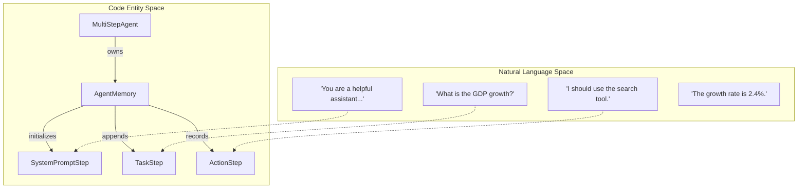
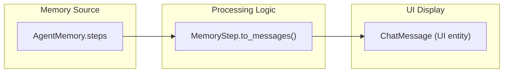

<!-- source: DeepWiki mcp.deepwiki.com · repo huggingface/smolagents · page 7.4 Memory Inspection & Replay · fetched 2026-10-26 -->

# Memory Inspection & Replay

Relevant source files

The following files were used as context for generating this wiki page:

- [docs/source/en/tutorials/inspect_runs.md](docs/source/en/tutorials/inspect_runs.md)
- [docs/source/zh/tutorials/inspect_runs.md](docs/source/zh/tutorials/inspect_runs.md)
- [src/smolagents/memory.py](src/smolagents/memory.py)
- [src/smolagents/monitoring.py](src/smolagents/monitoring.py)
- [tests/test_memory.py](tests/test_memory.py)

This page documents methods for inspecting, replaying, and debugging agent execution history through the `AgentMemory` system. For information about the memory data structures themselves, see [Agent Memory & State Management](#3.4). For console output during execution, see [AgentLogger & LogLevel](#7.1). For instrumentation and distributed tracing, see [OpenTelemetry Integration](#7.3).

## Overview

After an agent completes execution, its memory contains a complete trace of all steps taken, including system prompts, tasks, planning steps, action steps, and final answers. The `AgentMemory` class provides methods to access individual memory steps, replay execution with formatted console output, and serialize history for persistence or UI rendering.

Key capabilities include:
- **Replay**: Regenerating the execution trace via `AgentMemory.replay()` [[src/smolagents/memory.py:248-271]]().
- **Serialization**: Converting steps to JSON-safe dictionaries via `ActionStep.dict()` [[src/smolagents/memory.py:66-90]]().
- **Summarization**: Extracting concise step histories via `get_succinct_steps()` [[src/smolagents/memory.py:239-246]]().
- **Debugging**: Inspecting token usage and timing per step via `Monitor` and `ActionStep` [[src/smolagents/monitoring.py:81-118]]().

Sources: [src/smolagents/memory.py:18-18](), [src/smolagents/monitoring.py:81-118]()

## Memory Structure: Natural Language to Code

The `AgentMemory` acts as the bridge between the high-level reasoning process and the underlying data structures.

### Reasoning Bridge

Sources: [src/smolagents/memory.py:42-212](), [src/smolagents/memory.py:221-234]()

## Memory Replay and Console Reconstruction

The `replay()` method allows developers to reconstruct the visual flow of an agent's run after the fact. It takes an `AgentLogger` and iterates through the `steps` list.

### Replay Implementation
The `AgentMemory.replay(logger: AgentLogger, detailed: bool = False)` method prints execution history with Rich-formatted output [[src/smolagents/memory.py:248-271]](). 

- **TaskStep**: Triggers `logger.log_task()` [[src/smolagents/memory.py:252-253]]().
- **ActionStep**: Logs model outputs via `logger.log_markdown()` and observations. If `detailed=True`, it also logs the full `model_input_messages` [[src/smolagents/memory.py:256-267]]().
- **PlanningStep**: Logs the generated plan via `logger.log_markdown()` [[src/smolagents/memory.py:269-271]]().

### Execution Debugging with Rich
The `AgentLogger` uses the `Rich` library to provide readable execution traces.
- **`log_task()`**: Renders a task panel with `YELLOW_HEX` border style [[src/smolagents/monitoring.py:200-216]]().
- **`log_code()`**: Uses `rich.syntax.Syntax` with the `monokai` theme to highlight Python actions [[src/smolagents/monitoring.py:174-188]]().
- **`sanitize_for_rich()`**: A critical utility used to escape characters (like `[` or `]`) in LLM outputs to prevent Rich markup parsing errors [[src/smolagents/monitoring.py:30-34]](), [[src/smolagents/monitoring.py:205-205]]().

Sources: [src/smolagents/memory.py:248-271](), [src/smolagents/monitoring.py:130-216]()

## Memory Serialization

The framework provides several ways to serialize agent state for storage or transmission.

### ActionStep.dict() Serialization
The `ActionStep.dict()` method is a custom implementation that handles non-primitive types:
- **Tool Calls**: Converts `ToolCall` objects via their own `.dict()` method [[src/smolagents/memory.py:25-38]](), which uses `make_json_serializable` for arguments [[src/smolagents/memory.py:36-36]]().
- **Messages**: Converts `ChatMessage` dataclasses into nested dictionaries using `get_dict_from_nested_dataclasses` [[src/smolagents/memory.py:71-75]]().
- **Images**: Converts `PIL.Image` observations into bytes using `image.tobytes()` [[src/smolagents/memory.py:84-86]]().
- **Metadata**: Includes serialized `Timing` and `TokenUsage` objects [[src/smolagents/memory.py:70-70]](), [[src/smolagents/memory.py:88-88]]().

### Succinct vs Full Steps
- `get_full_steps()`: Returns all steps as dictionaries, including full input message histories [[src/smolagents/memory.py:236-237]]().
- `get_succinct_steps()`: Returns step dictionaries but excludes `model_input_messages` and `model_output_message` to save space [[src/smolagents/memory.py:239-246]]().

### Code Extraction
The `return_full_code()` method concatenates all `code_action` strings from `ActionStep` instances into a single block, useful for auditing the entire generated script [[src/smolagents/memory.py:273-277]]().

Sources: [src/smolagents/memory.py:66-90](), [src/smolagents/memory.py:236-277](), [tests/test_memory.py:52-117]()

## Monitoring and Metrics

The `Monitor` class tracks execution performance across steps and provides feedback via the logger.

| Metric | Code Entity | Description |
| :--- | :--- | :--- |
| **Duration** | `Timing.duration` | Calculated as `end_time - start_time` [[src/smolagents/monitoring.py:67-68]](). |
| **Tokens** | `TokenUsage` | Tracks `input_tokens`, `output_tokens`, and `total_tokens` [[src/smolagents/monitoring.py:37-54]](). |
| **Aggregation** | `Monitor.update_metrics` | Updates cumulative counts and logs step duration to the console [[src/smolagents/monitoring.py:100-118]](). |

Sources: [src/smolagents/monitoring.py:37-118]()

## UI Reconstruction Flow

In interfaces like Gradio, memory steps are converted into UI-friendly message formats via the `to_messages()` method.

### Data Transformation Flow

The `to_messages()` method in `ActionStep` converts internal state into a list of `ChatMessage` objects, handling the conversion of tool calls, observations, and images into the standard message format used for display [[src/smolagents/memory.py:92-150]]().

Sources: [src/smolagents/memory.py:92-150](), [src/smolagents/monitoring.py:200-216]()

---

