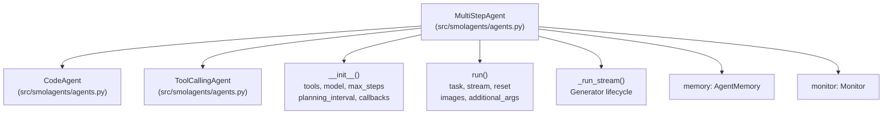
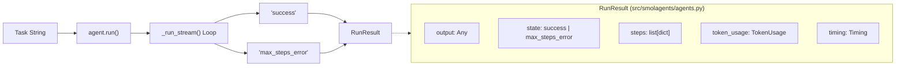
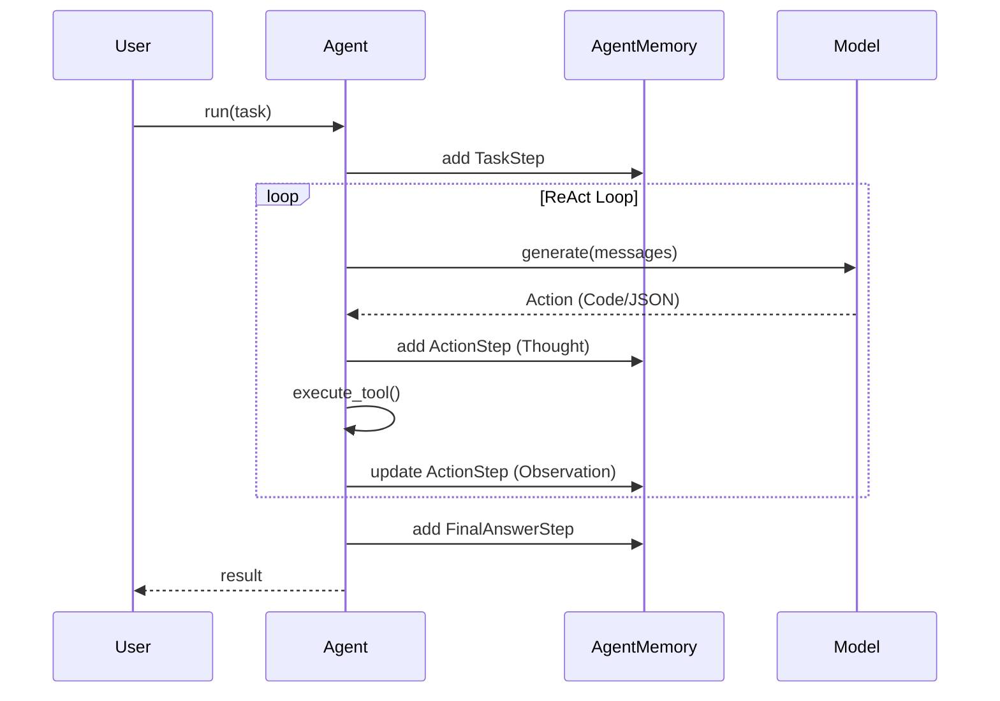

<!-- source: DeepWiki mcp.deepwiki.com · repo huggingface/smolagents · page 8.1 Python API · fetched 2026-10-26 -->

# Python API

<details>
<summary>Relevant source files</summary>

The following files were used as context for generating this wiki page:

- [docs/source/en/reference/agents.md](docs/source/en/reference/agents.md)
- [docs/source/hi/reference/agents.md](docs/source/hi/reference/agents.md)
- [docs/source/zh/reference/agents.md](docs/source/zh/reference/agents.md)
- [src/smolagents/agents.py](src/smolagents/agents.py)
- [tests/test_agents.py](tests/test_agents.py)

</details>


This page documents the direct Python API for programmatically using agents in `smolagents`. It covers agent initialization, the `run()` and `_run_stream()` methods, configuration parameters, execution control, and result handling.

For command-line usage, see [Command Line Interface](#8.2). For web interface deployment, see [Gradio Web UI](#8.3). For streaming execution details, see [Streaming & Real-time Updates](#8.4).

---

## Agent Initialization

All agents inherit from the `MultiStepAgent` abstract base class and require two primary arguments: a `model` and a list of `tools`.

### Core Agent Classes

The following diagram maps the high-level agent types to their implementation classes and core lifecycle methods.

**Agent Class Hierarchy**

**Sources:** [src/smolagents/agents.py:268-293](), [src/smolagents/agents.py:1270-1288](), [src/smolagents/agents.py:1463-1478]()

### Initialization Parameters

The `MultiStepAgent.__init__()` method accepts the following parameters:

| Parameter | Type | Default | Description |
|-----------|------|---------|-------------|
| `tools` | `list[Tool]` | Required | List of tools the agent can use. |
| `model` | `Model` | Required | Language model to power the agent. |
| `prompt_templates` | `PromptTemplates` | `None` | Custom Jinja2 templates for prompts. |
| `instructions` | `str` | `None` | Custom instructions inserted into the system prompt. |
| `max_steps` | `int` | `20` | Maximum number of steps per run before `AgentMaxStepsError`. |
| `add_base_tools` | `bool` | `False` | Whether to add default tools like `DuckDuckGoSearchTool`. |
| `verbosity_level` | `LogLevel` | `LogLevel.INFO` | Logging verbosity (OFF/ERROR/INFO/DEBUG). |
| `managed_agents` | `list` | `None` | Child agents for hierarchical delegation. |
| `step_callbacks` | `list[Callable]` | `None` | Callbacks executed at the end of each step. |
| `planning_interval` | `int` | `None` | Interval (in steps) for generating planning steps. |
| `final_answer_checks` | `list[Callable]` | `None` | Validation functions for the final answer. |

**Sources:** [src/smolagents/agents.py:294-353](), [src/smolagents/agents.py:355-434]()

### CodeAgent-Specific Parameters

`CodeAgent` adds parameters for its unique Python execution environment:

| Parameter | Type | Default | Description |
|-----------|------|---------|-------------|
| `additional_authorized_imports` | `list[str]` | `[]` | Python modules authorized for the local interpreter. |
| `executor_type` | `str` | `"local"` | Environment: `"local"`, `"e2b"`, `"docker"`, etc. |
| `executor` | `PythonExecutor` | `None` | Custom executor instance (e.g., `LocalPythonExecutor`). |

**Sources:** [src/smolagents/agents.py:1270-1288]()

---

## The run() Method

The `run()` method is the primary entry point. It orchestrates the full ReAct loop until the agent produces a final answer or reaches the maximum step limit.

### Method Signature

```python
def run(
    self,
    task: str,
    stream: bool = False,
    reset: bool = True,
    images: list["PIL.Image.Image"] | None = None,
    additional_args: dict | None = None,
    max_steps: int | None = None,
    return_full_result: bool | None = None,
) -> Any | RunResult
```
**Sources:** [src/smolagents/agents.py:436-467]()

### Return Values: RunResult Dataclass

When `return_full_result=True`, the agent returns a `RunResult` object containing detailed telemetry and state. Note that the `messages` attribute is deprecated in favor of `steps`.

**Data Flow: Task to Result**

**Sources:** [src/smolagents/agents.py:195-215](), [src/smolagents/agents.py:217-234](), [src/smolagents/agents.py:505-538]()

### Parameters

- **`task`**: The natural language instruction. [src/smolagents/agents.py:468]()
- **`stream`**: If `True`, returns a generator yielding `MemoryStep` objects or `ChatMessageStreamDelta`. [src/smolagents/agents.py:471-472]()
- **`reset`**: If `True` (default), clears memory and metrics before starting. [src/smolagents/agents.py:478-480]()
- **`additional_args`**: Dictionary of variables (like DataFrames) made available to the agent's state. [src/smolagents/agents.py:494-497]()
- **`max_steps`**: Override the default step limit for this specific run. [src/smolagents/agents.py:499-500]()

**Sources:** [src/smolagents/agents.py:468-503]()

---

## Programmatic Usage Patterns

### Pattern 1: Basic Execution
```python
from smolagents import CodeAgent, HfApiModel
agent = CodeAgent(tools=[], model=HfApiModel())
answer = agent.run("What is 2+2?")
```
**Sources:** [src/smolagents/agents.py:436-538]()

### Pattern 2: Multi-turn Conversation
By setting `reset=False`, the agent maintains its `AgentMemory` across calls.
```python
agent.run("My name is Alice.", reset=True)
agent.run("What is my name?", reset=False) # Accesses previous TaskStep
```
**Sources:** [src/smolagents/agents.py:478-480](), [tests/test_agents.py:484-496]()

### Pattern 3: Programmatic Streaming
Streaming allows real-time inspection of the `ActionStep` and `ToolCall` objects as they are generated via the `_run_stream` generator.
```python
for step in agent.run("Search for 'smolagents'", stream=True):
    if hasattr(step, "tool_calls"):
        print(f"Calling tool: {step.tool_calls[0].name}")
```
**Sources:** [src/smolagents/agents.py:540-611](), [src/smolagents/memory.py:51-100]()

---

## Agent State and Memory

The agent's internal state is managed by `AgentMemory`.

| Entity | Role | File Reference |
|--------|------|----------------|
| `AgentMemory` | Container for all steps in the conversation. | [src/smolagents/memory.py:357-360]() |
| `ActionStep` | Records model thoughts, tool calls, and observations. | [src/smolagents/memory.py:51-54]() |
| `TaskStep` | Records the initial user request and images. | [src/smolagents/memory.py:102-104]() |
| `SystemPromptStep` | Records the system instructions used. | [src/smolagents/memory.py:121-123]() |
| `Monitor` | Tracks `TokenUsage` and `Timing` metrics. | [src/smolagents/monitoring.py:168-171]() |

**Memory Architecture**

**Sources:** [src/smolagents/agents.py:540-611](), [src/smolagents/memory.py:357-458]()

### Introspection Methods
- `agent.memory.get_succinct_steps()`: Returns a list of steps as dictionaries, excluding large system prompts. [src/smolagents/memory.py:415-442]()
- `agent.write_memory_to_messages()`: Converts the current memory into a list of `ChatMessage` objects for the LLM. [src/smolagents/agents.py:758-770]()

**Sources:** [src/smolagents/memory.py:415-458](), [src/smolagents/agents.py:758-770]()

---

## Configuration Options

### Interrupting and Callbacks
- **`agent.interrupt()`**: Sets a flag to stop execution at the end of the current step. [src/smolagents/agents.py:754-756]()
- **`step_callbacks`**: A list of functions called within the `CallbackRegistry` system after every iteration. [src/smolagents/agents.py:416-435]()

**Sources:** [src/smolagents/agents.py:754-756](), [src/smolagents/agents.py:416-435]()

### Final Answer Validation
The `final_answer_checks` parameter allows passing functions that validate the output. If a check returns `False`, the agent is notified of the error and must retry until `max_steps` is reached. [src/smolagents/agents.py:613-618]()

**Sources:** [src/smolagents/agents.py:589-591](), [src/smolagents/agents.py:613-618]()

---

