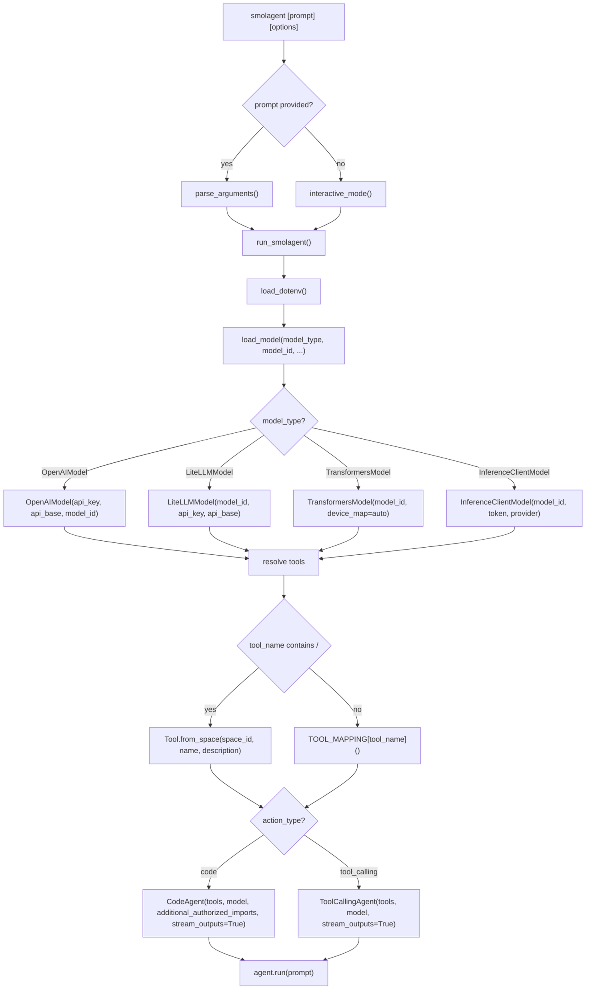
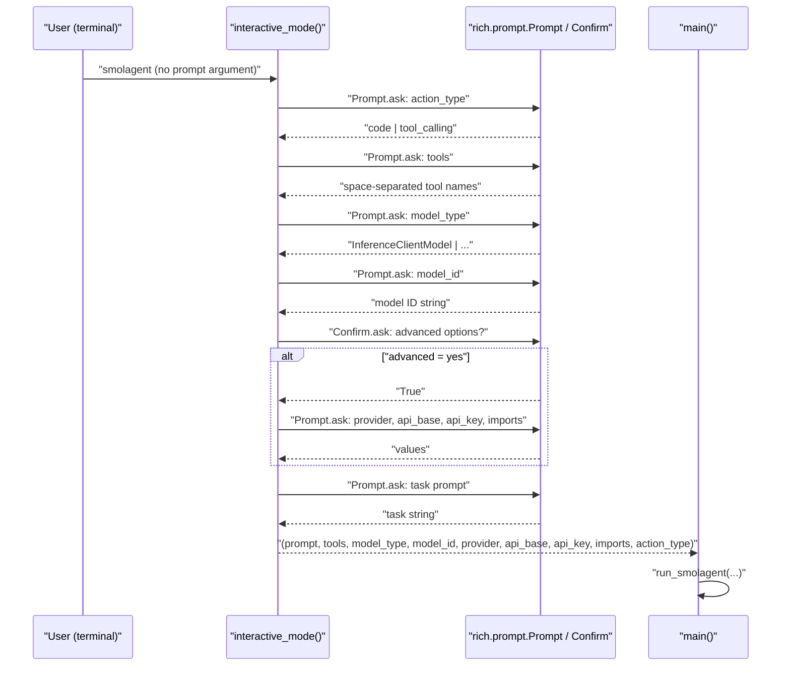
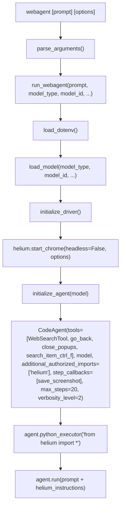
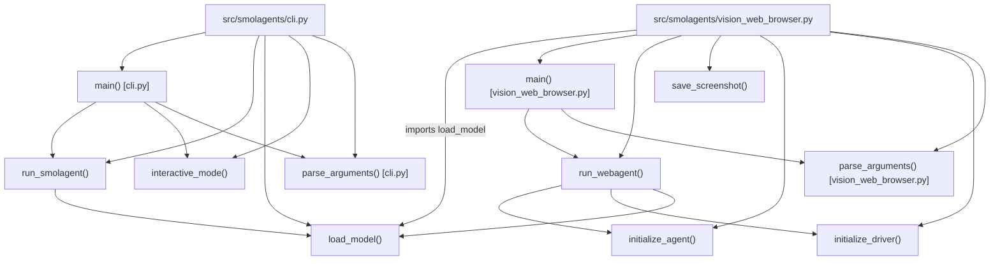

<!-- source: DeepWiki mcp.deepwiki.com · repo huggingface/smolagents · page 8.2 Command Line Interface · fetched 2026-10-26 -->

# Command Line Interface

Relevant source files

The following files were used as context for generating this wiki page:

- [examples/agent_from_any_llm.py](examples/agent_from_any_llm.py)
- [src/smolagents/cli.py](src/smolagents/cli.py)
- [src/smolagents/vision_web_browser.py](src/smolagents/vision_web_browser.py)
- [tests/test_cli.py](tests/test_cli.py)
- [tests/test_vision_web_browser.py](tests/test_vision_web_browser.py)

This page documents the two CLI entry points provided by `smolagents`: the general-purpose `smolagent` command (defined in `src/smolagents/cli.py`) and the browser automation `webagent` command (defined in `src/smolagents/vision_web_browser.py`). Both commands are registered as executable scripts in the project configuration and can be run directly after installation.

For information about interacting with agents programmatically, see [Python API](#8.1). For the Gradio web interface, see [Gradio Web UI](#8.3). For detail on the tool and model types referenced by the CLI, see [Tool System](#5) and [Model Integration](#4).

---

## Entry Points

Both commands are declared as console scripts in the project's build configuration:

| Command    | Module + Function                              | Primary Use                                 |
|------------|------------------------------------------------|---------------------------------------------|
| `smolagent` | `smolagents.cli:main`                          | General agent runner with configurable model, tools, and imports |
| `webagent`  | `smolagents.vision_web_browser:main`            | Browser automation agent using Selenium/Helium |

Sources: [src/smolagents/cli.py:262-290](), [src/smolagents/vision_web_browser.py:250-252]()

---

## `smolagent` Command

**Source:** [src/smolagents/cli.py]()

### Argument Reference

The `parse_arguments` function [src/smolagents/cli.py:45-107]() defines the following arguments:

| Argument            | Type     | Default                            | Description                                                                    |
|---------------------|----------|------------------------------------|--------------------------------------------------------------------------------|
| `prompt`            | positional (optional) | `None`                  | Task string to pass to the agent. Omitting triggers interactive mode.          |
| `--model-type`      | str      | `"InferenceClientModel"`           | Model class name to instantiate. Accepted values listed below.                 |
| `--model-id`        | str      | `"Qwen/Qwen3-Next-80B-A3B-Thinking"` | Model identifier passed to the selected model class [src/smolagents/cli.py:69](). |
| `--action-type`     | str      | `"code"`                           | `"code"` → `CodeAgent`; `"tool_calling"` → `ToolCallingAgent` [src/smolagents/cli.py:64](). |
| `--tools`           | list     | `["web_search"]`                   | Space-separated names from `TOOL_MAPPING`, or HuggingFace Space IDs [src/smolagents/cli.py:81](). |
| `--imports`         | list     | `[]`                               | Python modules to add to `additional_authorized_imports` on `CodeAgent` [src/smolagents/cli.py:75](). |
| `--verbosity-level` | int      | `1`                                | Controls `AgentLogger` output verbosity (0–2) [src/smolagents/cli.py:87](). |
| `--provider`        | str      | `None`                             | Inference provider (API models only) [src/smolagents/cli.py:94](). |
| `--api-base`        | str      | `None`                             | Base URL for the model API endpoint [src/smolagents/cli.py:100](). |
| `--api-key`         | str      | `None`                             | API key; falls back to environment variables when not specified [src/smolagents/cli.py:105](). |

**Accepted `--model-type` values:**

| Value                  | Instantiated Class        |
|------------------------|---------------------------|
| `InferenceClientModel` | `InferenceClientModel`    |
| `OpenAIModel`          | `OpenAIModel`             |
| `LiteLLMModel`         | `LiteLLMModel`            |
| `TransformersModel`    | `TransformersModel`       |

Sources: [src/smolagents/cli.py:45-107](), [src/smolagents/cli.py:188-216]()

---

### Execution Flow

**Title: `smolagent` CLI execution flow**

Sources: [src/smolagents/cli.py:219-259](), [src/smolagents/cli.py:188-216](), [src/smolagents/cli.py:262-290]()

---

### `load_model` Function

`load_model` [src/smolagents/cli.py:188-216]() centralizes model instantiation for both CLI commands. It accepts `model_type`, `model_id`, and optional `api_base`, `api_key`, and `provider` parameters. Environment variable fallbacks include:

- `OpenAIModel`: `FIREWORKS_API_KEY` (default `api_base` is `https://api.fireworks.ai/inference/v1`) [src/smolagents/cli.py:197-198]().
- `InferenceClientModel`: `HF_TOKEN` [src/smolagents/cli.py:215]().

`load_model` is also imported and reused by `vision_web_browser.py` [src/smolagents/vision_web_browser.py:14]().

---

### `run_smolagent` Function

`run_smolagent` [src/smolagents/cli.py:219-259]() is the main execution function. Key behaviors:

- Calls `load_dotenv()` to read `.env` files before accessing environment variables [src/smolagents/cli.py:230]().
- Iterates `tools` list: names containing `/` are resolved with `Tool.from_space` [src/smolagents/cli.py:236](); all others must be present in `TOOL_MAPPING` from `smolagents.default_tools` [src/smolagents/cli.py:238]().
- Raises `ValueError` if an unrecognized tool name is provided [src/smolagents/cli.py:241]().
- Instantiates `CodeAgent` with `stream_outputs=True` (for `"code"` action type) or `ToolCallingAgent` for `"tool_calling"` [src/smolagents/cli.py:246-258]().
- Calls `agent.run(prompt)` [src/smolagents/cli.py:259]().

---

### Interactive Mode

When no positional `prompt` argument is supplied, `main()` [src/smolagents/cli.py:262-290]() calls `interactive_mode()` [src/smolagents/cli.py:110-185](), which:

1. Prints a styled welcome panel via `rich.console.Console` [src/smolagents/cli.py:112-118]().
2. Prompts for `action_type` (`"code"` or `"tool_calling"`) [src/smolagents/cli.py:124-128]().
3. Displays a `rich.table.Table` of all available tools from `TOOL_MAPPING`, instantiating each to retrieve its `description` [src/smolagents/cli.py:131-144]().
4. Prompts for tool selection, model type, and model ID [src/smolagents/cli.py:150-161]().
5. Optionally prompts for `provider`, `api_base`, `api_key`, and additional imports if the user selects advanced configuration [src/smolagents/cli.py:170-178]().
6. Prompts for the task prompt [src/smolagents/cli.py:181-183]().
7. Returns all values to `main()`, which passes them to `run_smolagent`.

**Title: Interactive mode prompt sequence**

Sources: [src/smolagents/cli.py:110-185](), [src/smolagents/cli.py:262-290]()

---

## `webagent` Command

**Source:** [src/smolagents/vision_web_browser.py]()

The `webagent` CLI launches a vision-capable browser automation agent. It requires the `helium`, `selenium`, and `Pillow` packages, and a working Chrome installation.

### Argument Reference

Arguments are parsed by `parse_arguments` [src/smolagents/vision_web_browser.py:27-63]():

| Argument        | Default            | Description                                              |
|-----------------|--------------------|----------------------------------------------------------|
| `prompt`        | `search_request`   | Optional task. Defaults to a Wikipedia navigation example [src/smolagents/vision_web_browser.py:33](). |
| `--model-type`  | `"LiteLLMModel"`   | Model class (same values as `smolagent`) [src/smolagents/vision_web_browser.py:39](). |
| `--model-id`    | `"gpt-4o"`         | Model identifier [src/smolagents/vision_web_browser.py:45](). |
| `--provider`    | `None`             | Inference provider [src/smolagents/vision_web_browser.py:50](). |
| `--api-base`    | `None`             | API base URL [src/smolagents/vision_web_browser.py:55](). |
| `--api-key`     | `None`             | API key [src/smolagents/vision_web_browser.py:60](). |

Note: `--imports` and `--tools` are not configurable via `webagent` arguments — they are hardcoded in `initialize_agent` [src/smolagents/vision_web_browser.py:148-157]().

---

### Execution Flow

**Title: `webagent` execution flow**

Sources: [src/smolagents/vision_web_browser.py:217-247](), [src/smolagents/vision_web_browser.py:138-157]()

---

### Built-in Tools for `webagent`

`initialize_agent` [src/smolagents/vision_web_browser.py:148-157]() hard-codes four tools:

| Tool                | Type              | Description                                                     |
|---------------------|-------------------|-----------------------------------------------------------------|
| `WebSearchTool()`   | Default tool      | Web search capability [src/smolagents/vision_web_browser.py:151](). |
| `go_back`           | `@tool` function  | Calls `driver.back()` to navigate to the previous page [src/smolagents/vision_web_browser.py:125-128](). |
| `close_popups`      | `@tool` function  | Sends `Keys.ESCAPE` to dismiss modal overlays [src/smolagents/vision_web_browser.py:131-135](). |
| `search_item_ctrl_f`| `@tool` function  | Finds text on the page via XPath and scrolls to the nth match [src/smolagents/vision_web_browser.py:105-122](). |

The `search_item_ctrl_f` tool uses `_escape_xpath_string` [src/smolagents/vision_web_browser.py:87-102]() to safely construct XPath expressions and prevent injection via malicious search strings.

---

### `save_screenshot` Step Callback

`save_screenshot` [src/smolagents/vision_web_browser.py:66-84]() is registered as a `step_callbacks` entry on the agent. After each step it:

1. Waits 1 second for JavaScript animations to complete [src/smolagents/vision_web_browser.py:67]().
2. Captures a PNG screenshot from the Selenium driver [src/smolagents/vision_web_browser.py:74]().
3. Stores the image in `memory_step.observations_images` [src/smolagents/vision_web_browser.py:77]().
4. Removes screenshots from steps two or more steps back to limit memory usage [src/smolagents/vision_web_browser.py:71-73]().
5. Appends the current URL to `memory_step.observations` [src/smolagents/vision_web_browser.py:80-83]().

---

### `helium_instructions` System Context

`helium_instructions` [src/smolagents/vision_web_browser.py:160-214]() is a multi-line string appended to the user prompt before calling `agent.run`. It instructs the agent how to use the Helium browser automation library, including:

- Using `go_to()` to navigate to URLs [src/smolagents/vision_web_browser.py:167]().
- Using `click()` and `click(Link(...))` to interact with page elements [src/smolagents/vision_web_browser.py:172-177]().
- Using `scroll_down()` / `scroll_up()` for page scrolling [src/smolagents/vision_web_browser.py:186]().
- Using `close_popups()` for modal dismissal [src/smolagents/vision_web_browser.py:192]().
- Using `.exists()` for conditional element checks [src/smolagents/vision_web_browser.py:197]().

---

## Relationship Between CLI Modules

**Title: Module and function dependency map for CLI entry points**

Sources: [src/smolagents/cli.py](), [src/smolagents/vision_web_browser.py:14]()

---

## Environment Variables

Both commands call `load_dotenv()` at startup [src/smolagents/cli.py:230](), [src/smolagents/vision_web_browser.py:228](), so a `.env` file in the working directory is automatically sourced.

| Variable           | Used by                  | Purpose                                      |
|--------------------|--------------------------|----------------------------------------------|
| `HF_TOKEN`         | `load_model` (cli.py)    | Token for `InferenceClientModel` when `--api-key` not provided [src/smolagents/cli.py:215](). |
| `FIREWORKS_API_KEY`| `load_model` (cli.py)    | API key for `OpenAIModel` when `--api-key` not provided [src/smolagents/cli.py:197]().        |

Sources: [src/smolagents/cli.py:195-216](), [src/smolagents/vision_web_browser.py:228]()

---

