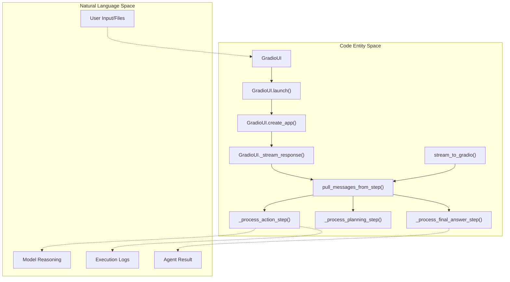
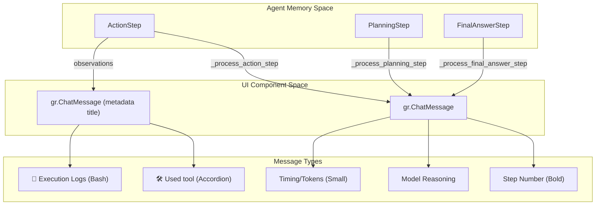

<!-- source: DeepWiki mcp.deepwiki.com · repo huggingface/smolagents · page 8.3 Gradio Web UI · fetched 2026-10-26 -->

# Gradio Web UI

<details>
<summary>Relevant source files</summary>

The following files were used as context for generating this wiki page:

- [examples/gradio_ui.py](examples/gradio_ui.py)
- [src/smolagents/gradio_ui.py](src/smolagents/gradio_ui.py)
- [tests/conftest.py](tests/conftest.py)
- [tests/fixtures/agents.py](tests/fixtures/agents.py)
- [tests/test_gradio_ui.py](tests/test_gradio_ui.py)
- [tests/test_monitoring.py](tests/test_monitoring.py)

</details>


This page documents the Gradio-based web interface for `smolagents`, covering the `GradioUI` class and the standalone `stream_to_gradio` utility defined in `src/smolagents/gradio_ui.py`. These components bridge the agent's streaming execution model to a rendered browser chat interface.

This page focuses on rendering and UI concerns. For the underlying streaming event model that feeds the UI, see page 8.4. For the CLI-based interfaces, see page 8.2.

---

## Installation

The Gradio UI requires the optional `gradio` dependency group:

```bash
pip install 'smolagents[gradio]'
```

Both `GradioUI` and `stream_to_gradio` check for the availability of the `gradio` package at runtime using the `_is_package_available` utility. If missing, a `ModuleNotFoundError` is raised with instructions to install the dependency group. [src/smolagents/gradio_ui.py:257-260](), [src/smolagents/gradio_ui.py:288-291]()

**Sources:** `src/smolagents/gradio_ui.py`

---

## Public API Surface

The module exports two primary symbols for web-based interaction:

| Symbol | Type | Purpose |
|---|---|---|
| `stream_to_gradio` | function | Low-level generator; converts agent run events to `gr.ChatMessage` objects or raw strings. |
| `GradioUI` | class | High-level wrapper; builds and launches a `gr.ChatInterface` backed by a `MultiStepAgent`. |

**Sources:** [src/smolagents/gradio_ui.py:248-276](), [src/smolagents/gradio_ui.py:279-461]()

---

## Architecture Overview

**Diagram: GradioUI Component Relationships**



**Sources:** [src/smolagents/gradio_ui.py:80-461]()

---

## `GradioUI` Class

Defined in [src/smolagents/gradio_ui.py:279-461]().

### Constructor

```python
GradioUI(agent, file_upload_folder=None, reset_agent_memory=False)
```

| Parameter | Type | Description |
|---|---|---|
| `agent` | `MultiStepAgent` | The agent instance to wrap. |
| `file_upload_folder` | `str \| None` | Destination directory for uploaded files. If `None`, file upload is disabled. |
| `reset_agent_memory` | `bool` | If `True`, the agent's memory is reset before each user message. |

**Initialization behavior:**
- Converts `file_upload_folder` to a `Path` object and ensures the directory exists via `os.makedirs`. [src/smolagents/gradio_ui.py:314-316]()
- Reads `agent.name` and `agent.description` for display in the UI title. [src/smolagents/gradio_ui.py:318-321]()

**Sources:** [src/smolagents/gradio_ui.py:310-322]()

### `launch(share=True, **kwargs)`

Wraps `create_app().launch()`. It sets `debug=True` and forwards all extra keyword arguments to Gradio's native `launch()` method (e.g., `server_port`, `auth`). [src/smolagents/gradio_ui.py:422-430]()

**Sources:** [src/smolagents/gradio_ui.py:422-430]()

### `create_app()`

Assembles the Gradio application and returns a `gr.ChatInterface` object. 

Key details:
- Configures `gr.Chatbot` with LaTeX delimiter support for math rendering. [src/smolagents/gradio_ui.py:441-443]()
- Sets `multimodal=True` on the interface if a `file_upload_folder` is provided. [src/smolagents/gradio_ui.py:454]()
- Handles Gradio versioning: passes `type="messages"` for compatibility with Gradio 5.x. [src/smolagents/gradio_ui.py:453]()

**Sources:** [src/smolagents/gradio_ui.py:432-461]()

---

## File Upload Handling

The UI provides a mechanism for passing local files to the agent.

### `upload_file(file, file_uploads_log, allowed_file_types=None)`
The entry point for file processing. It defaults to allowing `.pdf`, `.docx`, and `.txt`. [src/smolagents/gradio_ui.py:338-340]() It calls `_save_uploaded_file` and returns a status message and an updated log of paths. [src/smolagents/gradio_ui.py:335-360]()

**Sources:** [src/smolagents/gradio_ui.py:335-360](), [tests/test_gradio_ui.py:43-56]()

### `_save_uploaded_file(file)`
Sanitizes the filename using regex `re.sub(r"[^\w\-.]", "_", original_name)` to prevent directory traversal or shell injection characters. [src/smolagents/gradio_ui.py:328]() It copies the file to `self.file_upload_folder` using `shutil.copy`. [src/smolagents/gradio_ui.py:331]()

**Sources:** [src/smolagents/gradio_ui.py:324-333](), [tests/test_gradio_ui.py:101-116]()

---

## `stream_to_gradio` Function

Defined in [src/smolagents/gradio_ui.py:248-276]().

A standalone utility that executes an agent and yields Gradio-compatible objects. It is used internally by `GradioUI._stream_response`. [src/smolagents/gradio_ui.py:397]()

| Event type | Yielded Content |
|---|---|
| `ActionStep \| PlanningStep \| FinalAnswerStep` | `gr.ChatMessage` objects via `pull_messages_from_step`. |
| `ChatMessageStreamDelta` | Plain `str` (the content of the delta). |

It automatically sets `skip_model_outputs=True` if `agent.stream_outputs` is enabled to prevent duplicate text display during token-by-token streaming. [src/smolagents/gradio_ui.py:266]()

**Sources:** [src/smolagents/gradio_ui.py:248-276](), [tests/test_monitoring.py:100-117]()

---

## Step-to-Message Pipeline

**Diagram: Mapping Code Steps to UI Messages**



**Sources:** [src/smolagents/gradio_ui.py:80-223]()

### `pull_messages_from_step(step_log, skip_model_outputs=False)`
The main dispatcher that converts internal memory steps into one or more `gr.ChatMessage` instances. [src/smolagents/gradio_ui.py:226-245]()

**Sources:** [src/smolagents/gradio_ui.py:226-245](), [tests/test_gradio_ui.py:137-152]()

### Processor Details

1. **`_process_action_step`**: Renders the step number [src/smolagents/gradio_ui.py:94-96](), the model's reasoning [src/smolagents/gradio_ui.py:99-101](), tool calls (formatted via `_format_code_content`) [src/smolagents/gradio_ui.py:104-129](), execution logs [src/smolagents/gradio_ui.py:131-139](), and any generated images (using `AgentImage.to_string()`) [src/smolagents/gradio_ui.py:142-149](). It appends a footnote via `get_step_footnote_content`. [src/smolagents/gradio_ui.py:158-162]()
2. **`_process_planning_step`**: Renders the current agent plan [src/smolagents/gradio_ui.py:179-180]() and associated token/timing metrics [src/smolagents/gradio_ui.py:182-185]().
3. **`_process_final_answer_step`**: Handles different `AgentType` outputs. `AgentImage` and `AgentAudio` are converted to dictionary formats with `path` and `mime_type` for Gradio rendering. [src/smolagents/gradio_ui.py:189-223]()

**Sources:** [src/smolagents/gradio_ui.py:80-223](), [tests/test_monitoring.py:119-154]()

---

## Utility Functions

### Footnote Generation
`get_step_footnote_content` creates a styled HTML span containing the duration (from `step_log.timing.duration`) and token counts (from `step_log.token_usage.input_tokens` and `output_tokens`). [src/smolagents/gradio_ui.py:29-36]()

**Sources:** [src/smolagents/gradio_ui.py:29-36]()

### Output Cleaning
`_clean_model_output` uses regex to remove trailing `<end_code>` tags and extra backticks that some models produce when terminating code blocks. [src/smolagents/gradio_ui.py:39-56]()

**Sources:** [src/smolagents/gradio_ui.py:39-56]()

### Code Formatting
`_format_code_content` ensures that tool arguments or code actions are wrapped in a standard ` ```python ` markdown block for consistent UI highlighting. [src/smolagents/gradio_ui.py:59-77]()

**Sources:** [src/smolagents/gradio_ui.py:59-77]()

---

## Usage Example

The standard way to launch the UI is to wrap an existing agent:

```python
from smolagents import CodeAgent, GradioUI, InferenceClientModel

agent = CodeAgent(
    tools=[],
    model=InferenceClientModel("meta-llama/Llama-3.3-70B-Instruct"),
    stream_outputs=True
)

# Launch with file upload capability
GradioUI(agent, file_upload_folder="./uploads").launch()
```

**Sources:** [examples/gradio_ui.py:1-16]()

---

