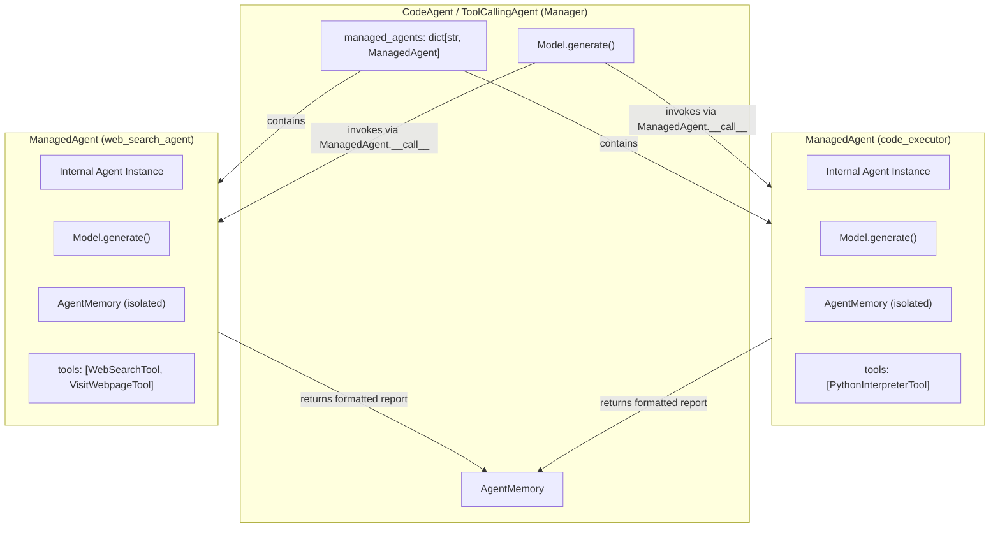
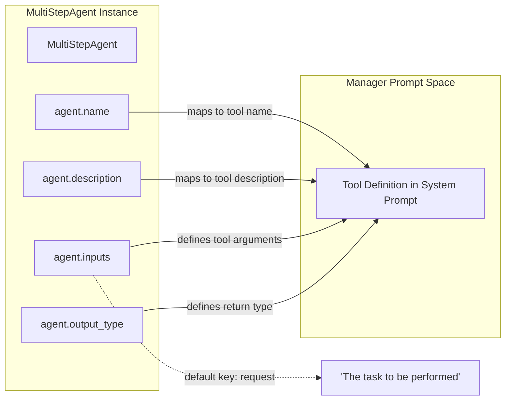
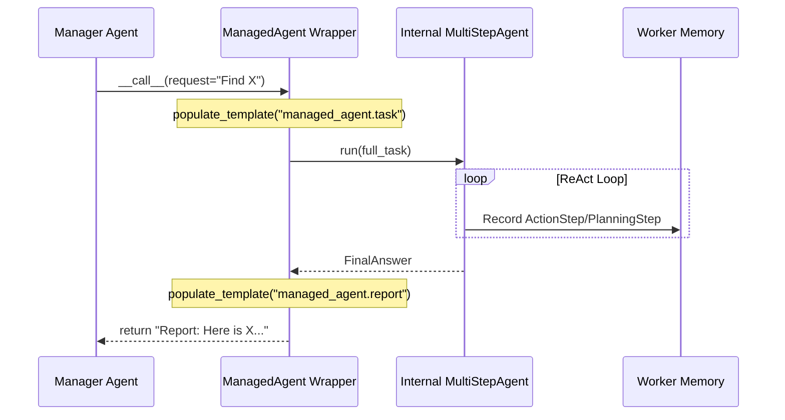

<!-- source: DeepWiki mcp.deepwiki.com · repo huggingface/smolagents · page 9.1 Multi-Agent Systems · fetched 2026-10-26 -->

# Multi-Agent Systems

<details>
<summary>Relevant source files</summary>

The following files were used as context for generating this wiki page:

- [docs/source/en/examples/multiagents.md](docs/source/en/examples/multiagents.md)
- [docs/source/hi/examples/multiagents.md](docs/source/hi/examples/multiagents.md)
- [docs/source/zh/examples/multiagents.md](docs/source/zh/examples/multiagents.md)
- [src/smolagents/agents.py](src/smolagents/agents.py)
- [tests/test_agents.py](tests/test_agents.py)

</details>


Multi-agent systems in `smolagents` enable hierarchical task decomposition by allowing a manager agent to coordinate multiple specialist agents. This architecture improves performance on complex tasks by specializing agents for specific capabilities while maintaining isolated memory contexts and reducing context window pressure on the manager.

## Overview

Multi-agent systems in `smolagents` follow a **hierarchical delegation model** where:
- A **manager agent** orchestrates task execution by delegating to **managed agents**.
- Each managed agent specializes in specific capabilities (e.g., web search, code generation, data analysis).
- Managed agents maintain **isolated memory** — the manager doesn't inherit their full execution history, preventing context window saturation [src/smolagents/agents.py:341-358]().
- Managed agents are **exposed to the manager like tools**, allowing the LLM to reason about when to delegate using standard tool-calling patterns [src/smolagents/agents.py:843-855]().

**Hierarchical Multi-Agent Architecture**



**Sources:** [src/smolagents/agents.py:341-358](), [src/smolagents/agents.py:404-414](), [docs/source/en/examples/multiagents.md:7-22]()

## ManagedAgent Wrapper

In `smolagents`, any `MultiStepAgent` (like `CodeAgent` or `ToolCallingAgent`) can be used as a managed agent. While the framework allows passing agents directly to the `managed_agents` list, they are internally wrapped in a `ManagedAgent` class [src/smolagents/agents.py:821-830](). This wrapper treats the agent as a tool with specific input/output schemas [src/smolagents/agents.py:843-866]().

### Agent Requirements

To function within a multi-agent system, an agent must have two required attributes:

| Attribute | Type | Purpose | Validation |
|-----------|------|---------|------------|
| `name` | `str` | Identifier used by the manager to call the agent. | Must be a valid Python identifier [src/smolagents/agents.py:364-367](). |
| `description` | `str` | Explains the agent's purpose to the manager's LLM. | Used to generate the tool-like schema in the system prompt [src/smolagents/agents.py:378-387](). |

### Automatic Schema Generation

When an agent is added to a manager, the framework automatically configures its input/output schema so the manager can treat it as a tool. This happens in `_setup_managed_agents()` within the `MultiStepAgent` initialization [src/smolagents/agents.py:369-377]().

**Code Entity Space: Managed Agent Schema Mapping**



**Sources:** [src/smolagents/agents.py:378-387](), [src/smolagents/agents.py:364-367](), [src/smolagents/agents.py:843-855]()

## Configuring Managed Agents

### Basic Setup

Initialize managed agents with a `name` and `description`, then pass them to the manager via the `managed_agents` parameter [src/smolagents/agents.py:307-311]().

```python
from smolagents import CodeAgent, ToolCallingAgent, InferenceClientModel, WebSearchTool

model = InferenceClientModel(model_id="Qwen/Qwen2.5-72B-Instruct")

# 1. Create the specialist (Managed Agent)
web_agent = ToolCallingAgent(
    tools=[WebSearchTool()],
    model=model,
    name="web_search_agent",
    description="Runs web searches for you. Give it your query as an argument."
)

# 2. Create the manager
manager_agent = CodeAgent(
    tools=[], 
    model=model, 
    managed_agents=[web_agent] # Internally wrapped in ManagedAgent
)
```

**Sources:** [docs/source/en/examples/multiagents.md:108-142](), [src/smolagents/agents.py:307-311](), [src/smolagents/agents.py:821-830]()

### Name Validation and Uniqueness

The framework enforces strict naming rules to ensure the manager's code-generation or JSON-parsing logic doesn't fail.
- **Python Identifiers**: Agent names must pass `is_valid_name()`, meaning no spaces, no hyphens, and no reserved keywords [src/smolagents/utils.py:92-92]().
- **Uniqueness**: The manager validates that all tool names and managed agent names are unique to prevent namespace collisions during the `_setup_managed_agents` call [src/smolagents/agents.py:404-414]().

**Sources:** [src/smolagents/agents.py:404-414](), [src/smolagents/utils.py:92-92]()

## Hierarchical Task Delegation

When a manager decides to use a managed agent, it triggers the `ManagedAgent.__call__` method [src/smolagents/agents.py:868-870](). This method acts as the bridge between the manager's context and the worker's execution loop.

### Communication Pattern: The `__call__` Method

The delegation follows a specific lifecycle defined in `ManagedAgent.__call__`:

1.  **Task Wrapping**: The input `request` from the manager is wrapped using the `managed_agent.task` prompt template [src/smolagents/agents.py:872-876]().
2.  **Execution**: The managed agent's `run()` method is called with the wrapped task. This creates a new, isolated execution context [src/smolagents/agents.py:876-876]().
3.  **Reporting**: The result is wrapped in the `managed_agent.report` template [src/smolagents/agents.py:879-883]().
4.  **Summary (Optional)**: If `provide_run_summary` is `True`, a condensed version of the managed agent's memory steps is appended to the report [src/smolagents/agents.py:884-889]().

**Data Flow: Manager to Worker**



**Sources:** [src/smolagents/agents.py:868-889](), [src/smolagents/agents.py:140-150]()

## Manager/Worker Patterns

### The "Thinking" Manager
It is recommended to use `CodeAgent` as the manager. Its ability to write Python logic allows it to handle complex planning, conditional logic, and data manipulation between calls to specialist agents [docs/source/en/examples/multiagents.md:131-136]().

### Specialist Workers
Workers are often `ToolCallingAgent` instances if their task is linear (like web browsing) or `CodeAgent` instances if they need to perform local data processing before returning a result to the manager [docs/source/en/examples/multiagents.md:104-108]().

### Memory Isolation
A critical feature of this multi-agent system is that the manager's `AgentMemory` only sees the final report returned by the managed agent. The internal `ActionStep`, `PlanningStep`, and intermediate tool outputs of the worker are contained within the worker's own `AgentMemory` [src/smolagents/agents.py:343](), [src/smolagents/memory.py:214-230]().

**Sources:** [src/smolagents/agents.py:876-889](), [docs/source/en/examples/multiagents.md:131-136]()

## Implementation Details: `ManagedAgent` Logic

While users interact with agents, the framework treats them as specialized tools via the `ManagedAgent` class [src/smolagents/agents.py:821-830](). The `PromptTemplates` class defines how these interactions are formatted.

| Template Key | Purpose | Default Behavior |
|--------------|---------|------------------|
| `managed_agent.task` | How the manager's request is presented to the worker. | Defined in `ManagedAgentPromptTemplate` [src/smolagents/agents.py:140-150](). |
| `managed_agent.report` | How the worker's answer is presented back to the manager. | Formats the `final_answer` into a report string [src/smolagents/agents.py:140-150](). |

These templates are managed via `Jinja2` and the `populate_template` utility [src/smolagents/agents.py:102-108]().

**Sources:** [src/smolagents/agents.py:140-150](), [src/smolagents/agents.py:166-180](), [src/smolagents/agents.py:872-883]()

---

