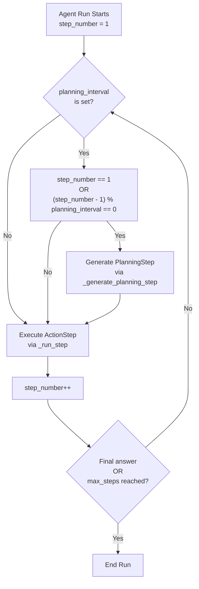
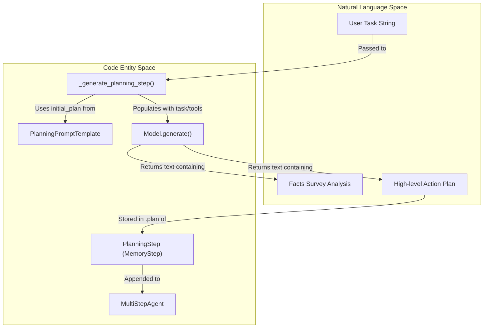
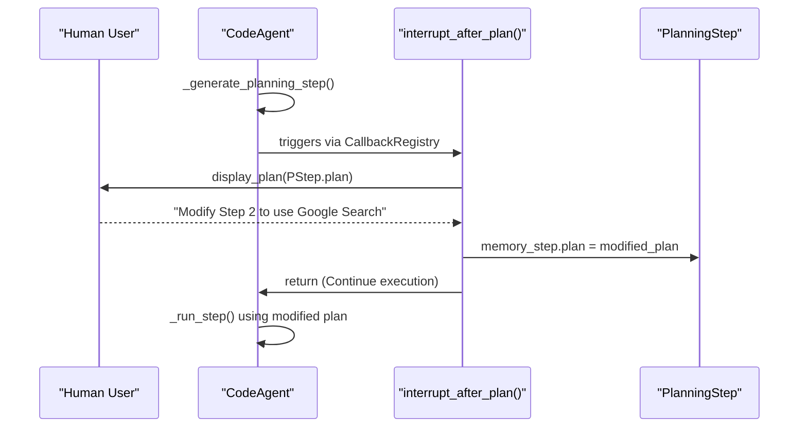

<!-- source: DeepWiki mcp.deepwiki.com · repo huggingface/smolagents · page 9.2 Planning Intervals & Strategy · fetched 2026-10-26 -->

# Planning Intervals & Strategy

<details>
<summary>Relevant source files</summary>

The following files were used as context for generating this wiki page:

- [docs/source/en/examples/plan_customization.md](docs/source/en/examples/plan_customization.md)
- [examples/plan_customization/README.md](examples/plan_customization/README.md)
- [examples/plan_customization/plan_customization.py](examples/plan_customization/plan_customization.py)
- [src/smolagents/agents.py](src/smolagents/agents.py)
- [tests/test_agents.py](tests/test_agents.py)

</details>


## Purpose and Scope

This document explains the **planning interval** feature in `smolagents`, which allows agents to periodically pause action execution to generate strategic plans. Planning intervals enable agents to assess progress and create or update high-level plans for completing complex tasks.

This page covers:
- The planning interval mechanism and triggering logic in `MultiStepAgent`.
- Planning prompt templates and the Facts survey methodology.
- Integration with the ReAct loop and `PlanningStep` in memory.
- Customization through callbacks for Human-in-the-Loop (HITL) workflows.

---

## Planning Interval Mechanism

### Triggering Logic

Planning intervals control when an agent generates a strategic plan during task execution. If `planning_interval` is set to an integer `N`, the agent generates a plan at step 1 (initial plan) and then every `N` action steps thereafter.

The triggering condition is evaluated within the `_run_stream` generator of the `MultiStepAgent` class [src/smolagents/agents.py:549-551]().

**Title: Planning Interval Decision Flow**


**Configuration Example:**
```python
agent = CodeAgent(
    tools=[search_tool],
    model=model,
    planning_interval=5  # Plan at steps 1, 6, 11, 16...
)
```

Sources: [src/smolagents/agents.py:549-567](), [src/smolagents/agents.py:305]()

---

## Planning Prompt Templates & Methodology

### Prompt Template Structure

Planning uses strategies defined in the `PlanningPromptTemplate` [src/smolagents/agents.py:125-138](). The templates are typically loaded from YAML files or initialized via the `PromptTemplates` typed dictionary [src/smolagents/agents.py:166-182]().

| Template Field | When Used | Purpose |
|----------------|-----------|---------|
| `initial_plan` | Step 1 | Prompt agent to create initial strategy and "Facts Survey". |
| `update_plan_pre_messages` | Steps N > 1 | Context provided before showing execution history. |
| `update_plan_post_messages` | Steps N > 1 | Prompt after history to request an updated plan. |

Sources: [src/smolagents/agents.py:125-138](), [src/smolagents/agents.py:183-192]()

### Facts Survey Methodology

The default planning strategy follows a structured "Facts Survey" approach before generating the plan. This forces the model to perform a preparatory analysis using three specific headings:
1. **Facts given in the task**: Specific names, dates, or values provided by the user.
2. **Facts to look up**: Information required but currently missing (e.g., search queries).
3. **Facts to derive**: Logic, computations, or reasoning needed from gathered facts.

This methodology is applied in both `CodeAgent` and `ToolCallingAgent` via their respective prompt configurations stored in `PromptTemplates` [src/smolagents/agents.py:166-182]().

Sources: [src/smolagents/agents.py:125-138](), [src/smolagents/agents.py:166-182]()

---

## Planning Step Execution

### Initial vs. Update Logic

The `_generate_planning_step` method handles the logic for both the first step and subsequent updates [src/smolagents/agents.py:641-744]().

**Title: Planning Logic Flow (Code Entity Space)**


**Implementation Details:**
- **Initial Plan**: Populates `initial_plan` with `task`, `tools`, and `managed_agents` [src/smolagents/agents.py:643-657]().
- **Plan Updates**: Uses `update_plan_pre_messages` and `update_plan_post_messages`. It includes the full memory context using `self.memory.get_succinct_steps()` to provide history without overwhelming the context window [src/smolagents/agents.py:681-713]().

Sources: [src/smolagents/agents.py:641-744](), [src/smolagents/memory.py:163-178]()

---

## PlanningStep in Memory

Each planning event results in a `PlanningStep` object stored in `AgentMemory.steps` [src/smolagents/memory.py:163]().

| Attribute | Description |
|-----------|-------------|
| `plan` | The generated text (Facts + Plan) [src/smolagents/memory.py:164](). |
| `model_input_messages` | The exact messages sent to the LLM for this step [src/smolagents/memory.py:165](). |
| `token_usage` | `TokenUsage` dataclass for this specific generation [src/smolagents/memory.py:167](). |
| `timing` | `Timing` dataclass (start, end, duration) [src/smolagents/memory.py:168](). |

The `plan` content is automatically formatted into a markdown block for subsequent model steps to ensure the agent follows its own strategy [src/smolagents/agents.py:678-680]().

Sources: [src/smolagents/memory.py:163-178](), [src/smolagents/agents.py:678-680]()

---

## Human-in-the-Loop Strategy

### Callback Integration

Users can intercept the planning process using `step_callbacks`. By targeting the `PlanningStep` type, developers can implement interactive plan review [docs/source/en/examples/plan_customization.md:17-30]().

**Title: HITL Plan Customization (Code Entity Space)**


**Key Implementation Pattern:**
1. Set `planning_interval` to a non-null value [examples/plan_customization/plan_customization.py:109]().
2. Define a callback that checks `if isinstance(memory_step, PlanningStep)` [examples/plan_customization/plan_customization.py:67]().
3. Modify `memory_step.plan` directly within the callback [examples/plan_customization/plan_customization.py:86]().
4. Use `agent.run(task, reset=False)` to resume execution after an interruption while preserving memory [examples/plan_customization/plan_customization.py:155]().

Sources: [examples/plan_customization/plan_customization.py:62-98](), [docs/source/en/examples/plan_customization.md:32-61](), [src/smolagents/agents.py:623](), [src/smolagents/memory.py:163]()

---

