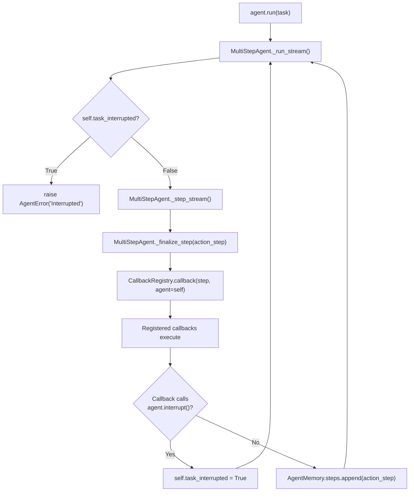
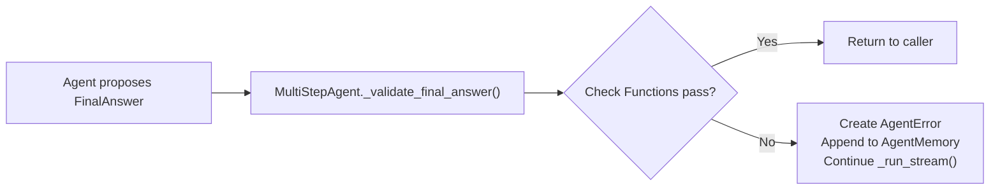
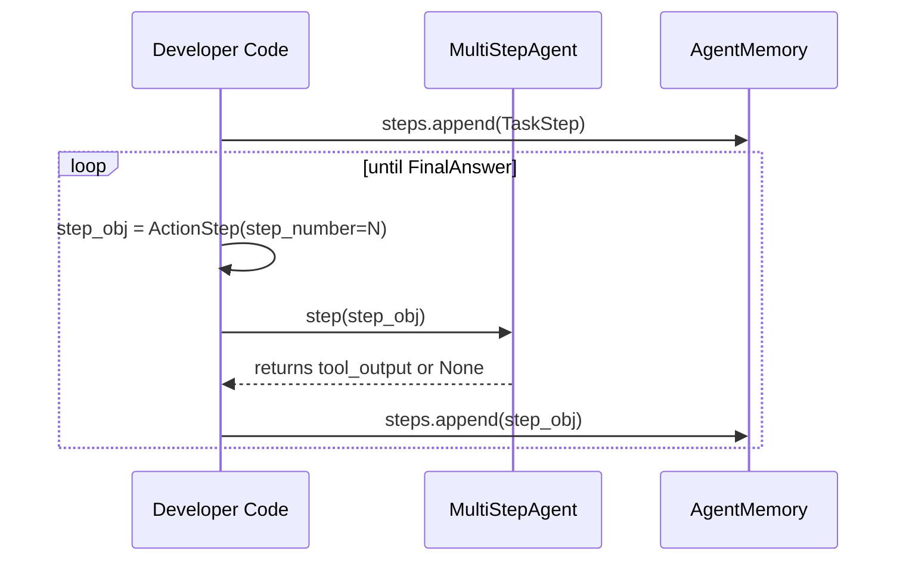

<!-- source: DeepWiki mcp.deepwiki.com · repo huggingface/smolagents · page 9.5 Human-in-the-Loop Workflows · fetched 2026-10-26 -->

# Human-in-the-Loop Workflows

<details>
<summary>Relevant source files</summary>

The following files were used as context for generating this wiki page:

- [src/smolagents/agents.py](src/smolagents/agents.py)
- [src/smolagents/default_tools.py](src/smolagents/default_tools.py)
- [tests/test_agents.py](tests/test_agents.py)
- [tests/test_default_tools.py](tests/test_default_tools.py)

</details>


This page describes the mechanisms available in `smolagents` for inserting human oversight or control into a running agent. It covers the `UserInputTool`, step callbacks, the interrupt mechanism, final answer validation, and manual step-by-step execution patterns.

## Mechanisms Overview

There are five main entry points for human-in-the-loop (HITL) control within the `MultiStepAgent` lifecycle:

| Mechanism | Primary API | When It Fires |
|---|---|---|
| **Direct Interaction** | `UserInputTool` | When the agent explicitly calls the tool to ask a question. [src/smolagents/default_tools.py:93-102]() |
| **Step Callbacks** | `step_callbacks` constructor arg | After every step execution, before the next step begins. [src/smolagents/agents.py:304-304]() |
| **Interrupt Signal** | `agent.interrupt()` | At the start of the next loop iteration in `_run_stream`. [src/smolagents/agents.py:754-756]() |
| **Final Answer Validation** | `final_answer_checks` | After a final answer is generated but before it is returned. [src/smolagents/agents.py:309-309]() |
| **Manual Step-by-Step** | `agent.step(memory_step)` | Under the caller's full programmatic control, bypassing the main loop. [src/smolagents/agents.py:782-787]() |

### Lifecycle Integration Diagram

The following diagram maps the logical flow of an agent run to the specific code entities that handle human intervention.

**Natural Language to Code Entity Space: Execution Flow**



Sources: [src/smolagents/agents.py:540-611](), [src/smolagents/agents.py:620-623](), [src/smolagents/agents.py:754-756]()

---

## UserInputTool

The `UserInputTool` is a built-in tool that allows the agent to pause execution and wait for a string input from the user via the standard Python `input()` function. [src/smolagents/default_tools.py:93-102]()

- **Role**: It acts as a bridge for the agent to request clarification, missing credentials, or preferences. [src/smolagents/default_tools.py:95-95]()
- **Implementation**: The `forward` method prompts the user with a `question` string using `input(f"{question} => Type your answer here:")` and returns the resulting input as the tool's observation. [src/smolagents/default_tools.py:99-101]()

```python
from smolagents import CodeAgent, UserInputTool

# The agent can now choose to call user_input() like any other tool
agent = CodeAgent(tools=[UserInputTool()], model=model)
agent.run("Ask me what my favorite color is and then tell me a joke about it.")
```

Sources: [src/smolagents/default_tools.py:93-102]()

---

## Step Callbacks

### Registration

Step callbacks are registered via the `step_callbacks` parameter in the `MultiStepAgent` constructor. [src/smolagents/agents.py:304-304]()

The `step_callbacks` argument is processed by the `CallbackRegistry` and supports two formats:
1. **`list[Callable]`**: Each callable is registered to trigger on `ActionStep` events. [src/smolagents/agents.py:426-428]()
2. **`dict[Type[MemoryStep], list[Callable]]`**: Callables are mapped to specific step types (e.g., `PlanningStep`, `ActionStep`, `FinalAnswerStep`). [src/smolagents/agents.py:416-425]()

### Callback Execution

Callbacks are executed at the end of `_finalize_step`. Each callback receives the current `MemoryStep` and the `agent` instance as arguments via `self.callbacks.callback(step, agent=self)`. [src/smolagents/agents.py:620-623]()

| Step Class | Trigger Point |
|---|---|
| `ActionStep` | After a tool call or code execution cycle completes. [src/smolagents/memory.py:195-214]() |
| `PlanningStep` | After the agent generates or updates its internal plan. [src/smolagents/memory.py:186-193]() |
| `FinalAnswerStep` | When the agent produces a `FinalAnswerTool` call. [src/smolagents/memory.py:236-240]() |

Sources: [src/smolagents/agents.py:416-434](), [src/smolagents/agents.py:620-623](), [src/smolagents/memory.py:186-240]()

---

## Interrupt Signal

### `agent.interrupt()`

The `interrupt()` method sets the internal `task_interrupted` flag to `True`. [src/smolagents/agents.py:754-756]()

The execution loop in `_run_stream` checks this flag at the start of every iteration. If `True`, it raises an `AgentError` with the message `"Task interrupted by user"`. [src/smolagents/agents.py:546-547]() This allows an external process or a callback to pause the agent safely between steps.

### Resuming Interrupted Tasks

To resume an interrupted agent without losing progress, call `run()` with `reset=False`. [src/smolagents/agents.py:478-479]() This preserves the existing `AgentMemory` and prevents the agent from re-initializing the task.

Sources: [src/smolagents/agents.py:546-547](), [src/smolagents/agents.py:754-756](), [src/smolagents/agents.py:478-479]()

---

## Final Answer Validation

The `final_answer_checks` parameter allows users to provide a list of validation functions. These are executed within `_validate_final_answer` after the agent proposes a final result. [src/smolagents/agents.py:309-309](), [src/smolagents/agents.py:613-618]()

**Validation Logic:**
- If a check returns `False` or raises an exception, the agent logs an `AgentError` to its memory explaining the failure. [src/smolagents/agents.py:589-591]()
- The agent then continues its loop, using the error message as feedback to attempt a corrected answer.

**Natural Language to Code Entity Space: Validation Logic**



Sources: [src/smolagents/agents.py:589-591](), [src/smolagents/agents.py:613-618]()

---

## Manual Step-by-Step Execution

For maximum control, developers can bypass the automated `run()` loop and invoke `agent.step()` directly. [src/smolagents/agents.py:782-787]()

**Manual Workflow:**
1. Manually initialize the agent's memory (e.g., adding a `TaskStep`). [src/smolagents/memory.py:177-184]()
2. Instantiate an `ActionStep` with the appropriate `step_number`. [src/smolagents/memory.py:195-214]()
3. Call `agent.step(action_step)`. This function performs the LLM generation and tool execution for that specific step. [src/smolagents/agents.py:782-787]()
4. Inspect the `action_step` for outputs or errors before deciding whether to proceed to the next step.



Sources: [src/smolagents/agents.py:782-787](), [src/smolagents/memory.py:177-214]()

---

