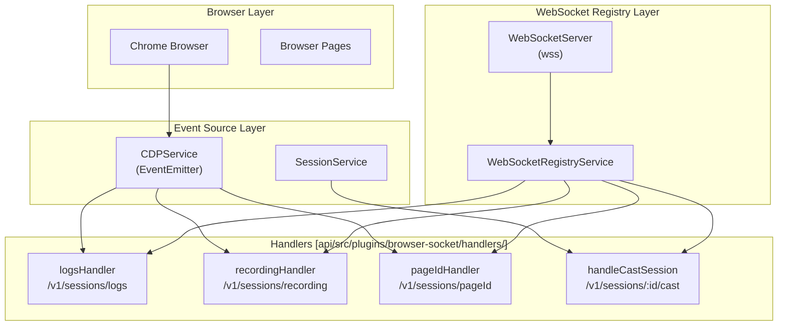
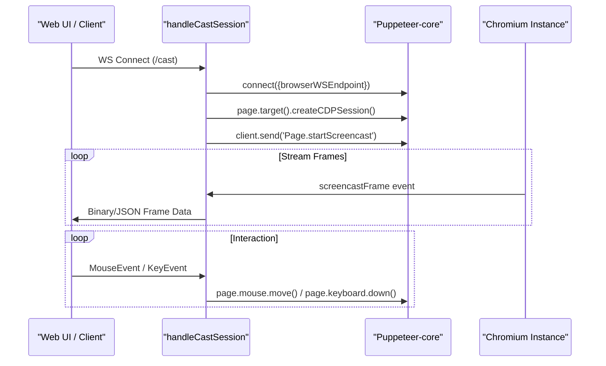

<!-- source: DeepWiki mcp.deepwiki.com · repo steel-dev/steel-browser · page 10 Real-time Communication · fetched 2026-10-26 -->

# Real-time Communication

Relevant source files

The following files were used as context for generating this wiki page:

- [api/src/plugins/browser-socket/browser-socket.ts](api/src/plugins/browser-socket/browser-socket.ts)
- [api/src/plugins/browser-socket/casting.handler.ts](api/src/plugins/browser-socket/casting.handler.ts)
- [api/src/plugins/browser-socket/handlers/logs.handler.ts](api/src/plugins/browser-socket/handlers/logs.handler.ts)
- [api/src/plugins/browser-socket/handlers/pageId.handler.ts](api/src/plugins/browser-socket/handlers/pageId.handler.ts)
- [api/src/plugins/browser-socket/handlers/recording.handler.ts](api/src/plugins/browser-socket/handlers/recording.handler.ts)
- [api/src/templates/live-session-streamer.ejs](api/src/templates/live-session-streamer.ejs)
- [api/src/types/casting.ts](api/src/types/casting.ts)
- [api/src/utils/casting.ts](api/src/utils/casting.ts)
- [api/src/utils/retry.ts](api/src/utils/retry.ts)

Steel Browser provides a real-time communication layer that enables clients to receive live updates about browser activity and interact with sessions. This system is built on WebSocket connections that stream events from the browser to connected clients, enabling interactive debugging, monitoring, and live "casting" of browser sessions.

For detailed information about WebSocket endpoint implementation and the connection upgrade mechanism, see [WebSocket API](#10.1). For information about how browser events are captured and logged, see [Browser Instrumentation & Logging](#10.2).

## Purpose and Scope

This document covers the real-time event streaming architecture in Steel Browser, including:

- Event emission from the `CDPService` and `SessionService`.
- WebSocket endpoint handlers and routing via the `browserWebSocket` plugin.
- Live session streaming ("casting") and interactive input handling.
- Integration between browser instrumentation and WebSocket delivery.

For information about the CDP WebSocket proxy for direct browser control, see [CDP Integration](#8.1). For session management APIs, see [Session Management API](#4.1).

## Architecture Overview

The real-time communication system consists of three layers:

1.  **Event Emission Layer**: `CDPService` captures browser events via instrumentation and emits them through Node.js `EventEmitter` [api/src/services/cdp/cdp.service.ts:80-183]().
2.  **WebSocket Server Layer**: `browserWebSocket` plugin manages WebSocket connections and routes them to appropriate handlers using a `WebSocketRegistryService` [api/src/plugins/browser-socket/browser-socket.ts:15-37]().
3.  **Handler Layer**: Specialized handlers (`logsHandler`, `recordingHandler`, `handleCastSession`) subscribe to events or interact with Puppeteer to stream data to clients.

**Sources**: [api/src/services/cdp/cdp.service.ts:80-183](), [api/src/plugins/browser-socket/browser-socket.ts:1-73]()

### Event Emission and Routing Architecture

**Sources**: [api/src/plugins/browser-socket/browser-socket.ts:25-70](), [api/src/plugins/browser-socket/handlers/logs.handler.ts:28-39](), [api/src/plugins/browser-socket/casting.handler.ts:18-25]()

## Live Session Casting

Steel Browser supports high-performance live streaming of browser sessions via the `handleCastSession` handler. This allows users to view and interact with a remote browser in real-time.

### Casting Architecture

The casting system uses Puppeteer's `Page.startScreencast` to capture frames and forwards them over WebSockets. It also translates client-side mouse and keyboard events back into browser actions.

**Sources**: [api/src/plugins/browser-socket/casting.handler.ts:176-250](), [api/src/plugins/browser-socket/casting.handler.ts:444-510](), [api/src/types/casting.ts:1-36]()

### Interactive Events

The system supports several event types for remote interaction:
- **MouseEvents**: Coordinates, button states, and click counts [api/src/types/casting.ts:1-14]().
- **KeyEvents**: Key codes, text input, and modifiers [api/src/types/casting.ts:16-27]().
- **Navigation**: Back, forward, refresh, and direct URL navigation [api/src/types/casting.ts:29-36]().

## WebSocket Handler System

The `browserWebSocket` plugin initializes a `WebSocketServer` in `noServer` mode [api/src/plugins/browser-socket/browser-socket.ts:13]() and hooks into the Fastify server's `upgrade` event [api/src/plugins/browser-socket/browser-socket.ts:39]().

### Default Handlers

Steel Browser includes several default handlers registered in the `WebSocketRegistryService`:

| Handler | Path | Description |
| :--- | :--- | :--- |
| `logsHandler` | `/v1/sessions/logs` | Streams instrumentation logs (console, network) [api/src/plugins/browser-socket/handlers/logs.handler.ts:29](). |
| `recordingHandler` | `/v1/sessions/recording` | Streams rrweb-compatible DOM recording events [api/src/plugins/browser-socket/handlers/recording.handler.ts:32](). |
| `pageIdHandler` | `/v1/sessions/pageId` | Notifies clients of the currently active page ID [api/src/plugins/browser-socket/handlers/pageId.handler.ts:28](). |
| `handleCastSession` | `/v1/sessions/:id/cast` | Provides the live video feed and interaction layer [api/src/plugins/browser-socket/casting.handler.ts:18](). |

### Connection Upgrade Flow

When an `upgrade` request arrives, the registry attempts to match the URL:
1.  **Matched**: The specific handler takes control of the socket [api/src/plugins/browser-socket/browser-socket.ts:56]().
2.  **Unmatched**: The request is proxied directly to the CDP WebSocket endpoint [api/src/plugins/browser-socket/browser-socket.ts:64]().

**Sources**: [api/src/plugins/browser-socket/browser-socket.ts:52-70]()

## Integration with UI Dashboard

The real-time communication system powers the **Steel Session Player**, a specialized UI for monitoring sessions.

- **Canvas Rendering**: Uses a `<canvas>` element to display screencast frames [api/src/templates/live-session-streamer.ejs:123-130]().
- **Tab Management**: Displays active browser tabs and allows switching via the `tabList` event [api/src/plugins/browser-socket/casting.handler.ts:118-143]().
- **URL Bar**: Reflects the current browser URL and allows remote navigation [api/src/templates/live-session-streamer.ejs:69-101]().

**Sources**: [api/src/templates/live-session-streamer.ejs:1-130](), [api/src/plugins/browser-socket/casting.handler.ts:118-143]()

## Summary

The real-time communication system in Steel Browser provides a robust architecture for live session interaction. Key components include:

- **CDPService**: The central hub for browser event emission [api/src/services/cdp/cdp.service.ts:80]().
- **WebSocketRegistryService**: Manages the routing of WebSocket connections to specialized handlers [api/src/plugins/browser-socket/browser-socket.ts:25]().
- **Casting Handler**: Leverages Puppeteer and CDP to provide a low-latency interactive stream [api/src/plugins/browser-socket/casting.handler.ts:18]().
- **Instrumentation Handlers**: Provide real-time access to logs and session recordings.

For details on the specific endpoints, see [WebSocket API](#10.1). For the underlying event capture logic, see [Browser Instrumentation & Logging](#10.2).

---

