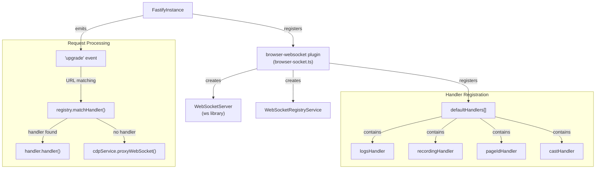
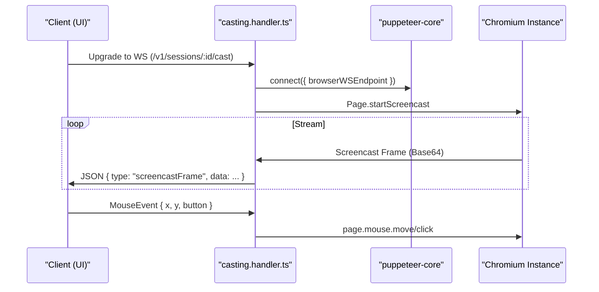

<!-- source: DeepWiki mcp.deepwiki.com · repo steel-dev/steel-browser · page 10.1 WebSocket API · fetched 2026-10-26 -->

# WebSocket API

<details>
<summary>Relevant source files</summary>

The following files were used as context for generating this wiki page:

- [api/src/plugins/browser-socket/browser-socket.ts](api/src/plugins/browser-socket/browser-socket.ts)
- [api/src/plugins/browser-socket/casting.handler.ts](api/src/plugins/browser-socket/casting.handler.ts)
- [api/src/plugins/browser-socket/handlers/cast.handler.ts](api/src/plugins/browser-socket/handlers/cast.handler.ts)
- [api/src/plugins/browser-socket/handlers/index.ts](api/src/plugins/browser-socket/handlers/index.ts)
- [api/src/plugins/browser-socket/handlers/logs.handler.ts](api/src/plugins/browser-socket/handlers/logs.handler.ts)
- [api/src/plugins/browser-socket/handlers/pageId.handler.ts](api/src/plugins/browser-socket/handlers/pageId.handler.ts)
- [api/src/plugins/browser-socket/handlers/recording.handler.ts](api/src/plugins/browser-socket/handlers/recording.handler.ts)
- [api/src/services/websocket-registry.service.ts](api/src/services/websocket-registry.service.ts)
- [api/src/steel-browser-plugin.ts](api/src/steel-browser-plugin.ts)
- [api/src/templates/live-session-streamer.ejs](api/src/templates/live-session-streamer.ejs)
- [api/src/types/casting.ts](api/src/types/casting.ts)
- [api/src/types/index.ts](api/src/types/index.ts)
- [api/src/types/websocket.ts](api/src/types/websocket.ts)
- [api/src/utils/casting.ts](api/src/utils/casting.ts)
- [api/src/utils/retry.ts](api/src/utils/retry.ts)
- [ui/vite.config.ts](ui/vite.config.ts)

</details>


## Purpose and Scope

This document describes the WebSocket API infrastructure in `steel-browser`, which enables real-time streaming of browser events, recordings, and live browser session "casting" (streaming and interaction). The WebSocket layer sits on top of the `CDPService` [api/src/services/cdp/cdp.service.ts:25]() and provides specialized endpoints for different types of real-time data.

For information about the underlying browser instrumentation that generates events, see [Browser Instrumentation & Logging](#10.2). For session management, see [Session Management API](#4.1).

## WebSocket Plugin Architecture

The WebSocket infrastructure is implemented as a Fastify plugin called `browser-socket`, which establishes a WebSocket server and registers specialized handlers.



**Sources:** [api/src/plugins/browser-socket/browser-socket.ts:15-74](), [api/src/plugins/browser-socket/handlers/index.ts:1-10](), [api/src/services/websocket-registry.service.ts:1-10]()

### Plugin Initialization

The `browser-websocket` plugin initializes during Fastify server startup:

1.  **Browser Launch**: Ensures `cdpService` has launched a browser instance [api/src/plugins/browser-socket/browser-socket.ts:19-23]().
2.  **Registry Creation**: Creates a `WebSocketRegistryService` to manage handler routing [api/src/plugins/browser-socket/browser-socket.ts:25]().
3.  **Handler Registration**: Registers default handlers (logs, recording, casting) and any custom handlers provided in `BrowserSocketOptions` [api/src/plugins/browser-socket/browser-socket.ts:27-35]().
4.  **Upgrade Listener**: Attaches an `upgrade` event listener to the HTTP server to intercept WebSocket requests [api/src/plugins/browser-socket/browser-socket.ts:39-70]().

### Handler Interface

All WebSocket handlers implement the `WebSocketHandler` interface [api/src/types/websocket.ts:12-21]():

```typescript
export interface WebSocketHandler {
  path: string; // URL path pattern
  handler: (
    request: IncomingMessage,
    socket: Duplex,
    head: Buffer,
    context: WebSocketHandlerContext,
  ) => void | Promise<void>;
}
```

The `WebSocketHandlerContext` [api/src/types/websocket.ts:23-27]() provides access to the `FastifyInstance`, the shared `WebSocketServer` (`wss`), and URL query parameters.

**Sources:** [api/src/plugins/browser-socket/browser-socket.ts:46-50](), [api/src/types/websocket.ts:1-27]()

## Available WebSocket Endpoints

| Endpoint | Purpose | Event Source | Payload Format |
| :--- | :--- | :--- | :--- |
| `/v1/sessions/logs` | Stream browser console/network logs | `EmitEvent.Log` | JSON array of log objects |
| `/v1/sessions/recording` | Stream rrweb recording events | `EmitEvent.Recording` | JSON array of events |
| `/v1/sessions/pageId` | Stream current page ID changes | `"pageId"` event | JSON object `{ pageId: string }` |
| `/v1/sessions/:id/cast` | Live browser streaming/interaction | `Page.startScreencast` | Binary (JPEG) + JSON control |
| **CDP Proxy** | Direct CDP protocol access | Browser CDP | Raw CDP protocol messages |

**Sources:** [api/src/plugins/browser-socket/handlers/logs.handler.ts:29](), [api/src/plugins/browser-socket/handlers/recording.handler.ts:32](), [api/src/plugins/browser-socket/handlers/pageId.handler.ts:28](), [api/src/plugins/browser-socket/handlers/cast.handler.ts:1-20]()

### Live Session Streaming (Casting)

The `handleCastSession` handler provides a high-performance live view of a browser session, allowing for both visual streaming and remote interaction.

**Key Features:**
*   **Screencasting**: Uses Chrome's `Page.startScreencast` to stream JPEG frames of the browser window [api/src/plugins/browser-socket/casting.handler.ts:300-315]().
*   **Bi-directional Interaction**: Supports `mouseEvent`, `keyEvent`, and `navigation` events sent from the client to control the browser [api/src/plugins/browser-socket/casting.handler.ts:340-420]().
*   **Tab Management**: Supports tab discovery mode, tab switching, and closing tabs [api/src/plugins/browser-socket/casting.handler.ts:118-143]().



**Sources:** [api/src/plugins/browser-socket/casting.handler.ts:18-116](), [api/src/plugins/browser-socket/casting.handler.ts:176-184](), [api/src/types/casting.ts:1-41]()

### Logs and Recording Handlers

These handlers function as event forwarders between the `CDPService` and the connected WebSocket clients.

*   **Logs**: Listens for `EmitEvent.Log` and sends JSON payloads [api/src/plugins/browser-socket/handlers/logs.handler.ts:10-16]().
*   **Recording**: Listens for `EmitEvent.Recording` and sends arrays of recorded events [api/src/plugins/browser-socket/handlers/recording.handler.ts:10-16]().

**Sources:** [api/src/plugins/browser-socket/handlers/logs.handler.ts:1-40](), [api/src/plugins/browser-socket/handlers/recording.handler.ts:1-43]()

## Connection Lifecycle and Cleanup

To prevent resource exhaustion, the WebSocket API implements strict cleanup logic:

1.  **Heartbeats**: The cast handler maintains a heartbeat to detect dead connections [api/src/plugins/browser-socket/casting.handler.ts:280-295]().
2.  **Listener Removal**: Handlers remove their listeners from `cdpService` when the socket closes [api/src/plugins/browser-socket/handlers/logs.handler.ts:22-25]().
3.  **Browser Disconnection**: The casting handler explicitly calls `browser.disconnect()` and stops screencasts upon socket closure [api/src/plugins/browser-socket/casting.handler.ts:63-116]().
4.  **Error Handling**: Errors in the upgrade process result in socket destruction to prevent hanging sockets [api/src/plugins/browser-socket/browser-socket.ts:55-60]().

**Sources:** [api/src/plugins/browser-socket/browser-socket.ts:55-69](), [api/src/plugins/browser-socket/casting.handler.ts:63-116]()

## CDP WebSocket Proxy

If a WebSocket upgrade request does not match any registered handler (e.g., `/v1/sessions/logs`), the system defaults to proxying the request directly to the internal browser's CDP endpoint [api/src/plugins/browser-socket/browser-socket.ts:61-69](). This allows standard automation tools (like Playwright or Puppeteer) to connect directly to `steel-browser` using its primary WebSocket port.

**Sources:** [api/src/plugins/browser-socket/browser-socket.ts:64-68]()

---

