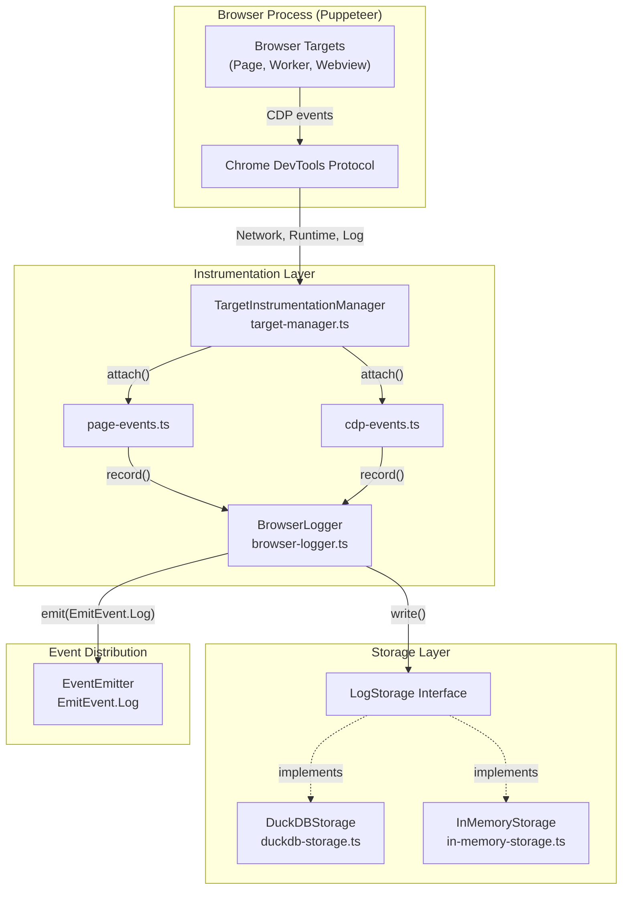
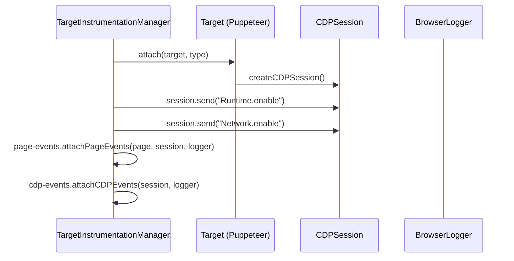

<!-- source: DeepWiki mcp.deepwiki.com · repo steel-dev/steel-browser · page 10.2 Browser Instrumentation & Logging · fetched 2026-10-26 -->

# Browser Instrumentation & Logging

Relevant source files

The following files were used as context for generating this wiki page:

- [api/src/plugins/browser.ts](api/src/plugins/browser.ts)
- [api/src/services/cdp/instrumentation/browser-logger.ts](api/src/services/cdp/instrumentation/browser-logger.ts)
- [api/src/services/cdp/instrumentation/cdp-events.ts](api/src/services/cdp/instrumentation/cdp-events.ts)
- [api/src/services/cdp/instrumentation/page-events.ts](api/src/services/cdp/instrumentation/page-events.ts)
- [api/src/services/cdp/instrumentation/storage/duckdb-storage.ts](api/src/services/cdp/instrumentation/storage/duckdb-storage.ts)
- [api/src/services/cdp/instrumentation/storage/in-memory-storage.ts](api/src/services/cdp/instrumentation/storage/in-memory-storage.ts)
- [api/src/services/cdp/instrumentation/storage/log-storage.interface.ts](api/src/services/cdp/instrumentation/storage/log-storage.interface.ts)
- [api/src/services/cdp/instrumentation/storage/safe-json.ts](api/src/services/cdp/instrumentation/storage/safe-json.ts)
- [api/src/services/cdp/instrumentation/target-manager.ts](api/src/services/cdp/instrumentation/target-manager.ts)
- [api/src/services/cdp/instrumentation/types.ts](api/src/services/cdp/instrumentation/types.ts)
- [api/src/services/cdp/instrumentation/utils.ts](api/src/services/cdp/instrumentation/utils.ts)
- [api/src/services/cdp/instrumentation/worker-events.ts](api/src/services/cdp/instrumentation/worker-events.ts)
- [api/src/types/enums.ts](api/src/types/enums.ts)

This document describes the browser instrumentation and logging system in Steel Browser. This system captures comprehensive browser events including console logs, network requests, page navigations, and errors, making them available both in real-time via WebSocket streams and through persistent storage.

---

## Purpose and Architecture

The instrumentation system monitors all browser targets (pages, service workers, shared workers) and captures their events into structured log records. These logs are emitted as real-time events and persisted to storage backends.

### Core Components

The instrumentation architecture consists of three primary components:

| Component | Type | Purpose |
|-----------|------|---------|
| `TargetInstrumentationManager` | Target Monitor | Attaches/detaches from browser targets, manages CDP domain lifecycle. |
| `BrowserLogger` | Event Recorder | Captures events, transforms them to structured records, emits/stores. |
| `LogStorage` | Storage Interface | Persists logs to DuckDB or in-memory store. |

**Sources:**
- [api/src/services/cdp/instrumentation/target-manager.ts:14-26]()
- [api/src/services/cdp/instrumentation/browser-logger.ts:37-112]()
- [api/src/plugins/browser.ts:24-55]()

---

## TargetInstrumentationManager

The `TargetInstrumentationManager` is responsible for monitoring browser targets and attaching instrumentation. It tracks the lifecycle of pages, service workers, and webviews.

### Target Lifecycle and Domain Management

When a target is attached via `attach(target, type)`, the manager creates a dedicated CDP session and enables specific domains based on the target type:

- **PAGE / BACKGROUND_PAGE**: Enables `Runtime`, `Log`, and `Network` [api/src/services/cdp/instrumentation/target-manager.ts:147-152]().
- **SERVICE_WORKER**: Enables `Runtime` and `Log`. `Network` is only enabled if it's an extension worker [api/src/services/cdp/instrumentation/target-manager.ts:154-161]().

**Sources:**
- [api/src/services/cdp/instrumentation/target-manager.ts:28-116]()
- [api/src/services/cdp/instrumentation/target-manager.ts:129-175]()

---

## Event Capture Implementation

### Page & Network Events
The `attachPageEvents` function [api/src/services/cdp/instrumentation/page-events.ts:24-30]() handles the bulk of high-level instrumentation:
- **Navigation**: Listens for `framenavigated` to record URL changes [api/src/services/cdp/instrumentation/page-events.ts:35-44]().
- **Network**: Uses CDP `Network.requestWillBeSent` and `Network.responseReceived` instead of Puppeteer's high-level events to ensure same-tab navigations and POST data are captured [api/src/services/cdp/instrumentation/page-events.ts:62-110]().
- **Response Bodies**: If `dangerouslyLogRequestDetails` is enabled, it fetches bodies via `Network.getResponseBody` for text-based MIME types [api/src/services/cdp/instrumentation/page-events.ts:115-143]().

### Console & Errors
- **Console**: Captures `Runtime.consoleAPICalled`. It serializes remote objects and formats stack traces into a string location [api/src/services/cdp/instrumentation/page-events.ts:158-170]().
- **Exceptions**: Captures `Runtime.exceptionThrown` for uncaught JavaScript errors [api/src/services/cdp/instrumentation/page-events.ts:172-181]().

### Protocol Tracing (CDP Events)
The `attachCDPEvents` function wraps the `session.send` method to log every command sent to the browser and its result/duration [api/src/services/cdp/instrumentation/cdp-events.ts:9-51](). It also listens for the generic `event` to log incoming CDP notifications, excluding redundant network events [api/src/services/cdp/instrumentation/cdp-events.ts:67-75]().

**Sources:**
- [api/src/services/cdp/instrumentation/page-events.ts:1-202]()
- [api/src/services/cdp/instrumentation/cdp-events.ts:1-76]()

---

## BrowserLogger

The `BrowserLogger` created by `createBrowserLogger` [api/src/services/cdp/instrumentation/browser-logger.ts:37]() acts as the central hub.

- **Context Management**: Allows attaching metadata (like `sessionId`) to all events via `setContext` [api/src/services/cdp/instrumentation/browser-logger.ts:47-56]().
- **Event Recording**: The `record(event)` method merges the event with the current context and dispatches it to:
    1. **Console**: If `enableConsoleLogging` is true [api/src/services/cdp/instrumentation/browser-logger.ts:63-65]().
    2. **Storage**: Calls `storage.write(event, context)` [api/src/services/cdp/instrumentation/browser-logger.ts:67-71]().
    3. **Real-time**: Emits `EmitEvent.Log` via an internal `EventEmitter` [api/src/services/cdp/instrumentation/browser-logger.ts:73]().

**Sources:**
- [api/src/services/cdp/instrumentation/browser-logger.ts:37-112]()
- [api/src/types/enums.ts:27-31]()

---

## Log Storage in DuckDB

Steel Browser uses **DuckDB** for high-performance analytical log storage.

### Schema
The `browser_events` table is designed for fast querying and filtering:

| Column | Type | Description |
|--------|------|-------------|
| `id` | VARCHAR | Primary key (UUID) |
| `timestamp` | TIMESTAMP | Event occurrence time |
| `event_type` | VARCHAR | Type (Request, Console, etc.) |
| `page_id` | VARCHAR | Target identifier |
| `data` | JSON | The serialized `BrowserEventUnion` |
| `context` | JSON | Session metadata |

[api/src/services/cdp/instrumentation/storage/duckdb-storage.ts:86-96]()

### Write Buffering
To minimize CPU impact and disk I/O spikes, `DuckDBStorage` implements a write buffer:
- Events are batched until the `writeBufferSize` (default 200) is reached [api/src/services/cdp/instrumentation/storage/duckdb-storage.ts:42, 163]().
- A periodic flush occurs every `writeBufferFlushInterval` (default 2000ms) [api/src/services/cdp/instrumentation/storage/duckdb-storage.ts:43, 120-127]().

### Configuration
Storage is initialized in the browser plugin based on environment variables or `logging` config [api/src/plugins/browser.ts:25-47]().

| Setting | Default | Env Var |
|---------|---------|---------|
| Enable Storage | `false` | `LOG_STORAGE_ENABLED` |
| Storage Path | `.../logs.duckdb` | `LOG_STORAGE_PATH` |

**Sources:**
- [api/src/services/cdp/instrumentation/storage/duckdb-storage.ts:11-116]()
- [api/src/plugins/browser.ts:24-53]()

---

## Event Types Reference

The system uses `BrowserEventType` to categorize all captured data:

| Event Type | Description |
|------------|-------------|
| `Request` | Outgoing HTTP request metadata [api/src/services/cdp/instrumentation/types.ts:11-20]() |
| `Response` | Incoming HTTP response metadata [api/src/services/cdp/instrumentation/types.ts:22-31]() |
| `ResponseBody` | Captured response content (if enabled) [api/src/services/cdp/instrumentation/types.ts:33-40]() |
| `Console` | `console.*` output from the page [api/src/services/cdp/instrumentation/types.ts:47-50]() |
| `PageError` | Uncaught JS exceptions [api/src/services/cdp/instrumentation/types.ts:52-59]() |
| `CDPCommand` | Protocol command sent to browser [api/src/services/cdp/instrumentation/types.ts:74-81]() |
| `CDPEvent` | Protocol notification from browser [api/src/services/cdp/instrumentation/types.ts:66-72]() |

**Sources:**
- [api/src/types/enums.ts:10-25]()
- [api/src/services/cdp/instrumentation/types.ts:4-115]()

---

