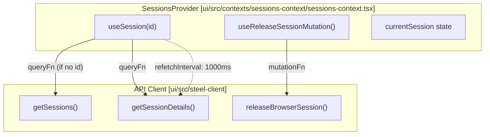
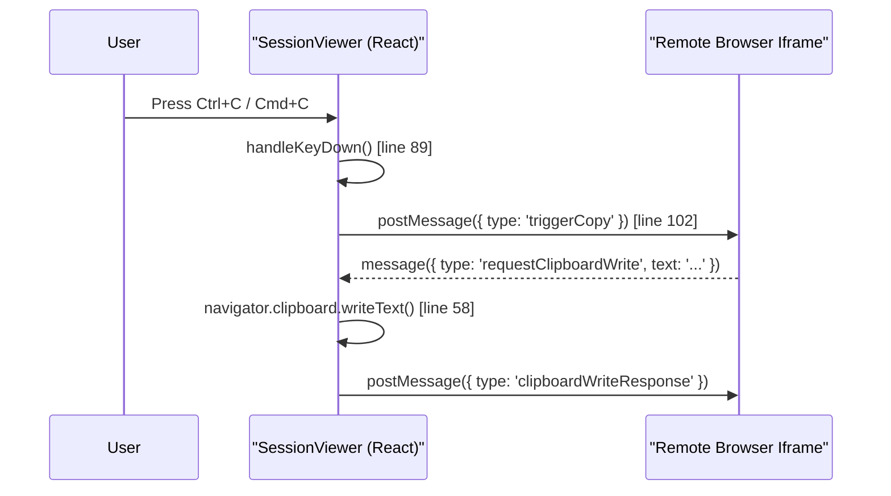

<!-- source: DeepWiki mcp.deepwiki.com · repo steel-dev/steel-browser · page 11.1 Session Management Interface · fetched 2026-10-26 -->

# Session Management Interface

Relevant source files

The following files were used as context for generating this wiki page:

- [.github/ISSUE_TEMPLATE/bug_report.md](.github/ISSUE_TEMPLATE/bug_report.md)
- [ui/src/App.tsx](ui/src/App.tsx)
- [ui/src/components/header/header.tsx](ui/src/components/header/header.tsx)
- [ui/src/components/sessions/session-console/session-devtools.tsx](ui/src/components/sessions/session-console/session-devtools.tsx)
- [ui/src/components/sessions/session-console/session-logs.tsx](ui/src/components/sessions/session-console/session-logs.tsx)
- [ui/src/components/sessions/session-viewer/empty-state.tsx](ui/src/components/sessions/session-viewer/empty-state.tsx)
- [ui/src/components/sessions/session-viewer/session-viewer.tsx](ui/src/components/sessions/session-viewer/session-viewer.tsx)
- [ui/src/containers/session-container.tsx](ui/src/containers/session-container.tsx)
- [ui/src/contexts/sessions-context/sessions-context.tsx](ui/src/contexts/sessions-context/sessions-context.tsx)
- [ui/src/contexts/sessions-context/sessions-context.types.ts](ui/src/contexts/sessions-context/sessions-context.types.ts)
- [ui/src/lib/query-client.ts](ui/src/lib/query-client.ts)
- [ui/src/main.tsx](ui/src/main.tsx)
- [ui/src/root-layout.tsx](ui/src/root-layout.tsx)

## Purpose and Scope

This document describes the React-based user interface for managing browser sessions in steel-browser. The Session Management Interface provides a web-based dashboard for creating, monitoring, and managing browser automation sessions. This page covers the UI components, session contexts, real-time log streaming, and the interactive session viewer.

For information about the backend session management API endpoints, see [Session Management API](). For details on the generated API client used by this interface, see [Generated API Client](). For WebSocket streaming capabilities, see [WebSocket API]().

## Overview

The Session Management Interface is a React application that provides a visual interface for session lifecycle operations and real-time monitoring. It is built using modern web technologies to ensure a responsive and type-safe experience.

### Key Features

- **Session Viewer**: An interactive iframe-based viewer for live browser sessions with clipboard synchronization [ui/src/components/sessions/session-viewer/session-viewer.tsx:12-195]().
- **Real-time Log Streaming**: A console interface that streams browser events, network requests, and console logs via WebSockets [ui/src/components/sessions/session-console/session-logs.tsx:4-88]().
- **Session Lifecycle Management**: Context-driven hooks for fetching session details and releasing active sessions [ui/src/contexts/sessions-context/sessions-context.tsx:24-94]().
- **Embedded DevTools**: Integration with Chrome DevTools Protocol (CDP) inspector for deep debugging [ui/src/components/sessions/session-console/session-devtools.tsx:4-36]().

### Technology Stack

| Component | Technology | Purpose |
|-----------|-----------|---------|
| Framework | React 18 | UI component framework [ui/src/main.tsx:6-11]() |
| State Management | TanStack React Query | Server state, caching, and polling [ui/src/lib/query-client.ts:1-10]() |
| Context API | React Context | Global session state and mutations [ui/src/contexts/sessions-context/sessions-context.tsx:20-22]() |
| Real-time | WebSockets | Live log and event streaming [ui/src/components/sessions/session-console/session-logs.tsx:9-24]() |
| Styling | Tailwind CSS | Utility-first styling [ui/src/App.tsx:1-11]() |

**Sources:** [ui/src/main.tsx:1-11](), [ui/src/lib/query-client.ts:1-10](), [ui/src/contexts/sessions-context/sessions-context.tsx:1-94]()

## Session Context and State Management

The UI manages session data through a centralized `SessionsProvider`. This provider utilizes TanStack React Query to handle data fetching, caching, and automatic refetching.

### SessionsContext Implementation

The `SessionsContext` provides hooks for components to interact with session data without manual state management.

- **`useSession`**: Fetches session details by ID. It implements a `refetchInterval` of 1000ms to keep the UI synchronized with the backend session status [ui/src/contexts/sessions-context/sessions-context.tsx:30-56]().
- **`useReleaseSessionMutation`**: Handles session termination. Upon success, it invalidates the `sessions` query and refetches the specific session query to update the UI state [ui/src/contexts/sessions-context/sessions-context.tsx:58-81]().

**Sources:** [ui/src/contexts/sessions-context/sessions-context.tsx:24-94](), [ui/src/contexts/sessions-context/sessions-context.types.ts:10-20]()

## Session Viewer Component

The `SessionViewer` is the primary interface for interacting with a live browser session. It embeds the browser's debug URL in an iframe and manages a complex "Clipboard Bridge".

### Clipboard Synchronization

Since the browser session runs in a remote container, the UI implements a bridge to synchronize the local user's clipboard with the remote browser.

- **Keyboard Interception**: The component captures `Ctrl+C` and `Ctrl+V` events to trigger programmatic copy/paste actions within the iframe [ui/src/components/sessions/session-viewer/session-viewer.tsx:89-128]().
- **Message Handling**: It listens for `MessageEvent` from the iframe to fulfill `requestClipboardRead` and `requestClipboardWrite` requests using the browser's `navigator.clipboard` API [ui/src/components/sessions/session-viewer/session-viewer.tsx:24-86]().
- **Sandbox Security**: The iframe is configured with specific sandbox permissions (`allow-same-origin`, `allow-scripts`, `allow-clipboard-write`, `allow-clipboard-read`) to enable these features safely [ui/src/components/sessions/session-viewer/session-viewer.tsx:189-192]().

**Sources:** [ui/src/components/sessions/session-viewer/session-viewer.tsx:10-195]()

## Real-time Monitoring and Logs

The `SessionLogs` component provides a terminal-like interface for viewing session activity in real-time via WebSockets.

### Log Processing Logic

Logs are received as JSON strings over a WebSocket connection to `${env.VITE_WS_URL}/v1/sessions/logs` [ui/src/components/sessions/session-console/session-logs.tsx:9]().

| Log Type | Visual Indicator (Color) | Formatting Logic |
|----------|--------------------------|------------------|
| **Console** | `var(--cyan-a11)` | Strips timestamp/level prefixes from message [ui/src/components/sessions/session-console/session-logs.tsx:42-50]() |
| **Request** | `var(--pink-a11)` | Displays `[METHOD] URL` [ui/src/components/sessions/session-console/session-logs.tsx:51]() |
| **Response** | `var(--green-a11)` | Displays `[STATUS] URL` [ui/src/components/sessions/session-console/session-logs.tsx:52]() |
| **Error** | `var(--red-a11)` | Displays the error message [ui/src/components/sessions/session-console/session-logs.tsx:53]() |

The console automatically scrolls to the bottom as new logs arrive [ui/src/components/sessions/session-console/session-logs.tsx:28-32]().

**Sources:** [ui/src/components/sessions/session-console/session-logs.tsx:4-88]()

## Debugging and DevTools

For advanced troubleshooting, the UI integrates a `SessionDevTools` component.

- **CDP Inspector**: It embeds an iframe pointing to the backend's devtools inspector (`/v1/devtools/inspector.html`) [ui/src/components/sessions/session-console/session-devtools.tsx:29-35]().
- **Dynamic Page ID**: It subscribes to a WebSocket (`/v1/sessions/pageId`) to receive the current active page's ID, ensuring the inspector stays attached to the correct tab [ui/src/components/sessions/session-console/session-devtools.tsx:8-17]().

**Sources:** [ui/src/components/sessions/session-console/session-devtools.tsx:4-36]()

## UI Layout and Navigation

The dashboard layout is managed by `RootLayout` and `SessionContainer`.

- **`RootLayout`**: Wraps the application in `QueryClientProvider`, `SessionsProvider`, and `ThemeProvider` [ui/src/root-layout.tsx:9-25]().
- **`Header`**: Displays the current session ID (truncated) and a "Live" badge if the session status is active [ui/src/components/header/header.tsx:34-52]().
- **`SessionContainer`**: Provides a split-pane view between the `SessionViewer` and the `SessionConsole`. Users can toggle the console visibility using a side button [ui/src/containers/session-container.tsx:19-50]().
- **Empty State**: Displays a custom illustration and help links if a session has no events [ui/src/components/sessions/session-viewer/empty-state.tsx:5-36]().

**Sources:** [ui/src/root-layout.tsx:9-25](), [ui/src/containers/session-container.tsx:9-51](), [ui/src/components/header/header.tsx:7-74]()

---

