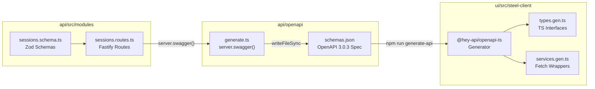
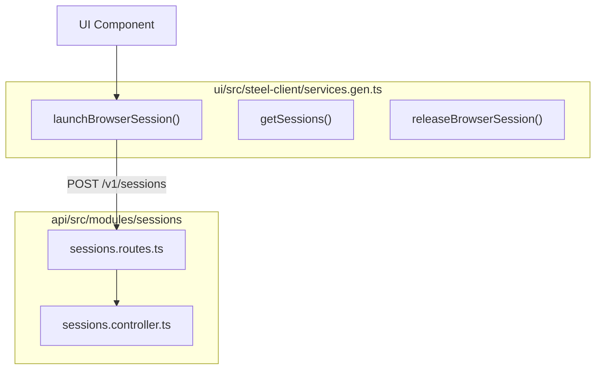

<!-- source: DeepWiki mcp.deepwiki.com · repo steel-dev/steel-browser · page 11.2 Generated API Client · fetched 2026-10-26 -->

# Generated API Client

<details>
<summary>Relevant source files</summary>

The following files were used as context for generating this wiki page:

- [api/openapi/generate.ts](api/openapi/generate.ts)
- [api/openapi/schemas.json](api/openapi/schemas.json)
- [api/src/config.ts](api/src/config.ts)
- [api/src/modules/sessions/sessions.routes.ts](api/src/modules/sessions/sessions.routes.ts)
- [ui/src/steel-client/schemas.gen.ts](ui/src/steel-client/schemas.gen.ts)
- [ui/src/steel-client/services.gen.ts](ui/src/steel-client/services.gen.ts)
- [ui/src/steel-client/types.gen.ts](ui/src/steel-client/types.gen.ts)

</details>


This document describes the auto-generated TypeScript API client used by the Steel Browser UI to communicate with the Fastify API service. The client provides type-safe access to all API endpoints with automatic request/response validation and transformation.

## Overview

The Steel Browser UI uses a code-generated TypeScript client created by `@hey-api/openapi-ts` from the OpenAPI specification. This ensures type safety across the entire stack: Zod schemas in the API generate OpenAPI specs, which then generate TypeScript types and service functions for the UI. The generated client is located in `ui/src/steel-client/` and consists of three main artifacts:

- **types.gen.ts** - TypeScript type definitions for all request/response schemas. [ui/src/steel-client/types.gen.ts:1-10]()
- **services.gen.ts** - API service functions with automatic type inference. [ui/src/steel-client/services.gen.ts:1-98]()
- **schemas.gen.ts** - JSON schema definitions for runtime validation. [ui/src/steel-client/schemas.gen.ts:1-10]()

Sources: [ui/src/steel-client/types.gen.ts:1-10](), [ui/src/steel-client/services.gen.ts:1-98](), [ui/src/steel-client/schemas.gen.ts:1-10]()

## Generation Pipeline

The pipeline bridges the "Natural Language Space" of API definitions into the "Code Entity Space" of the UI client.

### API to Client Bridge

Title: "API Schema to UI Client Flow"


**Generation Flow:**

1. The API service registers routes in [api/src/modules/sessions/sessions.routes.ts:23-242]() using schemas defined in `sessions.schema.ts`.
2. The [api/openapi/generate.ts:15-35]() script starts the Fastify server, calls `server.swagger()`, and adds the server URL from environment variables. [api/openapi/generate.ts:19-26]()
3. The resulting JSON is written to [api/openapi/schemas.json]().
4. The UI runs the `@hey-api/openapi-ts` generator to produce the type-safe client.

Sources: [api/src/modules/sessions/sessions.routes.ts:23-242](), [api/openapi/generate.ts:1-36](), [api/openapi/schemas.json:1-10]()

## Generated Type Definitions

### Core Request/Response Types

The [ui/src/steel-client/types.gen.ts]() file contains TypeScript interfaces for all API operations.

| Type Category | Examples | Purpose |
|---------------|----------|---------|
| Request Bodies | `CreateSession`, `ScrapeRequest` | Input parameters for API calls |
| Response Bodies | `ScrapeResponse`, `SessionDetails` | Returned data structures |
| Options | `LaunchBrowserSessionData` | Wrappers containing body, path, and query params |

**Example: CreateSession Type**
The `CreateSession` type in [ui/src/steel-client/types.gen.ts:74-280]() includes detailed configurations for proxies, user agents, and browser contexts including cookies and storage.

Sources: [ui/src/steel-client/types.gen.ts:3-47](), [ui/src/steel-client/types.gen.ts:74-280]()

## Generated Service Functions

### Client Initialization

The [ui/src/steel-client/services.gen.ts:97]() file initializes the fetch-based client:

```typescript
export const client = createClient(createConfig());
```

### Service Function Pattern

Service functions wrap the HTTP calls with full type awareness for the `data` and `error` payloads.

Title: "Code Entity Interaction: UI to API"


**Example Service Function: `launchBrowserSession`**
From [ui/src/steel-client/services.gen.ts:168-180]():
```typescript
export const launchBrowserSession = <ThrowOnError extends boolean = false>(
  options?: Options<LaunchBrowserSessionData, ThrowOnError>,
) => {
  return (options?.client ?? client).post<
    LaunchBrowserSessionResponse,
    LaunchBrowserSessionError,
    ThrowOnError
  >({
    ...options,
    url: "/v1/sessions",
    responseTransformer: LaunchBrowserSessionResponseTransformer,
  });
};
```

### Key Service Functions

| Service Function | Method | Endpoint | Source |
|-----------------|--------|----------|--------|
| `scrape` | POST | `/v1/scrape` | [ui/src/steel-client/services.gen.ts:103-115]() |
| `health` | GET | `/v1/health` | [ui/src/steel-client/services.gen.ts:151-162]() |
| `launchBrowserSession` | POST | `/v1/sessions` | [ui/src/steel-client/services.gen.ts:168-180]() |
| `getSessions` | GET | `/v1/sessions` | [ui/src/steel-client/services.gen.ts:186-197]() |
| `getSessionDetails` | GET | `/v1/sessions/{sessionId}` | [ui/src/steel-client/services.gen.ts:203-215]() |
| `releaseBrowserSession`| POST | `/v1/sessions/{sessionId}/release` | [ui/src/steel-client/services.gen.ts:238-250]() |

Sources: [ui/src/steel-client/services.gen.ts:103-250]()

## Generated JSON Schemas

The [ui/src/steel-client/schemas.gen.ts]() file contains the raw OpenAPI schema objects as `const` objects. These are used by the generated client for metadata and can be utilized for runtime validation in the UI.

**Example: ScrapeRequestSchema**
From [ui/src/steel-client/schemas.gen.ts:3-37]():
```typescript
export const ScrapeRequestSchema = {
  title: "ScrapeRequest",
  type: "object",
  properties: {
    url: { type: "string" },
    format: {
      type: "array",
      items: {
        type: "string",
        enum: ["html", "readability", "cleaned_html", "markdown"],
      },
    },
    // ...
  },
  additionalProperties: false,
} as const;
```

Sources: [ui/src/steel-client/schemas.gen.ts:3-37](), [ui/src/steel-client/schemas.gen.ts:194-210]()

## Type Safety Guarantees

The integration of the generated client ensures that:
1. **URL Parameters**: Path parameters like `{sessionId}` are strictly typed and required in the `options.path` object. [ui/src/steel-client/services.gen.ts:212]()
2. **Request Bodies**: The `body` property of the options object must match the Zod-defined schema from the API. [ui/src/steel-client/services.gen.ts:171]()
3. **Response Handling**: The `data` returned from service calls is automatically typed, reducing the need for manual type assertions in React components. [ui/src/steel-client/services.gen.ts:106-110]()

Sources: [ui/src/steel-client/services.gen.ts:103-215](), [api/src/modules/sessions/sessions.routes.ts:41-57]()

---

