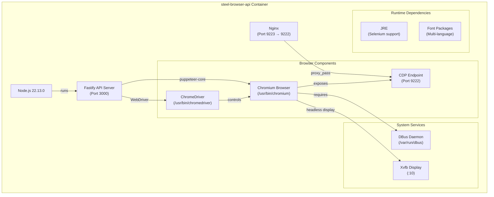
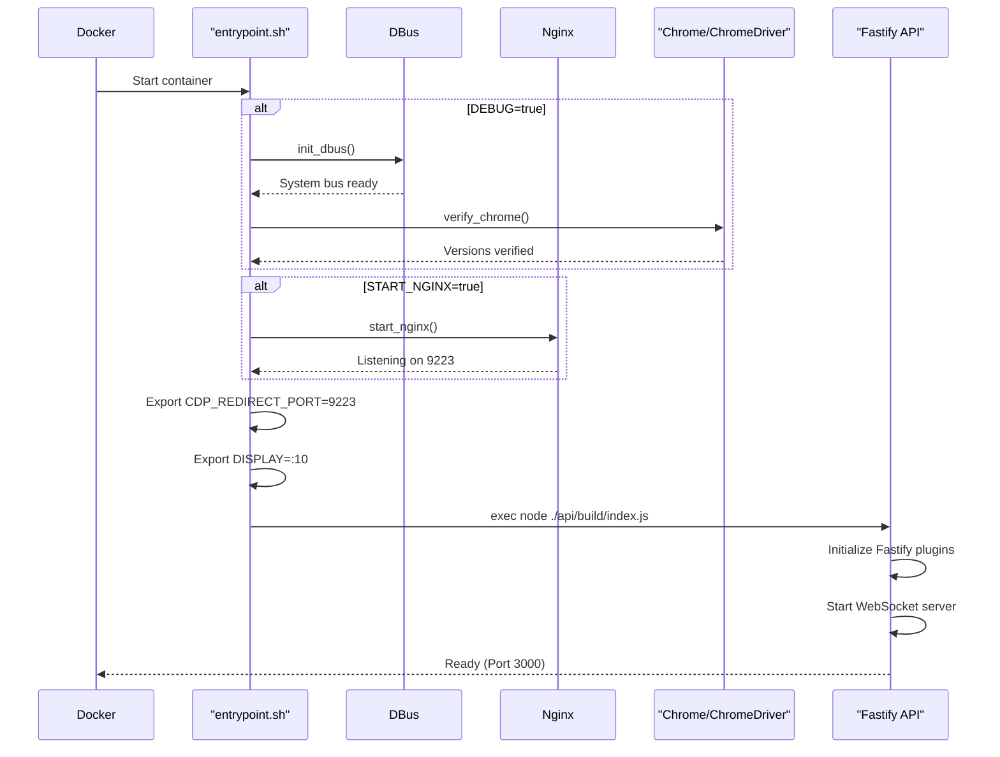
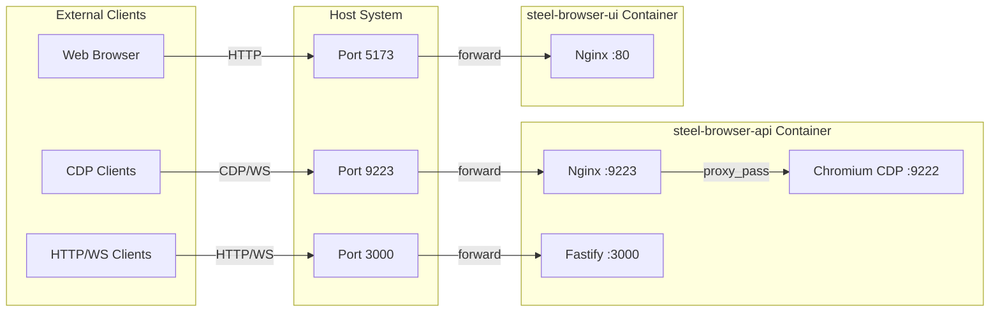
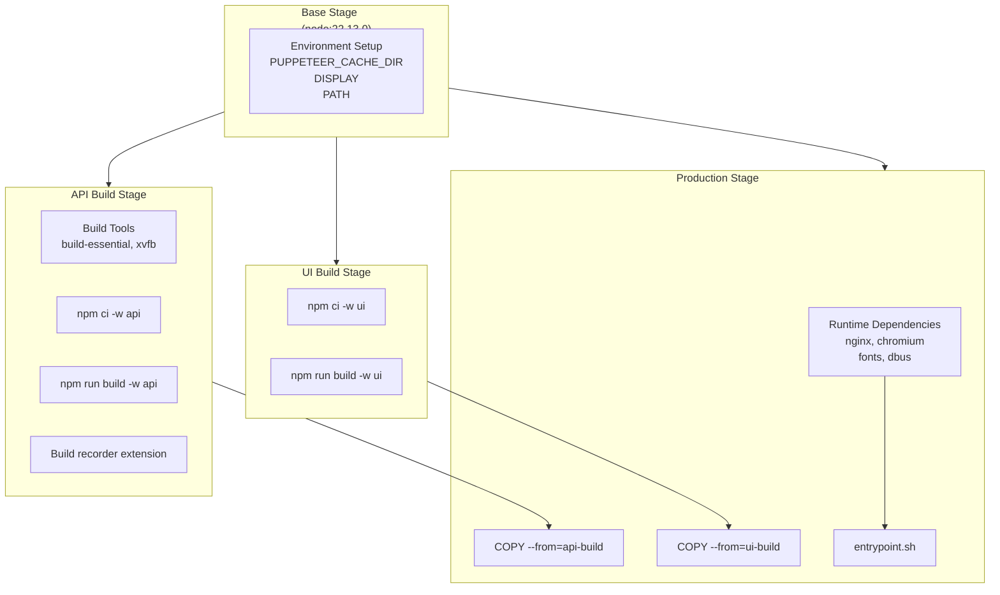
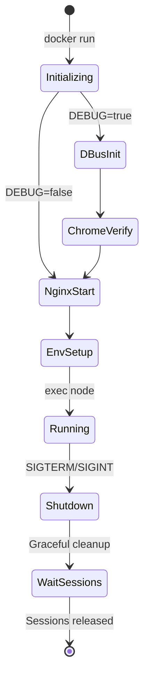

<!-- source: DeepWiki mcp.deepwiki.com · repo steel-dev/steel-browser · page 13 Deployment & Operations · fetched 2026-10-26 -->

# Deployment & Operations

<details>
<summary>Relevant source files</summary>

The following files were used as context for generating this wiki page:

- [Dockerfile](Dockerfile)
- [README.md](README.md)
- [api/Dockerfile](api/Dockerfile)
- [api/entrypoint.sh](api/entrypoint.sh)
- [docker-compose.dev.yml](docker-compose.dev.yml)
- [docker-compose.yml](docker-compose.yml)
- [images/star_img.png](images/star_img.png)
- [render.yaml](render.yaml)
- [ui/Dockerfile](ui/Dockerfile)

</details>


This document covers production deployment, container architecture, and operational considerations for the steel-browser system. It provides an overview of deployment options, runtime dependencies, environment configuration, and operational best practices.

For detailed configuration of individual subsystems, see:
- Container internals and build process: [Container Architecture](#13.1)
- Volume configuration and data persistence: [Storage & Persistence](#13.2)
- Port configuration and network setup: [Network Configuration](#13.3)
- Automated build and deployment: [CI/CD Pipeline](#13.4)
- System monitoring and health endpoints: [Health Checks & Monitoring](#13.5)

For initial setup and configuration details, see [Getting Started](#2).

## Deployment Options

The steel-browser system supports three primary deployment modes:

| Deployment Mode | Image(s) | Use Case |
|----------------|----------|----------|
| **Combined Container** | `ghcr.io/steel-dev/steel-browser:latest` | Single-container deployment with API and UI bundled. [Dockerfile:71-125]() |
| **Separate Containers** | `ghcr.io/steel-dev/steel-browser-api:latest`<br/>`ghcr.io/steel-dev/steel-browser-ui:latest` | Multi-container deployment with independent scaling. [docker-compose.yml:1-29]() |
| **Standalone** | Build from source | Development or custom environments using `npm run dev`. [README.md:124-132]() |

The combined container includes both the Fastify API server and the React UI application, served through a single Nginx instance. The separate container approach allows independent scaling and deployment of the API and UI layers.

**Sources:** [docker-compose.yml:1-40](), [Dockerfile:1-126](), [README.md:76-108]()

## Runtime Stack



**Runtime Stack Components:**

| Component | Purpose | Location |
|-----------|---------|----------|
| **Node.js 22.13.0** | JavaScript runtime for API server | [api/Dockerfile:1]() |
| **Nginx** | Reverse proxy for CDP connections | [api/Dockerfile:67]() |
| **Chromium** | Browser automation target | [api/Dockerfile:92]() |
| **ChromeDriver** | Selenium WebDriver implementation | [api/Dockerfile:92]() |
| **DBus** | Inter-process communication for Chrome | [api/Dockerfile:90]() |
| **Xvfb** | Virtual framebuffer for headless rendering | [api/Dockerfile:75]() |
| **JRE** | Java runtime for Selenium Grid compatibility | [api/Dockerfile:78]() |

**Sources:** [api/Dockerfile:1-110](), [api/entrypoint.sh:1-127]()

## Container Initialization Flow



The [api/entrypoint.sh]() script orchestrates container startup:

1. **Parse Arguments** - Check for `--no-nginx` flag [api/entrypoint.sh:93-100]()
2. **Initialize DBus** - Start system bus daemon [api/entrypoint.sh:12-31]()
3. **Verify Chrome** - Check browser and driver installation [api/entrypoint.sh:33-63]()
4. **Start Nginx** - Launch reverse proxy for CDP [api/entrypoint.sh:65-89]()
5. **Set Environment** - Configure `CDP_REDIRECT_PORT` and `DISPLAY` [api/entrypoint.sh:108-110]()
6. **Start API** - Execute node directly (not via npm) [api/entrypoint.sh:124]()

The script uses `exec` to replace the shell process with the Node.js process, ensuring proper signal handling for graceful shutdown.

**Sources:** [api/entrypoint.sh:91-127]()

## Environment Variables

### Core Configuration

| Variable | Default | Description |
|----------|---------|-------------|
| `NODE_ENV` | `production` | Runtime environment mode. [api/Dockerfile:7]() |
| `PUPPETEER_CACHE_DIR` | `/app/.cache` | Puppeteer browser cache location. [api/Dockerfile:8]() |
| `DISPLAY` | `:10` | X11 display for headless rendering. [api/Dockerfile:9]() |
| `CHROME_BIN` | `/usr/bin/chromium` | Chrome binary path. [api/Dockerfile:11]() |
| `CHROME_PATH` | `/usr/bin/chromium` | Alternate Chrome path variable. [api/Dockerfile:12]() |

**Sources:** [api/Dockerfile:7-12]()

### Network Configuration

| Variable | Default | Description |
|----------|---------|-------------|
| `HOST_IP` | `localhost` | Host IP address for binding. [api/Dockerfile:104]() |
| `CDP_REDIRECT_PORT` | `9223` | External CDP port (Nginx). [api/entrypoint.sh:109]() |
| `DOMAIN` | `localhost:3000` | API domain for URL generation. [docker-compose.yml:12]() |
| `CDP_DOMAIN` | `localhost:9223` | CDP domain for client connections. [docker-compose.yml:13]() |

**Sources:** [api/Dockerfile:104-105](), [api/entrypoint.sh:109](), [docker-compose.yml:12-13]()

### Storage Configuration

| Variable | Default | Description |
|----------|---------|-------------|
| `LOG_STORAGE_ENABLED` | `false` | Enable DuckDB event logging. [docker-compose.yml:14]() |
| `LOG_STORAGE_PATH` | `/data/logs/browser-logs.duckdb` | DuckDB database path. [docker-compose.yml:15]() |

**Sources:** [docker-compose.yml:14-15]()

### UI Configuration

The UI container uses environment variables that are substituted at runtime:

| Variable | Default | Description |
|----------|---------|-------------|
| `API_URL` | `http://api:3000` | Backend API URL (Docker network). [docker-compose.yml:24]() |
| `VITE_API_URL` | `""` | API endpoint path (proxied by Nginx). [Dockerfile:33]() |

**Sources:** [docker-compose.yml:24](), [Dockerfile:33]()

## Docker Compose Deployment

### Production Configuration

The standard production deployment uses two services: `api` and `ui`.

```yaml
# docker-compose.yml
services:
  api:
    image: ghcr.io/steel-dev/steel-browser-api:latest
    ports:
      - "3000:3000"  # Fastify API
      - "9223:9223"  # CDP proxy
    volumes:
      - logs:/data/logs
      - exports:/tmp/steel-browser-exports
      - ./.cache:/app/.cache
    environment:
      - DOMAIN=${DOMAIN:-localhost:3000}
      - CDP_DOMAIN=${CDP_DOMAIN:-localhost:9223}
      - LOG_STORAGE_ENABLED=true
    networks:
      - steel-network

  ui:
    image: ghcr.io/steel-dev/steel-browser-ui:latest
    ports:
      - "5173:80"  # Nginx serving UI
    environment:
      - API_URL=${API_URL:-http://api:3000}
    depends_on:
      - api
    networks:
      - steel-network
```

**Sources:** [docker-compose.yml:1-40]()

### Volume Mounts

| Volume | Mount Point | Purpose |
|--------|-------------|---------|
| `logs` | `/data/logs` | DuckDB browser event logs. [docker-compose.yml:8]() |
| `exports` | `/tmp/steel-browser-exports` | Session file storage and archives. [docker-compose.yml:9]() |
| `.cache` | `/app/.cache` | Puppeteer browser binaries. [docker-compose.yml:10]() |

The `logs` and `exports` volumes use Docker managed volumes for persistence, while `.cache` is mounted from the host to share browser binaries across container restarts.

**Sources:** [docker-compose.yml:7-10](), [docker-compose.yml:35-39]()

## Port Configuration



| Port | Service | Protocol | Purpose |
|------|---------|----------|---------|
| **3000** | Fastify API | HTTP/WS | REST API and WebSocket streaming. [api/Dockerfile:102]() |
| **9223** | Nginx (CDP Proxy) | CDP/WS | Chrome DevTools Protocol connections. [api/Dockerfile:102]() |
| **5173** | Nginx (UI) | HTTP | React UI application (host mapping). [docker-compose.yml:22]() |

The Nginx reverse proxy at port 9223 translates external CDP connections to the internal Chromium CDP port, enabling CDP access without exposing the browser directly.

**Sources:** [api/Dockerfile:102](), [docker-compose.yml:4-6](), [docker-compose.yml:21-22]()

## Multi-Stage Build Process



The [Dockerfile]() for the combined image uses a four-stage build:

1. **Base Stage** - Sets up common Node.js environment. [Dockerfile:3-12]()
2. **UI Build Stage** - Builds the React frontend. [Dockerfile:23-33]()
3. **API Build Stage** - Builds the Fastify backend and extensions. [Dockerfile:36-70]()
4. **Production Stage** - Installs system dependencies and assembles the final image. [Dockerfile:72-126]()

This approach minimizes the final image size by excluding build tools and dev dependencies.

**Sources:** [Dockerfile:1-126]()

## Graceful Shutdown

The entrypoint script uses `exec` to replace the shell process with the Node.js process, ensuring signals (SIGTERM, SIGINT) are delivered directly to the API server:

```bash
# api/entrypoint.sh:124
exec node ./api/build/index.js
```

This enables the application to implement graceful shutdown logic, waiting for active browser sessions to complete or be released before terminating. Using `npm run start` would introduce npm's signal handling, preventing proper cleanup.

**Sources:** [api/entrypoint.sh:118-124]()

## Operational Considerations

### Resource Requirements

| Resource | Minimum | Recommended |
|----------|---------|-------------|
| **CPU** | 2 cores | 4+ cores |
| **Memory** | 2 GB | 4+ GB |
| **Disk** | 5 GB | 20+ GB (for logs/exports) |

Each browser session requires significant memory. Plan capacity based on expected concurrent sessions.

### Container Lifecycle



1. **Initialization** - DBus and system services start. [api/entrypoint.sh:12-31]()
2. **Chrome Verification** - Browser and driver versions checked (if `DEBUG=true`). [api/entrypoint.sh:33-63]()
3. **Nginx Launch** - CDP proxy starts (unless `--no-nginx`). [api/entrypoint.sh:65-89]()
4. **Environment Setup** - CDP port and display configured. [api/entrypoint.sh:108-110]()
5. **API Start** - Fastify server launches. [api/entrypoint.sh:124]()

**Sources:** [api/entrypoint.sh:91-127]()

### Debugging and Logging

Enable debug logging by setting `DEBUG=true`:

```bash
docker run -e DEBUG=true ghcr.io/steel-dev/steel-browser
```

Debug mode enables:
- DBus initialization logging. [api/entrypoint.sh:13]()
- Chrome/ChromeDriver version verification. [api/entrypoint.sh:35]()
- Nginx startup logging. [api/entrypoint.sh:68]()
- Environment state logging. [api/entrypoint.sh:113]()

**Sources:** [api/entrypoint.sh:5-9]()

### Health Checks

For production deployments (e.g., Render), a health check endpoint is available at `/v1/health`.

**Sources:** [render.yaml:6]()

---

