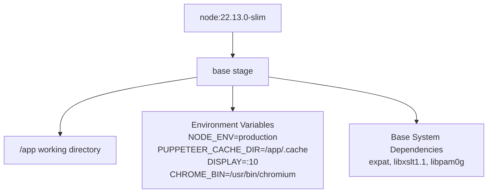
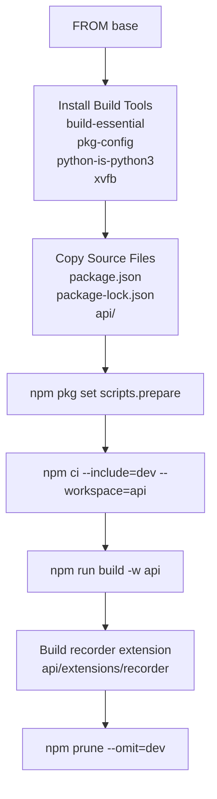
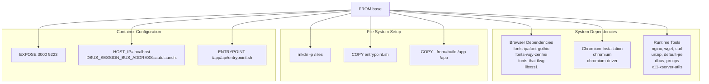
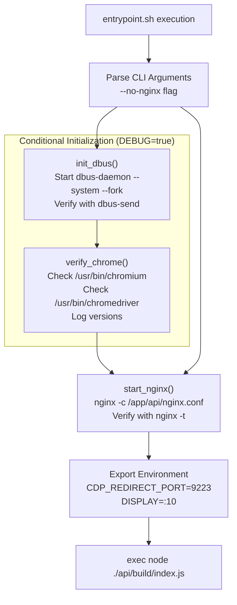
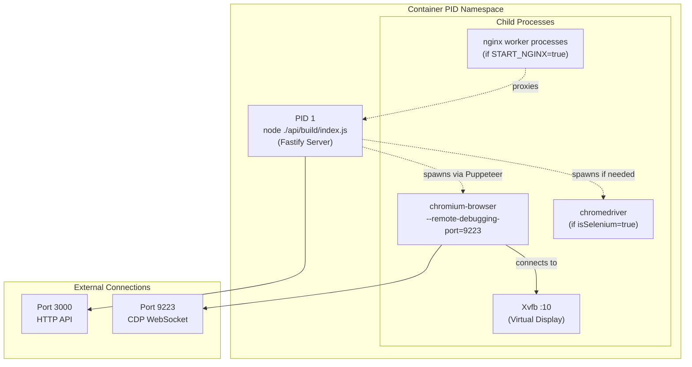
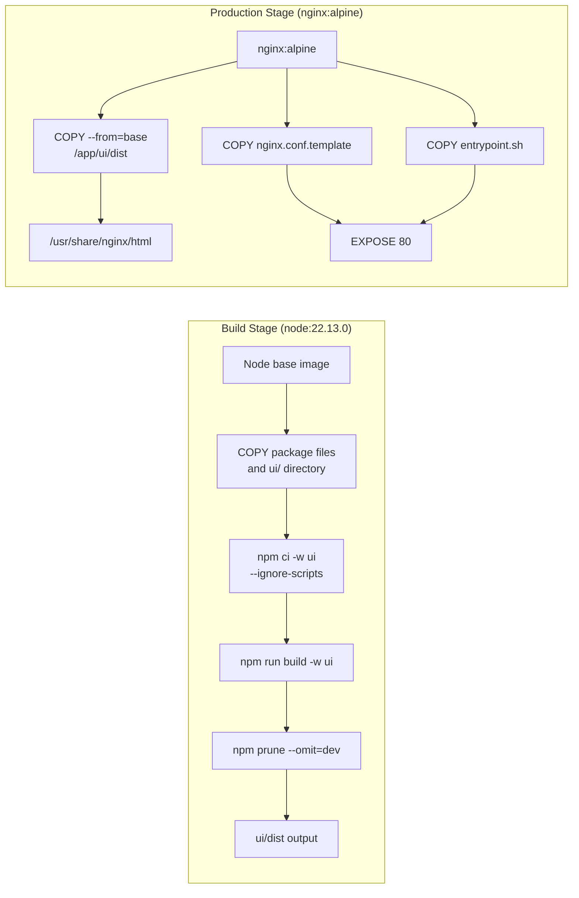
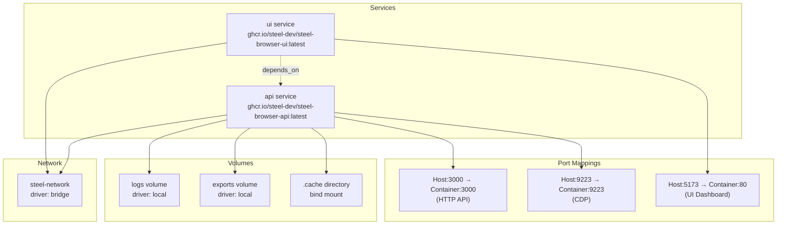
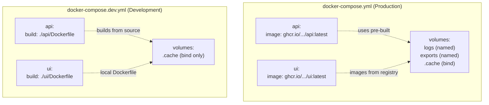
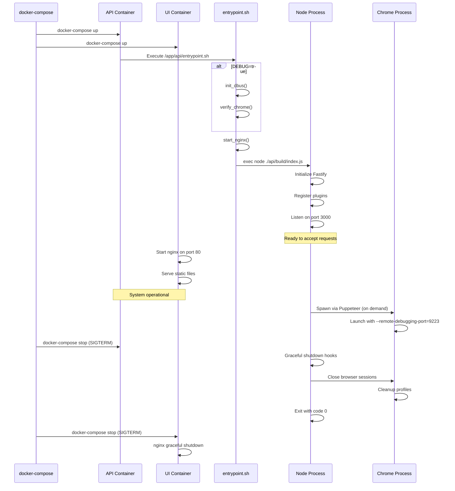

<!-- source: DeepWiki mcp.deepwiki.com · repo steel-dev/steel-browser · page 13.1 Container Architecture · fetched 2026-10-26 -->

# Container Architecture

<details>
<summary>Relevant source files</summary>

The following files were used as context for generating this wiki page:

- [.dockerignore](.dockerignore)
- [.github/workflows/check-build.yml](.github/workflows/check-build.yml)
- [api/.dockerignore](api/.dockerignore)
- [api/Dockerfile](api/Dockerfile)
- [api/entrypoint.sh](api/entrypoint.sh)
- [docker-compose.dev.yml](docker-compose.dev.yml)
- [docker-compose.yml](docker-compose.yml)
- [ui/Dockerfile](ui/Dockerfile)

</details>


This document explains the Docker container architecture of Steel Browser, including multi-stage build processes, initialization sequences, runtime process management, and container orchestration. This covers the physical deployment structure and how processes are managed within containers.

For information about storage volumes and data persistence, see [Storage & Persistence](#13.2). For network configuration and port mappings, see [Network Configuration](#13.3). For details about Docker Compose environment variables, see [Environment Configuration](#2.2).

## Overview

Steel Browser uses a multi-container architecture orchestrated by Docker Compose. The system consists of two primary service containers:

- **API Container**: Runs the Node.js Fastify server, manages Chromium browser processes, and provides the core automation engine.
- **UI Container**: Serves the React dashboard via nginx.

Both containers use multi-stage builds to separate build-time dependencies from runtime environments, minimizing production image size and attack surface.

Sources: [docker-compose.yml:1-40](), [api/Dockerfile:1-110](), [ui/Dockerfile:1-30]()

## API Container Multi-Stage Build

The API container uses a three-stage build process defined in the `api/Dockerfile`.

### Stage 1: Base Image (`base`)



The base stage establishes the foundation image with Node.js 22.13.0-slim and installs minimal runtime dependencies. Key environment variables are set at this stage:

| Environment Variable | Value | Purpose |
|---------------------|-------|---------|
| `NODE_ENV` | `production` | Optimizes Node.js runtime behavior |
| `PUPPETEER_CACHE_DIR` | `/app/.cache` | Stores Puppeteer browser binaries |
| `DISPLAY` | `:10` | X11 display for headless browser |
| `CHROME_BIN` | `/usr/bin/chromium` | Chrome binary location |
| `CHROME_PATH` | `/usr/bin/chromium` | Alternate Chrome path reference |

Sources: [api/Dockerfile:3-26]()

### Stage 2: Build Stage (`build`)



The build stage installs development dependencies and compiles the TypeScript source code. Notable steps:

1. **Husky Skip**: Disables git hooks in Docker environment [api/Dockerfile:41]().
2. **Workspace Install**: Uses npm workspaces to install only API dependencies [api/Dockerfile:46]().
3. **Extension Build**: Separately builds the recorder browser extension [api/Dockerfile:48-56]().
4. **Dependency Pruning**: Removes dev dependencies to reduce artifact size [api/Dockerfile:59-60]().

Sources: [api/Dockerfile:28-61]()

### Stage 3: Production Stage (`production`)



The production stage installs all runtime dependencies and copies build artifacts. Key components:

- **Chromium**: Installs both the browser (`chromium`) and WebDriver (`chromium-driver`) [api/Dockerfile:92]().
- **nginx**: Provides optional reverse proxy functionality [api/Dockerfile:67]().
- **Xvfb**: Virtual framebuffer for headless display [api/Dockerfile:75]().
- **DBus**: Inter-process communication required for Chrome [api/Dockerfile:79-80]().
- **Fonts**: International font support for browser rendering [api/Dockerfile:69-73]().
- **Java**: Required for Selenium WebDriver support (`default-jre`) [api/Dockerfile:78]().

Sources: [api/Dockerfile:62-110]()

## Container Initialization Process

The `api/entrypoint.sh` script orchestrates container startup, performing initialization checks and starting required services before launching the Node.js application.



### Initialization Functions

#### `init_dbus()`

Initializes the D-Bus system message bus required for Chrome inter-process communication:

1. Creates `/var/run/dbus` directory [api/entrypoint.sh:14]().
2. Removes stale PID file if present [api/entrypoint.sh:16-18]().
3. Starts `dbus-daemon --system --fork` [api/entrypoint.sh:20]().
4. Validates connection with `dbus-send` [api/entrypoint.sh:23-26]().

This function only runs when `DEBUG=true` [api/entrypoint.sh:102-103]().

Sources: [api/entrypoint.sh:12-31]()

#### `verify_chrome()`

Validates Chrome and ChromeDriver installation:

| Check | Path | Fallback |
|-------|------|----------|
| Chrome binary | `/usr/bin/chromium` | `$CHROME_EXECUTABLE_PATH` |
| ChromeDriver | `/usr/bin/chromedriver` | None (required) |

The function logs version information for both executables and only runs in DEBUG mode [api/entrypoint.sh:104]().

Sources: [api/entrypoint.sh:33-63]()

#### `start_nginx()`

Starts nginx if `START_NGINX=true`:

1. Launches nginx with custom config: `nginx -c /app/api/nginx.conf` [api/entrypoint.sh:69]().
2. Polls for successful startup with 10 retry attempts [api/entrypoint.sh:72-82]().
3. Skips startup if `--no-nginx` CLI flag detected [api/entrypoint.sh:86]().

The nginx process acts as a reverse proxy for certain API routes and static file serving.

Sources: [api/entrypoint.sh:65-89]()

### Final Execution

The entrypoint script uses `exec` to replace the shell process with the Node.js application:

```bash
exec node ./api/build/index.js
```

This ensures:
- The Node.js process becomes PID 1, receiving signals directly.
- Graceful shutdown hooks in the application receive SIGTERM.
- No intermediate shell process interferes with signal handling.

The direct execution is critical for session cleanup during container shutdown [api/entrypoint.sh:120-124]().

Sources: [api/entrypoint.sh:91-127]()

## Runtime Process Architecture

The API container runs multiple processes simultaneously:



### Process Lifecycle

| Process | Started By | Lifecycle | Purpose |
|---------|-----------|-----------|---------|
| `node` | `api/entrypoint.sh` (PID 1) | Container lifetime | Fastify API server |
| `nginx` | `api/entrypoint.sh` | Container lifetime | Optional reverse proxy |
| `Xvfb` | Environment setup | Container lifetime | Virtual display server |
| `chromium` | Puppeteer (`CDPService`) | Session lifetime | Browser automation |
| `chromedriver` | Selenium mode | Session lifetime | WebDriver protocol |

The Node.js process (PID 1) is responsible for:
- Spawning Chrome via Puppeteer's `browser.launch()` method.
- Managing Chrome subprocess lifecycle.
- Handling SIGTERM for graceful session release.
- Cleaning up temporary files and browser profiles.

Sources: [api/Dockerfile:9-12](), [api/entrypoint.sh:109-124]()

## UI Container Architecture

The UI container uses a simpler two-stage build optimized for static asset serving:



Key differences from API container:

- **Single-purpose**: Only serves static files, no backend logic.
- **Minimal runtime**: Alpine-based nginx image (~40MB total).
- **No browser dependencies**: No Chrome, fonts, or X11 requirements.
- **Template-based config**: nginx configuration supports runtime environment variable substitution via `entrypoint.sh` [ui/Dockerfile:24-25]().

Sources: [ui/Dockerfile:1-30]()

## Docker Compose Orchestration

The `docker-compose.yml` file defines service composition, networking, and volume management.



### Service Definitions

#### API Service Configuration

```yaml
volumes:
  - logs:/data/logs                      # DuckDB log storage
  - exports:/tmp/steel-browser-exports   # Temporary export files
  - ./.cache:/app/.cache                 # Puppeteer browser cache
```

The API service mounts three volumes:
- **Named volume `logs`**: Persists browser logs stored in DuckDB [docker-compose.yml:8]().
- **Named volume `exports`**: Temporary storage for file exports [docker-compose.yml:9]().
- **Bind mount `.cache`**: Shares Puppeteer browser binaries with host [docker-compose.yml:10]().

Environment variables configure external connectivity:
- `DOMAIN`: API server's external hostname [docker-compose.yml:12]().
- `CDP_DOMAIN`: CDP WebSocket endpoint hostname [docker-compose.yml:13]().
- `LOG_STORAGE_PATH`: DuckDB database file location [docker-compose.yml:15]().

Sources: [docker-compose.yml:2-17]()

#### UI Service Configuration

The UI service is simpler, with only environment configuration:

```yaml
environment:
  - API_URL=${API_URL:-http://api:3000}
```

The `API_URL` uses Docker's internal DNS (`api:3000`) to communicate with the API service over the `steel-network` bridge [docker-compose.yml:24](). The `depends_on` directive ensures the API starts before the UI [docker-compose.yml:25-26]().

Sources: [docker-compose.yml:19-28]()

### Network Configuration

```yaml
networks:
  steel-network:
    name: steel-network
    driver: bridge
```

The `steel-network` bridge provides:
- Internal DNS resolution (services can reference each other by name).
- Network isolation from other Docker networks.
- Default NAT for external connectivity.

Both services join this network, enabling the UI to call the API using the hostname `api` [docker-compose.yml:30-33]().

Sources: [docker-compose.yml:30-33]()

### Volume Strategy

| Volume Type | Name | Container Path | Purpose | Persistence |
|-------------|------|----------------|---------|-------------|
| Named | `logs` | `/data/logs` | DuckDB browser logs | Docker-managed |
| Named | `exports` | `/tmp/steel-browser-exports` | Temporary exports | Docker-managed |
| Bind | `.cache` | `/app/.cache` | Puppeteer binaries | Host filesystem |

The bind mount for `.cache` enables sharing browser binaries across container recreations and with the host system, avoiding repeated downloads [docker-compose.yml:10]().

Sources: [docker-compose.yml:35-39]()

## Development vs Production Configuration

The development Compose file (`docker-compose.dev.yml`) differs from production in key ways:



Key differences:

| Aspect | Production | Development |
|--------|-----------|-------------|
| Image source | Pre-built from GHCR | Local build from Dockerfile |
| Log volume | Persistent named volume | None (ephemeral) |
| Export volume | Named volume | None |
| Cache volume | Bind mount | Bind mount |
| Build context | Not applicable | Current directory `.` |

Development mode builds from source and omits log/export volumes since these are typically not needed during development, reducing setup complexity [docker-compose.dev.yml:1-35]().

Sources: [docker-compose.dev.yml:1-35]()

## Container Lifecycle Sequence



The lifecycle demonstrates:

1. **Sequential startup**: Entrypoint initialization before application launch.
2. **On-demand browser**: Chrome processes spawn only when sessions are created.
3. **Graceful shutdown**: SIGTERM propagates properly because Node.js is PID 1.
4. **Session cleanup**: Application code handles session release before exit.

The `exec` command in `api/entrypoint.sh` is critical for proper signal handling [api/entrypoint.sh:124]().

Sources: [api/entrypoint.sh:91-127](), [docker-compose.yml:1-40]()

---

