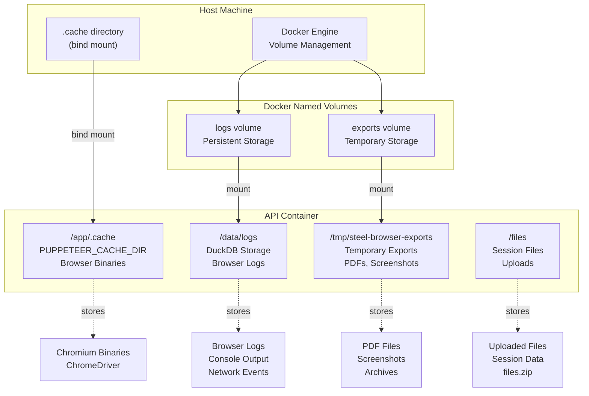
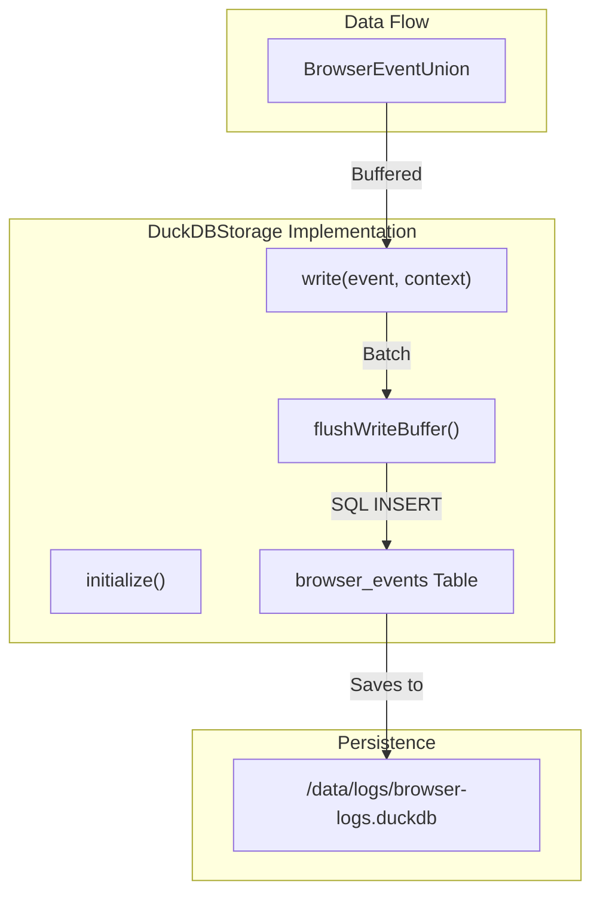
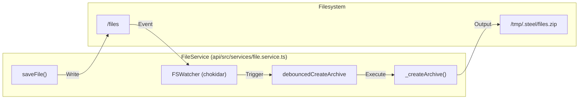

<!-- source: DeepWiki mcp.deepwiki.com · repo steel-dev/steel-browser · page 13.2 Storage & Persistence · fetched 2026-10-26 -->

# Storage & Persistence

<details>
<summary>Relevant source files</summary>

The following files were used as context for generating this wiki page:

- [api/Dockerfile](api/Dockerfile)
- [api/entrypoint.sh](api/entrypoint.sh)
- [api/src/modules/files/files.controller.ts](api/src/modules/files/files.controller.ts)
- [api/src/modules/files/files.routes.ts](api/src/modules/files/files.routes.ts)
- [api/src/modules/files/files.schema.ts](api/src/modules/files/files.schema.ts)
- [api/src/plugins/file-storage.ts](api/src/plugins/file-storage.ts)
- [api/src/services/cdp/instrumentation/storage/duckdb-storage.ts](api/src/services/cdp/instrumentation/storage/duckdb-storage.ts)
- [api/src/services/cdp/instrumentation/storage/safe-json.ts](api/src/services/cdp/instrumentation/storage/safe-json.ts)
- [api/src/services/cdp/instrumentation/utils.ts](api/src/services/cdp/instrumentation/utils.ts)
- [api/src/services/file.service.ts](api/src/services/file.service.ts)
- [docker-compose.dev.yml](docker-compose.dev.yml)
- [docker-compose.yml](docker-compose.yml)
- [ui/Dockerfile](ui/Dockerfile)

</details>


This document explains how Steel Browser manages data storage and persistence across container restarts, including volume strategies, cache management, log storage, and data lifecycle patterns. This page focuses on the deployment storage architecture. For session state management (cookies, localStorage, sessionStorage), see [4.3](). For file upload/download operations, see [7]().

## Volume Strategy Overview

Steel Browser employs three distinct storage strategies to balance performance, persistence, and host-level resource sharing:



Sources: [docker-compose.yml:8-10](), [api/Dockerfile:8](), [api/Dockerfile:98]()

### Storage Strategy Comparison

| Storage Type | Location | Purpose | Persistence | Sharing |
|--------------|----------|---------|-------------|---------|
| **Bind Mount** | `./.cache:/app/.cache` | Puppeteer browser binaries | Survives container deletion | Shared across containers and host |
| **Named Volume (logs)** | `logs:/data/logs` | DuckDB browser logs database | Docker-managed persistent | Container-isolated |
| **Named Volume (exports)** | `exports:/tmp/steel-browser-exports` | Temporary export files | Docker-managed persistent | Container-isolated |
| **Container Filesystem** | `/files` | Session file uploads | Lost on container deletion | Not shared |

Sources: [docker-compose.yml:8-10](), [docker-compose.yml:35-40]()

## Puppeteer Cache Management

### Cache Directory Configuration

The Puppeteer cache directory is configured via the `PUPPETEER_CACHE_DIR` environment variable and uses a bind mount strategy to enable host-level sharing and persistence beyond container lifecycle:

```mermaid
graph LR
    subgraph Configuration["Environment Configuration"]
        EnvVar["PUPPETEER_CACHE_DIR<br/>/app/.cache"]
        DockerEnv["Dockerfile ENV<br/>Line 8"]
    end
    
    subgraph BindMount["Bind Mount Strategy"]
        HostCache["Host: ./.cache"]
        ContainerCache["Container: /app/.cache"]
    end
    
    subgraph CachedContent["Cached Content"]
        ChromiumBinary["Chromium Binary<br/>~300MB"]
        ChromeDriver["ChromeDriver Binary<br/>~20MB"]
        PuppeteerMetadata["Puppeteer Metadata<br/>revision info"]
    end
    
    DockerEnv --> EnvVar
    EnvVar --> ContainerCache
    HostCache <|--|>|"bidirectional sync"| ContainerCache
    ContainerCache --> ChromiumBinary
    ContainerCache --> ChromeDriver
    ContainerCache --> PuppeteerMetadata
```

**Key Characteristics:**

- **Path**: `/app/.cache` inside container, mapped to `./.cache` on host [api/Dockerfile:8](), [docker-compose.yml:10]()
- **Size**: Approximately 320MB for Chromium and ChromeDriver binaries.
- **Lifecycle**: Persists across container restarts and deletions.
- **Benefit**: Avoids re-downloading browser binaries on each container rebuild.

Sources: [api/Dockerfile:8](), [docker-compose.yml:10]()

### Browser Binary Storage

When Puppeteer launches, it checks `PUPPETEER_CACHE_DIR` for compatible browser binaries. The entrypoint script verifies Chrome availability at `/usr/bin/chromium` or via `CHROME_EXECUTABLE_PATH` [api/entrypoint.sh:34-63](). The `api/Dockerfile` installs `chromium` and `chromium-driver` directly via `apt-get` [api/Dockerfile:92](), while the cache directory handles Puppeteer-managed downloads.

Sources: [api/Dockerfile:92](), [api/entrypoint.sh:34-63]()

## Log Storage

### DuckDB Persistent Storage

Steel Browser utilizes `DuckDBStorage` for high-performance browser event persistence. This storage backend is initialized with configurable resource limits to minimize CPU and memory impact.



**Configuration Options:**
- **`maxThreads`**: Defaults to 2 to throttle CPU usage [api/src/services/cdp/instrumentation/storage/duckdb-storage.ts:66]().
- **`memoryLimit`**: Defaults to "256MB" [api/src/services/cdp/instrumentation/storage/duckdb-storage.ts:67]().
- **`parquetCompression`**: Supports `zstd`, `snappy` (default), `gzip`, or `none` [api/src/services/cdp/instrumentation/storage/duckdb-storage.ts:68]().
- **`writeBufferEnabled`**: Writes are batched (default 100 events) and flushed periodically (default 1000ms) to reduce I/O overhead [api/src/services/cdp/instrumentation/storage/duckdb-storage.ts:69-71]().

**Table Schema:**
The `browser_events` table includes fields for `id`, `timestamp`, `event_type`, `target_type`, `page_id`, `data` (JSON), and `context` (JSON) [api/src/services/cdp/instrumentation/storage/duckdb-storage.ts:86-96]().

Sources: [api/src/services/cdp/instrumentation/storage/duckdb-storage.ts:48-116](), [docker-compose.yml:14-15]()

## Session File Storage

### File Service Architecture

The `FileService` manages session-specific files stored in `/files` [api/src/services/file.service.ts:28](). It uses a singleton pattern and integrates with `chokidar` to monitor filesystem changes.



**Key Behaviors:**
- **Path Security**: `getSafeFilePath` ensures files remain within `baseFilesPath` and prevents directory traversal [api/src/services/file.service.ts:88-97]().
- **Automated Archiving**: Any file addition, deletion, or directory change triggers a debounced call (500ms) to create a `files.zip` archive using the `archiver` library [api/src/services/file.service.ts:34-37, 47-60]().
- **Upload Handling**: The `FilesController` processes `multipart/form-data` uploads, supporting both binary file fields and URL-based downloads [api/src/modules/files/files.controller.ts:41-157]().

Sources: [api/src/services/file.service.ts:16-86](), [api/src/modules/files/files.controller.ts:17-40]()

## Export Files Storage

### Temporary Export Volume

Export files (PDFs, screenshots) are stored in `/tmp/steel-browser-exports` and mounted to a Docker named volume in production [docker-compose.yml:9]().

**Characteristics:**
- **Persistence**: Survives container restarts via the `exports` named volume [docker-compose.yml:38-39]().
- **Cleanup**: No automatic cleanup is performed by the `FileService`. Users must manage disk space manually or via external cron jobs.
- **Access**: Files are accessible via the `FilesController` download endpoints [api/src/modules/files/files.routes.ts:57-69]().

Sources: [docker-compose.yml:9, 38-39](), [api/src/modules/files/files.routes.ts:133-145]()

## Data Persistence Summary

| Data Type | Location | Persistence Level | Implementation |
|-----------|----------|-------------------|----------------|
| **Browser Binaries** | `/app/.cache` | High (Bind Mount) | `PUPPETEER_CACHE_DIR` |
| **Browser Logs** | `/data/logs/*.duckdb` | High (Named Volume) | `DuckDBStorage` |
| **Session Files** | `/files` | Ephemeral (Container) | `FileService` |
| **Export Files** | `/tmp/steel-browser-exports` | Medium (Named Volume) | `FilesController` |

Sources: [api/Dockerfile:98](), [docker-compose.yml:7-10](), [api/src/services/cdp/instrumentation/storage/duckdb-storage.ts:50]()

---

