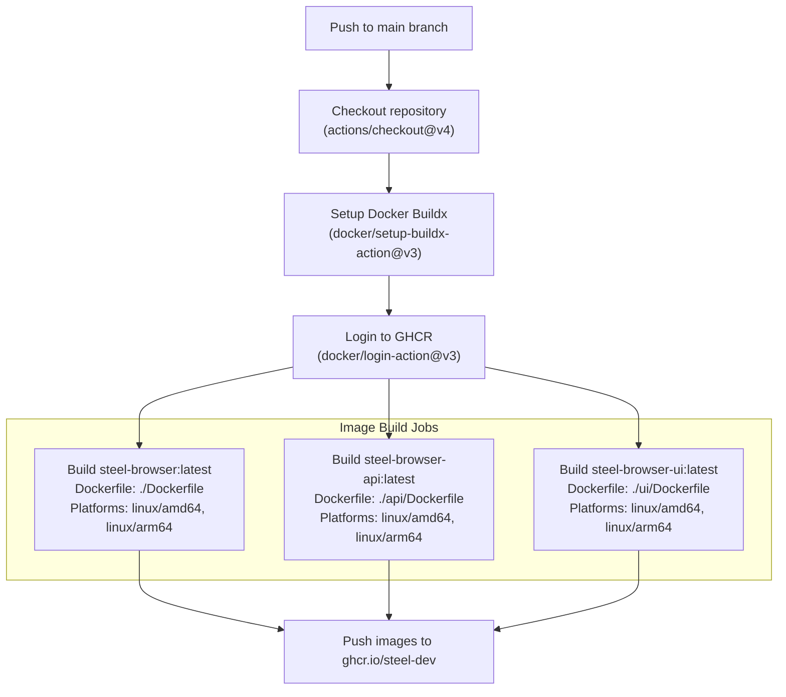
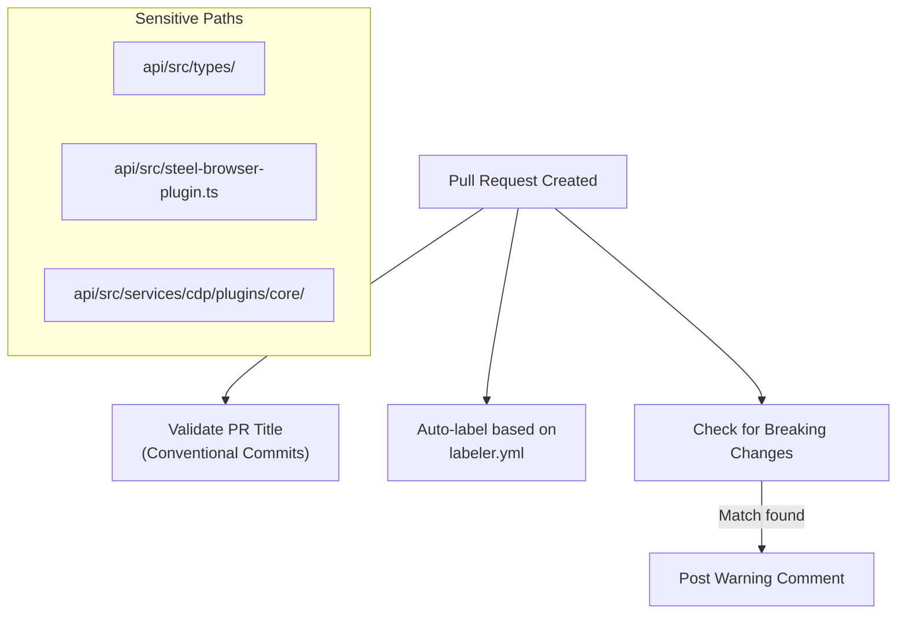

<!-- source: DeepWiki mcp.deepwiki.com · repo steel-dev/steel-browser · page 13.4 CI/CD Pipeline · fetched 2026-10-26 -->

# CI/CD Pipeline

<details>
<summary>Relevant source files</summary>

The following files were used as context for generating this wiki page:

- [.github/labeler.yml](.github/labeler.yml)
- [.github/workflows/build-docker.yml](.github/workflows/build-docker.yml)
- [.github/workflows/pr-checks.yml](.github/workflows/pr-checks.yml)
- [.github/workflows/release.yml](.github/workflows/release.yml)
- [api/nginx.conf](api/nginx.conf)
- [ui/src/env.ts](ui/src/env.ts)

</details>


## Purpose and Scope

This document describes the Continuous Integration and Continuous Deployment (CI/CD) pipeline for the steel-browser system. The pipeline automates building and publishing multi-platform Docker images to GitHub Container Registry (GHCR), manages semantic versioning, and performs quality checks on pull requests.

For details on container architecture and multi-stage builds, see [Container Architecture](#13.1). For deployment instructions using published images, see [Docker Deployment](#2.3).

---

## Overview

The steel-browser CI/CD pipeline is implemented using GitHub Actions and consists of three primary workflows:
1. **Docker Build**: Automates multi-platform image builds.
2. **Quality Checks**: Validates PR titles and monitors for breaking changes.
3. **Automatic Release**: Handles semantic versioning, tagging, and changelog generation.

**Sources:** [.github/workflows/build-docker.yml:1-38](), [.github/workflows/pr-checks.yml:1-44](), [.github/workflows/release.yml:1-113]()

---

## Workflow Architecture

### Build and Push Workflow

The primary workflow `build-docker.yml` executes on every push to the `main` branch and performs the following operations:



**Workflow Structure:**

| Step | Action | Purpose |
|------|--------|---------|
| Checkout | `actions/checkout@v4` | Clones the repository to the runner [.github/workflows/build-docker.yml:13-14]() |
| Setup Buildx | `docker/setup-buildx-action@v3` | Configures Docker Buildx for multi-platform builds [.github/workflows/build-docker.yml:16-18]() |
| Login | `docker/login-action@v3` | Authenticates to GitHub Container Registry [.github/workflows/build-docker.yml:20-25]() |
| Build & Push | `docker buildx build` | Builds and pushes images for multiple platforms [.github/workflows/build-docker.yml:27-37]() |

---

## Pull Request Quality Checks

The `pr-checks.yml` workflow ensures that contributions maintain project standards.

### Validation Logic

The workflow monitors specific file paths to warn reviewers about potential breaking changes in core services:



- **Semantic PRs**: Enforces conventional commit messages for automated versioning [.github/workflows/pr-checks.yml:17-20]().
- **Path-Based Labeling**: Uses `.github/labeler.yml` to categorize PRs (e.g., `api`, `ui`, `cdp`, `plugin-system`) [.github/labeler.yml:1-72]().
- **Breaking Change Detection**: Triggers warnings if files in `api/src/types/` or core plugin directories are modified [.github/workflows/pr-checks.yml:35-38]().

**Sources:** [.github/workflows/pr-checks.yml:13-44](), [.github/labeler.yml:1-72]()

---

## Release and Versioning

The `release.yml` workflow automates the software lifecycle using semantic versioning.

### Automatic Version Bumping

The pipeline calculates the next version based on commit message keywords:
- **Major**: `breaking`, `breaking-change`, `major` [.github/workflows/release.yml:29]()
- **Patch**: `patch`, `fix`, `docs`, `feat`, `minor` [.github/workflows/release.yml:27]()
- **Suffix**: All automated releases currently use a `-beta` suffix [.github/workflows/release.yml:25]()

### Changelog Generation

A changelog is automatically generated by categorizing commits into:
- **Improvements**: Commits labeled `feat` or `feature` [.github/workflows/release.yml:56-61]()
- **Bug Fixes**: Commits labeled `fix` or `bug` [.github/workflows/release.yml:63-68]()
- **Documentation**: Commits labeled `docs` [.github/workflows/release.yml:70-74]()

**Sources:** [.github/workflows/release.yml:20-91]()

---

## Docker Image Build Pipeline

The workflow builds three distinct Docker images:

### Image Types

**1. steel-browser:latest (Combined Image)**
- Built from root `Dockerfile` [.github/workflows/build-docker.yml:29]()
- Contains both API server and UI static files.

**2. steel-browser-api:latest (API Image)**
- Built from `api/Dockerfile` [.github/workflows/build-docker.yml:33]()
- Contains Fastify API, Chromium browser, and Nginx.
- Nginx configuration in `api/nginx.conf` handles CDP proxying on port 9223 [.api/nginx.conf:10-27]().

**3. steel-browser-ui:latest (UI Image)**
- Built from `ui/Dockerfile` [.github/workflows/build-docker.yml:37]()
- Contains static React UI build artifacts.
- Uses `VITE_API_URL` (default `/api`) and `VITE_WS_URL` (default `/ws`) for backend communication [ui/src/env.ts:3-7]().

---

## Multi-Platform Build Configuration

### Platform Support

The pipeline uses Docker Buildx to create multi-architecture images supporting:
- **linux/amd64**: Standard x86_64 architecture.
- **linux/arm64**: ARM64 architecture (Apple Silicon, AWS Graviton).

### Build Command Structure

```bash
docker buildx build --platform linux/amd64,linux/arm64 --push -t ghcr.io/steel-dev/steel-browser:latest .
```

**Sources:** [.github/workflows/build-docker.yml:28-37]()

---

## Container Registry Publishing

### GitHub Container Registry (GHCR)

All images are published to `ghcr.io/steel-dev` using the following authentication:
- **Registry**: `ghcr.io` [.github/workflows/build-docker.yml:23]()
- **Username**: `${{ secrets.GH_USERNAME }}` [.github/workflows/build-docker.yml:24]()
- **Password**: `${{ secrets.GH_TOKEN }}` [.github/workflows/build-docker.yml:25]()

---

## Related Pages

- [Container Architecture](#13.1) - Detailed container structure and multi-stage builds
- [Docker Deployment](#2.3) - Instructions for deploying published images
- [Network Configuration](#13.3) - Port and proxy configuration for deployments
- [Environment Configuration](#2.2) - Comprehensive guide to environment variables referenced in CI/CD

---

