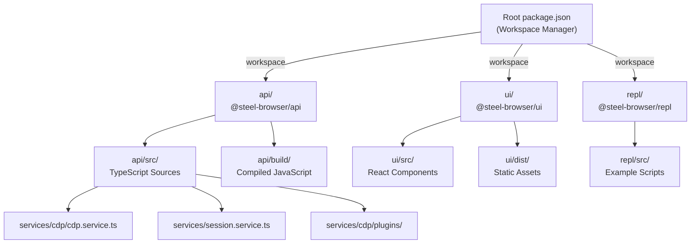
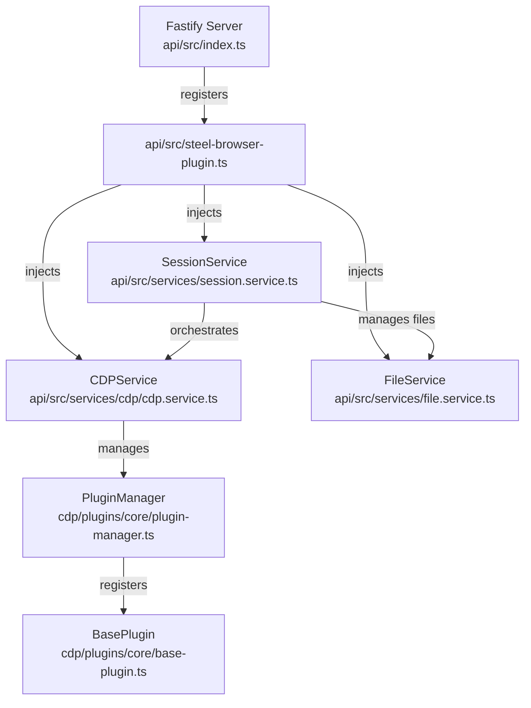
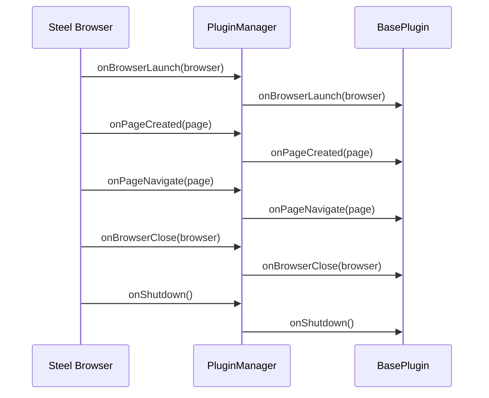

<!-- source: DeepWiki mcp.deepwiki.com · repo steel-dev/steel-browser · page 14 Development Guide · fetched 2026-10-26 -->

# Development Guide

<details>
<summary>Relevant source files</summary>

The following files were used as context for generating this wiki page:

- [CONTRIBUTING.md](CONTRIBUTING.md)
- [docs/ARCHITECTURE.md](docs/ARCHITECTURE.md)
- [docs/DEVELOPMENT_SETUP.md](docs/DEVELOPMENT_SETUP.md)
- [docs/README.md](docs/README.md)
- [docs/TROUBLESHOOTING.md](docs/TROUBLESHOOTING.md)

</details>


This guide provides an overview of the steel-browser codebase structure, development patterns, and extension mechanisms for developers who want to contribute to or extend the system. It covers the monorepo organization, core architectural patterns, plugin development, and testing strategies.

For detailed environment setup instructions, see [Development Environment Setup](#14.1). For in-depth architectural explanations, see [Architecture Deep Dive](#14.2). For plugin development, see [Creating Custom Plugins](#14.4).

## Monorepo Structure

The steel-browser codebase is organized as an npm workspace monorepo with three primary workspaces:

| Workspace | Directory | Purpose | Technology Stack |
|-----------|-----------|---------|------------------|
| **api** | `/api` | Backend server and browser automation engine | Fastify, TypeScript, Puppeteer |
| **ui** | `/ui` | Web-based session management dashboard | React, Vite, TanStack Query |
| **repl** | `/repl` | Interactive scripting environment | Node.js, Puppeteer |

**Workspace Structure**



**Sources:** [CONTRIBUTING.md:53-71](), [docs/DEVELOPMENT_SETUP.md:121-152]()

## Core Service Architecture

The API workspace contains the core browser automation engine, organized into distinct service layers.

**Service Layer Class Hierarchy**



**Sources:** [docs/ARCHITECTURE.md:26-115](), [CONTRIBUTING.md:73-101]()

### Key Service Classes

**CDPService** (`api/src/services/cdp/cdp.service.ts`)
- Primary browser automation service using Chrome DevTools Protocol. [docs/ARCHITECTURE.md:28-38]()
- Manages browser lifecycle, context isolation, and fingerprinting. [docs/ARCHITECTURE.md:33-38]()
- Implements plugin architecture via `PluginManager`. [docs/ARCHITECTURE.md:77-85]()
- Key methods: `launch()`, `shutdown()`, `createPage()`, `getPages()`. [docs/ARCHITECTURE.md:41-56]()

**SessionService** (`api/src/services/session.service.ts`)
- Orchestrates browser sessions with isolated contexts (cookies, storage). [docs/ARCHITECTURE.md:86-96]()
- Handles session persistence, cleanup, and concurrent management. [docs/ARCHITECTURE.md:91-95]()
- Interfaces with `CDPService` for browser execution. [CONTRIBUTING.md:94-97]()

**FileService** (`api/src/services/file.service.ts`)
- Handles session-scoped file operations (uploads, downloads). [docs/ARCHITECTURE.md:107-114]()
- Manages storage isolation and automatic cleanup on session end. [docs/ARCHITECTURE.md:113-114]()

**Sources:** [docs/ARCHITECTURE.md:28-115](), [CONTRIBUTING.md:84-101]()

## Development Workflow

The repository uses npm workspaces for dependency management and provides unified build and development commands.

**Development Commands**

```bash
# Start all workspaces in development mode with hot-reloading
npm run dev

# Build all workspaces
npm run build

# Development mode for API only
npm run dev -w api

# Development mode for UI only
npm run dev -w ui
```

**Sources:** [docs/DEVELOPMENT_SETUP.md:142-163](), [CONTRIBUTING.md:28-36]()

### API Development Workflow

The API uses Fastify's plugin system for modular design. [docs/ARCHITECTURE.md:174-188]() All API endpoints use Zod schemas for validation. [docs/ARCHITECTURE.md:202-212]()

**Route Organization**
- **Actions** (`/v1/*`): Scrape, screenshot, PDF. [docs/ARCHITECTURE.md:194]()
- **Sessions** (`/v1/sessions/*`): Session management. [docs/ARCHITECTURE.md:195]()
- **CDP** (`/v1/cdp/*`): Direct protocol access. [docs/ARCHITECTURE.md:196]()
- **Files** (`/v1/files/*`): Upload/download. [docs/ARCHITECTURE.md:197]()

**Sources:** [docs/ARCHITECTURE.md:172-212]()

## Plugin System Architecture

The plugin system enables extending browser automation behavior through lifecycle hooks without modifying core code. [docs/ARCHITECTURE.md:58-60]()

**Plugin Lifecycle Flow**



**Sources:** [docs/ARCHITECTURE.md:118-141](), [CONTRIBUTING.md:181-193]()

### Plugin Lifecycle Hooks

Plugins extend `BasePlugin` and can implement methods such as:
- `onBrowserLaunch(browser)`: Called when browser process starts. [CONTRIBUTING.md:185]()
- `onPageCreated(page)`: Called for each new page/tab. [CONTRIBUTING.md:186]()
- `onPageNavigate(page)`: Called on page navigation. [CONTRIBUTING.md:187]()
- `onBrowserClose(browser)`: Called when browser closes. [CONTRIBUTING.md:190]()
- `onShutdown()`: Final cleanup hook. [CONTRIBUTING.md:191]()

**Sources:** [docs/ARCHITECTURE.md:65-74](), [CONTRIBUTING.md:181-193]()

## Configuration and Environment

Configuration is managed through environment variables. For local development, these are typically placed in a `.env` file. [docs/DEVELOPMENT_SETUP.md:211-215]()

| Variable | Description | Default |
|----------|-------------|---------|
| `PORT` | API server port | `3000` |
| `CHROME_HEADLESS` | Run browser in headless mode | `false` (dev) |
| `CHROME_EXECUTABLE_PATH` | Path to Chrome/Chromium binary | System dependent |
| `ENABLE_CDP_LOGGING` | Enable detailed CDP protocol logs | `true` (dev) |

**Sources:** [docs/DEVELOPMENT_SETUP.md:211-234](), [docs/TROUBLESHOOTING.md:50-58]()

## Debugging Techniques

### Enable Debug Logging
You can enable various levels of logging to troubleshoot issues:
```bash
export ENABLE_VERBOSE_LOGGING=true
export ENABLE_CDP_LOGGING=true
export LOG_CUSTOM_EMIT_EVENTS=true
```
**Sources:** [docs/TROUBLESHOOTING.md:203-214]()

### Browser Debugging
To see what the browser is doing during automation, disable headless mode:
```bash
export CHROME_HEADLESS=false
```
You can also connect to the browser's DevTools directly at `http://localhost:9223`. [docs/TROUBLESHOOTING.md:231-240]()

### Node.js Inspector
Start the API with the inspector enabled for debugging with VS Code or Chrome DevTools:
```bash
node --inspect ./api/build/index.js
```
**Sources:** [docs/TROUBLESHOOTING.md:216-227]()

## Troubleshooting Common Issues

### Browser Launch Failures
Often caused by missing dependencies or incorrect paths. [docs/TROUBLESHOOTING.md:41-48]()
- **Solution**: Verify `CHROME_EXECUTABLE_PATH` is set correctly. [docs/TROUBLESHOOTING.md:50-58]()
- **Solution (Linux)**: Ensure required system libraries (like `libnss3`) are installed. [docs/TROUBLESHOOTING.md:60-77]()

### Port Conflicts
If port `3000` (API) or `5173` (UI) is already in use. [docs/TROUBLESHOOTING.md:89-95]()
- **Solution**: Use `lsof -i :3000` to find the process and kill it, or change the `PORT` env variable. [docs/TROUBLESHOOTING.md:97-110]()

**Sources:** [docs/TROUBLESHOOTING.md:41-110]()

---

