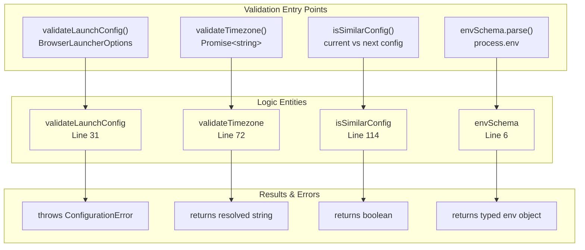
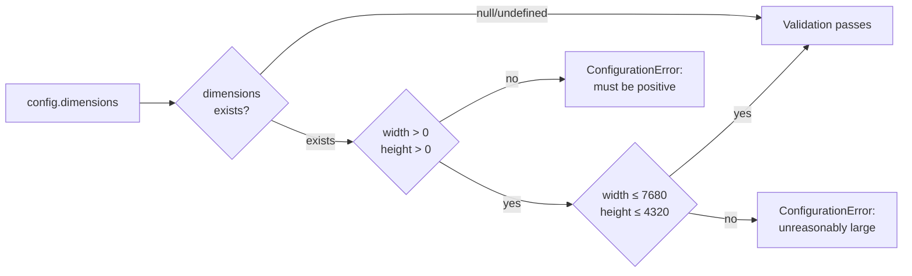

<!-- source: DeepWiki mcp.deepwiki.com · repo steel-dev/steel-browser · page 14.3 Configuration Validation · fetched 2026-10-26 -->

# Configuration Validation

<details>
<summary>Relevant source files</summary>

The following files were used as context for generating this wiki page:

- [api/.env.example](api/.env.example)
- [api/.prettierrc](api/.prettierrc)
- [api/src/env.ts](api/src/env.ts)
- [api/src/plugins/schemas.ts](api/src/plugins/schemas.ts)
- [api/src/routes.ts](api/src/routes.ts)
- [api/src/services/cdp/errors/launch-errors.ts](api/src/services/cdp/errors/launch-errors.ts)
- [api/src/services/cdp/utils/error-handlers.ts](api/src/services/cdp/utils/error-handlers.ts)
- [api/src/services/cdp/utils/validation.ts](api/src/services/cdp/utils/validation.ts)
- [repl/package.json](repl/package.json)
- [ui/package.json](ui/package.json)

</details>


This document covers the configuration validation system used to ensure browser launch parameters are valid and to determine when browser instances can be reused. Configuration validation occurs before browser launch and during session management to prevent runtime errors and optimize resource usage.

For information about the configuration interface being validated, see [api/src/types/index.js](). For environment variable validation, see [api/src/env.ts]().

## Purpose and Scope

Configuration validation serves three primary functions:

1.  **Pre-launch Validation** - Validates browser launch parameters before attempting to start a browser instance.
2.  **Timezone Resolution** - Asynchronously validates and resolves timezone configurations with timeout handling.
3.  **Configuration Comparison** - Determines if two configurations are similar enough to reuse an existing browser instance.

All validation logic is centralized in `api/src/services/cdp/utils/validation.ts`.

Sources: [api/src/services/cdp/utils/validation.ts:1-190](), [api/src/env.ts:1-84]()

## Validation Functions Overview

The system uses `zod` for environment-level validation and custom logic for runtime browser configurations.



Sources: [api/src/services/cdp/utils/validation.ts:31-190](), [api/src/env.ts:6-86]()

## validateLaunchConfig

The `validateLaunchConfig` function performs pre-launch validation of browser configuration parameters. This validation catches common configuration errors before attempting to launch a browser.

### Validation Rules

| Configuration Field | Validation Rule | Error Type |
| :--- | :--- | :--- |
| `dimensions.width` | Must be > 0 and ≤ 7680 | `ConfigurationError` (`DIMENSIONS`) |
| `dimensions.height` | Must be > 0 and ≤ 4320 | `ConfigurationError` (`DIMENSIONS`) |
| `options.proxyUrl` | Must be valid URL format | `ConfigurationError` (`PROXY_URL`) |

### Dimensions Validation

The function enforces a minimum dimension of 1 pixel and a maximum of 8K resolution (7680x4320) to prevent resource exhaustion or browser crashes.



Sources: [api/src/services/cdp/utils/validation.ts:31-48]()

### Proxy URL Validation

Proxy URL validation uses the built-in `URL` constructor to verify format validity:

```typescript
if (config.options.proxyUrl) {
  try {
    new URL(config.options.proxyUrl);
  } catch {
    throw new ConfigurationError(
      `Invalid proxy URL format: ${config.options.proxyUrl}`,
      ConfigurationField.PROXY_URL,
      config.options.proxyUrl,
    );
  }
}
```

Sources: [api/src/services/cdp/utils/validation.ts:50-61]()

## validateTimezone

The `validateTimezone` function handles asynchronous timezone validation with timeout protection. Timezone resolution may involve external API calls, so this function implements a race mechanism to prevent hanging.

### Validation Flow

The function implements a race between the `timezonePromise` and a timeout (default 10000ms).

| Parameter | Default | Purpose |
| :--- | :--- | :--- |
| `timezonePromise` | (required) | Async timezone resolution |
| `timeoutMs` | 10000 | Maximum wait time |

After resolution, it validates the string using `Intl.DateTimeFormat`:

```typescript
try {
  Intl.DateTimeFormat(undefined, { timeZone: timezone });
  return timezone;
} catch (timezoneError) {
  throw new ConfigurationError(
    `Invalid timezone resolved: ${timezone}`,
    ConfigurationField.TIMEZONE,
    timezone,
  );
}
```

Sources: [api/src/services/cdp/utils/validation.ts:72-105]()

## isSimilarConfig

The `isSimilarConfig` function determines whether two browser launch configurations are similar enough to reuse an existing browser instance. This avoids the overhead of launching a new browser when differences are negligible.

### Configuration Normalization

Before comparison, the function normalizes values to handle defaults and array sorting:

*   **`normalizeArgs`**: Filters out falsy values and sorts alphabetically [api/src/services/cdp/utils/validation.ts:129-129]().
*   **`normalizeExt`**: Sorts extensions alphabetically [api/src/services/cdp/utils/validation.ts:130-130]().
*   **`extra` Handling**: Destructures to remove `session` and `streaming` properties which do not affect browser-level reuse [api/src/services/cdp/utils/validation.ts:162-171]().

### Comparison Logic

The function performs a deep equality check using `JSON.stringify` for objects and arrays, and strict equality for primitives. It also performs an asynchronous comparison for timezones using `comparePromiseValues` [api/src/services/cdp/utils/validation.ts:12-26]().

```typescript
return (
  currentHeadless === nextHeadless &&
  currentProxy === nextProxy &&
  currentUserAgent === nextUserAgent &&
  // ... other primitive checks
  JSON.stringify(currentArgs) === JSON.stringify(nextArgs) &&
  JSON.stringify(currentExtra) === JSON.stringify(nextExtra) &&
  (await timezoneComparisonPromise)
);
```

Sources: [api/src/services/cdp/utils/validation.ts:114-189]()

## Error Handling and Execution Utilities

The system provides utility functions in `api/src/services/cdp/utils/error-handlers.ts` to categorize operations by criticality.

| Function | Behavior | Use Case |
| :--- | :--- | :--- |
| `executeCritical` | Throws a categorized error on failure | Essential steps like browser launch |
| `executeOptional` | Logs warning but continues on failure | Non-essential cleanup or optimization |
| `executeBestEffort` | Silently logs on failure | Optional features or logging |

### Launch Error Types

Errors are categorized using `LaunchErrorType` to allow for intelligent recovery strategies:
*   `TIMEOUT`: Browser failed to start within limits.
*   `CONFIGURATION`: Invalid parameters provided.
*   `RESOURCE`: Missing binary or disk space.
*   `NETWORK`: Proxy or WebSocket binding failures.

Sources: [api/src/services/cdp/utils/error-handlers.ts:18-87](), [api/src/services/cdp/errors/launch-errors.ts:6-17]()

## Environment Validation

Environment variables are validated at startup using `zod`. This ensures the application does not start with invalid system paths or malformed configuration strings.

### Key Environment Schemas

| Variable | Type | Default | Transformation |
| :--- | :--- | :--- | :--- |
| `USE_SSL` | Boolean | `false` | Transforms `"true"`/`"1"` to `true` |
| `DEFAULT_HEADERS` | Object | `{}` | Parses JSON string to record |
| `CHROME_ARGS` | Array | `[]` | Splits space-separated string |
| `PORT` | String | `"3000"` | Default string port |

Sources: [api/src/env.ts:6-86]()

---

