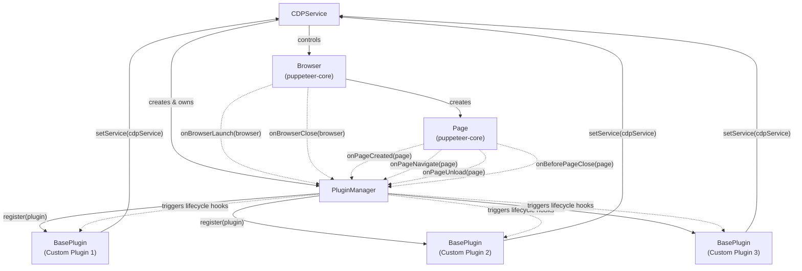
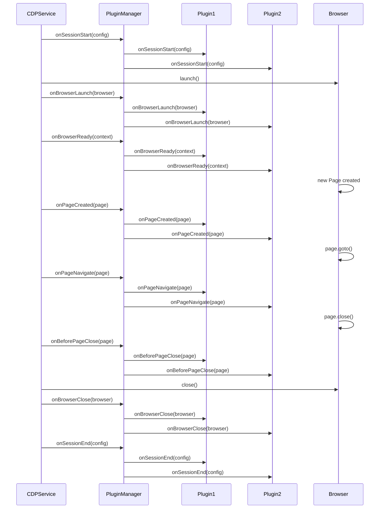
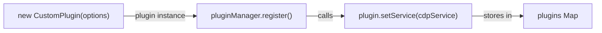
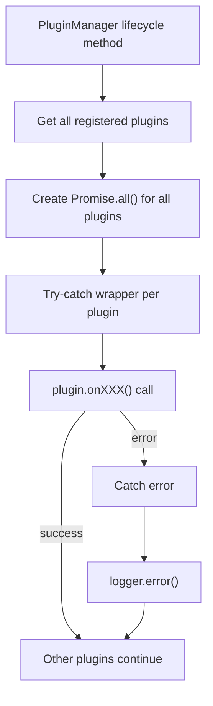

<!-- source: DeepWiki mcp.deepwiki.com · repo steel-dev/steel-browser · page 14.4 Creating Custom Plugins · fetched 2026-10-26 -->

# Creating Custom Plugins

<details>
<summary>Relevant source files</summary>

The following files were used as context for generating this wiki page:

- [api/src/plugins/browser-socket/handlers/cast.handler.ts](api/src/plugins/browser-socket/handlers/cast.handler.ts)
- [api/src/plugins/browser-socket/handlers/index.ts](api/src/plugins/browser-socket/handlers/index.ts)
- [api/src/services/cdp/cdp.service.ts](api/src/services/cdp/cdp.service.ts)
- [api/src/services/cdp/plugins/core/base-plugin.ts](api/src/services/cdp/plugins/core/base-plugin.ts)
- [api/src/services/cdp/plugins/core/plugin-manager.ts](api/src/services/cdp/plugins/core/plugin-manager.ts)
- [api/src/services/websocket-registry.service.ts](api/src/services/websocket-registry.service.ts)
- [api/src/steel-browser-plugin.ts](api/src/steel-browser-plugin.ts)
- [api/src/types/index.ts](api/src/types/index.ts)
- [api/src/types/websocket.ts](api/src/types/websocket.ts)
- [docs/PLUGIN_DEVELOPMENT.md](docs/PLUGIN_DEVELOPMENT.md)
- [ui/vite.config.ts](ui/vite.config.ts)

</details>


This document provides a step-by-step guide for developers who want to extend steel-browser's browser automation capabilities by creating custom plugins. Plugins allow you to hook into the browser lifecycle and execute custom logic at key points during browser sessions.

For architectural background on the plugin system, see [BasePlugin & PluginManager](#9.1). For information about built-in plugins already available, see [Built-in Plugins](#9.2).

## Overview

The plugin system in steel-browser is built around an event-driven architecture that allows you to extend browser automation functionality without modifying core services. Plugins extend the `BasePlugin` abstract class and implement lifecycle hooks that are called at specific points during browser and page lifecycles.

**Sources:** [api/src/services/cdp/plugins/core/base-plugin.ts:1-55](), [api/src/services/cdp/plugins/core/plugin-manager.ts:1-217]()

## Plugin Architecture

The following diagram shows how plugins integrate with the core `CDPService` and `PluginManager`:



**Sources:** [api/src/services/cdp/plugins/core/plugin-manager.ts:7-16](), [api/src/services/cdp/plugins/core/base-plugin.ts:27-40]()

## BasePlugin Class

All custom plugins must extend the `BasePlugin` abstract class. The class provides:

| Member | Type | Description |
|--------|------|-------------|
| `name` | `string` | Unique identifier for the plugin |
| `options` | `PluginOptions` | Configuration options passed to constructor |
| `cdpService` | `CDPService \| null` | Reference to `CDPService` (set by `PluginManager`) |

**Constructor Signature:**
```typescript
constructor(options: PluginOptions)
```

The `PluginOptions` interface requires a `name` property and accepts arbitrary additional properties:

```typescript
export interface PluginOptions {
  name: string;
  [key: string]: any;
}
```

**Sources:** [api/src/services/cdp/plugins/core/base-plugin.ts:22-36]()

## Lifecycle Hooks

The `BasePlugin` class defines lifecycle hooks that your plugin can override. All hooks are optional and have default no-op implementations. The following table describes when each hook is called:

| Hook Method | Parameters | When Called | Use Cases |
|-------------|-----------|-------------|-----------|
| `onSessionStart` | `sessionConfig: BrowserLauncherOptions` | Before browser launch/reuse | Pre-launch configuration changes |
| `onBrowserLaunch` | `browser: Browser` | After browser process starts | Initialize browser-level resources |
| `onBrowserReady` | `context: BrowserLauncherOptions` | After browser is fully initialized | Access final configuration |
| `onPageCreated` | `page: Page` | When any page/tab is created | Inject scripts, set up page-level event listeners |
| `onPageNavigate` | `page: Page` | Before page navigates to new URL | Pre-navigation setup |
| `onPageUnload` | `page: Page` | Before page unloads | Capture state before navigation away |
| `onBeforePageClose` | `page: Page` | Before page closes | Save page data, cleanup resources |
| `onBrowserClose` | `browser: Browser` | Before browser process closes | Cleanup browser-level resources |
| `onBeforeSessionEnd` | `sessionConfig: BrowserLauncherOptions` | Before shutdown begins | Final data capture |
| `onSessionEnd` | `sessionConfig: BrowserLauncherOptions` | After all teardown is complete | Save session summary, finalize logs |
| `onShutdown` | `reason: ShutdownReason` | During service shutdown | Global cleanup based on `ShutdownReason` |

**Hook Execution Flow:**



All hooks return `Promise<void>` or `void`, and the `PluginManager` executes all plugins' hooks in parallel using `Promise.all()`.

**Sources:** [api/src/services/cdp/plugins/core/base-plugin.ts:43-54](), [api/src/services/cdp/plugins/core/plugin-manager.ts:54-216]()

## Creating a Custom Plugin: Step-by-Step

### Step 1: Create Plugin Class

Create a new TypeScript file for your plugin and extend `BasePlugin`:

```typescript
// Example: custom-analytics-plugin.ts
import { BasePlugin, PluginOptions } from "./base-plugin.js";
import { Browser, Page } from "puppeteer-core";

interface AnalyticsPluginOptions extends PluginOptions {
  trackingId: string;
  endpoint: string;
}

export class AnalyticsPlugin extends BasePlugin {
  private trackingId: string;
  private endpoint: string;
  private pageViews: number = 0;

  constructor(options: AnalyticsPluginOptions) {
    super(options);
    this.trackingId = options.trackingId;
    this.endpoint = options.endpoint;
  }
}
```

**Key Points:**
- Extend `BasePlugin` from [api/src/services/cdp/plugins/core/base-plugin.ts:27]()
- Create custom options interface extending `PluginOptions`
- Call `super(options)` in constructor to initialize base properties

### Step 2: Implement Lifecycle Hooks

Override the lifecycle hooks you need. Each hook can be `async` if it performs asynchronous operations:

```typescript
export class AnalyticsPlugin extends BasePlugin {
  // ... constructor and properties ...

  public async onBrowserLaunch(browser: Browser): Promise<void> {
    console.log(`[${this.name}] Browser launched with tracking ID: ${this.trackingId}`);
  }

  public async onPageCreated(page: Page): Promise<void> {
    // Inject analytics script into page
    await page.evaluateOnNewDocument((trackingId) => {
      (window as any).__analytics = { trackingId };
    }, this.trackingId);
  }

  public async onPageNavigate(page: Page): Promise<void> {
    this.pageViews++;
    await this.sendEvent('pageview', { url: page.url() });
  }

  public async onSessionEnd(): Promise<void> {
    await this.sendEvent('session_end', { totalPageViews: this.pageViews });
  }

  private async sendEvent(eventType: string, data: any): Promise<void> {
    // Implementation for sending event
  }
}
```

**Sources:** [api/src/services/cdp/plugins/core/base-plugin.ts:43-54]()

### Step 3: Access CDPService

If your plugin needs access to the `CDPService`, use the `cdpService` property (set by `PluginManager`):

```typescript
export class AdvancedPlugin extends BasePlugin {
  public async onPageCreated(page: Page): Promise<void> {
    if (this.cdpService) {
      const browser = this.cdpService.getBrowserInstance();
      // Access CDPService methods...
    }
  }
}
```

**Sources:** [api/src/services/cdp/plugins/core/base-plugin.ts:30-40](), [api/src/services/cdp/cdp.service.ts:205]()

## Registering Your Plugin

### Registration with PluginManager

Plugins are registered with the `PluginManager` instance owned by `CDPService`.



The `PluginManager.register()` method:
1. Checks if plugin name already exists (logs warning if duplicate).
2. Calls `plugin.setService(this.service)` to inject `CDPService` reference.
3. Stores plugin in internal `Map<string, BasePlugin>`.

**Sources:** [api/src/services/cdp/plugins/core/plugin-manager.ts:21-29]()

### Example Registration

```typescript
// Inside CDPService or during app setup
const analyticsPlugin = new AnalyticsPlugin({
  name: 'analytics',
  trackingId: 'UA-12345',
  endpoint: 'https://api.analytics.com'
});

cdpService.pluginManager.register(analyticsPlugin);
```

## Error Handling

The `PluginManager` wraps all plugin lifecycle hook calls in try-catch blocks to prevent plugin errors from crashing the browser automation:



Example implementation from `PluginManager`:
[api/src/services/cdp/plugins/core/plugin-manager.ts:123-132]()
```typescript
  public async onPageCreated(page: Page): Promise<void> {
    const promises = Array.from(this.plugins.values()).map(async (plugin) => {
      try {
        await plugin.onPageCreated(page);
      } catch (error) {
        this.logger.error(`Error in plugin ${plugin.name}.onPageCreated: ${error}`);
      }
    });
    await Promise.all(promises);
  }
```

**Sources:** [api/src/services/cdp/plugins/core/plugin-manager.ts:54-216]()

## Unregistering and Retrieval

Plugins can be managed dynamically:

- **Unregister**: `pluginManager.unregister('pluginName')` removes the plugin. [api/src/services/cdp/plugins/core/plugin-manager.ts:34-42]()
- **Retrieval**: `pluginManager.getPlugin<T>('pluginName')` retrieves a registered instance. [api/src/services/cdp/plugins/core/plugin-manager.ts:47-49]()

## Shutdown Reasons

When `onShutdown` is called, it receives a `ShutdownReason` enum value to help the plugin decide what cleanup to perform:

| Reason | Description |
|--------|-------------|
| `SESSION_END` | Normal graceful session termination |
| `SECURITY_VIOLATION` | Violation detected (e.g. `file://` access) |
| `RELAUNCH` | Closing instance before a new launch |
| `LAUNCH_FAILURE` | Cleanup after a failed launch attempt |
| `MODE_SWITCH` | Switching between CDP and Selenium |

**Sources:** [api/src/services/cdp/plugins/core/base-plugin.ts:9-20]()

---

