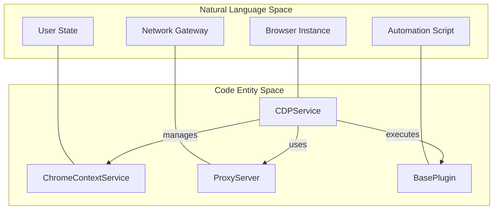
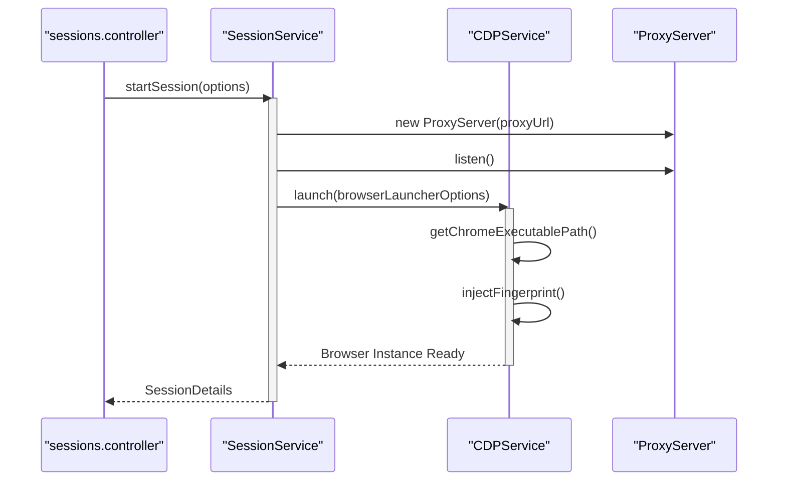

<!-- source: DeepWiki mcp.deepwiki.com · repo steel-dev/steel-browser · page 16 Glossary · fetched 2026-10-26 -->

# Glossary

Relevant source files

The following files were used as context for generating this wiki page:

- [Dockerfile](Dockerfile)
- [README.md](README.md)
- [api/.env.example](api/.env.example)
- [api/package.json](api/package.json)
- [api/src/env.ts](api/src/env.ts)
- [api/src/modules/actions/actions.controller.ts](api/src/modules/actions/actions.controller.ts)
- [api/src/modules/actions/actions.routes.ts](api/src/modules/actions/actions.routes.ts)
- [api/src/modules/actions/actions.schema.ts](api/src/modules/actions/actions.schema.ts)
- [api/src/plugins/schemas.ts](api/src/plugins/schemas.ts)
- [api/src/routes.ts](api/src/routes.ts)
- [api/src/services/cdp/cdp.service.ts](api/src/services/cdp/cdp.service.ts)
- [api/src/services/cdp/plugins/core/base-plugin.ts](api/src/services/cdp/plugins/core/base-plugin.ts)
- [api/src/services/cdp/plugins/core/plugin-manager.ts](api/src/services/cdp/plugins/core/plugin-manager.ts)
- [api/src/services/selenium.service.ts](api/src/services/selenium.service.ts)
- [api/src/services/session.service.ts](api/src/services/session.service.ts)
- [api/src/utils/passthough-proxy.ts](api/src/utils/passthough-proxy.ts)
- [api/src/utils/proxy.ts](api/src/utils/proxy.ts)
- [images/star_img.png](images/star_img.png)
- [package-lock.json](package-lock.json)
- [render.yaml](render.yaml)

This glossary defines codebase-specific terms, abbreviations, and domain concepts used within the Steel Browser project. It serves as a technical reference for engineers to map natural language concepts to their respective implementations.

## Core Domain Concepts

### CDP (Chrome DevTools Protocol)
The primary protocol used by Steel to communicate with and control Chromium-based browsers. Unlike higher-level automation frameworks, Steel interacts directly with CDP to provide granular control over network interception, console logs, and target management.
*   **Implementation**: Managed via `CDPService`.
*   **Key Class**: `CDPService` [api/src/services/cdp/cdp.service.ts:83-83]()
*   **Data Flow**: The service maintains a `browserInstance` [api/src/services/cdp/cdp.service.ts:87-87]() and handles lifecycle events like `onBrowserLaunch` and `onPageCreated`.

### Session
A logical grouping of a browser instance (or context), its associated state (cookies, storage), and infrastructure (proxies). Sessions in Steel are designed to be long-lived or ephemeral depending on the `keepAlive` configuration.
*   **Implementation**: Tracked by `SessionService`.
*   **Key Type**: `SessionDetails` [api/src/modules/sessions/sessions.schema.js:9-9]()
*   **Management**: `SessionService` maintains an `activeSession` and a history of `pastSessions` [api/src/services/session.service.ts:66-67]().

### Fingerprinting
The process of generating and injecting browser attributes (User Agent, WebGL vendor, screen dimensions, etc.) to make the automated browser appear as a legitimate user device.
*   **Tools**: Uses `fingerprint-generator` and `fingerprint-injector` [api/src/services/cdp/cdp.service.ts:4-9]().
*   **Injection**: Handled during the browser launch sequence in `CDPService`.

### Proxy Chain
The mechanism where Steel acts as a local proxy server (`ProxyServer`) that forwards traffic to an upstream provider. This allows Steel to intercept requests for ad-blocking and bandwidth optimization before they leave the local environment.
*   **Implementation**: `ProxyServer` [api/src/utils/proxy.ts:15-15]().
*   **Bypass**: Internal traffic (e.g., to the API itself) is bypassed via `PROXY_INTERNAL_BYPASS` [api/src/utils/proxy.ts:31-37]().

---

## System Architecture Mapping

The following diagram illustrates how natural language concepts map to specific classes and services within the codebase.

**Concept to Code Entity Mapping**

**Sources**: [api/src/services/cdp/cdp.service.ts:83-104](), [api/src/services/session.service.ts:58-80](), [api/src/utils/proxy.ts:15-22]()

---

## Technical Terminology

| Term | Definition | Code Pointer |
| :--- | :--- | :--- |
| **CDP Redirect Port** | The port used to expose the browser's remote debugging interface. | `CDP_REDIRECT_PORT` [api/src/env.ts:18-18]() |
| **Primary Page** | The main tab of a browser session, often reused for quick actions like scraping. | `this.primaryPage` [api/src/services/cdp/cdp.service.ts:93-93]() |
| **Plugin Manager** | Orchestrates the lifecycle hooks (onPageCreated, onShutdown) for all registered plugins. | `PluginManager` [api/src/services/cdp/plugins/core/plugin-manager.ts:7-7]() |
| **Stealth** | Features intended to bypass bot detection, including fingerprint injection and header manipulation. | `Anti-Detection Features` [README.md:55-55]() |
| **Scrape Format** | The output format requested for a web page (HTML, Markdown, or Readability). | `ScrapeFormat` [api/src/modules/actions/actions.controller.ts:5-5]() |
| **Target Instrumentation** | The system for capturing and logging browser-level events (logs, network, console). | `TargetInstrumentationManager` [api/src/services/cdp/cdp.service.ts:75-75]() |

---

## Session Lifecycle Data Flow

The following diagram shows the transition of a session from request to active state, highlighting the interaction between services.

**Session Initialization Flow**

**Sources**: [api/src/services/session.service.ts:119-175](), [api/src/services/cdp/cdp.service.ts:130-167](), [api/src/utils/proxy.ts:65-69]()

---

## Environment & Infrastructure

*   **`CHROME_EXECUTABLE_PATH`**: The absolute path to the Google Chrome or Chromium binary. If not provided, the system attempts to auto-detect it based on the OS [api/src/utils/browser.ts:130-155]().
*   **`USER_DATA_DIR`**: The directory where Chrome stores profile data (cookies, cache). Steel can persist this directory to maintain state across sessions [api/src/services/session.service.ts:176-180]().
*   **`OptimizeBandwidth`**: A configuration flag that triggers the blocking of images, media, and stylesheets to reduce data usage [api/src/services/session.service.ts:194-204]().
*   **`ShutdownReason`**: An enumeration used by the `PluginManager` to inform plugins why a browser is closing (e.g., `SECURITY_VIOLATION`, `SESSION_END`) [api/src/services/cdp/plugins/core/base-plugin.ts:9-20]().

**Sources**: [api/src/env.ts:27-32](), [api/src/services/session.service.ts:176-204](), [api/src/services/cdp/plugins/core/base-plugin.ts:9-20]()