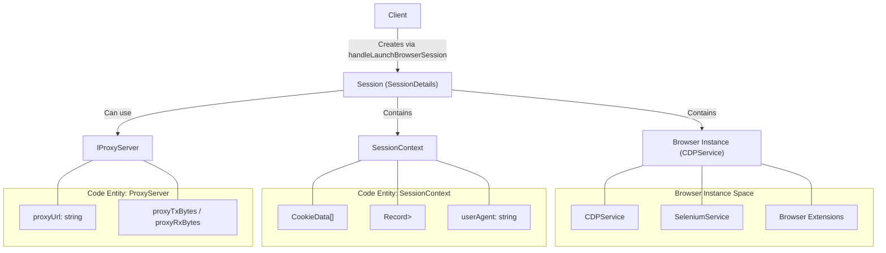
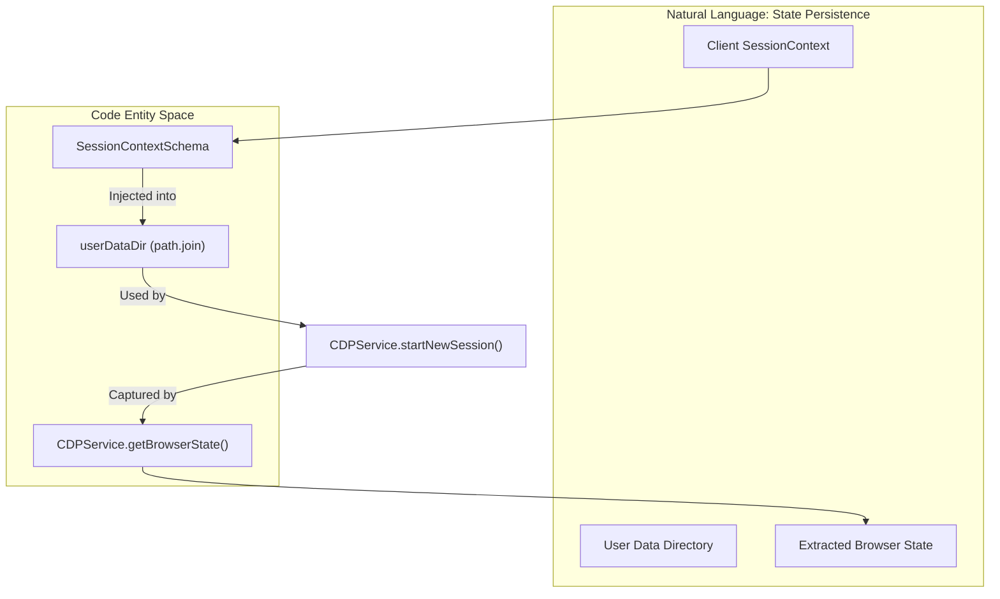
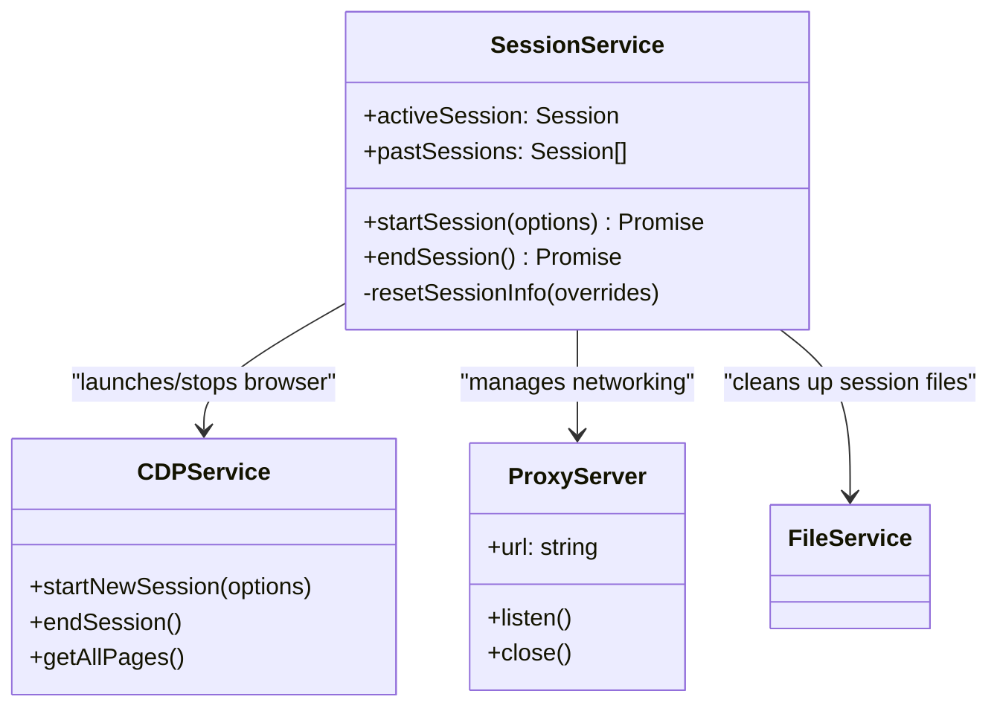

<!-- source: DeepWiki mcp.deepwiki.com · repo steel-dev/steel-browser · page 4 Browser Sessions · fetched 2026-10-26 -->

# Browser Sessions

<details>
<summary>Relevant source files</summary>

The following files were used as context for generating this wiki page:

- [api/src/modules/sessions/sessions.controller.ts](api/src/modules/sessions/sessions.controller.ts)
- [api/src/modules/sessions/sessions.schema.ts](api/src/modules/sessions/sessions.schema.ts)
- [api/src/services/session.service.ts](api/src/services/session.service.ts)

</details>


This page documents the browser session system in Steel Browser, which is the core mechanism for creating, managing, and interacting with browser instances. Browser sessions enable stateful browsing experiences with persistence of cookies, local storage, and other browser state.

For detailed documentation on specific session topics, see the following child pages:
- [Session Management API](#4.1) — Document session lifecycle endpoints: create, list, retrieve, release, and configuration options.
- [Session Configuration](#4.2) — Detailed reference for `BrowserLauncherOptions` and session configuration parameters.
- [Session Storage & State](#4.3) — Explain session context: cookies, `localStorage`, `sessionStorage`, `indexedDB` persistence.
- [Live Session Monitoring](#4.4) — Document live session details, streaming, and debugging capabilities.

## Session Overview

A browser session in Steel represents a fully-functioning browser instance with its own isolated state, configuration, and lifecycle. Sessions provide a consistent way to manage browser instances, their proxy configurations, and browser state across operations.



Sources: [api/src/services/session.service.ts:25-29](), [api/src/modules/sessions/sessions.schema.ts:93-127](), [api/src/services/session.service.ts:93-119]()

## Session Lifecycle

Browser sessions follow a specific lifecycle managed by the `SessionService`. The service maintains an `activeSession` and a history of `pastSessions`. For details on managing this lifecycle via API, see [Session Management API](#4.1).

```mermaid
stateDiagram-v2
    [*] --> "idle" : SessionService Constructor
    "idle" --> "live" : startSession()
    "live" --> "live" : CDP/Selenium Interactions
    "live" --> "released" : endSession()
    "live" --> "failed" : Exception in startSession/CDP
    "released" --> "idle" : resetSessionInfo()
    "failed" --> "idle" : resetSessionInfo()
    
    note right of "idle"
      defaultSession values applied
    end note
    
    note right of "live"
      Browser process running
      ProxyServer.listen() active
    end note
    
    note right of "released"
      Session pushed to pastSessions[]
      Cleanup via fileService.cleanupFiles()
    end note
```

Sources: [api/src/services/session.service.ts:40-51](), [api/src/services/session.service.ts:66-67](), [api/src/services/session.service.ts:166-174](), [api/src/services/session.service.ts:286-308]()

## Session Configuration

When creating a new browser session, you can configure various aspects of the browser's behavior, including anti-detection features, proxy settings, and viewport dimensions. For a full reference of available options, see [Session Configuration](#4.2).

| Property | Description | Code Entity |
|----------|-------------|-------------|
| `proxyUrl` | Upstream proxy to route traffic through | `CreateSession.proxyUrl` |
| `userAgent` | Custom string or generated via fingerprint | `CreateSession.userAgent` |
| `dimensions` | Viewport width and height | `CreateSession.dimensions` |
| `isSelenium` | Toggle between CDP and Selenium modes | `CreateSession.isSelenium` |
| `optimizeBandwidth` | Block images/media to save data | `OptimizeBandwidthOptions` |
| `deviceConfig` | Emulate "desktop" or "mobile" | `deviceConfigSchema` |

Sources: [api/src/modules/sessions/sessions.schema.ts:28-91](), [api/src/services/session.service.ts:194-204]()

## Session Storage & Persistence

Steel Browser can preserve and restore browser state including cookies and `localStorage`. This is critical for automation that requires login persistence. For details on how state is handled, see [Session Storage & State](#4.3).



Sources: [api/src/modules/sessions/sessions.schema.ts:32-34](), [api/src/services/session.service.ts:176-180](), [api/src/modules/sessions/sessions.controller.ts:82-89]()

## Live Session Monitoring

Active sessions can be monitored in real-time through the UI Dashboard or via direct API calls to retrieve page lists and screenshots. For information on the streaming architecture and debugging tools, see [Live Session Monitoring](#4.4).

The `SessionService` provides metadata for these tools:
- `websocketUrl`: For real-time event streaming. [api/src/services/session.service.ts:42]()
- `debugUrl`: For viewing the live browser instance. [api/src/services/session.service.ts:43]()
- `sessionViewerUrl`: For the dashboard interface. [api/src/services/session.service.ts:45]()

Sources: [api/src/modules/sessions/sessions.controller.ts:169-235](), [api/src/services/session.service.ts:80-91]()

## Session Management Implementation

The `SessionService` class acts as the orchestrator, coordinating between the `CDPService` (for browser control), `ProxyServer` (for networking), and `FileService` (for session artifacts).



Sources: [api/src/services/session.service.ts:58-91](), [api/src/services/session.service.ts:208-211](), [api/src/services/session.service.ts:303-305]()

---

