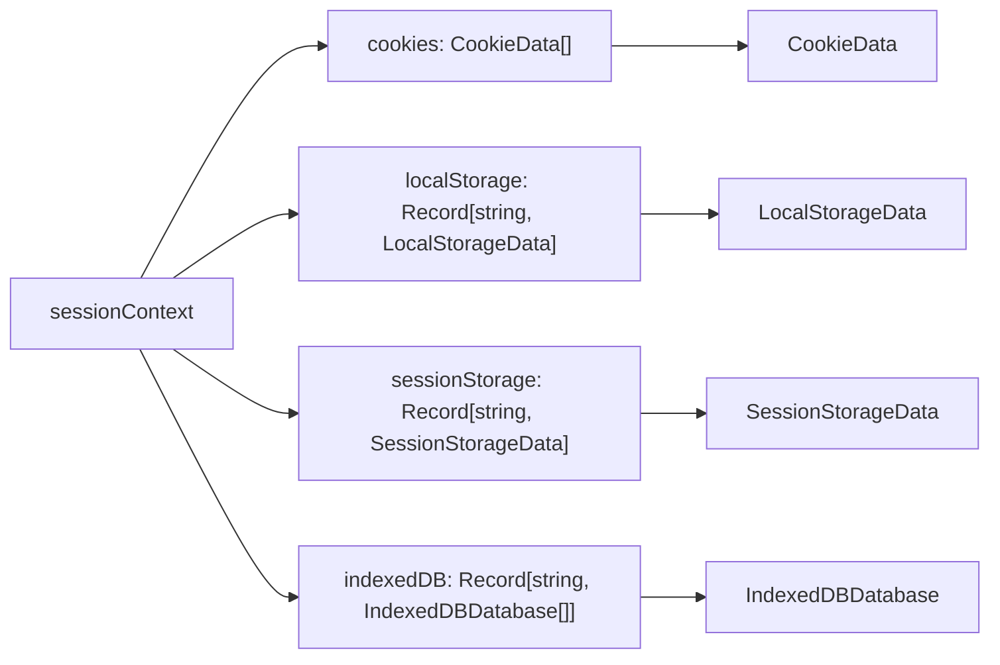
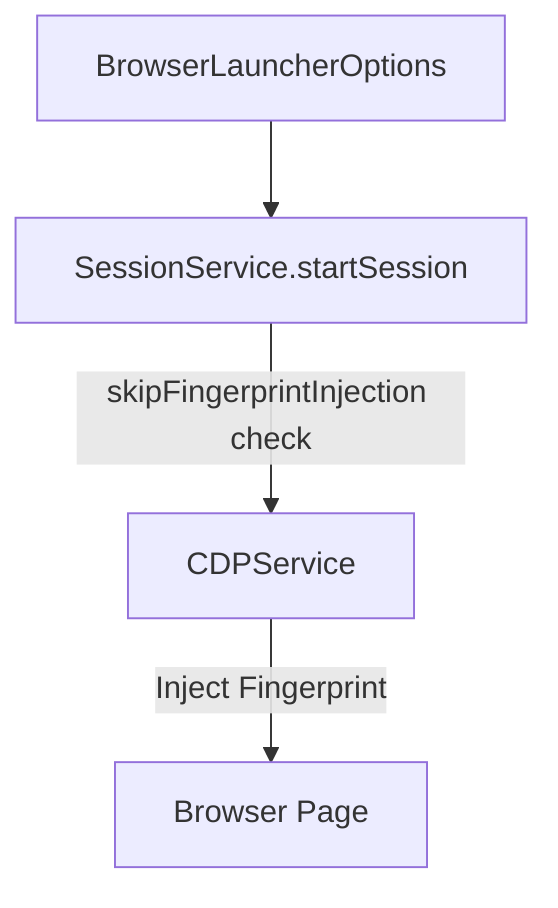
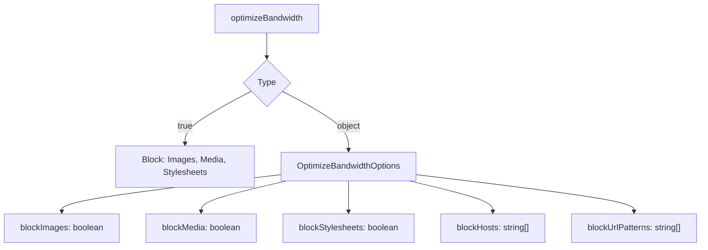

<!-- source: DeepWiki mcp.deepwiki.com · repo steel-dev/steel-browser · page 4.2 Session Configuration · fetched 2026-10-26 -->

# Session Configuration

Relevant source files

The following files were used as context for generating this wiki page:

- [api/src/modules/sessions/sessions.controller.ts](api/src/modules/sessions/sessions.controller.ts)
- [api/src/modules/sessions/sessions.schema.ts](api/src/modules/sessions/sessions.schema.ts)
- [api/src/services/session.service.ts](api/src/services/session.service.ts)
- [api/src/types/browser.ts](api/src/types/browser.ts)

This page provides a detailed reference for browser session configuration parameters. The configuration system controls browser launch options, anti-detection features, request filtering, session context persistence, and other automation behaviors.

For information about managing session lifecycles through API endpoints, see [Session Management API](4.1). For details on how session state is persisted and restored, see [Session Storage & State](4.3).

## Configuration Object Overview

Browser sessions are configured using the `BrowserLauncherOptions` interface defined in [api/src/types/browser.ts:28-58](). This interface serves as the primary configuration object passed to the `CDPService` when launching browser instances.

```mermaid
graph TB
    BLO["BrowserLauncherOptions"]
    BSO["BrowserServerOptions"]
    SC["sessionContext"]
    OB["OptimizeBandwidthOptions"]
    Fingerprint["BrowserFingerprintWithHeaders"]
    Credentials["CredentialsOptions"]
    
    BLO --> BSO
    BLO --> SC
    BLO --> OB
    BLO --> Fingerprint
    BLO --> Credentials
    
    BSO --> args["args: string[]"]
    BSO --> headless["headless: boolean"]
    BSO --> proxyUrl["proxyUrl: string"]
    BSO --> timeout["timeout: number"]
    BSO --> chromiumSandbox["chromiumSandbox: boolean"]
    
    SC --> cookies["cookies: CookieData[]"]
    SC --> localStorage["localStorage: Record[string, LocalStorageData]"]
    SC --> sessionStorage["sessionStorage: Record[string, SessionStorageData]"]
    SC --> indexedDB["indexedDB: Record[string, IndexedDBDatabase[]]"]
    
    OB --> blockImages["blockImages: boolean"]
    OB --> blockMedia["blockMedia: boolean"]
    OB --> blockStylesheets["blockStylesheets: boolean"]
    OB --> blockHosts["blockHosts: string[]"]
    OB --> blockUrlPatterns["blockUrlPatterns: string[]"]
    
    BLO --> stealth["stealth: boolean"]
    BLO --> userAgent["userAgent: string"]
    BLO --> blockAds["blockAds: boolean"]
    BLO --> customHeaders["customHeaders: Record[string, string]"]
    BLO --> timezone["timezone: Promise[string]"]
    BLO --> dimensions["dimensions: {width, height}"]
    BLO --> userDataDir["userDataDir: string"]
    BLO --> extensions["extensions: string[]"]
    BLO --> skipFingerprintInjection["skipFingerprintInjection: boolean"]
    BLO --> deviceConfig["deviceConfig: {device: 'desktop' | 'mobile'}"]
```

**Configuration Structure Diagram**: Shows the `BrowserLauncherOptions` interface and its nested configuration objects.

**Sources:** [api/src/types/browser.ts:28-58](), [api/src/modules/sessions/sessions.schema.ts:28-91]()

## Browser Server Options

The `BrowserServerOptions` interface [api/src/types/browser.ts:60-70]() controls low-level browser launch parameters.

| Option | Type | Default | Description |
|--------|------|---------|-------------|
| `headless` | `boolean` | `env.CHROME_HEADLESS` | Launch browser in headless mode [api/src/services/session.service.ts:215-215]() |
| `args` | `string[]` | `[]` | Chrome command-line arguments |
| `chromiumSandbox` | `boolean` | `false` | Enable Chromium sandbox |
| `devtools` | `boolean` | `false` | Auto-open DevTools |
| `proxyUrl` | `string` | `undefined` | Proxy server URL [api/src/services/session.service.ts:216-216]() |
| `timeout` | `number` | `30000` | Browser launch timeout |
| `downloadsPath` | `string` | `undefined` | Directory for downloads |

**Sources:** [api/src/types/browser.ts:60-70](), [api/src/services/session.service.ts:213-217]()

## Session Context Configuration

The `sessionContext` option [api/src/types/browser.ts:32-37]() restores browser state from a previous session. This is useful for maintaining logged-in states.

### Context Data Types

**Session Context Types Diagram**: Shows the structure of session context data used for state restoration.

**Sources:** [api/src/types/browser.ts:32-37](), [api/src/modules/sessions/sessions.schema.ts:32-34]()

## Anti-Detection Configuration

Steel-browser includes anti-detection capabilities controlled through several configuration options.

### Stealth and Fingerprinting

| Option | Type | Description |
|--------|------|-------------|
| `stealth` | `boolean` | Enable comprehensive anti-detection features [api/src/types/browser.ts:31]() |
| `skipFingerprintInjection` | `boolean` | Skip fingerprint script injection [api/src/modules/sessions/sessions.schema.ts:57-60]() |
| `userAgent` | `string` | Custom user agent string [api/src/modules/sessions/sessions.schema.ts:31-31]() |
| `deviceConfig` | `{device: "desktop" \| "mobile"}` | Device profile for fingerprint generation [api/src/modules/sessions/sessions.schema.ts:10-15]() |

### Fingerprint Injection Flow

**Fingerprint Injection Flow**: Shows how fingerprint configuration flows from `BrowserLauncherOptions` through the services.

**Sources:** [api/src/services/session.service.ts:93-119](), [api/src/modules/sessions/sessions.schema.ts:57-60]()

## Request Filtering & Optimization

Steel-browser provides control over network requests to reduce bandwidth usage and block unwanted content.

### Ad Blocking

The `blockAds` option [api/src/modules/sessions/sessions.schema.ts:36-39]() enables filtering of common advertising and tracking domains.

### Bandwidth Optimization

The `optimizeBandwidth` option [api/src/modules/sessions/sessions.schema.ts:40-56]() accepts either a boolean or a detailed `OptimizeBandwidthOptions` object. If `true`, it enables blocking for images, media, and stylesheets [api/src/services/session.service.ts:197-199]().

**Bandwidth Optimization Flow**: Maps configuration options to optimization behaviors.

**Sources:** [api/src/services/session.service.ts:194-206](), [api/src/types/browser.ts:11-17]()

## Browser Dimensions & Viewport

The `dimensions` option [api/src/modules/sessions/sessions.schema.ts:72-78]() controls the browser viewport size.

### Mobile Device Logic
If `deviceConfig.device` is set to `"mobile"`, the system enforces minimum dimensions of 508x1074 [api/src/services/session.service.ts:154-164]().

**Sources:** [api/src/services/session.service.ts:154-164](), [api/src/modules/sessions/sessions.schema.ts:72-78]()

## Timezone Configuration

The `timezone` option [api/src/modules/sessions/sessions.schema.ts:71-71]() allows setting a specific timezone for the session.

If not provided, the `SessionService` attempts to fetch the timezone based on the `proxyUrl` using the `TimezoneFetcher` [api/src/services/session.service.ts:143-151]().

**Sources:** [api/src/services/session.service.ts:143-151](), [api/src/services/timezone-fetcher.service.ts:1-80]()

## User Preferences & Extensions

### User Preferences
The `userPreferences` option [api/src/modules/sessions/sessions.schema.ts:79-84]() allows setting Chrome profile preferences. By default, Steel-browser disables the internal PDF viewer [api/src/services/session.service.ts:182-187]().

### Chrome Extensions
The `extensions` option [api/src/modules/sessions/sessions.schema.ts:68-68]() accepts an array of strings representing extensions to be loaded into the browser session.

**Sources:** [api/src/services/session.service.ts:182-191](), [api/src/modules/sessions/sessions.schema.ts:68-84]()

## Complete Configuration Reference Table

| Option | Type | Description |
|--------|------|-------------|
| `sessionId` | `string` | Unique identifier for the session [api/src/modules/sessions/sessions.schema.ts:29]() |
| `proxyUrl` | `string` | Proxy URL for the session [api/src/modules/sessions/sessions.schema.ts:30]() |
| `isSelenium` | `boolean` | Indicates if Selenium is used [api/src/modules/sessions/sessions.schema.ts:35]() |
| `persist` | `boolean` | Flag to indicate if session should be persisted [api/src/modules/sessions/sessions.schema.ts:69]() |
| `userDataDir` | `string` | User data directory path [api/src/modules/sessions/sessions.schema.ts:70]() |
| `headless` | `boolean` | Headless mode for the session [api/src/modules/sessions/sessions.schema.ts:90]() |
| `fullscreen` | `boolean` | Launch in fullscreen mode [api/src/modules/sessions/sessions.schema.ts:62-65]() |
| `credentials` | `CredentialsOptions` | Configuration for session credentials [api/src/modules/sessions/sessions.schema.ts:18-26]() |

**Sources:** [api/src/modules/sessions/sessions.schema.ts:28-91](), [api/src/types/browser.ts:28-58]()

---

