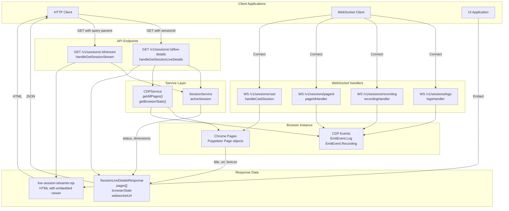
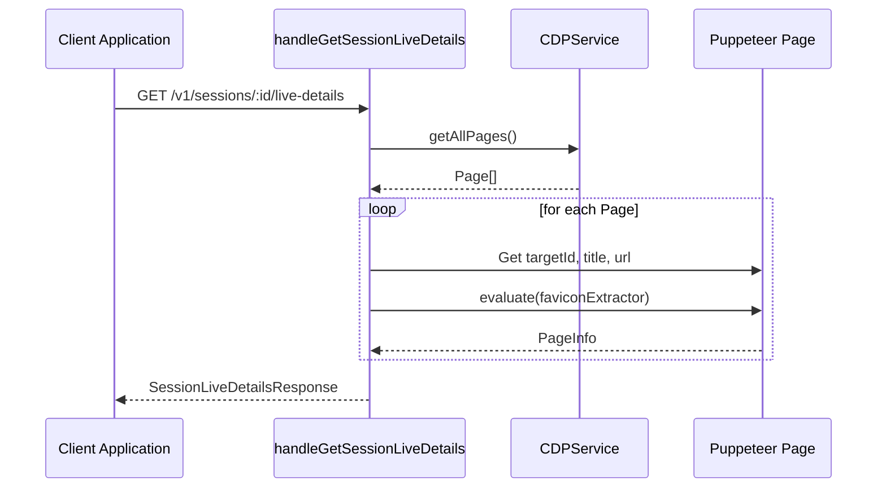

<!-- source: DeepWiki mcp.deepwiki.com · repo steel-dev/steel-browser · page 4.4 Live Session Monitoring · fetched 2026-10-26 -->

# Live Session Monitoring

<details>
<summary>Relevant source files</summary>

The following files were used as context for generating this wiki page:

- [api/src/modules/sessions/sessions.controller.ts](api/src/modules/sessions/sessions.controller.ts)
- [api/src/modules/sessions/sessions.schema.ts](api/src/modules/sessions/sessions.schema.ts)
- [api/src/plugins/browser-socket/casting.handler.ts](api/src/plugins/browser-socket/casting.handler.ts)
- [api/src/templates/live-session-streamer.ejs](api/src/templates/live-session-streamer.ejs)
- [api/src/types/casting.ts](api/src/types/casting.ts)
- [api/src/utils/casting.ts](api/src/utils/casting.ts)

</details>


This document covers the real-time monitoring and debugging capabilities for active browser sessions, including live page information retrieval, WebSocket streaming of browser events, and embedded browser viewing interfaces.

For information about session creation and lifecycle management, see [Session Management API](#4.1). For details on browser event logging and storage, see [Browser Instrumentation & Logging](#10.2). For WebSocket endpoint specifications, see [WebSocket API](#10.1).

---

## Overview

Live Session Monitoring provides real-time visibility into active browser sessions through HTTP endpoints and WebSocket streams. This functionality enables debugging, monitoring page state, viewing live browser output, and tracking session metrics as they occur.

**Key capabilities:**
- Retrieve information about all open pages/tabs in a session.
- Stream browser events and screencasts in real-time via WebSocket connections.
- Embed live browser views in external applications with interaction support.
- Monitor session state, duration, and resource usage.
- Access debugging interfaces for Chrome DevTools integration.

Sources: [api/src/modules/sessions/sessions.controller.ts:169-243](), [api/src/modules/sessions/sessions.schema.ts:148-170]()

---

## Live Session Monitoring Architecture



**Diagram: Live Session Monitoring Data Flow**

This architecture shows how live session data flows from the browser through `CDPService` and specialized WebSocket handlers to client applications.

Sources: [api/src/modules/sessions/sessions.controller.ts:1-244](), [api/src/plugins/browser-socket/casting.handler.ts:18-53]()

---

## Live Details Endpoint

The live details endpoint provides comprehensive information about an active browser session, including all open pages, browser state, and URLs for real-time monitoring.

### Endpoint Specification

| Attribute | Value |
|-----------|-------|
| **Method** | GET |
| **Path** | `/v1/sessions/:id/live-details` |
| **Handler** | `handleGetSessionLiveDetails` |
| **Response** | `SessionLiveDetailsResponse` |
| **Purpose** | Retrieve current state of all pages and browser metadata |

### Response Schema

The `SessionLiveDetailsResponse` schema includes:

```typescript
{
  pages: Array<{
    id: string,           // Target ID from page.target()._targetId
    url: string,          // Current page URL
    title: string,        // Page title from page.title()
    favicon: string | null // Extracted favicon URL or null
  }>,
  browserState: {
    status: "idle" | "live" | "released" | "failed",
    userAgent: string,
    browserVersion: string,
    initialDimensions: { width: number, height: number },
    pageCount: number
  },
  websocketUrl: string,           // Base WebSocket URL for streaming
  sessionViewerUrl: string,       // URL to embedded viewer
  sessionViewerFullscreenUrl: string  // Viewer without controls
}
```

Sources: [api/src/modules/sessions/sessions.schema.ts:153-175]()

### Implementation Details

The `handleGetSessionLiveDetails` function performs the following operations:

1. **Page Enumeration** - Calls `server.cdpService.getAllPages()` to retrieve all Puppeteer `Page` objects [api/src/modules/sessions/sessions.controller.ts:175-175]().
2. **Page Information Extraction** - For each page:
   - Extracts target ID via `page.target()._targetId` [api/src/modules/sessions/sessions.controller.ts:180-180]().
   - Retrieves page title using `page.title()` [api/src/modules/sessions/sessions.controller.ts:182-182]().
   - Evaluates JavaScript in page context to extract favicon URL [api/src/modules/sessions/sessions.controller.ts:186-198]().
3. **Browser State Collection** - Retrieves browser version from `server.cdpService.getBrowserState()` [api/src/modules/sessions/sessions.controller.ts:216-216]().
4. **Session Data Assembly** - Combines page info with session metadata from `server.sessionService.activeSession` [api/src/modules/sessions/sessions.controller.ts:219-234]().

Sources: [api/src/modules/sessions/sessions.controller.ts:169-243]()

---

## Session Streaming Interface

The session streaming interface provides an embeddable HTML viewer for real-time browser interaction and observation.

### Endpoint Specification

| Attribute | Value |
|-----------|-------|
| **Method** | GET |
| **Path** | `/v1/sessions/:id/stream` |
| **Handler** | `handleGetSessionStream` |
| **Response** | HTML content (rendered from EJS template) |
| **Purpose** | Embed live browser view in external applications |

### Query Parameters

The `SessionStreamQuery` schema defines customization options:

| Parameter | Type | Default | Description |
|-----------|------|---------|-------------|
| `showControls` | boolean | `true` | Display browser navigation controls |
| `theme` | `"dark"` \| `"light"` | `"dark"` | UI theme for embedded viewer |
| `interactive` | boolean | `true` | Enable user interaction with browser |
| `pageId` | string | - | Connect to specific page by target ID |
| `pageIndex` | string | - | Connect to page by tab index |

Sources: [api/src/modules/sessions/sessions.schema.ts:137-151]()

### Single Page vs Multi-Page Mode

The streaming interface operates in two modes:

**Multi-Page Mode (default):**
- Displays all browser tabs/pages.
- Allows switching between pages.
- WebSocket URL: `ws://domain/v1/sessions/cast`.

**Single Page Mode:**
- Triggered when `pageId` or `pageIndex` is specified [api/src/modules/sessions/sessions.controller.ts:149-149]().
- Displays only the targeted page.
- WebSocket URL includes page identifier: `ws://domain/v1/sessions/cast?pageId=xxx` [api/src/modules/sessions/sessions.controller.ts:152-157]().

Sources: [api/src/modules/sessions/sessions.controller.ts:142-167]()

---

## WebSocket Streaming Channels

Live session monitoring utilizes multiple WebSocket channels for different types of real-time data streaming.

### Cast Channel (Interactive Screencasting)

**Path:** `/v1/sessions/:id/cast`  
**Handler:** `handleCastSession` [api/src/plugins/browser-socket/casting.handler.ts:18-18]()

The Cast Channel is the primary mechanism for real-time visual streaming and interaction. It uses Puppeteer's `CDPSession` to start a screencast and handles incoming user input events (mouse, keyboard, navigation).

**Key Features:**
- **Screencasting**: Uses `Page.startScreencast` to stream frames to the client [api/src/plugins/browser-socket/casting.handler.ts:76-81]().
- **Input Handling**: Translates client WebSocket messages into Puppeteer actions like `mouseEvent`, `keyEvent`, and `navigation` [api/src/types/casting.ts:1-36]().
- **Tab Discovery**: In multi-page mode, it tracks `targetcreated` and `targetdestroyed` events to notify the client of tab changes [api/src/plugins/browser-socket/casting.handler.ts:199-230]().

**Interaction Logic:**
When a `navigation` event is received, the `navigatePage` utility executes the requested action (back, forward, refresh, or goto) [api/src/utils/casting.ts:5-19]().

Sources: [api/src/plugins/browser-socket/casting.handler.ts:1-240](), [api/src/utils/casting.ts:5-19]()

### Other Streaming Channels

| Channel | Path | Purpose |
|---------|------|---------|
| **Logs** | `/v1/sessions/logs` | Streams browser console logs (Console, Network, etc.) |
| **Recording** | `/v1/sessions/recording` | Streams events for session replay/instrumentation |
| **Page ID** | `/v1/sessions/pageId` | Notifies when the active tab/target changes |

Sources: [api/src/plugins/browser-socket/browser-socket.ts:25-35]()

---

## Page Information Collection

The live details endpoint and the cast handler both need to resolve page metadata.

### Collection Logic Flow



**Diagram: Page Metadata Resolution Sequence**

The system uses `getPageTitle` and `getPageFavicon` utilities to safely extract data from pages. The favicon extractor evaluates a script in the browser context to find `<link rel="icon">` tags and resolve them to absolute URLs [api/src/utils/casting.ts:21-45]().

Sources: [api/src/modules/sessions/sessions.controller.ts:175-214](), [api/src/utils/casting.ts:21-45]()

---

## Browser Session Metrics

The `SessionDetails` schema defines the metrics tracked during a live session:

| Metric | Source | Description |
|--------|--------|-------------|
| `duration` | Computed | Elapsed time in ms since `createdAt` [api/src/modules/sessions/sessions.controller.ts:120-120]() |
| `eventCount` | `activeSession` | Number of CDP events processed [api/src/modules/sessions/sessions.schema.ts:98-98]() |
| `proxyTxBytes` | `activeSession` | Data transmitted through proxy [api/src/modules/sessions/sessions.schema.ts:114-118]() |
| `proxyRxBytes` | `activeSession` | Data received through proxy [api/src/modules/sessions/sessions.schema.ts:119-123]() |
| `status` | `activeSession` | Current lifecycle: `idle`, `live`, `released`, `failed` [api/src/modules/sessions/sessions.schema.ts:96-96]() |

Sources: [api/src/modules/sessions/sessions.schema.ts:93-127](), [api/src/modules/sessions/sessions.controller.ts:120-125]()

---

## Error Handling and Resilience

### Screencast Cleanup
The `handleCastSession` function implements a robust `handleSessionCleanup` routine to prevent memory leaks and dangling browser connections. It stops screencasts, detaches CDP clients, removes event listeners, and disconnects the browser instance when the WebSocket closes [api/src/plugins/browser-socket/casting.handler.ts:63-116]().

### Isolation
If a single page fails during info collection (e.g., due to a crash or navigation), the `handleGetSessionLiveDetails` loop catches the error and continues processing other pages, ensuring the monitoring dashboard remains functional [api/src/modules/sessions/sessions.controller.ts:207-214]().

Sources: [api/src/plugins/browser-socket/casting.handler.ts:63-116](), [api/src/modules/sessions/sessions.controller.ts:207-214]()

---

