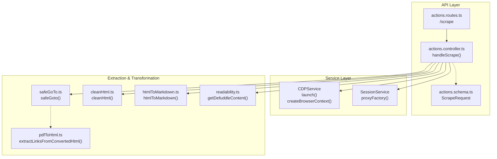
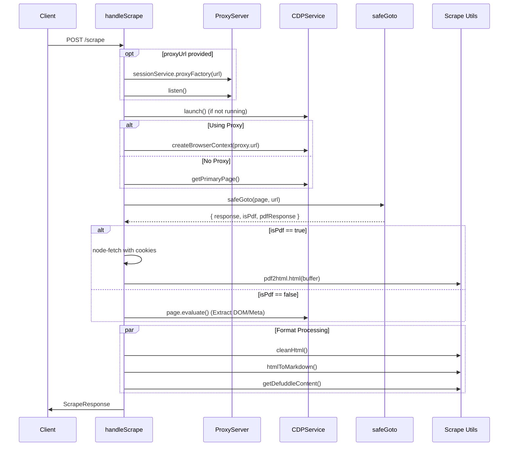

<!-- source: DeepWiki mcp.deepwiki.com · repo steel-dev/steel-browser · page 5.1 Web Scraping · fetched 2026-10-26 -->

# Web Scraping

Relevant source files

The following files were used as context for generating this wiki page:

- [api/src/modules/actions/actions.controller.ts](api/src/modules/actions/actions.controller.ts)
- [api/src/modules/actions/actions.routes.ts](api/src/modules/actions/actions.routes.ts)
- [api/src/modules/actions/actions.schema.ts](api/src/modules/actions/actions.schema.ts)
- [api/src/services/selenium.service.ts](api/src/services/selenium.service.ts)
- [api/src/types/turndown.d.ts](api/src/types/turndown.d.ts)
- [api/src/utils/passthough-proxy.ts](api/src/utils/passthough-proxy.ts)
- [api/src/utils/proxy.ts](api/src/utils/proxy.ts)
- [api/src/utils/schema.ts](api/src/utils/schema.ts)
- [api/src/utils/scrape/cleanHtml.ts](api/src/utils/scrape/cleanHtml.ts)
- [api/src/utils/scrape/htmlToMarkdown.ts](api/src/utils/scrape/htmlToMarkdown.ts)
- [api/src/utils/scrape/index.ts](api/src/utils/scrape/index.ts)
- [api/src/utils/scrape/pdfToHtml.ts](api/src/utils/scrape/pdfToHtml.ts)
- [api/src/utils/scrape/readability.ts](api/src/utils/scrape/readability.ts)
- [api/src/utils/scrape/safeGoTo.ts](api/src/utils/scrape/safeGoTo.ts)
- [api/src/utils/scrape/transformHtml.ts](api/src/utils/scrape/transformHtml.ts)

This page documents the web scraping functionality in Steel Browser, focusing on the Quick Actions API endpoint `/v1/scrape` which allows extraction of content from web pages in various formats. This stateless API provides a simple way to scrape web content without maintaining browser state between requests.

For information about capturing screenshots and generating PDFs, see [Screenshots & PDF Generation](5.2).

## Web Scraping Architecture

The web scraping system in Steel Browser enables extracting content from any webpage through a simple API request. It leverages the Chrome DevTools Protocol (CDP) via the `CDPService` to control browser instances and extract content.

### System Mapping: API to Code Entities

The following diagram bridges the logical scraping flow to the specific classes and functions in the codebase.

Sources: [api/src/modules/actions/actions.routes.ts:7-23](), [api/src/modules/actions/actions.controller.ts:25-30](), [api/src/services/cdp/cdp.service.ts:3-10](), [api/src/utils/scrape/safeGoTo.ts:11-43]()

## Request Parameters

The scrape endpoint accepts parameters defined in the `ScrapeRequest` Zod schema [api/src/modules/actions/actions.schema.ts:5-19]().

| Parameter | Type | Required | Description |
|-----------|------|----------|-------------|
| `url` | string | No | The URL of the webpage to scrape. |
| `format` | `ScrapeFormat[]` | No | Array of output formats: `HTML`, `MARKDOWN`, `CLEANED_HTML`, `READABILITY`. |
| `screenshot` | boolean | No | Whether to include a base64 screenshot in the response. |
| `pdf` | boolean | No | Whether to include a base64 PDF in the response. |
| `proxyUrl` | string | No | Optional proxy URL. If provided, a temporary `ProxyServer` is spawned. |
| `delay` | number | No | Milliseconds to wait after page load before extraction. |

Sources: [api/src/modules/actions/actions.schema.ts:5-19](), [api/src/modules/actions/actions.controller.ts:33]()

## Scraping Process Flow

The scraping process in `handleScrape` manages the browser lifecycle, handles PDF-specific logic, and performs content transformation.

Sources: [api/src/modules/actions/actions.controller.ts:38-151](), [api/src/utils/scrape/safeGoTo.ts:11-43]()

## Output Formats & Transformation

Steel Browser provides several transformation utilities to prepare content for LLMs or storage:

| Format | Code Entity | Description |
|--------|-------------|------------|
| `HTML` | `document.documentElement.outerHTML` | Full raw source from the browser evaluation [api/src/modules/actions/actions.controller.ts:182](). |
| `CLEANED_HTML` | `cleanHtml()` | Removes blacklisted tags like `script`, `style`, `svg`, and `path`. Strips attributes like `onerror` and `js.*` [api/src/utils/scrape/cleanHtml.ts:3-66](). |
| `MARKDOWN` | `htmlToMarkdown()` | Uses `Turndown` with plugins for tables, task lists, and code blocks. Includes a linting pass to fix formatting [api/src/utils/scrape/htmlToMarkdown.ts:10-28](). |
| `READABILITY` | `getDefuddleContent()` | Uses the `defuddle` library (Readability port) to extract the "main" article content [api/src/modules/actions/actions.controller.ts:17](). |

### Metadata Extraction
Regardless of the format, the system extracts rich metadata during the `page.evaluate()` phase, including:
- Standard meta: `title`, `description`, `author`, `keywords`.
- OpenGraph: `og:title`, `og:image`, `og:description`.
- Linked Data: `application/ld+json` blocks.
- Page details: `language`, `urlSource`, `timestamp`.

Sources: [api/src/modules/actions/actions.controller.ts:158-204](), [api/src/utils/scrape/cleanHtml.ts:4-30]()

## PDF Handling

Steel Browser includes a specialized path for URLs that resolve to PDF files. The `safeGoto` utility detects `application/pdf` content-types [api/src/utils/scrape/safeGoTo.ts:23-25]().

1. **Detection**: If `safeGoto` detects a PDF, it returns `isPdf: true`.
2. **Acquisition**: The controller performs a `node-fetch` using the browser's current cookies to download the PDF buffer [api/src/modules/actions/actions.controller.ts:100-118]().
3. **Conversion**: The buffer is converted to HTML using `pdf2html` [api/src/modules/actions/actions.controller.ts:121]().
4. **Metadata Mapping**: `buildHtmlLikeMetadataFromPdf` maps PDF metadata (Title, Author, CreationDate) into the standard HTML metadata schema [api/src/utils/scrape/pdfToHtml.ts:67-138]().

Sources: [api/src/modules/actions/actions.controller.ts:97-150](), [api/src/utils/scrape/pdfToHtml.ts:67-138]()

## Proxy Implementation

When `proxyUrl` is passed to the scrape endpoint, Steel Browser creates a local `ProxyServer` instance [api/src/utils/proxy.ts:15]().

- **Internal Bypass**: The proxy automatically detects and bypasses requests to internal hosts defined in `env.PROXY_INTERNAL_BYPASS` or the local host [api/src/utils/proxy.ts:29-37]().
- **Passthrough**: For bypassed requests, it uses `PassthroughServer` to avoid header corruption [api/src/utils/passthough-proxy.ts:20]().
- **Upstream**: Standard requests are forwarded to the provided `upstreamProxyUrl` [api/src/utils/proxy.ts:48]().

Sources: [api/src/utils/proxy.ts:15-69](), [api/src/utils/passthough-proxy.ts:20-71]()

## Error Handling

The endpoint uses `getErrors` and `updateLog` to manage failures [api/src/modules/actions/actions.controller.ts:6-7]().
- **Navigation Errors**: If `page.goto` fails (e.g., timeout), the error is caught, and resources are cleaned up.
- **Cleanup**: In the `finally` block, if a proxy context was created, it is closed via `context.close()`. If the primary page was used, it is navigated to `about:blank` to reset state for the next request [api/src/modules/actions/actions.controller.ts:275-285]().

Sources: [api/src/modules/actions/actions.controller.ts:275-295]()

---

