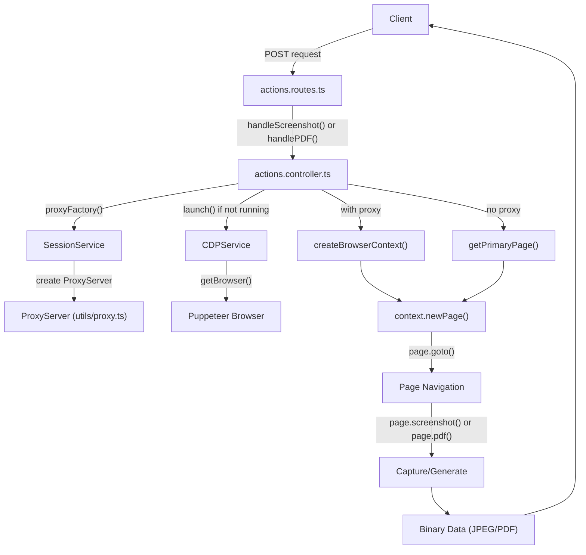
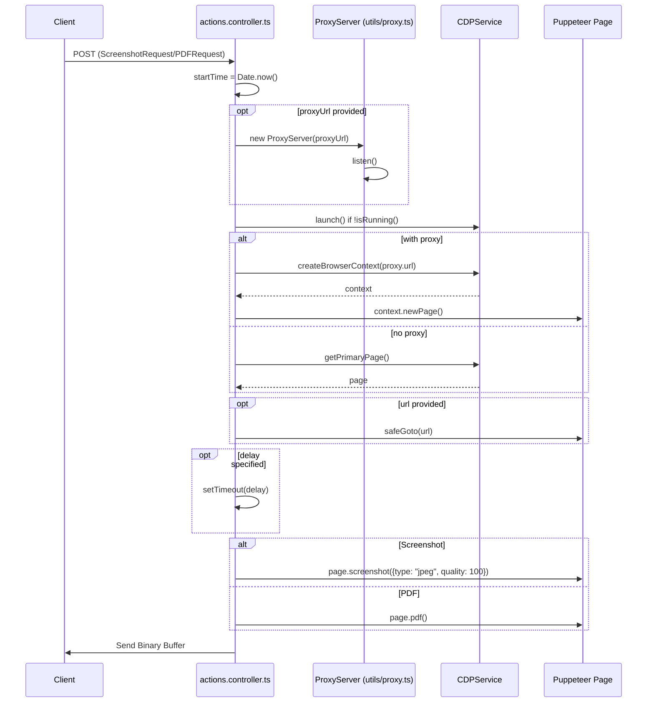

<!-- source: DeepWiki mcp.deepwiki.com · repo steel-dev/steel-browser · page 5.2 Screenshots & PDF Generation · fetched 2026-10-26 -->

# Screenshots & PDF Generation

<details>
<summary>Relevant source files</summary>

The following files were used as context for generating this wiki page:

- [api/src/modules/actions/actions.controller.ts](api/src/modules/actions/actions.controller.ts)
- [api/src/modules/actions/actions.routes.ts](api/src/modules/actions/actions.routes.ts)
- [api/src/modules/actions/actions.schema.ts](api/src/modules/actions/actions.schema.ts)
- [api/src/services/selenium.service.ts](api/src/services/selenium.service.ts)
- [api/src/utils/passthough-proxy.ts](api/src/utils/passthough-proxy.ts)
- [api/src/utils/proxy.ts](api/src/utils/proxy.ts)
- [api/src/utils/scrape/pdfToHtml.ts](api/src/utils/scrape/pdfToHtml.ts)
- [api/src/utils/scrape/safeGoTo.ts](api/src/utils/scrape/safeGoTo.ts)

</details>


Steel Browser provides robust capabilities for capturing screenshots and generating PDF documents from web pages. These features are available through both stateless quick action API endpoints and as part of browser sessions. This document details how to use these features, the implementation details, and configuration options.

For information about web scraping capabilities, see [Web Scraping](#5.1).

## 1. Overview

Steel provides screenshot and PDF generation capabilities through dedicated API endpoints. These features allow you to:

- Capture full-page or viewport-only screenshots in JPEG format [api/src/modules/actions/actions.controller.ts:268-268]()
- Generate PDF documents from rendered web pages [api/src/modules/actions/actions.controller.ts:348-348]()
- Use per-request proxy configuration [api/src/modules/actions/actions.controller.ts:229-232]()
- Apply custom delays for dynamic content loading [api/src/modules/actions/actions.controller.ts:258-260]()
- Track detailed timing metrics [api/src/modules/actions/actions.controller.ts:225-226]()

Both features are available as:
1. **Quick Actions** - Stateless endpoints at `/v1/screenshot` and `/v1/pdf` [api/src/modules/actions/actions.routes.ts:26-59]()
2. **Session Actions** - Session-aware endpoints that use existing browser contexts.

**Screenshot & PDF Request Flow**



Sources: [api/src/modules/actions/actions.controller.ts:219-376](), [api/src/modules/actions/actions.routes.ts:26-59]()

## 2. API Endpoints

Steel provides endpoints for screenshot and PDF generation within the `actions` module.

### 2.1 Quick Action Endpoints

**Screenshot:**
```
POST /v1/screenshot
```
Captures a JPEG screenshot. Returns binary image data.
[api/src/modules/actions/actions.routes.ts:26-41]()

**PDF:**
```
POST /v1/pdf
```
Generates a PDF document. Returns binary PDF data.
[api/src/modules/actions/actions.routes.ts:43-59]()

## 3. Request and Response Schemas

### 3.1 Screenshot Request Schema (`ScreenshotRequest`)

| Field | Type | Required | Description |
|-------|------|----------|-------------|
| `url` | string | No | Target URL to screenshot. |
| `proxyUrl` | string \| null | No | Proxy URL or `null` to disable proxy. |
| `delay` | number | No | Milliseconds to wait before capturing. |
| `fullPage` | boolean | No | Capture entire scrollable page (default: false). |
| `logUrl` | string | No | URL to POST timing metrics. |

Sources: [api/src/modules/actions/actions.schema.ts:59-71]()

### 3.2 PDF Request Schema (`PDFRequest`)

| Field | Type | Required | Description |
|-------|------|----------|-------------|
| `url` | string | No | Target URL to render as PDF. |
| `proxyUrl` | string \| null | No | Proxy URL or `null` to disable proxy. |
| `delay` | number | No | Milliseconds to wait before generating. |
| `logUrl` | string | No | URL to POST timing metrics. |

Sources: [api/src/modules/actions/actions.schema.ts:75-86]()

## 4. Implementation Details

**Processing Sequence**



Sources: [api/src/modules/actions/actions.controller.ts:219-376](), [api/src/utils/scrape/safeGoTo.ts:11-43]()

### 4.1 Screenshot Capture

Screenshots use Puppeteer's `page.screenshot()` method with high-quality settings [api/src/modules/actions/actions.controller.ts:268-268]():

- **Format**: `jpeg`
- **Quality**: `100`
- **Full Page**: Configurable via `fullPage` boolean in request [api/src/modules/actions/actions.schema.ts:69-69]().

### 4.2 PDF Generation

PDFs are generated using Puppeteer's `page.pdf()` method [api/src/modules/actions/actions.controller.ts:348-348]().

## 5. Proxy Support

The `ProxyServer` class in `api/src/utils/proxy.ts` handles per-request proxying.

### 5.1 ProxyServer Implementation

The `ProxyServer` extends `proxy-chain.Server` [api/src/utils/proxy.ts:15-15](). It includes a `prepareRequestFunction` that implements:

- **Internal Bypass**: Checks if the hostname is `0.0.0.0`, the system `HOST`, or listed in `env.PROXY_INTERNAL_BYPASS` [api/src/utils/proxy.ts:29-37]().
- **Passthrough**: If bypassed, it uses a `PassthroughServer` (Node `http.createServer`) to forward requests manually [api/src/utils/passthough-proxy.ts:20-71]().
- **Upstream Forwarding**: Otherwise, it forwards to the provided `upstreamProxyUrl` [api/src/utils/proxy.ts:48-49]().

Sources: [api/src/utils/proxy.ts:15-69](), [api/src/utils/passthough-proxy.ts:20-125]()

## 6. Integration with Scraping

The `/v1/scrape` endpoint can optionally return screenshots or PDFs alongside extracted content [api/src/modules/actions/actions.schema.ts:8-9]().

### 6.1 PDF to HTML Conversion
When a target URL returns a PDF content-type, Steel uses `pdf2html` to convert the document for scraping [api/src/modules/actions/actions.controller.ts:121-121]().
- **Metadata Extraction**: `pdf2html.meta` extracts document properties [api/src/modules/actions/actions.controller.ts:125-125]().
- **Link Extraction**: `extractLinksFromConvertedHtml` uses `cheerio` to find links in the converted HTML [api/src/utils/scrape/pdfToHtml.ts:56-65]().

### 6.2 Safe Navigation
`safeGoto` is used to handle navigations where the response might be a PDF, preventing Puppeteer from throwing `net::ERR_ABORTED` [api/src/utils/scrape/safeGoTo.ts:11-43]().

Sources: [api/src/modules/actions/actions.controller.ts:97-150](), [api/src/utils/scrape/pdfToHtml.ts:67-138]()

## 7. Performance Tracking

Detailed timing metrics are collected for both operations:

| Metric | Code Reference |
|--------|----------------|
| `proxyTime` | [api/src/modules/actions/actions.controller.ts:233-233]() |
| `pageLoadTime` | [api/src/modules/actions/actions.controller.ts:262-262]() |
| `screenshotTime` | [api/src/modules/actions/actions.controller.ts:270-270]() |
| `pdfTime` | [api/src/modules/actions/actions.controller.ts:350-350]() |

If a `logUrl` is provided, these metrics are sent to the external sink via `updateLog` [api/src/modules/actions/actions.controller.ts:273-275]().

Sources: [api/src/modules/actions/actions.controller.ts:225-275](), [api/src/utils/logging.ts:1-10]()

---

