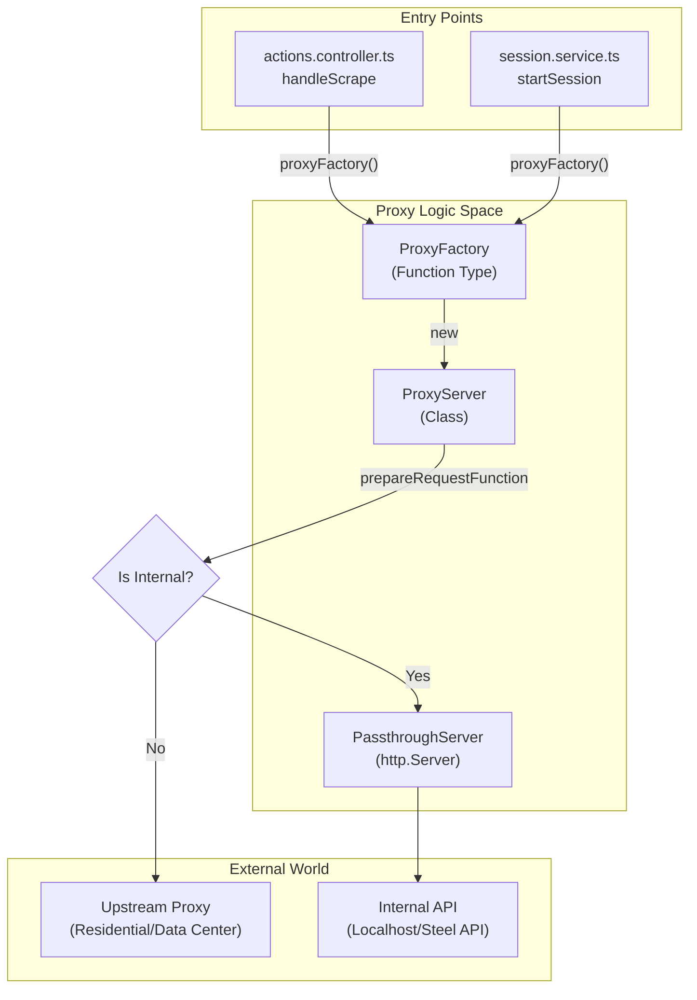
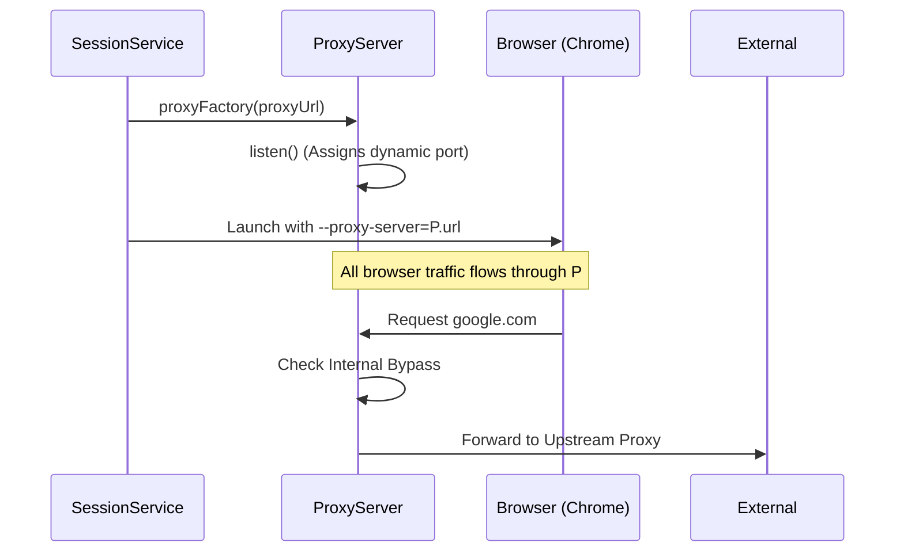

<!-- source: DeepWiki mcp.deepwiki.com · repo steel-dev/steel-browser · page 6 Proxy Support · fetched 2026-10-26 -->

# Proxy Support

Relevant source files

The following files were used as context for generating this wiki page:

- [api/src/modules/actions/actions.controller.ts](api/src/modules/actions/actions.controller.ts)
- [api/src/modules/actions/actions.routes.ts](api/src/modules/actions/actions.routes.ts)
- [api/src/modules/actions/actions.schema.ts](api/src/modules/actions/actions.schema.ts)
- [api/src/services/selenium.service.ts](api/src/services/selenium.service.ts)
- [api/src/services/session.service.ts](api/src/services/session.service.ts)
- [api/src/utils/passthough-proxy.ts](api/src/utils/passthough-proxy.ts)
- [api/src/utils/proxy.ts](api/src/utils/proxy.ts)
- [api/src/utils/requests.ts](api/src/utils/requests.ts)

This document describes the proxy infrastructure in Steel Browser, including the `ProxyServer` implementation, internal bypass mechanisms, traffic monitoring, and per-request proxy overrides. The system is designed to provide seamless integration between browser automation and external proxy providers while maintaining high performance for internal communications.

---

## Overview

Steel Browser provides a flexible proxy system that supports:
- **Session-level proxy configuration**: Persistent browser sessions using a single proxy identity.
- **Per-request proxy overrides**: Dynamic proxy switching for quick actions (scrape, screenshot, PDF).
- **Internal request bypass**: Prevents proxy loops for traffic destined for the local system.
- **Traffic monitoring**: Real-time accounting of transmitted (`txBytes`) and received (`rxBytes`) data.
- **Bandwidth optimization**: Integration with request interception to block images, media, or ads before they reach the proxy.

The proxy implementation wraps the `proxy-chain` library, extending it with Steel-specific logic for internal routing and traffic tracking.

**Sources**: [api/src/utils/proxy.ts:1-70](), [api/src/services/session.service.ts:93-119](), [api/src/utils/passthough-proxy.ts:1-126]()

---

## Proxy Architecture

The following diagram illustrates how the `SessionService` coordinates with the `ProxyServer` and `CDPService` to route traffic.

**Sources**: [api/src/utils/proxy.ts:15-69](), [api/src/services/session.service.ts:64-64](), [api/src/modules/actions/actions.controller.ts:39-42]()

---

## IProxyServer Interface

The `IProxyServer` interface defines the contract for all proxy implementations within the system.

| Property/Method | Type | Description |
|----------------|------|-------------|
| `url` | `string` | The local URL the browser connects to (e.g., `http://127.0.0.1:PORT`). |
| `upstreamProxyUrl` | `string` | The actual external proxy URL being wrapped. |
| `txBytes` | `number` | Total bytes transmitted to the upstream proxy. |
| `rxBytes` | `number` | Total bytes received from the upstream proxy. |
| `listen()` | `Promise<void>` | Starts the server on a dynamic port. |
| `close(force?)` | `Promise<void>` | Stops the server and cleans up resources. |

**Sources**: [api/src/utils/proxy.ts:6-13]()

---

## ProxyServer Implementation

### Class Structure and Routing

The `ProxyServer` class extends `proxy-chain`'s `Server`. Its primary responsibility is to decide whether a request should be forwarded to an external provider or handled internally.

[api/src/utils/proxy.ts:15-69]()

### Internal Bypass Logic

To prevent performance degradation and infinite loops, the system identifies internal traffic (e.g., the browser communicating with the Steel API) and bypasses the upstream proxy.

[api/src/utils/proxy.ts:26-50]()

1. **Default Bypass**: Always includes `0.0.0.0` and the value of `process.env.HOST`.
2. **Configuration**: Users can extend this list via the `PROXY_INTERNAL_BYPASS` environment variable.
3. **Execution**: If a match is found, the request is handed off to `PassthroughServer` and `makePassthrough`.

**Sources**: [api/src/utils/proxy.ts:29-45](), [api/src/env.js:1-10]()

### Traffic Accounting

The proxy tracks bytes only for external (upstream) connections to ensure accurate billing and usage reporting.

[api/src/utils/proxy.ts:53-59]()

- **Event**: Listens to the `connectionClosed` event.
- **Filter**: If the `connectionId` is found in the `hostConnections` set (internal traffic), it is ignored.
- **Aggregation**: Adds `stats.trgTxBytes` and `stats.trgRxBytes` to the session totals.

---

## PassthroughServer & makePassthrough

Internal requests require a specialized handler because `proxy-chain` can occasionally corrupt internal chunked requests. The `PassthroughServer` provides a clean HTTP reverse proxy.

### Hop-by-Hop Header Filtering

To comply with RFC 2616, the system strips connection-specific headers before forwarding internal requests.

[api/src/utils/passthough-proxy.ts:4-14]()

Headers stripped include: `connection`, `proxy-authenticate`, `keep-alive`, `transfer-encoding`, and `upgrade`.

### Request Forwarding

The `makePassthrough` function manually pipes the client request to the target and collects the response.

[api/src/utils/passthough-proxy.ts:79-125]()

---

## Proxy Usage Patterns

### Session-Level Proxies

In a standard session, the proxy is initialized during `startSession` and remains active until the session is closed.

**Sources**: [api/src/services/session.service.ts:208-211](), [api/src/services/session.service.ts:216-217]()

### Per-Request Overrides (Quick Actions)

For endpoints like `/scrape`, a user can provide a `proxyUrl` in the request body. This creates an ephemeral proxy and a temporary browser context.

[api/src/modules/actions/actions.controller.ts:39-58]()

1. **Proxy Creation**: `sessionService.proxyFactory(proxyUrl)` is called.
2. **Context Isolation**: `browserService.createBrowserContext(proxy.url)` ensures this proxy is only used for the specific request.
3. **Cleanup**: The context and proxy are closed immediately after the action completes.

**Sources**: [api/src/modules/actions/actions.controller.ts:39-42](), [api/src/modules/actions/actions.controller.ts:57-58]()

---

## Bandwidth Optimization

Steel Browser can reduce proxy costs by blocking heavy resources before they are requested from the proxy server.

[api/src/services/session.service.ts:193-206]()

When `optimizeBandwidth` is enabled, the `CDPService` filters requests based on patterns defined in `utils/requests.ts`:
- **Images**: `RE_IMAGE_EXT` (jpg, png, webp, etc.) [api/src/utils/requests.ts:53-53]()
- **Media**: `RE_VIDEO_EXT` (mp4, m3u8, etc.) [api/src/utils/requests.ts:54-54]()
- **Ads**: `AD_HOSTS` list (doubleclick.net, google-analytics.com, etc.) [api/src/utils/requests.ts:1-51]()

**Sources**: [api/src/utils/requests.ts:65-79](), [api/src/services/session.service.ts:193-206]()

---

## Selenium Support

Selenium sessions also support proxying by passing the local proxy URL into the Chrome arguments.

[api/src/services/selenium.service.ts:20-30]()

The `SeleniumService` filters the `launchOptions` and injects the `proxy-server` argument into the `java -jar selenium-server.jar` execution.

**Sources**: [api/src/services/selenium.service.ts:27-27](), [api/src/services/session.service.ts:216-230]()

---

