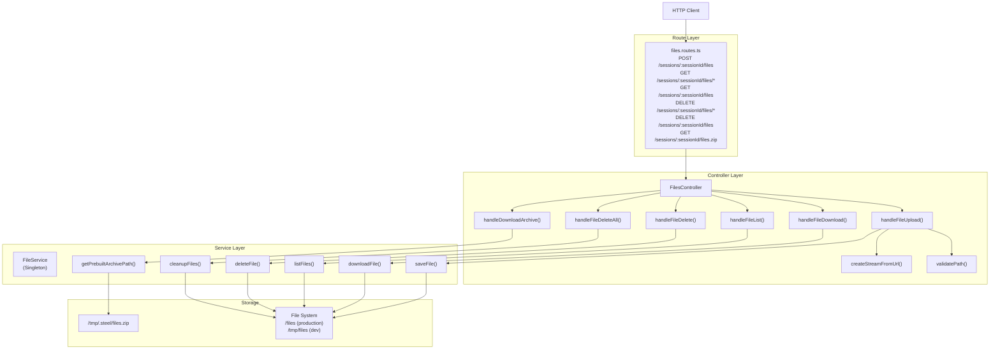
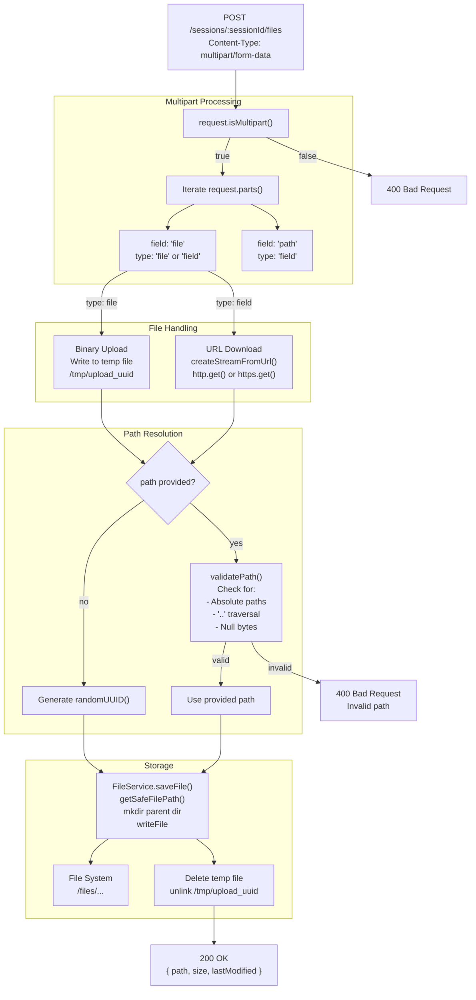
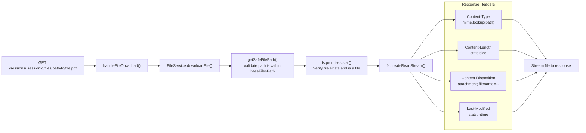
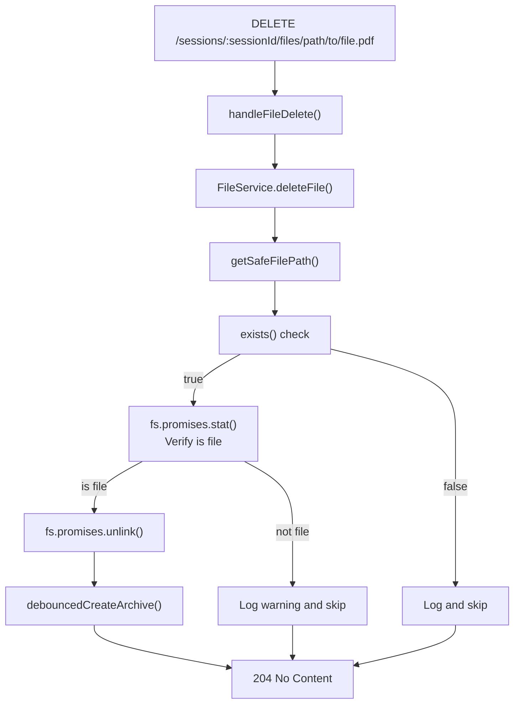
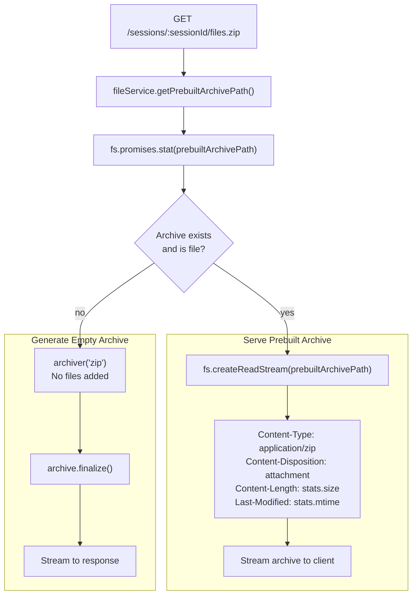

<!-- source: DeepWiki mcp.deepwiki.com · repo steel-dev/steel-browser · page 7.1 File API · fetched 2026-10-26 -->

# File API

<details>
<summary>Relevant source files</summary>

The following files were used as context for generating this wiki page:

- [api/src/modules/files/files.controller.ts](api/src/modules/files/files.controller.ts)
- [api/src/modules/files/files.routes.ts](api/src/modules/files/files.routes.ts)
- [api/src/modules/files/files.schema.ts](api/src/modules/files/files.schema.ts)
- [api/src/plugins/file-storage.ts](api/src/plugins/file-storage.ts)
- [api/src/services/file.service.ts](api/src/services/file.service.ts)

</details>


## Purpose and Scope

This document describes the HTTP REST API for managing files within browser sessions. The File API provides endpoints for uploading files (via binary data or URL), downloading files, listing files, deleting files, and retrieving bulk archives. Each session maintains its own isolated file storage namespace.

For information about the automatic archive generation system and file watching mechanism that powers the archive endpoint, see [Archive Management](#7.2). For general session management concepts, see [Session Management API](#4.1).

---

## API Architecture

The File API follows a three-layer architecture: routes define HTTP endpoints, controllers handle request/response logic, and the `FileService` singleton manages the underlying file operations.



**Sources:** [api/src/modules/files/files.routes.ts:1-149](), [api/src/modules/files/files.controller.ts:1-337](), [api/src/services/file.service.ts:1-474]()

---

## API Endpoints Reference

| Method | Endpoint | Operation ID | Description |
|--------|----------|--------------|-------------|
| `POST` | `/sessions/:sessionId/files` | `upload_file` | Upload a file via binary data or URL |
| `HEAD` | `/sessions/:sessionId/files/*` | `head_file` | Get file metadata without downloading |
| `GET` | `/sessions/:sessionId/files/*` | `download_file` | Download a specific file |
| `GET` | `/sessions/:sessionId/files` | `list_files` | List all files in the session |
| `DELETE` | `/sessions/:sessionId/files/*` | `delete_file` | Delete a specific file |
| `DELETE` | `/sessions/:sessionId/files` | `delete_all_files` | Delete all files in the session |
| `GET` | `/sessions/:sessionId/files.zip` | `download_archive` | Download all files as a zip archive |

**Sources:** [api/src/modules/files/files.routes.ts:18-146]()

---

## File Upload

### Multipart Form Data

File uploads use `multipart/form-data` encoding with two fields:

- **`file`** (required): Either binary file data or a URL string to download from.
- **`path`** (optional): Destination path in the session's file storage.



**Sources:** [api/src/modules/files/files.controller.ts:41-157](), [api/src/modules/files/files.routes.ts:18-41]()

### Binary File Upload

When uploading binary file data, the controller writes the multipart stream to a temporary file in `/tmp/upload_${uuid}`, then reads it back as a stream for the `FileService`:

```typescript
// Implementation details from handleFileUpload
tempFilePath = path.join(tmpdir(), `upload_${uuidv4()}`);
const writeStream = fs.createWriteStream(tempFilePath);
await pipeline(file.file, writeStream);

// Then read back and save
const readStream = fs.createReadStream(tempFilePath);
saveFileResult = await this.fileService.saveFile({
  filePath: finalPath,
  stream: readStream,
});
```

**Sources:** [api/src/modules/files/files.controller.ts:67-114]()

### URL Download

When the `file` field contains a URL string instead of binary data, the controller downloads the file using Node.js's `http` or `https` modules via `createStreamFromUrl()`:

```typescript
// Implementation details from createStreamFromUrl
const protocol = url.startsWith("https") ? https : http;
protocol.get(url, (response) => {
  if (response.statusCode !== 200) {
    return reject(new Error(`Failed to fetch file: ${response.statusCode}`));
  }
  // ... extract name and resolve stream
});
```

**Sources:** [api/src/modules/files/files.controller.ts:115-136](), [api/src/modules/files/files.controller.ts:159-191]()

### Path Validation

The `validatePath()` method enforces security constraints on file paths to prevent directory traversal attacks:

| Check | Rule | Reason |
|-------|------|--------|
| Absolute paths | `path.isAbsolute()` must return `false` | Prevents writing outside base directory |
| Parent directory | No `..` sequences allowed | Prevents traversal attacks |
| Null bytes | No `\0` characters allowed | Prevents null byte injection |
| Normalized path | `path.normalize()` must not start with `..` | Catches additional traversal attempts |

**Sources:** [api/src/modules/files/files.controller.ts:20-39]()

### File Size Limits

The multipart parser enforces a configurable maximum file size per session, defaulting to 100MB:

```typescript
// From files.routes.ts
await server.register(fastifyMultipart, {
  limits: {
    fileSize: server.steelBrowserConfig.fileStorage?.maxSizePerSession ?? 100 * MB,
  },
  attachFieldsToBody: false,
});
```

**Sources:** [api/src/modules/files/files.routes.ts:11-16]()

---

## File Download

### Single File Download

The `GET /sessions/:sessionId/files/*` endpoint serves individual files with appropriate headers:



**Sources:** [api/src/modules/files/files.controller.ts:193-216](), [api/src/services/file.service.ts:149-178]()

### HEAD Request Support

The `HEAD /sessions/:sessionId/files/*` endpoint returns the same headers as GET but without the file body, allowing clients to check file existence and metadata efficiently via `fileService.getFile()`:

**Sources:** [api/src/modules/files/files.controller.ts:218-236](), [api/src/modules/files/files.routes.ts:43-55]()

---

## File Listing

The `GET /sessions/:sessionId/files` endpoint recursively lists all files in the session's storage directory using `fileService.listFiles()`:

```typescript
// Response format (Zod schema: MultipleFiles)
{
  "data": [
    {
      "path": "document.pdf",
      "size": 1048576,
      "lastModified": "2024-01-15T10:30:00.000Z"
    }
  ]
}
```

Files are sorted by `lastModified` in descending order (newest first).

**Sources:** [api/src/modules/files/files.controller.ts:238-259](), [api/src/services/file.service.ts:203-250](), [api/src/modules/files/files.schema.ts:14-16]()

---

## File Deletion

### Single File Deletion

The `DELETE /sessions/:sessionId/files/*` endpoint deletes a specific file via `fileService.deleteFile()`:



**Sources:** [api/src/modules/files/files.controller.ts:261-275](), [api/src/services/file.service.ts:252-278]()

### Bulk Deletion

The `DELETE /sessions/:sessionId/files` endpoint removes all files and resets the session's file storage via `fileService.cleanupFiles()`:

**Process:**
1. Cancel any pending archive creation operations.
2. Delete the prebuilt archive file (`/tmp/.steel/files.zip`).
3. Delete all temporary archive files (`files-*.zip.tmp`).
4. Recursively remove all files from the base files directory.
5. Trigger creation of a new empty archive.

**Sources:** [api/src/modules/files/files.controller.ts:277-289](), [api/src/services/file.service.ts:280-329]()

---

## Archive Download

The `GET /sessions/:sessionId/files.zip` endpoint serves a pre-generated zip archive containing all session files. The archive is automatically maintained by the `FileService`'s file watching mechanism.

### Endpoint Behavior



**Sources:** [api/src/modules/files/files.controller.ts:291-335](), [api/src/modules/files/files.routes.ts:133-145]()

### Archive Path

The prebuilt archive is stored at `/tmp/.steel/files.zip`. This location is initialized in the `FileService` constructor:

**Sources:** [api/src/services/file.service.ts:26-30](), [api/src/services/file.service.ts:335-337]()

---

## Request/Response Schemas

The File API uses Zod schemas for request/response validation, which are also used to generate OpenAPI documentation.

### FileUploadRequest
- `file`: The file to upload (binary) or URL string to download from.
- `path`: (Optional) Path to the file in the storage system.

**Sources:** [api/src/modules/files/files.schema.ts:3-6]()

### FileDetails
- `path`: Path to the file in the storage system.
- `size`: Size of the file in bytes.
- `lastModified`: Timestamp when the file was last updated.

**Sources:** [api/src/modules/files/files.schema.ts:8-12]()

### MultipleFiles
- `data`: Array of `FileDetails` for the current page.

**Sources:** [api/src/modules/files/files.schema.ts:14-16]()

---

## Security Considerations

### Path Safety

The `FileService` implements multiple layers of path validation:

1. **Relative path enforcement**: `getSafeFilePath()` rejects absolute paths.
2. **Base path containment**: Resolved paths must start with `baseFilesPath`.
3. **Traversal prevention**: Paths containing `..` are rejected.
4. **Normalization**: Paths are normalized before validation.

```typescript
// From FileService.getSafeFilePath()
const resolvedPath = resolve(this.baseFilesPath, relativePath);
if (
  !resolvedPath.startsWith(this.baseFilesPath + path.sep) &&
  resolvedPath !== this.baseFilesPath
) {
  throw new Error("Invalid path");
}
```

**Sources:** [api/src/services/file.service.ts:87-96]()

### File System Isolation

Each session's files are stored in the base files directory. In production, this is `/files`; in development, it's a directory in `tmpdir()`:

**Sources:** [api/src/services/file.service.ts:27-28]()

### Error Handling

The controller catches and logs errors, returning appropriate HTTP status codes:

- **400 Bad Request**: Invalid path, missing file, or request not being multipart.
- **500 Internal Server Error**: File system errors or stream failures.

**Sources:** [api/src/modules/files/files.controller.ts:49-54](), [api/src/modules/files/files.controller.ts:150-156]()

---

## Plugin Registration

The `FileService` is registered as a Fastify decorator via the `file-storage` plugin, making it available throughout the application:

```typescript
// From api/src/plugins/file-storage.ts
const fileStoragePlugin: FastifyPluginAsync = async (fastify, _options) => {
  fastify.log.info("Registering file service");
  fastify.decorate("fileService", FileService.getInstance());
};
```

This ensures a single `FileService` instance handles all file operations across the application.

**Sources:** [api/src/plugins/file-storage.ts:1-10]()

---

