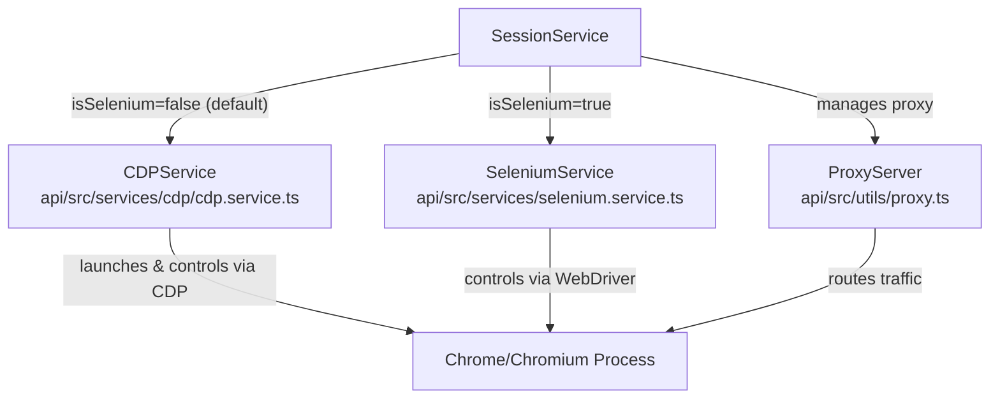
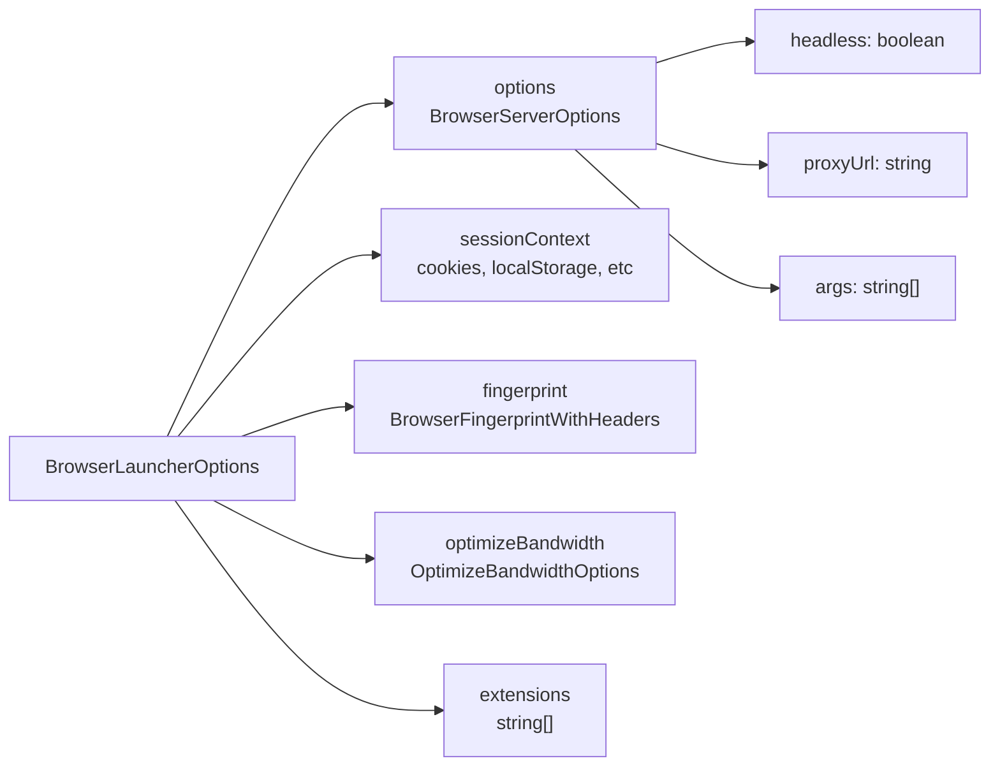
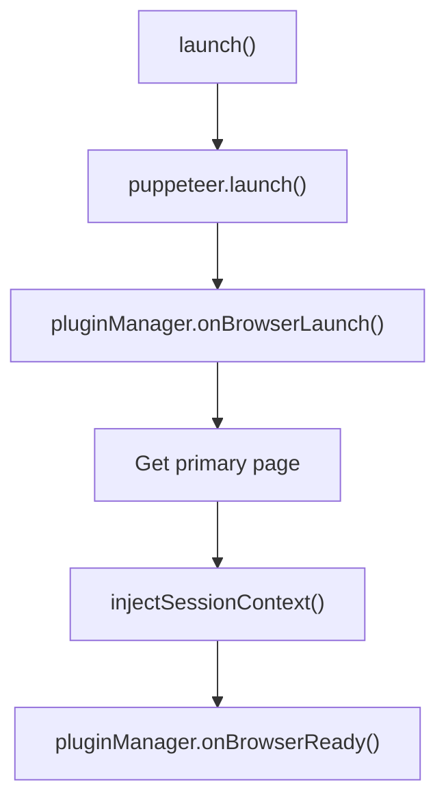
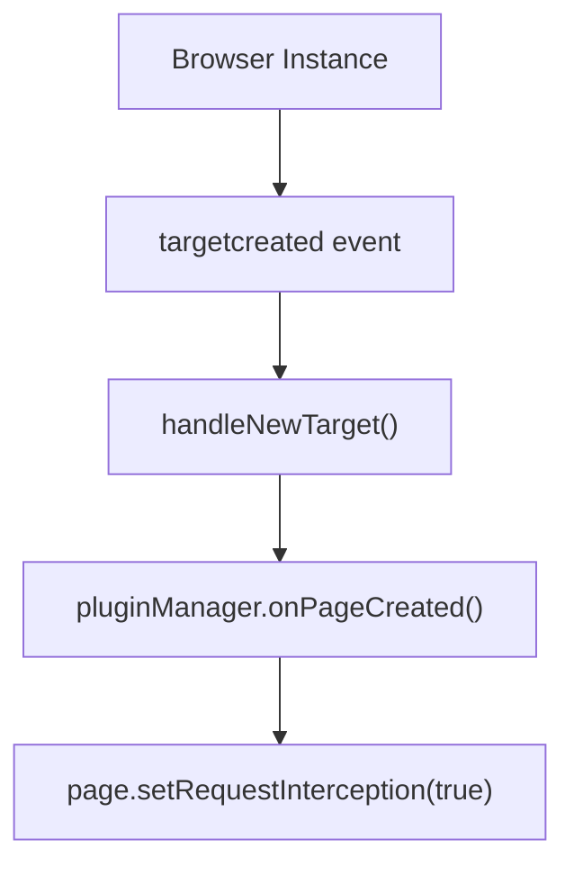

<!-- source: DeepWiki mcp.deepwiki.com · repo steel-dev/steel-browser · page 8 Browser Automation Features · fetched 2026-10-26 -->

# Browser Automation Features

Relevant source files

The following files were used as context for generating this wiki page:

- [api/src/modules/actions/actions.controller.ts](api/src/modules/actions/actions.controller.ts)
- [api/src/modules/actions/actions.routes.ts](api/src/modules/actions/actions.routes.ts)
- [api/src/modules/actions/actions.schema.ts](api/src/modules/actions/actions.schema.ts)
- [api/src/services/cdp/cdp.service.ts](api/src/services/cdp/cdp.service.ts)
- [api/src/services/cdp/plugins/core/base-plugin.ts](api/src/services/cdp/plugins/core/base-plugin.ts)
- [api/src/services/cdp/plugins/core/plugin-manager.ts](api/src/services/cdp/plugins/core/plugin-manager.ts)
- [api/src/services/selenium.service.ts](api/src/services/selenium.service.ts)
- [api/src/utils/passthough-proxy.ts](api/src/utils/passthough-proxy.ts)
- [api/src/utils/proxy.ts](api/src/utils/proxy.ts)

## Purpose and Scope

This page provides an overview of the browser automation capabilities in steel-browser. It covers the core automation mechanisms (Chrome DevTools Protocol and Selenium WebDriver), anti-detection features, request interception, and extension support. For detailed information on specific features, see:
- Session lifecycle management: [Browser Sessions](#4)
- Quick action APIs for scraping/screenshots: [Quick Actions API](#5)
- Plugin extensibility: [Plugin System](#9)

## Core Automation Architecture

steel-browser provides two automation modes orchestrated by `SessionService`:

| Mode | Service | Protocol | Use Case |
|------|---------|----------|----------|
| **CDP** (default) | `CDPService` | Chrome DevTools Protocol | Full-featured automation with fingerprinting, plugins, instrumentation |
| **Selenium** | `SeleniumService` | WebDriver Protocol | Compatibility with existing Selenium/WebDriver scripts |

### Session Service Orchestration

**Diagram: Session Service Architecture**

The `SessionService` acts as the orchestration layer, selecting the appropriate automation backend. While `CDPService` uses `puppeteer-core` to manage the browser via CDP [api/src/services/cdp/cdp.service.ts:24](), `SeleniumService` spawns a standalone Selenium server to interface with the browser via WebDriver [api/src/services/selenium.service.ts:40-44]().

Sources: [api/src/services/cdp/cdp.service.ts:83-182](), [api/src/services/selenium.service.ts:8-18]()

## Browser Launch Configuration

Browser sessions are configured via `BrowserLauncherOptions`, which provides extensive control over browser behavior:

**Diagram: Browser Launch Configuration Structure**

### Key Configuration Options

| Option | Type | Purpose |
|--------|------|---------|
| `options.headless` | `boolean` | Run browser in headless mode [api/src/services/cdp/cdp.service.ts:152]() |
| `options.proxyUrl` | `string` | Upstream proxy URL for routing traffic [api/src/utils/proxy.ts:48-49]() |
| `blockAds` | `boolean` | Block requests to known ad networks [api/src/services/cdp/cdp.service.ts:156]() |
| `timezone` | `string` | Override browser timezone [api/src/services/cdp/cdp.service.ts:159]() |
| `userPreferences` | `object` | Chrome user preferences (e.g., PDF viewer settings) [api/src/services/cdp/cdp.service.ts:160-165]() |

Sources: [api/src/services/cdp/cdp.service.ts:150-167](), [api/src/utils/proxy.ts:22-51]()

## Browser Launch Process

The browser launch process in `CDPService` follows a structured sequence with comprehensive error handling:

**Diagram: Browser Launch Sequence**

The `CDPService` utilizes a `PluginManager` to notify registered plugins at various stages of the lifecycle, such as `onBrowserLaunch` and `onBrowserReady` [api/src/services/cdp/plugins/core/plugin-manager.ts:96-118]().

Sources: [api/src/services/cdp/cdp.service.ts:169-180](), [api/src/services/cdp/plugins/core/plugin-manager.ts:54-118]()

## Target and Page Management

The `CDPService` handles browser targets (pages, workers, extensions) through event-driven lifecycle management:

**Diagram: Target Lifecycle Management**

When a new page target is created, `CDPService` performs several setup tasks:
1. **Instrumentation**: Attaches `TargetInstrumentationManager` to capture logs and events [api/src/services/cdp/cdp.service.ts:177-180]().
2. **Plugin Notification**: Invokes `onPageCreated` for all active plugins [api/src/services/cdp/plugins/core/plugin-manager.ts:123-132]().
3. **Request Control**: Enables request interception to allow filtering of ads or specific resource types [api/src/services/cdp/cdp.service.ts:36-38]().

Sources: [api/src/services/cdp/cdp.service.ts:103-104](), [api/src/services/cdp/plugins/core/plugin-manager.ts:123-132]()

## Request Interception and Filtering

The system provides robust request filtering to optimize performance and security. The logic resides in `api/src/utils/requests.ts` and is applied during the page lifecycle.

| Feature | Function | Description |
|--------|----------|-------------|
| **Ad Blocking** | `isAdRequest()` | Blocks known tracking and advertisement domains [api/src/utils/requests.ts:32](). |
| **Media Blocking** | `isHeavyMediaRequest()` | Filters large video or audio files to save bandwidth [api/src/utils/requests.ts:33](). |
| **Host Blocking** | `isHostBlocked()` | Prevents navigation to specific blacklisted hostnames [api/src/utils/requests.ts:34](). |
| **Pattern Matching** | `isUrlMatchingPatterns()` | Blocks URLs based on regex or glob patterns [api/src/utils/requests.ts:35](). |

Sources: [api/src/services/cdp/cdp.service.ts:30-38](), [api/src/utils/requests.ts:30-38]()

## Browser Extensions

steel-browser supports loading Chrome extensions to enhance automation capabilities. Extension paths are resolved and passed to the browser during the launch phase [api/src/services/cdp/cdp.service.ts:47]().

- **Loading**: Extensions are specified in the `BrowserLauncherOptions` [api/src/services/cdp/cdp.service.ts:157]().
- **Default Extensions**: The system can be configured to load a set of default extensions for every session.

Sources: [api/src/services/cdp/cdp.service.ts:47](), [api/src/services/cdp/cdp.service.ts:157]()

## CDP Integration Details

For in-depth information on Chrome DevTools Protocol integration, page control, and browser events, see [CDP Integration](#8.1).

## Selenium WebDriver Support

The `SeleniumService` provides a compatibility layer for users migrating from traditional Selenium grids. It manages the lifecycle of the `selenium-server.jar` and provides the necessary connection URL [api/src/services/selenium.service.ts:40-45](). For more details, see [Selenium Support](#8.2).

## Anti-Detection Features

Stealth is a core component of the automation engine. The `CDPService` integrates `FingerprintGenerator` and `FingerprintInjector` to mask automation signatures [api/src/services/cdp/cdp.service.ts:4-9](). For detailed stealth configuration, see [Anti-Detection Features](#8.3).

## Request Interception & Filtering

For advanced details on how to configure ad-blocking and resource filtering, see [Request Interception & Filtering](#8.4).

## Browser Extensions

To learn how to package and deploy custom extensions within your sessions, see [Browser Extensions](#8.5).

---

