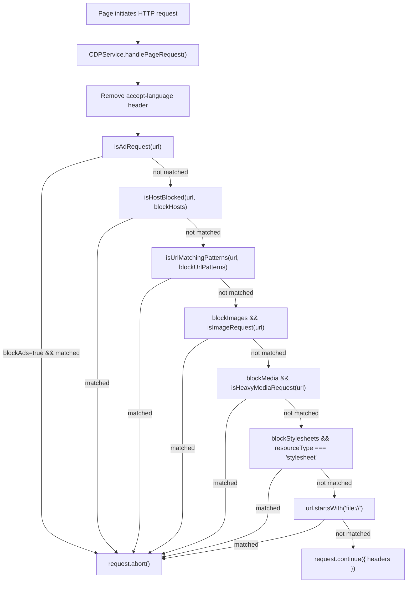
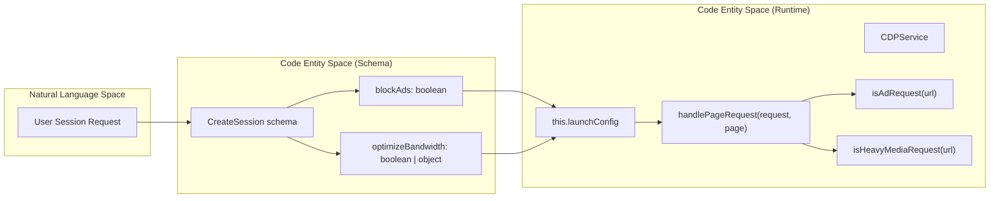
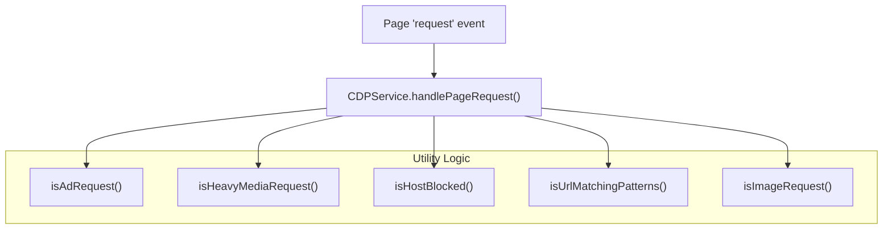

<!-- source: DeepWiki mcp.deepwiki.com · repo steel-dev/steel-browser · page 8.4 Request Interception & Filtering · fetched 2026-10-26 -->

# Request Interception & Filtering

<details>
<summary>Relevant source files</summary>

The following files were used as context for generating this wiki page:

- [api/src/modules/sessions/sessions.controller.ts](api/src/modules/sessions/sessions.controller.ts)
- [api/src/modules/sessions/sessions.schema.ts](api/src/modules/sessions/sessions.schema.ts)
- [api/src/services/cdp/cdp.service.ts](api/src/services/cdp/cdp.service.ts)
- [api/src/services/cdp/plugins/core/base-plugin.ts](api/src/services/cdp/plugins/core/base-plugin.ts)
- [api/src/services/cdp/plugins/core/plugin-manager.ts](api/src/services/cdp/plugins/core/plugin-manager.ts)

</details>


This document describes the request interception and filtering system in steel-browser, which provides fine-grained control over network requests made by browser sessions. The system enables ad blocking, bandwidth optimization, custom host/URL filtering, and security protections.

For information about anti-detection fingerprinting and header manipulation, see [8.3 Anti-Detection Features](). For browser launch configuration, see [4.2 Session Configuration]().

## Purpose and Architecture

The request interception system operates at the Chrome DevTools Protocol (CDP) level using `puppeteer-core`, intercepting every HTTP request before it leaves the browser. This allows steel-browser to block, modify, or allow requests based on configurable criteria including ad detection, resource type, host patterns, and URL patterns.

Request interception is implemented in the `CDPService` and configured through `BrowserLauncherOptions` when creating sessions. All filtering happens synchronously during the request lifecycle, ensuring minimal performance impact while maximizing control.

**Sources:** [api/src/services/cdp/cdp.service.ts:83-106](), [api/src/services/cdp/cdp.service.ts:366-439](), [api/src/modules/sessions/sessions.schema.ts:36-56]()

## Request Interception Flow



**Sources:** [api/src/services/cdp/cdp.service.ts:385-439](), [api/src/utils/requests.ts:1-111]()

## Request Interception Configuration

The following diagram maps the configuration schema to the internal runtime entities within `CDPService`.



**Sources:** [api/src/modules/sessions/sessions.schema.ts:28-56](), [api/src/services/cdp/cdp.service.ts:385-439](), [api/src/utils/requests.ts:30-51]()

## Ad Blocking

### Overview

The `blockAds` configuration option enables automatic blocking of requests to known advertising and tracking domains. When enabled, steel-browser maintains a curated list of ad networks, analytics services, and tracking platforms.

### Implementation

Ad blocking is implemented through the `isAdRequest()` utility function, which checks if the request hostname matches any domain in the `AD_HOSTS` list. The check performs both exact matches and subdomain matches.

```typescript
// Configuration in sessions.schema.ts
blockAds: z.boolean().optional()
```

### Blocked Hosts

The system blocks requests to categories including Ad Networks, Analytics, Ad Exchanges, and Social Tracking via the `AD_HOSTS` array defined in `requests.ts`.

### Request Flow

When ad blocking is enabled:

1. Page initiates HTTP request.
2. `handlePageRequest()` receives the request.
3. `isAdRequest(request.url())` checks hostname against `AD_HOSTS`.
4. If matched, `request.abort()` is called and request is logged.
5. If not matched, request continues to next filter.

**Sources:** [api/src/services/cdp/cdp.service.ts:393-397](), [api/src/utils/requests.ts:1-60](), [api/src/modules/sessions/sessions.schema.ts:36-39]()

## Bandwidth Optimization

### Overview

The `optimizeBandwidth` option provides multiple strategies for reducing bandwidth consumption by blocking resource types and specific hosts/URLs. It can be configured as a boolean (enabling all optimizations) or as an object with granular control.

### Configuration Modes

#### Boolean Mode

When set to `true`, the system enables `blockImages`, `blockMedia`, and `blockStylesheets`.

#### Object Mode

```typescript
optimizeBandwidth: {
  blockImages: boolean;
  blockMedia: boolean;
  blockStylesheets: boolean;
  blockHosts: string[];
  blockUrlPatterns: string[];
}
```

### Resource Type Filtering

#### Image Blocking

When `blockImages: true`, the system blocks:
- Resources with `resourceType === "image"`.
- URLs matching image extensions via `isImageRequest()`.

#### Media Blocking

When `blockMedia: true`, the system blocks:
- Resources with `resourceType === "media"`.
- URLs matching video extensions or streaming protocols via `isHeavyMediaRequest()`.

#### Stylesheet Blocking

When `blockStylesheets: true`, the system blocks:
- Resources with `resourceType === "stylesheet"`.

### Host and Pattern Blocking

#### Host Blocking

The `blockHosts` array accepts domain names that should be completely blocked. The `isHostBlocked()` function performs exact hostname and subdomain matching.

#### URL Pattern Blocking

The `blockUrlPatterns` array accepts glob-style patterns. The `isUrlMatchingPatterns()` function converts these to regular expressions.

**Sources:** [api/src/services/cdp/cdp.service.ts:389-430](), [api/src/utils/requests.ts:62-111](), [api/src/modules/sessions/sessions.schema.ts:40-56]()

## Header Manipulation

### Accept-Language Removal

The request interception system automatically removes the `accept-language` header from all requests as an anti-detection measure. This helps prevent headless browser detection through language fingerprinting.

```typescript
const headers = request.headers();
delete headers["accept-language"]; 
```

This modification occurs in `handlePageRequest` before any other filtering logic.

**Sources:** [api/src/services/cdp/cdp.service.ts:386-388]()

## Security Filtering

### File Protocol Protection

The system includes automatic protection against file protocol requests (`file://`), which could expose the local filesystem. 

1. **Request Level**: Any request to a `file://` URL triggers `request.abort()`, logs the violation, and initiates a browser shutdown via `this.shutdown()`.
2. **Response Level**: If a response is received from a `file://` URL, the page is closed and the browser is shut down.

**Sources:** [api/src/services/cdp/cdp.service.ts:432-438](), [api/src/services/cdp/cdp.service.ts:370-378]()

## Implementation Details

### Request Interception Setup

Request interception is enabled for every page created in the browser. The `CDPService` listens for the `targetcreated` event. If the target is a page, it calls `page.setRequestInterception(true)` and attaches the `handlePageRequest` handler.

### Handler Logic Association

The following diagram bridges the logical request handling steps to the specific code functions.



**Sources:** [api/src/services/cdp/cdp.service.ts:385-439](), [api/src/utils/requests.ts:1-111]()

## Configuration Reference

### BrowserLauncherOptions & Schema

| Field | Type | Description |
|-------|------|-------------|
| `blockAds` | `boolean` | Enable ad blocking. |
| `optimizeBandwidth` | `boolean \| object` | Enable bandwidth optimization (images, media, stylesheets, hosts, patterns). |
| `skipFingerprintInjection`| `boolean` | Flag to skip fingerprint injection. |

**Sources:** [api/src/modules/sessions/sessions.schema.ts:28-60](), [api/src/services/cdp/cdp.service.ts:150-167]()

## Logging

Blocked requests are logged via the `CDPService` logger:

- **Ads**: `[CDPService] Blocked request to ad related resource: ${url}`
- **Hosts/Patterns**: `[CDPService] Blocked request to blocked host or pattern: ${url}`
- **Resources**: `[CDPService] Blocked ${resourceType} resource due to optimizeBandwidth...`
- **Security**: `[CDPService] Blocked request to file protocol: ${url}`

**Sources:** [api/src/services/cdp/cdp.service.ts:394-434]()

---

