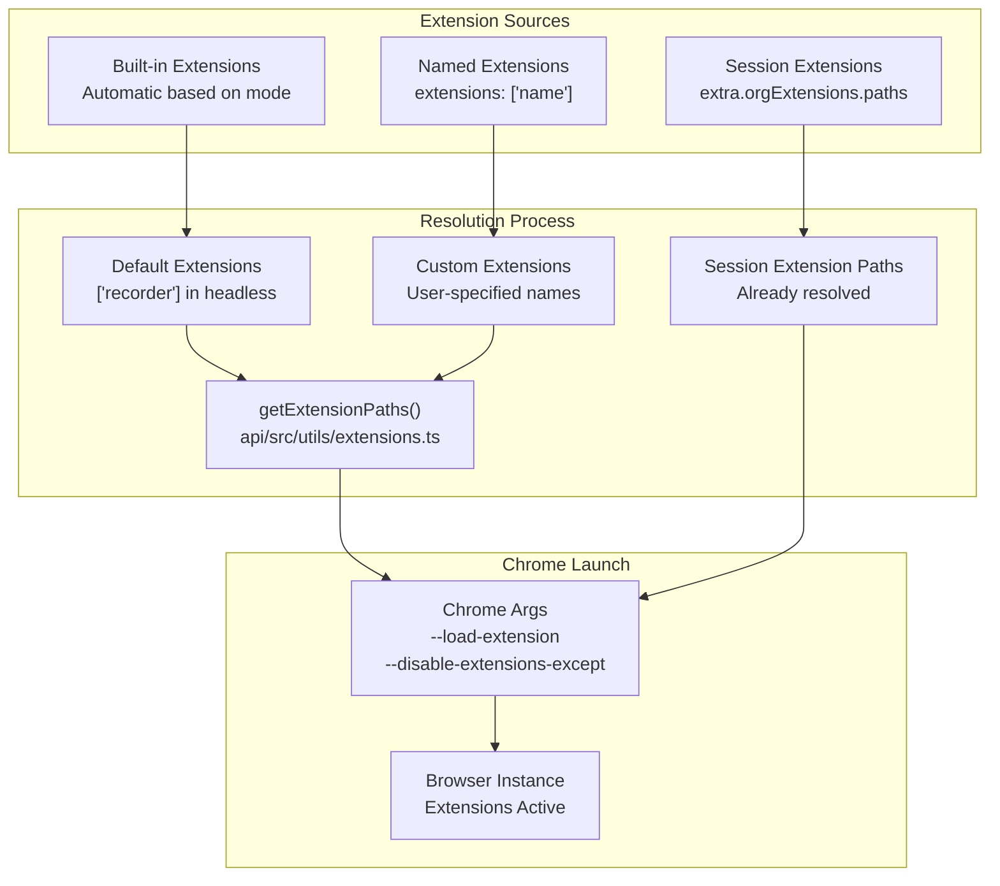
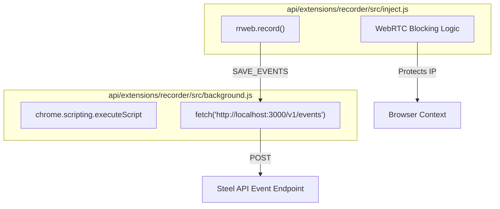
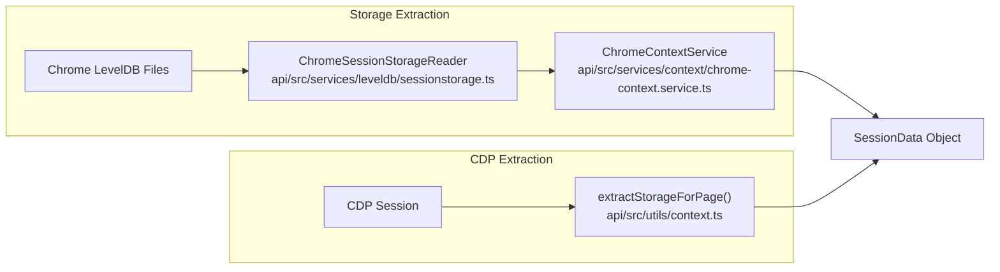

<!-- source: DeepWiki mcp.deepwiki.com · repo steel-dev/steel-browser · page 8.5 Browser Extensions · fetched 2026-10-26 -->

# Browser Extensions

<details>
<summary>Relevant source files</summary>

The following files were used as context for generating this wiki page:

- [api/extensions/recorder/.gitignore](api/extensions/recorder/.gitignore)
- [api/extensions/recorder/manifest.json](api/extensions/recorder/manifest.json)
- [api/extensions/recorder/package-lock.json](api/extensions/recorder/package-lock.json)
- [api/extensions/recorder/package.json](api/extensions/recorder/package.json)
- [api/extensions/recorder/src/background.js](api/extensions/recorder/src/background.js)
- [api/extensions/recorder/src/inject.js](api/extensions/recorder/src/inject.js)
- [api/src/services/context/chrome-context.service.ts](api/src/services/context/chrome-context.service.ts)
- [api/src/services/leveldb/sessionstorage.ts](api/src/services/leveldb/sessionstorage.ts)
- [api/src/services/timezone-fetcher.service.ts](api/src/services/timezone-fetcher.service.ts)
- [api/src/utils/context.ts](api/src/utils/context.ts)
- [api/src/utils/extensions.ts](api/src/utils/extensions.ts)

</details>


This document describes how Chrome extensions are loaded and managed in steel-browser sessions. Browser extensions are packaged Chrome extensions that can be loaded into browser instances to add functionality such as recording, automation helpers, or custom tooling.

For information about the Plugin system that provides lifecycle hooks for extending browser automation behavior, see [Plugin System](#9).

---

## Overview

Steel-browser supports loading Chrome extensions into browser sessions. Extensions can be:
- Built-in extensions bundled with the system (e.g., the recorder extension)
- Named extensions resolved from the extensions directory
- Custom extensions provided as file system paths

Extensions are loaded during browser launch and remain active throughout the session lifecycle. Each extension runs in its own background page context and can interact with web pages through Chrome's extension APIs.

**Sources:**
- [api/src/utils/extensions.ts:4-38]()
- [api/extensions/recorder/manifest.json:1-26]()

---

## Extension Types

Steel-browser supports three types of extensions:

| Extension Type | Description | Configuration Method | Example |
|---------------|-------------|---------------------|---------|
| Built-in | System extensions bundled with steel-browser | Automatically loaded based on headless mode | `recorder` |
| Named | Extensions resolved from the extensions directory | Specified by name in `extensions` array | `["my-extension"]` |
| Session-specific | External extensions provided via API | Passed in `extra.orgExtensions.paths` | Absolute file paths |

### Extension Source Resolution

The system uses `getExtensionPaths` to resolve named extensions by checking the `api/extensions` directory.



**Sources:**
- [api/src/utils/extensions.ts:4-10]()
- [api/src/utils/extensions.ts:21-23]()

---

## Built-in Extensions: The Recorder

Steel-browser includes a built-in `recorder` extension located in `api/extensions/recorder/`. This extension uses `rrweb` to capture session events for playback and debugging.

### Recorder Implementation

The recorder consists of three main components:
1.  **Manifest**: Defines permissions (`scripting`, `activeTab`) and the background service worker [api/extensions/recorder/manifest.json:1-26]().
2.  **Background Script**: Injects the recorder into tabs and forwards events to the Steel API at `/v1/events` [api/extensions/recorder/src/background.js:1-55]().
3.  **Injected Script**: Uses `rrweb` to record DOM changes and also handles WebRTC blocking for privacy on specific sites [api/extensions/recorder/src/inject.js:1-57]().

### WebRTC Blocking Logic
The recorder extension includes a privacy feature that disables WebRTC on all sites except a whitelist (e.g., Google Meet, Zoom, Discord) to prevent IP leaks [api/extensions/recorder/src/inject.js:28-54]().



**Sources:**
- [api/extensions/recorder/src/inject.js:4-26]()
- [api/extensions/recorder/src/inject.js:28-54]()
- [api/extensions/recorder/src/background.js:1-3]()

---

## Configuration

Extensions are configured when creating a browser session through the `BrowserLauncherOptions` interface.

### Session Creation with Extensions

Extensions can be specified in the session creation request:

```typescript
// In BrowserLauncherOptions
{
  extensions?: string[],          // Named extensions to load from api/extensions/
  extra?: {
    orgExtensions?: {
      paths: string[]              // Absolute paths to custom extension directories
    }
  }
}
```

**Sources:**
- [api/src/utils/extensions.ts:4-38]()

---

## Extension Loading Mechanism

Extensions are loaded via Chrome command-line arguments. The `CDPService` (or similar launcher) aggregates paths from `getExtensionPaths` and any session-specific paths provided in the `extra` field.

### Launch Arguments Format

When extensions are present, two Chrome arguments are added:

| Argument | Purpose | Format |
|----------|---------|--------|
| `--load-extension` | Loads specified extensions on startup | Comma-separated absolute paths |
| `--disable-extensions-except` | Disables all extensions except the specified ones | Comma-separated absolute paths |

**Sources:**
- [api/src/utils/extensions.ts:21-23]()
- [api/extensions/recorder/manifest.json:13-25]()

---

## Data Extraction and Storage

While extensions provide active functionality, Steel-browser also uses CDP (Chrome DevTools Protocol) and direct filesystem access to manage session state like `localStorage` and `sessionStorage`.

### Storage Resolution Flow

The `ChromeContextService` and `ChromeSessionStorageReader` handle persistent state that extensions or pages might create.



**Sources:**
- [api/src/services/leveldb/sessionstorage.ts:204-229]()
- [api/src/services/context/chrome-context.service.ts:8-56]()
- [api/src/utils/context.ts:19-27]()

---

## Extension Lifecycle

Extensions follow the browser session lifecycle and are loaded during launch and closed during shutdown.

1.  **Launch Phase**: The system identifies required extensions, resolves paths via `getExtensionPaths`, and starts Chrome with `--load-extension`.
2.  **Active Phase**: Extension background scripts (like `background.js` in the recorder) listen for events. Content scripts (like `inject.js`) are injected into pages as they load [api/extensions/recorder/manifest.json:16-25]().
3.  **Shutdown Phase**: Extensions are unloaded when the browser process is terminated.

**Sources:**
- [api/extensions/recorder/src/background.js:5-19]()
- [api/src/utils/extensions.ts:4-38]()

---

