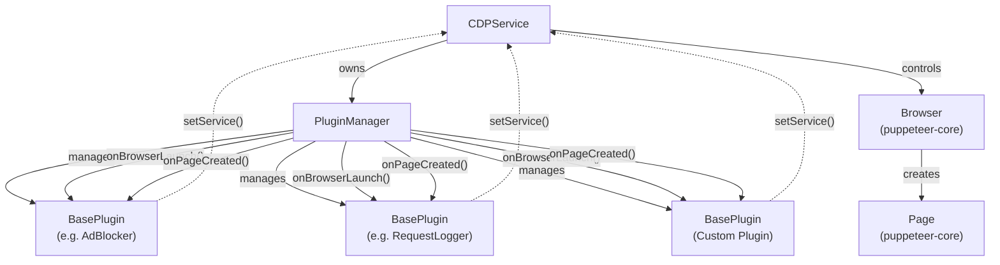
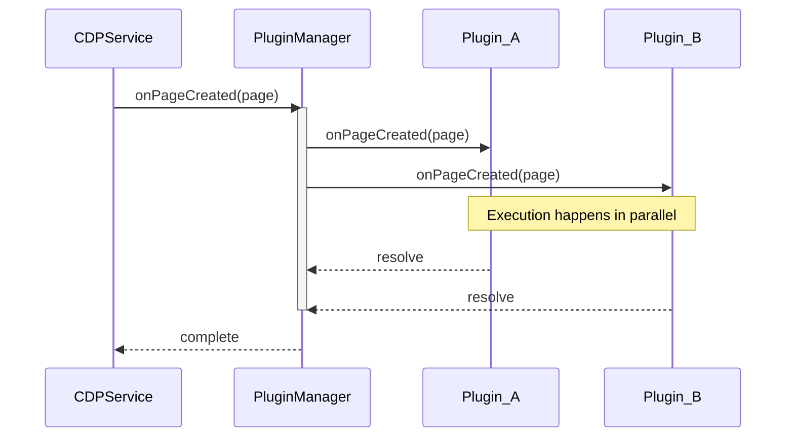

<!-- source: DeepWiki mcp.deepwiki.com · repo steel-dev/steel-browser · page 9.1 BasePlugin & PluginManager · fetched 2026-10-26 -->

# BasePlugin & PluginManager

<details>
<summary>Relevant source files</summary>

The following files were used as context for generating this wiki page:

- [api/src/plugins/browser-socket/handlers/cast.handler.ts](api/src/plugins/browser-socket/handlers/cast.handler.ts)
- [api/src/plugins/browser-socket/handlers/index.ts](api/src/plugins/browser-socket/handlers/index.ts)
- [api/src/services/cdp/cdp.service.ts](api/src/services/cdp/cdp.service.ts)
- [api/src/services/cdp/plugins/core/base-plugin.ts](api/src/services/cdp/plugins/core/base-plugin.ts)
- [api/src/services/cdp/plugins/core/index.ts](api/src/services/cdp/plugins/core/index.ts)
- [api/src/services/cdp/plugins/core/plugin-manager.ts](api/src/services/cdp/plugins/core/plugin-manager.ts)
- [api/src/services/websocket-registry.service.ts](api/src/services/websocket-registry.service.ts)
- [api/src/steel-browser-plugin.ts](api/src/steel-browser-plugin.ts)
- [api/src/types/index.ts](api/src/types/index.ts)
- [api/src/types/websocket.ts](api/src/types/websocket.ts)
- [docs/PLUGIN_DEVELOPMENT.md](docs/PLUGIN_DEVELOPMENT.md)
- [ui/vite.config.ts](ui/vite.config.ts)

</details>


## Purpose and Scope

The plugin system provides an extensible architecture for customizing browser automation behavior at key points in the browser and page lifecycle. The `BasePlugin` abstract class defines lifecycle hooks that plugins can implement, while the `PluginManager` orchestrates plugin registration and event distribution across all registered plugins.

This document covers the plugin architecture, lifecycle hooks, and the mechanics of plugin registration and execution.

**Sources:** [api/src/services/cdp/plugins/core/base-plugin.ts:27-55](), [api/src/services/cdp/plugins/core/plugin-manager.ts:7-217]()

---

## Plugin Architecture Overview

The plugin system consists of three primary components that work together to enable modular browser automation extensions:



**Diagram: Plugin System Component Relationships**

The `CDPService` owns the `PluginManager`, which maintains a registry of `BasePlugin` instances. Each plugin receives a reference to `CDPService` via `setService()`, allowing plugins to access browser instances and CDP functionality. When lifecycle events occur (browser launch, page creation, etc.), `CDPService` calls the corresponding method on `PluginManager`, which propagates the event to all registered plugins in parallel.

**Sources:** [api/src/services/cdp/cdp.service.ts:169-169](), [api/src/services/cdp/plugins/core/base-plugin.ts:27-40](), [api/src/services/cdp/plugins/core/plugin-manager.ts:7-16]()

---

## BasePlugin Class

The `BasePlugin` abstract class serves as the base for all plugins in the system. Plugins extend this class and implement the lifecycle hooks they need to customize browser behavior.

### Class Structure

```typescript
export abstract class BasePlugin {
  public name: string;
  protected options: PluginOptions;
  protected cdpService: CDPService | null;
}
```

| Property | Type | Description |
|----------|------|-------------|
| `name` | `string` | Unique identifier for the plugin, used for registration and retrieval |
| `options` | `PluginOptions` | Configuration options passed during plugin construction |
| `cdpService` | `CDPService \| null` | Reference to `CDPService`, set by `PluginManager` after registration |

**Sources:** [api/src/services/cdp/plugins/core/base-plugin.ts:27-36]()

### Constructor and Service Injection

The `BasePlugin` constructor accepts a `PluginOptions` object that includes a `name` property. The `cdpService` reference is initially `null` and is injected by `PluginManager.register()` via the `setService()` method:

```typescript
constructor(options: PluginOptions) {
  this.name = options.name;
  this.options = options;
  this.cdpService = null;
}

public setService(service: CDPService): void {
  this.cdpService = service;
}
```

This dependency injection pattern allows plugins to access browser instances, pages, and CDP functionality through the `CDPService` instance.

**Sources:** [api/src/services/cdp/plugins/core/base-plugin.ts:32-40]()

### Lifecycle Hooks

`BasePlugin` defines multiple lifecycle hooks that plugins can override. All hooks have default empty implementations:

| Hook | Parameters | Called When |
|------|------------|-------------|
| `onSessionStart` | `sessionConfig` | Before a session begins (launch or reuse) |
| `onBrowserLaunch` | `browser` | Immediately after the browser process launches |
| `onBrowserReady` | `context` | After browser is fully configured and ready |
| `onPageCreated` | `page` | When a new page/tab is created |
| `onPageNavigate` | `page` | Before page begins navigation |
| `onPageUnload` | `page` | Before page content unloads |
| `onBeforePageClose` | `page` | Before a page is closed |
| `onBrowserClose` | `browser` | Before the browser process closes |
| `onBeforeSessionEnd`| `sessionConfig` | Before session shutdown begins |
| `onSessionEnd` | `sessionConfig` | After teardown and session-end work is complete |
| `onShutdown` | `reason` | During system shutdown with a specific `ShutdownReason` |

**Sources:** [api/src/services/cdp/plugins/core/base-plugin.ts:42-55]()

### Shutdown Reasons

The `ShutdownReason` enum provides context to the `onShutdown` hook:

| Reason | Description |
|--------|-------------|
| `SESSION_END` | Normal graceful session termination |
| `SECURITY_VIOLATION` | Security violation detected (e.g., restricted protocol access) |
| `RELAUNCH` | Browser is closing to be replaced by a new instance |
| `LAUNCH_FAILURE` | Cleanup before a retry after a failed launch |
| `MODE_SWITCH` | Switching browser modes (e.g., CDP to Selenium) |

**Sources:** [api/src/services/cdp/plugins/core/base-plugin.ts:9-20]()

---

## PluginManager Class

The `PluginManager` maintains the plugin registry and coordinates lifecycle event distribution across all registered plugins.

### Class Structure

```typescript
export class PluginManager {
  private plugins: Map<string, BasePlugin>;
  private service: CDPService;
  private logger: FastifyBaseLogger;
}
```

The `PluginManager` constructor requires both a `CDPService` instance and a logger:

```typescript
constructor(service: CDPService, logger: FastifyBaseLogger) {
  this.plugins = new Map();
  this.service = service;
  this.logger = logger;
}
```

**Sources:** [api/src/services/cdp/plugins/core/plugin-manager.ts:7-16]()

### Plugin Registration and Management

The `register()` method adds a plugin to the registry and injects the service:

```typescript
public register(plugin: BasePlugin): void {
  if (this.plugins.has(plugin.name)) {
    this.logger.warn(`Plugin with name ${plugin.name} is already registered. Overwriting.`);
  }

  plugin.setService(this.service);
  this.plugins.set(plugin.name, plugin);
  this.logger.info(`Registered plugin: ${plugin.name}`);
}
```

The `PluginManager` also provides `unregister(pluginName)` to remove plugins and `getPlugin<T>(pluginName)` to retrieve a specific instance with type safety.

**Sources:** [api/src/services/cdp/plugins/core/plugin-manager.ts:21-49]()

### Event Propagation Pattern

Each lifecycle event method in `PluginManager` follows a parallel execution pattern using `Promise.all()`. This ensures that one slow or failing plugin does not block others.



**Diagram: Parallel Plugin Execution Sequence**

Example implementation from `onBrowserLaunch()`:

```typescript
public async onBrowserLaunch(browser: Browser): Promise<void> {
  const promises = Array.from(this.plugins.values()).map(async (plugin) => {
    try {
      await plugin.onBrowserLaunch(browser);
    } catch (error) {
      this.logger.error(`Error in plugin ${plugin.name}.onBrowserLaunch: ${error}`);
    }
  });
  await Promise.all(promises);
}
```

**Sources:** [api/src/services/cdp/plugins/core/plugin-manager.ts:96-105]()

---

## Integration with CDPService

`CDPService` integrates the `PluginManager` throughout its core methods.

### Initialization
The `PluginManager` is instantiated in the `CDPService` constructor.

**Sources:** [api/src/services/cdp/cdp.service.ts:169-169]()

### Event Triggering
`CDPService` triggers plugin hooks at critical junctions. For example, during session termination, it calls multiple hooks to ensure plugins can perform cleanup:

1. `onBeforeSessionEnd` is called at the start of the shutdown process.
2. `onShutdown` is called with the specific `ShutdownReason`.
3. `onSessionEnd` or `onAfterSessionEnd` are called once cleanup is finalized.

**Sources:** [api/src/services/cdp/plugins/core/plugin-manager.ts:68-91](), [api/src/services/cdp/plugins/core/plugin-manager.ts:193-216]()

---

## Creating Custom Plugins

To create a custom plugin, developers should follow the pattern outlined in the `PLUGIN_DEVELOPMENT.md` guide:

1. **Extend BasePlugin**: Create a class extending `BasePlugin`.
2. **Implement Hooks**: Override the necessary lifecycle methods.
3. **Register**: Use `cdpService.registerPlugin(instance)` to activate it.

### Example: Simple Hello World Plugin

```typescript
import { BasePlugin, PluginOptions } from './core/base-plugin.js';
import { Browser, Page } from 'puppeteer-core';

export class HelloWorldPlugin extends BasePlugin {
  constructor(options: PluginOptions) {
    super({ name: 'hello-world', ...options });
  }

  async onBrowserLaunch(browser: Browser): Promise<void> {
    console.log('Browser process started');
  }

  async onPageCreated(page: Page): Promise<void> {
    console.log(`New page created: ${page.url()}`);
  }
}
```

**Sources:** [docs/PLUGIN_DEVELOPMENT.md:9-30]()

---

