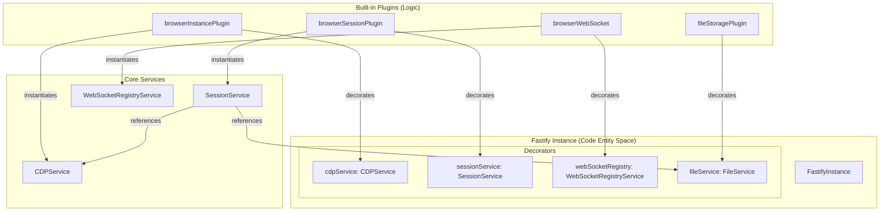
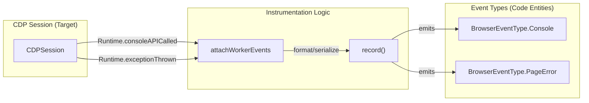

<!-- source: DeepWiki mcp.deepwiki.com · repo steel-dev/steel-browser · page 9.2 Built-in Plugins · fetched 2026-10-26 -->

# Built-in Plugins

Relevant source files

The following files were used as context for generating this wiki page:

- [api/src/plugins/browser-session.ts](api/src/plugins/browser-session.ts)
- [api/src/plugins/browser-socket/handlers/cast.handler.ts](api/src/plugins/browser-socket/handlers/cast.handler.ts)
- [api/src/plugins/browser-socket/handlers/index.ts](api/src/plugins/browser-socket/handlers/index.ts)
- [api/src/plugins/browser.ts](api/src/plugins/browser.ts)
- [api/src/services/cdp/instrumentation/storage/in-memory-storage.ts](api/src/services/cdp/instrumentation/storage/in-memory-storage.ts)
- [api/src/services/cdp/instrumentation/storage/log-storage.interface.ts](api/src/services/cdp/instrumentation/storage/log-storage.interface.ts)
- [api/src/services/cdp/instrumentation/worker-events.ts](api/src/services/cdp/instrumentation/worker-events.ts)
- [api/src/services/websocket-registry.service.ts](api/src/services/websocket-registry.service.ts)
- [api/src/steel-browser-plugin.ts](api/src/steel-browser-plugin.ts)
- [api/src/types/fastify.d.ts](api/src/types/fastify.d.ts)
- [api/src/types/index.ts](api/src/types/index.ts)
- [api/src/types/websocket.ts](api/src/types/websocket.ts)
- [ui/vite.config.ts](ui/vite.config.ts)

This page documents the built-in plugins provided by steel-browser for logging, recording, and browser instrumentation. These plugins extend browser automation capabilities through the plugin system architecture and are integrated into the Fastify server lifecycle.

---

## Overview

The steel-browser system utilizes a set of built-in plugins to manage core services and extend browser functionality. These plugins are registered during the server initialization sequence in `api/src/steel-browser-plugin.ts` [api/src/steel-browser-plugin.ts:59-90]().

Key built-in plugins include:
- **Browser Instance Plugin**: Manages the `CDPService` lifecycle and log storage initialization [api/src/plugins/browser.ts:24-75]().
- **Browser Session Plugin**: Orchestrates the `SessionService` which links CDP, Selenium, and File services [api/src/plugins/browser-session.ts:5-13]().
- **Browser WebSocket Plugin**: Handles real-time communication for logs, recordings, and live views [api/src/plugins/browser-socket/browser-socket.ts]().
- **Logging & Storage**: Provides persistent event capture using DuckDB or in-memory backends [api/src/plugins/browser.ts:29-53]().

Sources: [api/src/steel-browser-plugin.ts:1-96](), [api/src/plugins/browser.ts:1-77]()

---

## Plugin Integration Architecture

The following diagram illustrates how built-in plugins bridge the Natural Language Space of "Browser Management" to the Code Entity Space of Fastify decorators and services.

**Service-Plugin Mapping**

The `SteelBrowserConfig` is passed to the main plugin [api/src/steel-browser-plugin.ts:59](), which then distributes configuration to specific built-in plugins like `browserWebSocket` [api/src/steel-browser-plugin.ts:73-75]().

Sources: [api/src/steel-browser-plugin.ts:31-57](), [api/src/plugins/browser-session.ts:6-12](), [api/src/types/fastify.d.ts:8-15]()

---

## Logging & Storage Plugin

The `browserInstancePlugin` [api/src/plugins/browser.ts:24]() is responsible for initializing the log storage backend. It selects between persistent and ephemeral storage based on environment variables or configuration.

### Storage Selection Logic

| Environment Variable | Config Property | Storage Implementation | Description |
|----------------------|-----------------|------------------------|-------------|
| `LOG_STORAGE_ENABLED`| `logging.enableStorage` | `DuckDBStorage` | Persistent columnar storage for high-performance event analysis [api/src/plugins/browser.ts:36-44](). |
| N/A (Default)        | N/A             | `InMemoryStorage`      | Ephemeral storage with a fixed event limit (default 1000) [api/src/plugins/browser.ts:50-52](). |

### DuckDB Configuration
When `DuckDBStorage` is used, it is initialized with specific performance parameters:
- **maxThreads**: 1 [api/src/plugins/browser.ts:38]()
- **memoryLimit**: 128MB [api/src/plugins/browser.ts:39]()
- **writeBufferSize**: 200 events [api/src/plugins/browser.ts:42]()
- **flushInterval**: 2000ms [api/src/plugins/browser.ts:43]()

Sources: [api/src/plugins/browser.ts:25-53](), [api/src/services/cdp/instrumentation/storage/in-memory-storage.ts:14-20]()

---

## Browser Instrumentation & Worker Events

Instrumentation is automatically attached to browser targets. The `attachWorkerEvents` function demonstrates how internal listeners are registered to capture console logs and errors from Service Workers and other non-page targets.

**Worker Event Data Flow**

When a console event occurs in a worker, the `serializeRemoteObject` utility [api/src/services/cdp/instrumentation/worker-events.ts:15]() converts complex CDP objects into strings before they are recorded by the `BrowserLogger` [api/src/services/cdp/instrumentation/worker-events.ts:18-24]().

Sources: [api/src/services/cdp/instrumentation/worker-events.ts:6-37](), [api/src/services/cdp/instrumentation/storage/log-storage.interface.ts:1-17]()

---

## WebSocket Handler Registry

The `browserWebSocket` plugin [api/src/steel-browser-plugin.ts:73]() registers a suite of default handlers that allow real-time interaction with browser sessions.

### Default Handlers
The system provides several built-in handlers defined in `api/src/plugins/browser-socket/handlers/index.ts` [api/src/plugins/browser-socket/handlers/index.ts:12-17]():

- **logsHandler**: Streams real-time logs from the storage backend.
- **castHandler**: Provides a live screen-cast of the browser session.
- **pageIdHandler**: Manages target-specific communication.
- **recordingHandler**: Streams DOM mutation events for session replay.

### Handler Registration Flow
1. **Plugin Initialization**: `browserWebSocket` receives `customHandlers` from `SteelBrowserConfig` [api/src/steel-browser-plugin.ts:74]().
2. **Registry Service**: Handlers are registered in the `WebSocketRegistryService` [api/src/services/websocket-registry.service.ts:6-8]().
3. **URL Matching**: The `matchHandler` method [api/src/services/websocket-registry.service.ts:14-23]() uses path-prefix matching to route incoming WebSocket connections to the correct logic.

Sources: [api/src/services/websocket-registry.service.ts:1-24](), [api/src/types/websocket.ts:12-27]()

---

## Plugin Lifecycle Hooks

The `browserInstancePlugin` decorates the Fastify instance with hooks that allow other parts of the system to react to browser lifecycle events.

- **registerCDPLaunchHook**: Allows registration of functions that run before the browser starts [api/src/plugins/browser.ts:58-63]().
- **registerCDPShutdownHook**: Allows registration of cleanup functions that run after the browser stops [api/src/plugins/browser.ts:64-69]().
- **onListen Hook**: The plugin automatically triggers `cdpService.launch()` when the Fastify server starts listening [api/src/plugins/browser.ts:71-74]().

Sources: [api/src/plugins/browser.ts:58-74](), [api/src/steel-browser-plugin.ts:37-41]()

---

## Summary of Configuration Options

Built-in plugins are configured via the `SteelBrowserConfig` interface passed during registration:

| Property | Sub-property | Description |
|----------|--------------|-------------|
| `fileStorage` | `maxSizePerSession` | Limits disk usage for session files [api/src/steel-browser-plugin.ts:47-49](). |
| `logging` | `enableStorage` | Toggles persistent DuckDB storage [api/src/steel-browser-plugin.ts:52](). |
| `logging` | `storagePath` | Custom path for the `.duckdb` file [api/src/steel-browser-plugin.ts:53](). |
| `logging` | `enableLogsRoutes` | Toggles the `/v1/logs` API endpoints [api/src/steel-browser-plugin.ts:55](). |
| `customWsHandlers`| N/A | Array of user-defined WebSocket handlers [api/src/steel-browser-plugin.ts:50](). |

Sources: [api/src/steel-browser-plugin.ts:46-57](), [api/src/plugins/browser.ts:25-34]()

---

