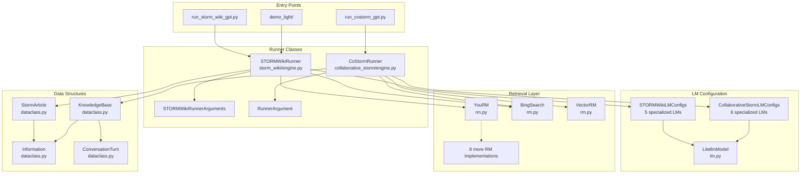
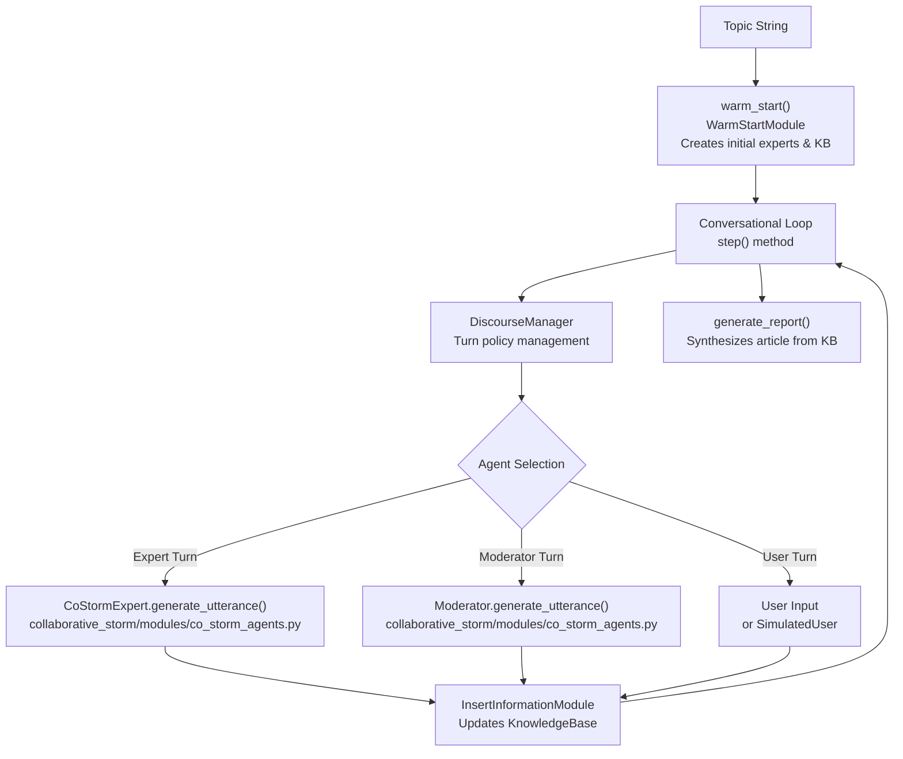
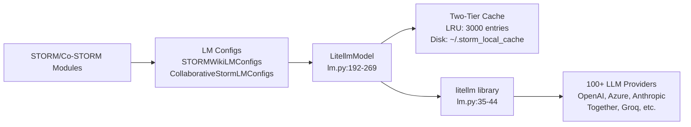
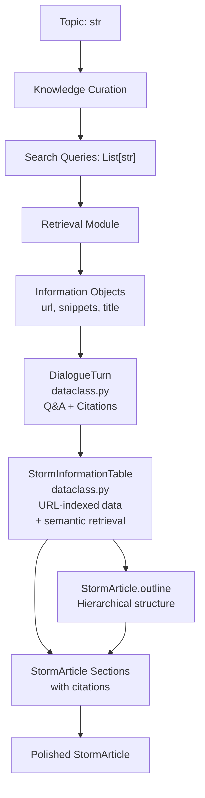
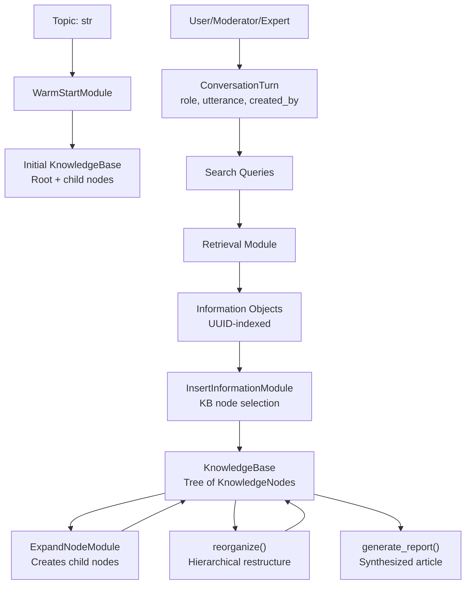
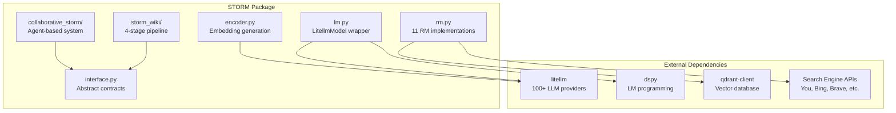

<!-- source: DeepWiki mcp.deepwiki.com · repo stanford-oval/storm · page 1 Overview · fetched 2026-10-26 -->

# Overview

<details>
<summary>Relevant source files</summary>

The following files were used as context for generating this wiki page:

- [.github/workflows/python-package.yml](.github/workflows/python-package.yml)
- [README.md](README.md)
- [knowledge_storm/__init__.py](knowledge_storm/__init__.py)
- [knowledge_storm/lm.py](knowledge_storm/lm.py)
- [setup.py](setup.py)

</details>


This document provides a comprehensive overview of the STORM (Synthesis of Topic Outlines through Retrieval and Multi-perspective question asking) repository. STORM is a language model-powered system that generates Wikipedia-like articles from scratch using Internet search. The repository contains two distinct operational modes: **STORM** for automated article generation and **Co-STORM** for human-AI collaborative knowledge curation.

For detailed installation instructions and quick start guides, see [Installation and Setup](#1.1). For architecture details, see [System Architecture](#1.2). For STORM-specific implementation, see [STORM Wiki Generation System](#2). For Co-STORM implementation, see [Co-STORM Collaborative System](#3).

## What is STORM?

STORM is a multi-stage language model system that automates the research and writing process for long-form articles with citations. The system addresses the challenge of generating comprehensive, well-structured content by breaking the problem into two fundamental stages:

1. **Pre-writing stage**: Conducts Internet-based research to collect references and generates a hierarchical outline
2. **Writing stage**: Uses the outline and references to generate full-length articles with proper citations

The core innovation is **perspective-guided question asking**: instead of directly prompting language models to ask questions, STORM discovers different perspectives by surveying existing articles on similar topics and uses these perspectives to guide the question-asking process. Questions are asked through **simulated conversations** between a Wikipedia writer and a topic expert, both powered by language models, grounded in Internet sources.

Sources: [README.md:1-55]()

## What is Co-STORM?

Co-STORM extends STORM with a **collaborative discourse protocol** that enables human participation in the knowledge curation process. The system implements three types of agents:

- **Co-STORM LLM experts**: Generate answers grounded in external knowledge sources and raise follow-up questions
- **Moderator**: Generates thought-provoking questions inspired by retrieved information not yet discussed
- **Human user**: Can observe the discourse passively or actively engage by injecting utterances to steer the conversation

Co-STORM maintains a **dynamic mind map** (`KnowledgeBase`) that organizes collected information into a hierarchical concept structure. This shared conceptual space helps reduce cognitive load during long, in-depth conversations and enables the system to continuously reorganize information as the discourse progresses.

Sources: [README.md:56-70]()

## Core Package Structure

The STORM repository is distributed as the `knowledge-storm` package on PyPI (current version 1.1.1). The package exposes eight main modules:

| Module | Purpose | Key Classes |
|--------|---------|-------------|
| `storm_wiki` | STORM pipeline implementation | `STORMWikiRunner`, `STORMWikiRunnerArguments` |
| `collaborative_storm` | Co-STORM implementation | `CoStormRunner`, `RunnerArgument` |
| `interface` | Abstract base classes | `InformationTable`, `Article`, `Retriever`, `Module`, `Engine`, `Agent` |
| `lm` | Language model wrappers | `LitellmModel` (supports 100+ LLM providers) |
| `rm` | Retrieval module implementations | `YouRM`, `BingSearch`, `VectorRM`, etc. (11 total) |
| `encoder` | Text embedding generation | `Encoder` |
| `utils` | Helper functions | `ArticleTextProcessing`, `FileIOHelper`, `WebPageHelper` |
| `dataclass` | Core data structures | `Information`, `DialogueTurn`, `ConversationTurn` |

The package structure enables users to import only what they need while maintaining clear separation between abstract interfaces and concrete implementations.

Sources: [setup.py:17-38](), [knowledge_storm/__init__.py:1-10]()

## System Architecture: Code Entity View

The following diagram maps the natural language system description to actual code entities:



This architecture shows how user-facing entry points (example scripts and frontend) instantiate runner classes, which in turn coordinate language models, retrieval modules, and data structures.

Sources: [README.md:104-217](), [knowledge_storm/__init__.py:1-10]()

## STORM vs Co-STORM: Operational Paradigms

The repository implements two distinct operational paradigms that share infrastructure but differ fundamentally in execution:

### STORM: Linear 4-Stage Pipeline

```mermaid
graph LR
    Input["Topic String"] --> Stage1["Stage 1: Knowledge Curation<br/>StormKnowledgeCurationModule<br/>storm_wiki/modules/knowledge_curation.py"]
    Stage1 --> Stage2["Stage 2: Outline Generation<br/>StormOutlineGenerationModule<br/>storm_wiki/modules/outline_generation.py"]
    Stage2 --> Stage3["Stage 3: Article Generation<br/>StormArticleGenerationModule<br/>storm_wiki/modules/article_generation.py"]
    Stage3 --> Stage4["Stage 4: Article Polishing<br/>StormArticlePolishingModule<br/>storm_wiki/modules/article_polishing.py"]
    Stage4 --> Output["StormArticle"]
```



The STORM pipeline executes deterministically through four discrete stages:

1. **Knowledge Curation**: Simulates conversations between `ConvSimulator` (writer) and topic expert to collect information. Uses perspective-guided question asking to ensure breadth and depth.
2. **Outline Generation**: Organizes collected information into a hierarchical structure using the `StormInformationTable`.
3. **Article Generation**: Populates outline sections with content, section by section, using retrieved information.
4. **Article Polishing**: Adds lead section and optionally removes duplicate content.

Each stage completes fully before the next begins. Results are stored in `StormArticle` with proper citation management.

### Co-STORM: Iterative Collaborative Loop



Co-STORM operates iteratively:

1. **Warm Start**: `warm_start()` initializes experts and creates initial `KnowledgeBase` structure
2. **Conversation Loop**: `step()` method repeatedly invokes agents based on turn policy
3. **Dynamic Knowledge Organization**: `KnowledgeBase` continuously reorganizes via `InsertInformationModule` and `ExpandNodeModule`
4. **Report Generation**: Final article synthesized from organized `KnowledgeBase`

The system uses `ConversationTurn` objects to track discourse history and supports both observation mode (user watches) and active mode (user participates).

Sources: [README.md:40-70](), [README.md:104-217]()

## Infrastructure Layer: Shared Components

Both STORM and Co-STORM rely on a common infrastructure layer that provides provider-agnostic access to external services:

### Language Model Integration



The `LitellmModel` class ([lm.py:192-269]()) wraps the `litellm` library to provide:

- **Universal LLM access**: Supports 100+ providers through a single interface
- **Two-tier caching**: LRU memory cache (3000 entries) plus disk cache to reduce API costs
- **Thread-safe token tracking**: `prompt_tokens` and `completion_tokens` counters with lock protection
- **Task-specific model assignment**: Different models can be assigned to different tasks (e.g., cheaper models for conversation, powerful models for generation)

The system configures multiple specialized language models per runner (5 for STORM, 6 for Co-STORM) to optimize cost-quality tradeoffs.

Sources: [knowledge_storm/lm.py:1-269](), [README.md:92-101]()

### Retrieval Module Layer

The repository provides 11 retrieval module implementations, all conforming to a unified interface:

| Retrieval Module | Type | Key Features |
|------------------|------|--------------|
| `YouRM` | Web Search | You.com search API integration |
| `BingSearch` | Web Search | Bing Search API with configurable results |
| `BraveRM` | Web Search | Brave Search engine |
| `SerperRM` | Web Search | Serper.dev API wrapper |
| `DuckDuckGoSearchRM` | Web Search | DuckDuckGo search |
| `TavilySearchRM` | Web Search | Tavily search API |
| `SearXNG` | Web Search | SearXNG meta-search |
| `GoogleSearch` | Web Search | Google Custom Search API |
| `VectorRM` | Vector Search | Qdrant vector database for custom documents |
| `AzureAISearch` | Specialized | Azure Cognitive Search |
| `StanfordOvalArxivRM` | Specialized | ArXiv paper search |

All retrieval modules implement the `retrieve(query: str, exclude_urls: list)` method and return `Information` objects with URL, snippets, and titles. The `VectorRM` uses the `Encoder` class for semantic similarity matching against user-provided documents.

Sources: [README.md:92-101](), [knowledge_storm/rm.py:1-50]() (note: full rm.py likely extends beyond shown lines)

## Data Flow and Transformation

### STORM Data Pipeline



STORM transforms data through discrete stages:
1. Topic → Search queries via perspective-guided question asking
2. Queries → `Information` objects via retrieval module
3. `Information` → `DialogueTurn` objects (Q&A pairs with citations)
4. `DialogueTurn` → `StormInformationTable` (URL-indexed, supports semantic search)
5. `StormInformationTable` → `StormArticle` (outline + sections + citations)

### Co-STORM Data Flow



Co-STORM maintains dynamic data structures:
1. `ConversationTurn` objects capture each utterance with role and metadata
2. `Information` objects assigned UUIDs for citation tracking
3. `InsertInformationModule` maps information to appropriate `KnowledgeNode` in tree
4. `KnowledgeBase` continuously reorganizes as new information arrives
5. `ExpandNodeModule` creates child nodes when topics warrant deeper exploration
6. Final report generated by traversing organized knowledge tree

Sources: [README.md:1-70](), Diagram 4 from high-level overview

## Multi-LLM System Design

Both STORM and Co-STORM implement a **multi-LLM system paradigm** where different tasks are assigned to different language model instances:

### STORM Task Assignment (5 LMs)

| Configuration Method | Task | Rationale |
|---------------------|------|-----------|
| `set_conv_simulator_lm()` | Conversation simulation, query splitting | Cheaper/faster model acceptable |
| `set_question_asker_lm()` | Question generation | Cheaper/faster model acceptable |
| `set_outline_gen_lm()` | Outline structure creation | More powerful model needed |
| `set_article_gen_lm()` | Section writing with citations | Most powerful model needed |
| `set_article_polish_lm()` | Lead section and refinement | Powerful model needed |

### Co-STORM Task Assignment (6 LMs)

| Configuration Method | Task | Rationale |
|---------------------|------|-----------|
| `set_question_answering_lm()` | Expert utterance generation | Powerful model for quality responses |
| `set_discourse_manage_lm()` | Turn policy decisions | Moderate model for coordination |
| `set_utterance_polishing_lm()` | Utterance refinement | Powerful model for final output |
| `set_warmstart_outline_gen_lm()` | Initial KB structure | Moderate model |
| `set_question_asking_lm()` | Moderator questions | Moderate model |
| `set_knowledge_base_lm()` | KB operations (insert, expand) | Moderate model |

This design allows optimization for cost-quality tradeoffs: use cheaper models (e.g., `gpt-3.5-turbo`) for intermediate steps and more powerful models (e.g., `gpt-4o`) for user-facing outputs.

Sources: [README.md:104-217](), [knowledge_storm/lm.py:192-269]()

## Technology Stack Summary



The repository is built on:
- **litellm**: Universal LLM provider interface supporting OpenAI, Azure, Anthropic, Together, Groq, and 100+ others
- **dspy**: Framework for language model programming with modular components
- **qdrant-client**: Vector database integration for semantic search over custom documents
- **Search APIs**: Direct integration with 8+ web search engines

The modular design with abstract interfaces ([interface.py]()) enables custom implementations of any component while maintaining compatibility with the rest of the system.

Sources: [README.md:72-101](), [requirements.txt]() (implied), [knowledge_storm/lm.py:1-44]()

## Usage Patterns

### STORM: Fully Automated Pipeline

```python
from knowledge_storm import STORMWikiRunnerArguments, STORMWikiRunner, STORMWikiLMConfigs
from knowledge_storm.lm import LitellmModel
from knowledge_storm.rm import YouRM

# Configure LMs
lm_configs = STORMWikiLMConfigs()
lm_configs.set_conv_simulator_lm(LitellmModel(model='gpt-3.5-turbo', ...))
lm_configs.set_article_gen_lm(LitellmModel(model='gpt-4o', ...))
# ... configure other LMs

# Initialize runner
engine_args = STORMWikiRunnerArguments(...)
rm = YouRM(ydc_api_key=..., k=engine_args.search_top_k)
runner = STORMWikiRunner(engine_args, lm_configs, rm)

# Execute pipeline
runner.run(
    topic="Quantum Computing",
    do_research=True,
    do_generate_outline=True,
    do_generate_article=True,
    do_polish_article=True
)
```

The `run()` method executes all stages sequentially. Boolean flags control which stages execute (useful for resuming from intermediate results).

### Co-STORM: Interactive Collaboration

```python
from knowledge_storm.collaborative_storm.engine import CoStormRunner, RunnerArgument
from knowledge_storm.lm import LitellmModel
from knowledge_storm.rm import BingSearch

# Configure runner
lm_config = CollaborativeStormLMConfigs()
# ... set 6 specialized LMs
runner_argument = RunnerArgument(topic="Climate Change", ...)
rm = BingSearch(bing_search_api_key=..., k=...)
costorm_runner = CoStormRunner(lm_config, runner_argument, rm)

# Warm start
costorm_runner.warm_start()

# Iterative discourse
for i in range(num_turns):
    # Observe mode: system generates next turn
    conv_turn = costorm_runner.step()
    
    # OR Active mode: user provides input
    # costorm_runner.step(user_utterance="Tell me more about...")

# Generate final report
costorm_runner.knowledge_base.reorganize()
article = costorm_runner.generate_report()
```

The `step()` method advances the conversation by one turn. Without arguments, agents generate utterances automatically. With `user_utterance`, the human steers the conversation.

Sources: [README.md:104-217]()

## Key Design Principles

1. **Abstraction through Interfaces**: [interface.py]() defines abstract contracts (`InformationTable`, `Article`, `Retriever`, `Module`, `Engine`, `Agent`) that enable custom implementations

2. **Provider Agnosticism**: The `LitellmModel` wrapper and multiple RM implementations allow switching between providers without code changes

3. **Modular Pipeline Design**: STORM's 4-stage pipeline and Co-STORM's agent system are composed of swappable modules

4. **Multi-LLM Optimization**: Different tasks assigned to different models optimize cost-quality tradeoffs

5. **Caching Strategy**: Two-tier LRU + disk caching reduces redundant API calls and costs

6. **Thread-Safe Operations**: Token tracking and concurrent operations protected by locks

7. **DSPy Integration**: Both systems leverage DSPy's language model programming paradigm for modular, declarative specifications

These principles enable the system to scale from research prototypes to production deployments while maintaining flexibility for customization.

Sources: [README.md:273-292](), [knowledge_storm/lm.py:115-123](), [knowledge_storm/interface.py:1-50]() (implied)

---

