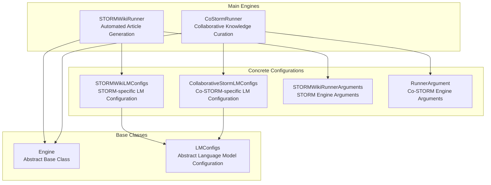
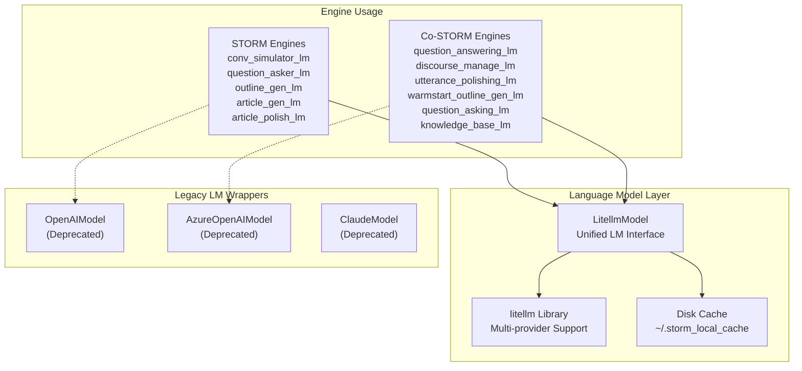
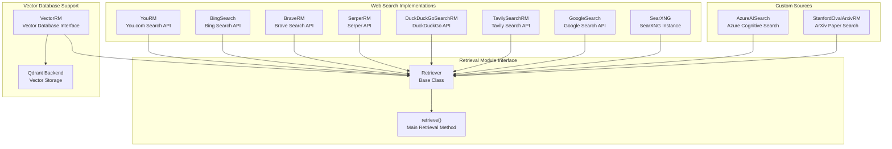
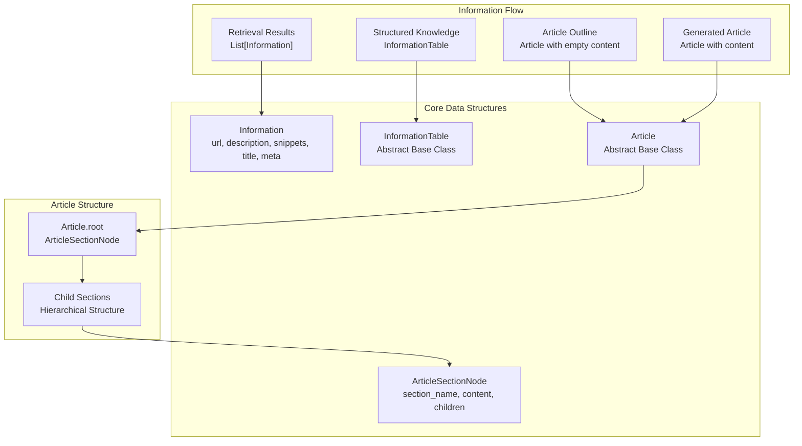
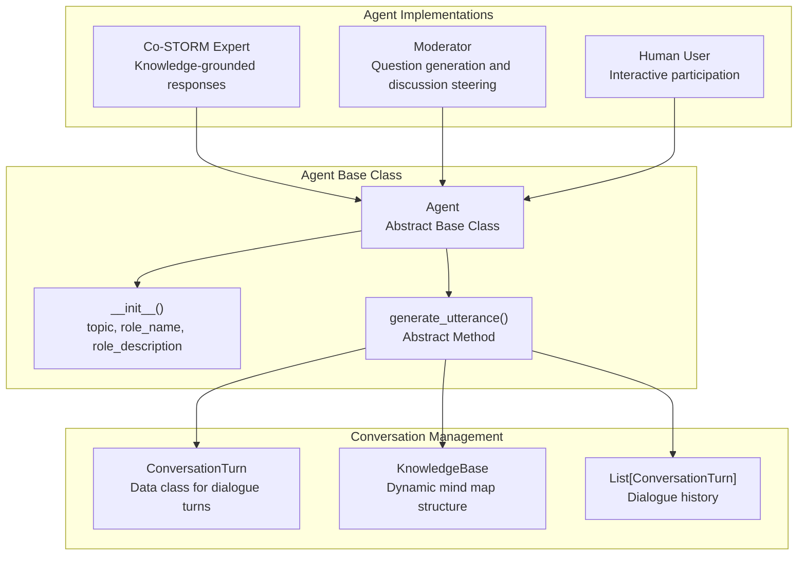

<!-- source: DeepWiki mcp.deepwiki.com · repo stanford-oval/storm · page 1.2 System Architecture · fetched 2026-10-26 -->

# Architecture Overview

Relevant source files

The following files were used as context for generating this wiki page:

- [README.md](README.md)
- [knowledge_storm/interface.py](knowledge_storm/interface.py)
- [knowledge_storm/lm.py](knowledge_storm/lm.py)
- [knowledge_storm/storm_wiki/engine.py](knowledge_storm/storm_wiki/engine.py)
- [knowledge_storm/utils.py](knowledge_storm/utils.py)

This document provides a comprehensive overview of the STORM repository's architecture, covering the modular design that supports both automated and collaborative knowledge curation systems. The architecture consists of two primary engines (`STORMWikiRunner` and `CoStormRunner`) built on shared infrastructure components including language models, retrieval modules, and abstract interfaces.

For specific implementation details of individual components, see [Core Components](#4). For usage examples and configuration, see [Examples and Usage](#5).

## Dual Engine System

The STORM repository implements two distinct but complementary knowledge curation engines that share common infrastructure while serving different use cases.

### Primary Engine Classes

**STORM Engine Architecture**: `STORMWikiRunner` follows a sequential pipeline approach with four distinct phases: knowledge curation, outline generation, article generation, and article polishing. Each phase is implemented as a separate module with clearly defined interfaces.

**Co-STORM Engine Architecture**: `CoStormRunner` implements a collaborative discourse protocol supporting multi-agent interaction with human participants. It maintains a dynamic knowledge base structure and supports iterative conversation management.

Sources: [knowledge_storm/interface.py:485-563](), [README.md:104-216]()

## Shared Infrastructure Components

The architecture emphasizes modularity through shared infrastructure components that both engines utilize.

### Language Model Integration

The `LitellmModel` class provides a unified interface supporting all language model providers listed in the litellm documentation. Both engines use specialized language model configurations with different models optimized for specific tasks.

Sources: [README.md:96-97](), [README.md:114-134](), [README.md:164-186]()

### Retrieval Module Architecture

All retrieval modules implement the `Retriever` base class interface, enabling seamless switching between different search engines and vector databases. The `retrieve()` method returns a list of `Information` objects with standardized metadata.

Sources: [knowledge_storm/interface.py:260-320](), [README.md:98-100]()

## Abstract Interface System

The repository defines a comprehensive set of abstract interfaces that enable modularity and extensibility.

### Core Module Interfaces

| Interface Class | Purpose | Key Method | Implementations |
|-----------------|---------|------------|-----------------|
| `KnowledgeCurationModule` | Information gathering stage | `research()` | STORM conversation simulation, Co-STORM warm start |
| `OutlineGenerationModule` | Article structure generation | `generate_outline()` | STORM outline generation |
| `ArticleGenerationModule` | Content creation stage | `generate_article()` | STORM section-by-section writing |
| `ArticlePolishingModule` | Final refinement stage | `polish_article()` | STORM article polishing |

### Data Structure Interfaces

The `Information` class serves as the fundamental data unit, containing retrieved content with metadata. The `Article` class implements a hierarchical tree structure through `ArticleSectionNode` objects, supporting nested sections and content organization.

Sources: [knowledge_storm/interface.py:23-258](), [knowledge_storm/interface.py:322-408]()

## Agent System Architecture

Co-STORM implements a multi-agent architecture supporting collaborative discourse between AI agents and human participants.

### Agent Interface and Implementations

The `Agent` abstract base class defines the interface for all conversational participants in Co-STORM. Each agent implementation provides specialized utterance generation strategies based on their role and the current conversation context.

Sources: [knowledge_storm/interface.py:565-609]()

## Data Processing Pipeline

The system implements a structured data processing pipeline that transforms user topics into comprehensive articles through multiple stages.

### STORM Processing Flow

```mermaid
flowchart LR
    subgraph "Input Processing"
        UserTopic["User Topic<br/>String input"]
    end
    
    subgraph "Knowledge Curation"
        PersonaGeneration["Persona Generation<br/>Perspective discovery"]
        ConversationSimulation["Conversation Simulation<br/>Q&A dialogue"]
        InformationRetrieval["Information Retrieval<br/>Search API calls"]
        StormInformationTable["StormInformationTable<br/>Structured storage"]
    end
    
    subgraph "Content Generation"
        OutlineGeneration["Outline Generation<br/>Hierarchical structure"]
        SectionGeneration["Section Generation<br/>Content creation with citations"]
        ArticlePolishing["Article Polishing<br/>Summarization and refinement"]
    end
    
    subgraph "Output"
        FinalArticle["Final Article<br/>Wikipedia-style output"]
    end
    
    UserTopic --> PersonaGeneration
    PersonaGeneration --> ConversationSimulation
    ConversationSimulation --> InformationRetrieval
    InformationRetrieval --> StormInformationTable
    StormInformationTable --> OutlineGeneration
    OutlineGeneration --> SectionGeneration
    SectionGeneration --> ArticlePolishing
    ArticlePolishing --> FinalArticle
```

### Co-STORM Processing Flow

```mermaid
flowchart LR
    subgraph "Initialization"
        WarmStart["Warm Start<br/>Initial knowledge gathering"]
        InitialKnowledgeBase["Initial Knowledge Base<br/>Hierarchical mind map"]
    end
    
    subgraph "Collaborative Discourse"
        AgentUtterance["Agent Utterance<br/>Expert responses"]
        ModeratorQuestion["Moderator Question<br/>Discussion steering"]
        HumanInput["Human Input<br/>User participation"]
        KnowledgeBaseUpdate["Knowledge Base Update<br/>Dynamic reorganization"]
    end
    
    subgraph "Report Generation"
        ReportSynthesis["Report Synthesis<br/>Article generation from knowledge base"]
        CollaborativeArticle["Collaborative Article<br/>Final output"]
    end
    
    WarmStart --> InitialKnowledgeBase
    InitialKnowledgeBase --> AgentUtterance
    AgentUtterance --> ModeratorQuestion
    ModeratorQuestion --> HumanInput
    HumanInput --> KnowledgeBaseUpdate
    KnowledgeBaseUpdate --> AgentUtterance
    
    KnowledgeBaseUpdate --> ReportSynthesis
    ReportSynthesis --> CollaborativeArticle
```

The Co-STORM pipeline emphasizes iterative knowledge building through collaborative discourse, with the knowledge base continuously updated based on conversation turns.

Sources: [README.md:42-68](), [README.md:199-216]()

## Configuration and Extensibility

The architecture supports extensive configuration and customization through well-defined interfaces and configuration classes.

### Engine Configuration Structure

| Component | STORM Configuration | Co-STORM Configuration | Purpose |
|-----------|-------------------|----------------------|---------|
| Language Models | `STORMWikiLMConfigs` | `CollaborativeStormLMConfigs` | LM assignment for different tasks |
| Engine Arguments | `STORMWikiRunnerArguments` | `RunnerArgument` | Pipeline configuration parameters |
| Retrieval | `Retriever` implementations | `Retriever` implementations | External knowledge access |
| Logging | Built-in execution tracking | `LoggingWrapper` integration | Usage monitoring and debugging |

The modular design allows developers to customize individual components without affecting the overall architecture. Custom implementations can be created by extending the abstract base classes defined in `interface.py`.

Sources: [knowledge_storm/interface.py:427-483](), [README.md:273-292]()

---

