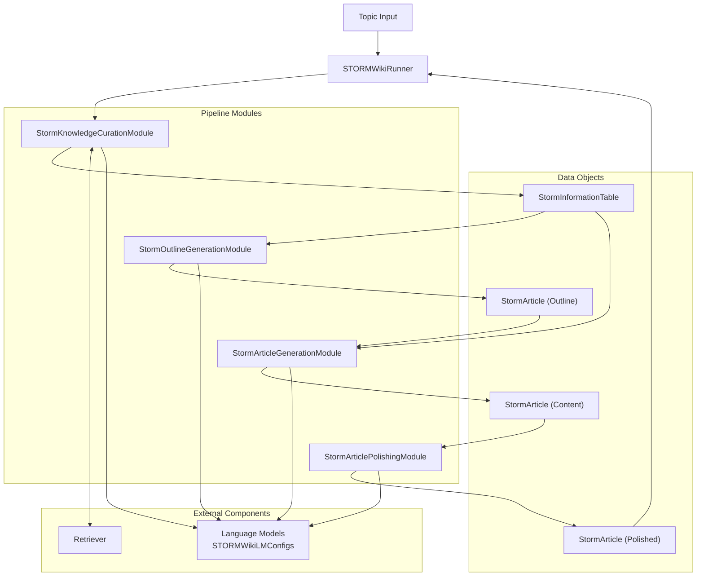
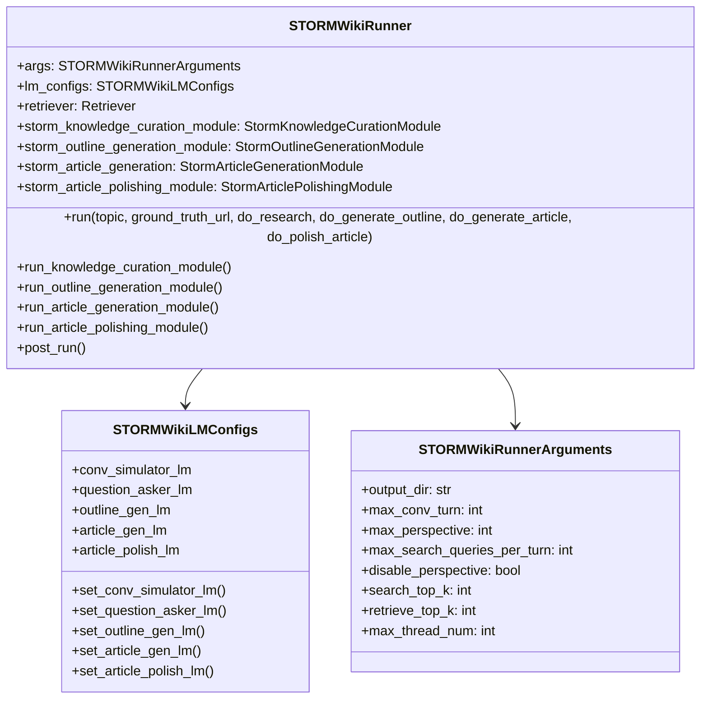
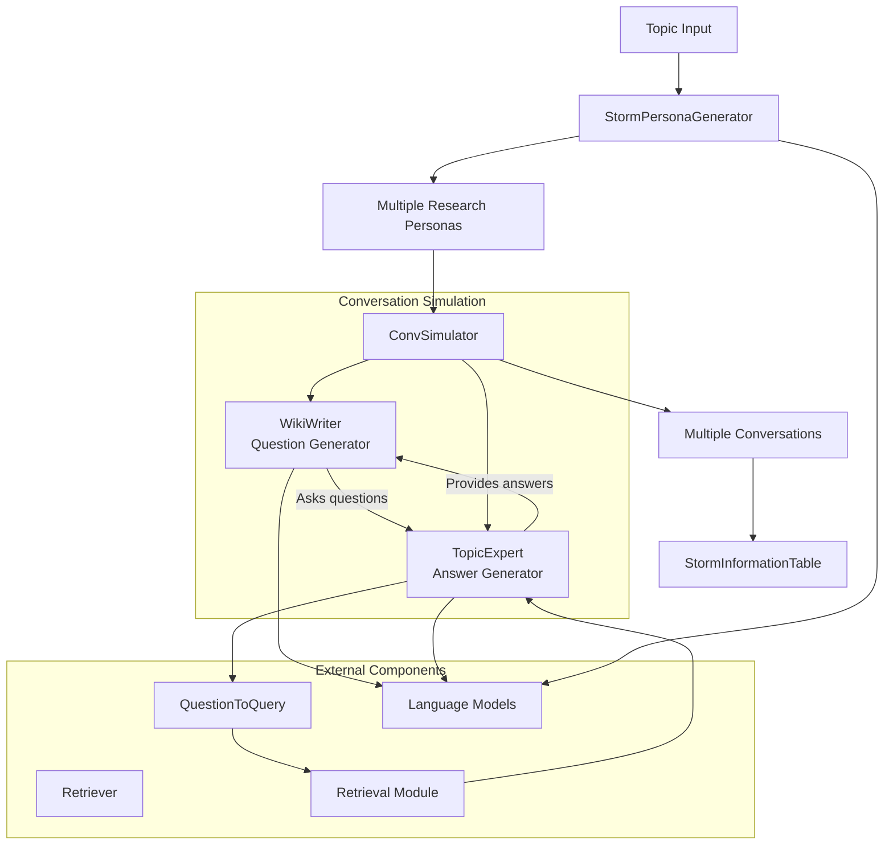
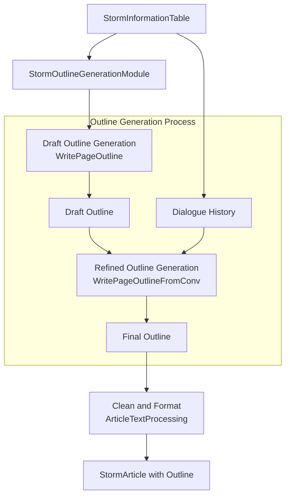
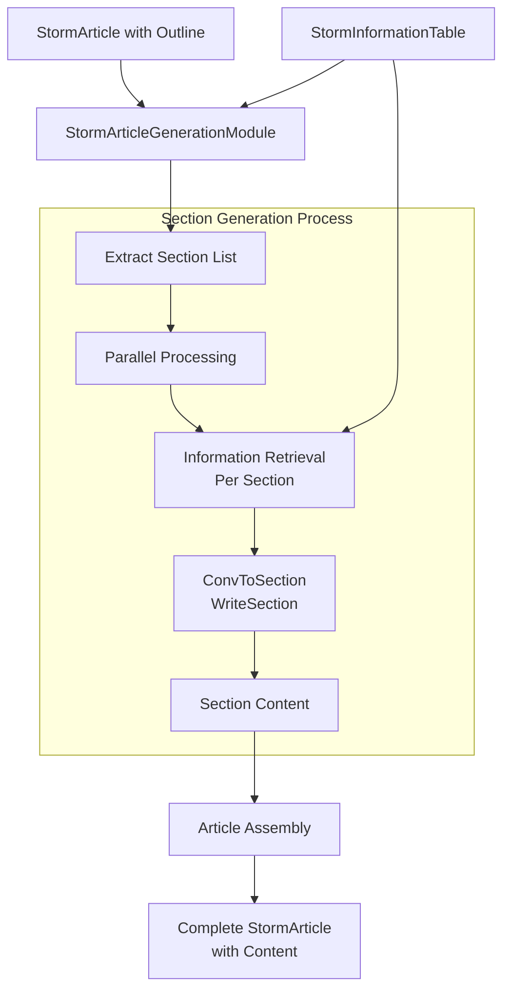
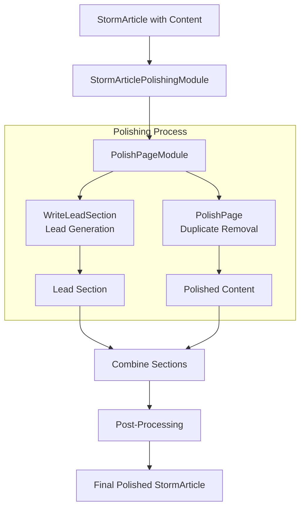
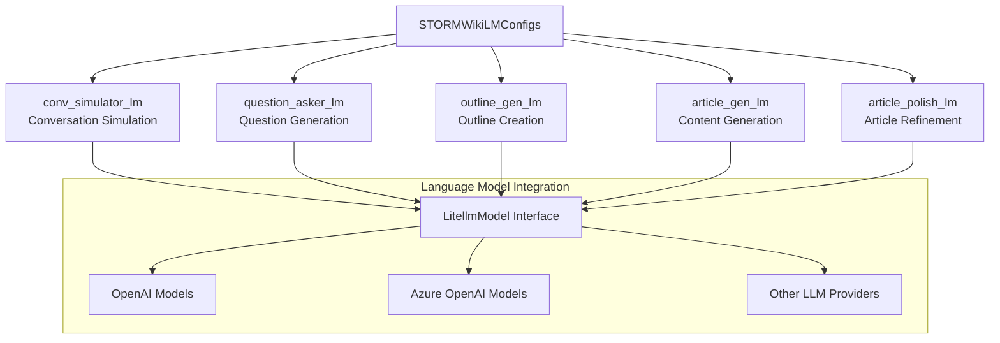

<!-- source: DeepWiki mcp.deepwiki.com · repo stanford-oval/storm · page 2 STORM Wiki Generation System · fetched 2026-10-26 -->

# STORM Wiki Generation System

<details>
<summary>Relevant source files</summary>

The following files were used as context for generating this wiki page:

- [README.md](README.md)
- [knowledge_storm/lm.py](knowledge_storm/lm.py)
- [knowledge_storm/storm_wiki/engine.py](knowledge_storm/storm_wiki/engine.py)
- [knowledge_storm/utils.py](knowledge_storm/utils.py)

</details>


The STORM (Synthesis of Topic Outlines through Retrieval and Multi-perspective Question Asking) Wiki Generation System is a comprehensive framework for automatically generating Wikipedia-like articles from scratch using language models and information retrieval. This document describes the architecture, components, and workflows of the STORM Wiki Generation System. For information about the collaborative extension of STORM, see [Co-STORM Collaborative System](#3).

## System Architecture

STORM follows a modular pipeline architecture that breaks down article generation into four distinct stages:

1. **Knowledge Curation**: Collects information through perspective-guided questioning and simulated conversations
2. **Outline Generation**: Creates a structured outline based on the collected information
3. **Article Generation**: Generates content for each section with proper citations
4. **Article Polishing**: Refines the article by adding a lead section and optionally removing duplicated content



Sources: [knowledge_storm/storm_wiki/engine.py:171-441](), [README.md:40-55]()

## STORMWikiRunner

The `STORMWikiRunner` class orchestrates the entire article generation process by managing pipeline modules, configurations, and workflow execution.



### Configuration and Initialization

The `STORMWikiRunner` is initialized with three main components:

1. **Arguments (`STORMWikiRunnerArguments`)**: Controls pipeline behavior such as maximum conversation turns, number of perspectives, and search parameters.
2. **Language Model Configurations (`STORMWikiLMConfigs`)**: Specifies which language models to use for different stages of the pipeline.
3. **Retrieval Module (`Retriever`)**: Handles information retrieval from external sources like search engines.

```python
# Example initialization
runner = STORMWikiRunner(engine_args, lm_configs, rm)
```

### Pipeline Execution

The `run()` method executes the entire article generation pipeline or specific stages based on the provided parameters:

```python
# Execute full pipeline
runner.run(
    topic="Quantum Computing",
    do_research=True,
    do_generate_outline=True,
    do_generate_article=True,
    do_polish_article=True
)
```

The pipeline allows for resuming from intermediate stages by setting earlier stages to `False` (the system will load previously generated data).

Sources: [knowledge_storm/storm_wiki/engine.py:174-311](), [README.md:106-147]()

## Knowledge Curation Pipeline

The Knowledge Curation module collects comprehensive information about a topic through perspective-guided question asking and simulated conversations between a Wikipedia writer and a topic expert.



### Perspective-Guided Question Asking

To ensure comprehensive coverage of a topic, STORM first generates different research personas (perspectives) through `StormPersonaGenerator`:

1. The persona generator identifies related Wikipedia pages to inform perspective creation
2. Multiple personas are created (default is a basic fact-writer plus additional specialized perspectives)
3. Each persona guides the question-asking process in a different direction

### Simulated Conversations

For each persona, STORM simulates a conversation between:

1. **WikiWriter (`AskQuestion`, `AskQuestionWithPersona`)**: Creates questions based on the assigned persona
2. **TopicExpert (`TopicExpert`)**: Answers questions using information retrieved from search engines:
   - Converts questions to search queries
   - Retrieves information from external sources
   - Generates answers grounded in the retrieved information
   - Adds citations to reference the sources

### Information Organization

All conversations are processed and stored in a `StormInformationTable` that:
- Maintains a record of all dialogue turns
- Organizes information for later retrieval during article generation
- Preserves citation sources for proper attribution

Sources: [knowledge_storm/storm_wiki/modules/knowledge_curation.py:17-393](), [knowledge_storm/storm_wiki/modules/persona_generator.py:114-154](), [README.md:51-54]()

## Outline Generation

The Outline Generation module creates a structured outline for the article based on the information collected during the knowledge curation phase.



The outline generation process follows these steps:

1. **Draft Outline Creation**: An initial outline is created directly from the LLM's knowledge of the topic using `WritePageOutline`
2. **Outline Refinement**: The draft outline is refined based on information from the simulated conversations using `WritePageOutlineFromConv`
3. **Cleaning and Formatting**: The outline is cleaned to ensure consistent formatting and remove unnecessary sections (like References)

The final outline follows a hierarchical Markdown structure with sections and subsections that will guide the article generation process.

Sources: [knowledge_storm/storm_wiki/modules/outline_generation.py:11-167](), [knowledge_storm/utils.py:456-503]()

## Article Generation

The Article Generation module transforms the outline and collected information into a coherent article with proper citations.



The article generation process involves:

1. **Section Extraction**: First-level sections are extracted from the outline
2. **Parallel Processing**: Multiple sections are generated concurrently using a thread pool
3. **Information Retrieval**: For each section, relevant information is retrieved from the `StormInformationTable`
4. **Section Writing**: The `ConvToSection` module generates content for each section using the `WriteSection` prompt
5. **Citation Management**: Citations are added inline to reference sources
6. **Article Assembly**: All sections are combined into a complete article

The module skips certain sections like "Introduction" (which will be created during polishing) and "Conclusion" (which is typically not included in Wikipedia articles).

Sources: [knowledge_storm/storm_wiki/modules/article_generation.py:15-176](), [README.md:284-282]()

## Article Polishing

The final stage refines the generated article to improve its quality and readability.



The article polishing process includes:

1. **Lead Section Creation**: A concise overview (introduction) of the topic is generated using `WriteLeadSection`
2. **Duplicate Removal** (Optional): If enabled, the `PolishPage` module identifies and removes duplicate information
3. **Post-Processing**: Final cleanup to ensure proper citation formatting and section organization

The lead section serves as a summary of the article, providing readers with a quick overview of the topic before diving into the detailed sections.

Sources: [knowledge_storm/storm_wiki/modules/article_polish.py:11-102]()

## Language Model Configuration

STORM uses different language models for different tasks to balance quality and efficiency through the `STORMWikiLMConfigs` class.



The language model configuration system allows:

1. **Task-Specific Models**: Different models for different pipeline stages (e.g., cheaper models for simpler tasks, more powerful models for content generation)
2. **Provider Flexibility**: Support for various LLM providers through the `LitellmModel` interface
3. **Parameter Customization**: Adjust temperature, top-p, and other parameters per task

Example configuration:

```python
lm_configs = STORMWikiLMConfigs()
gpt_35 = LitellmModel(model='gpt-3.5-turbo', max_tokens=500, **openai_kwargs)
gpt_4 = LitellmModel(model='gpt-4o', max_tokens=3000, **openai_kwargs)
lm_configs.set_conv_simulator_lm(gpt_35)
lm_configs.set_question_asker_lm(gpt_35)
lm_configs.set_outline_gen_lm(gpt_4)
lm_configs.set_article_gen_lm(gpt_4)
lm_configs.set_article_polish_lm(gpt_4)
```

Sources: [knowledge_storm/storm_wiki/engine.py:21-124](), [README.md:113-128]()

## Data Structures

STORM uses several key data structures to represent and manage information throughout the pipeline:

### StormInformationTable

Stores and organizes information collected during the knowledge curation phase:
- Maintains a record of all conversations with different personas
- Indexes information for efficient retrieval during article generation
- Preserves citation sources for proper attribution

### StormArticle

Represents the article at various stages (outline, draft, final):
- Stores hierarchical section structure
- Manages content for each section
- Handles references and citations
- Provides methods for serialization and deserialization

### DialogueTurn

Represents a single turn in the simulated conversations:
- User utterance (question from WikiWriter)
- Agent utterance (answer from TopicExpert)
- Search queries used to find information
- Search results retrieved from external sources

Sources: [knowledge_storm/storm_wiki/modules/storm_dataclass.py]()

## Integration with External Components

STORM integrates with several external components through well-defined interfaces:

### Retrieval Module

The `Retriever` class provides a unified interface to various search engines and information sources:
- Handles query formulation and execution
- Filters unreliable sources based on Wikipedia standards
- Normalizes search results for consistent processing

```python
# Example retrieval integration
rm = YouRM(ydc_api_key=os.getenv('YDC_API_KEY'), k=engine_args.search_top_k)
retriever = Retriever(rm=rm, max_thread=engine_args.max_thread_num)
```

### Language Model Integration

The language model integration leverages the `LitellmModel` class to provide a unified interface to various LLM providers:
- Supports OpenAI, Azure, and other providers
- Handles token limitations and response parsing
- Provides caching for efficiency

Sources: [knowledge_storm/storm_wiki/modules/retriever.py:1-233](), [knowledge_storm/lm.py](), [README.md:95-101]()

## Summary

The STORM Wiki Generation System implements a comprehensive pipeline for generating Wikipedia-like articles by breaking down the process into distinct stages that mirror human research and writing. By combining perspective-guided question asking, structured information organization, and quality-focused content generation, STORM produces well-sourced articles on a wide range of topics.

The modular architecture allows for customization of individual components, while the unified interfaces for language models and retrieval systems provide flexibility in deployment. The result is a powerful system that can automatically produce informative, well-structured articles with proper citations.

Sources: [README.md:40-55](), [README.md:282-286]()

---

