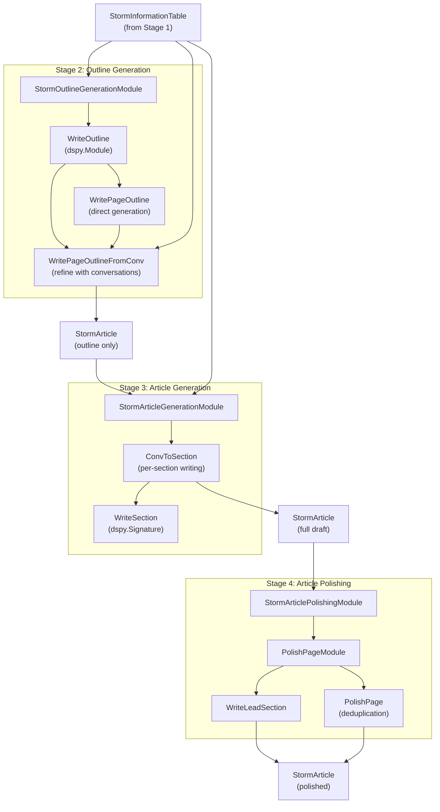
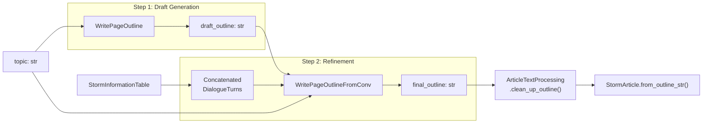
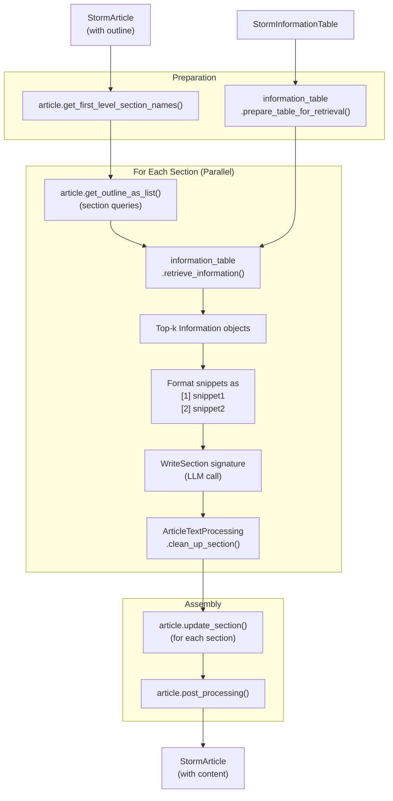
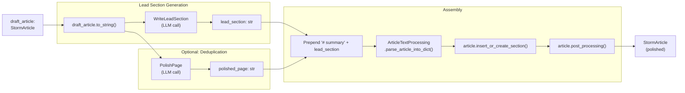
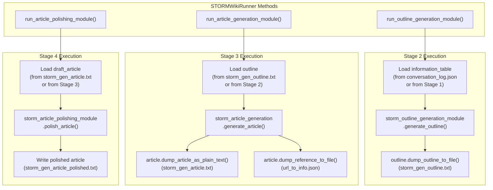
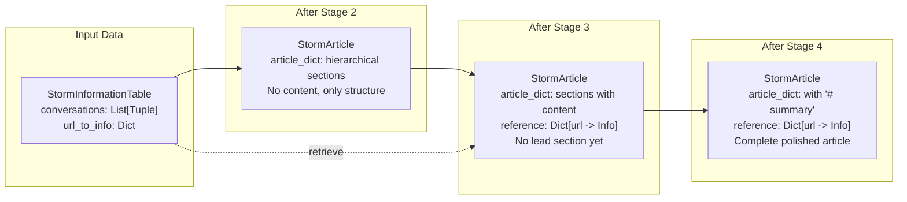

<!-- source: DeepWiki mcp.deepwiki.com · repo stanford-oval/storm · page 2.3 Outline and Article Generation Modules · fetched 2026-10-26 -->

# Outline and Article Generation Modules

<details>
<summary>Relevant source files</summary>

The following files were used as context for generating this wiki page:

- [knowledge_storm/storm_wiki/engine.py](knowledge_storm/storm_wiki/engine.py)
- [knowledge_storm/storm_wiki/modules/article_generation.py](knowledge_storm/storm_wiki/modules/article_generation.py)
- [knowledge_storm/storm_wiki/modules/article_polish.py](knowledge_storm/storm_wiki/modules/article_polish.py)
- [knowledge_storm/storm_wiki/modules/knowledge_curation.py](knowledge_storm/storm_wiki/modules/knowledge_curation.py)
- [knowledge_storm/storm_wiki/modules/outline_generation.py](knowledge_storm/storm_wiki/modules/outline_generation.py)
- [knowledge_storm/storm_wiki/modules/persona_generator.py](knowledge_storm/storm_wiki/modules/persona_generator.py)
- [knowledge_storm/storm_wiki/modules/retriever.py](knowledge_storm/storm_wiki/modules/retriever.py)
- [knowledge_storm/utils.py](knowledge_storm/utils.py)

</details>


This page documents the **outline generation**, **article generation**, and **article polishing** modules that constitute stages 2-4 of the STORM Wiki pipeline. These modules transform collected information from the knowledge curation stage into a structured, polished Wikipedia-style article.

For information about the knowledge curation stage (stage 1), see [Knowledge Curation Module](#2.2). For details on the data structures used (`StormInformationTable`, `StormArticle`), see [STORM Data Structures](#2.4).

## Overview: Pipeline Stages 2-4

After the knowledge curation stage collects information through simulated conversations, the remaining stages organize and synthesize this information into a final article:

1. **Stage 2 - Outline Generation**: Creates a hierarchical outline from collected information
2. **Stage 3 - Article Generation**: Writes content for each section using relevant information
3. **Stage 4 - Article Polishing**: Adds a lead section and optionally removes duplicate content



**Diagram: Three-stage transformation from information to polished article**

Sources: [knowledge_storm/storm_wiki/engine.py:195-206](), [knowledge_storm/storm_wiki/modules/outline_generation.py:11-21](), [knowledge_storm/storm_wiki/modules/article_generation.py:15-32](), [knowledge_storm/storm_wiki/modules/article_polish.py:11-28]()

## Stage 2: Outline Generation Module

The `StormOutlineGenerationModule` creates a hierarchical outline from the information collected during knowledge curation. This stage uses a two-step process: first generating a draft outline from parametric knowledge, then refining it based on the conversation history.

### Module Architecture

The outline generation module is implemented in [knowledge_storm/storm_wiki/modules/outline_generation.py:11-73]().

| Component | Type | Purpose |
|-----------|------|---------|
| `StormOutlineGenerationModule` | Class | Main interface for outline generation |
| `WriteOutline` | `dspy.Module` | Orchestrates two-step outline creation |
| `WritePageOutline` | `dspy.Signature` | Generates initial draft outline |
| `WritePageOutlineFromConv` | `dspy.Signature` | Refines outline using conversation history |

### Two-Step Outline Generation Process



**Diagram: Two-step outline generation with draft and refinement**

Sources: [knowledge_storm/storm_wiki/modules/outline_generation.py:84-125]()

### Outline Format and Cleanup

The generated outline follows Wikipedia conventions using markdown headers. The cleanup process removes unnecessary sections and citations:

**Outline Format:**
- Section titles: `# Title`
- Subsection titles: `## Title`
- Sub-subsection titles: `### Title`

**Removed Sections** (per [knowledge_storm/utils.py:457-503]()):
- "See also", "Notes", "References", "External links"
- "Bibliography", "Further reading", "Summary"
- "Appendices", "Appendix"
- All inline citations `[1]`, `[2]`, etc.

### Key Methods

**`generate_outline()`** - Main entry point [knowledge_storm/storm_wiki/modules/outline_generation.py:22-72]()

```python
def generate_outline(
    topic: str,
    information_table: StormInformationTable,
    old_outline: Optional[StormArticle] = None,
    callback_handler: BaseCallbackHandler = None,
    return_draft_outline: bool = False
) -> Union[StormArticle, Tuple[StormArticle, StormArticle]]
```

Parameters:
- `topic`: Article topic
- `information_table`: Collected information with dialogue history
- `old_outline`: Optional previous outline for comparison
- `return_draft_outline`: If True, returns both final and draft outlines

Returns: `StormArticle` with hierarchical outline structure

**Implementation Details:**

1. Concatenates all dialogue turns from information table [knowledge_storm/storm_wiki/modules/outline_generation.py:56-58]()
2. Calls `WriteOutline` module [knowledge_storm/storm_wiki/modules/outline_generation.py:59-63]()
3. Converts outline string to `StormArticle` using `from_outline_str()` [knowledge_storm/storm_wiki/modules/outline_generation.py:64-66]()

Sources: [knowledge_storm/storm_wiki/modules/outline_generation.py:11-73](), [knowledge_storm/utils.py:457-503]()

## Stage 3: Article Generation Module

The `StormArticleGenerationModule` generates article content for each section in the outline. It retrieves relevant information for each section and uses an LLM to write section content with inline citations.

### Module Architecture

The article generation module is implemented in [knowledge_storm/storm_wiki/modules/article_generation.py:15-134]().

| Component | Type | Purpose |
|-----------|------|---------|
| `StormArticleGenerationModule` | Class | Main interface for article generation |
| `ConvToSection` | `dspy.Module` | Converts information to section content |
| `WriteSection` | `dspy.Signature` | LLM signature for writing sections |

### Configuration Parameters

```python
class StormArticleGenerationModule:
    def __init__(
        article_gen_lm: Union[dspy.dsp.LM, dspy.dsp.HFModel],
        retrieve_top_k: int = 5,  # Top-k info to retrieve per section
        max_thread_num: int = 10  # Parallel section generation
    )
```

Sources: [knowledge_storm/storm_wiki/modules/article_generation.py:21-31]()

### Section Generation Workflow



**Diagram: Section-by-section article generation with information retrieval**

Sources: [knowledge_storm/storm_wiki/modules/article_generation.py:53-133]()

### Information Retrieval for Sections

The module retrieves relevant information for each section using semantic search:

1. **Query Generation**: Extract section and subsection titles as queries [knowledge_storm/storm_wiki/modules/article_generation.py:104-109]()
   ```python
   section_query = article_with_outline.get_outline_as_list(
       root_section_name=section_title,
       add_hashtags=False
   )
   ```

2. **Semantic Retrieval**: Search information table for top-k relevant snippets [knowledge_storm/storm_wiki/modules/article_generation.py:38-40]()
   ```python
   collected_info = information_table.retrieve_information(
       queries=section_query,
       search_top_k=self.retrieve_top_k
   )
   ```

3. **Format for LLM**: Present information with citation indices [knowledge_storm/storm_wiki/modules/article_generation.py:147-152]()

### Section Writing with Citations

The `WriteSection` signature instructs the LLM to write content with inline citations in Wikipedia format [knowledge_storm/storm_wiki/modules/article_generation.py:162-177]():

**Citation Format Requirements:**
- Use `[1]`, `[2]`, ..., `[n]` inline (e.g., "The capital is Washington, D.C.[1][3].")
- Use `#`, `##`, `###` for hierarchical section structure
- No separate References section needed

**Post-processing** [knowledge_storm/utils.py:506-538]():
- Remove incomplete sentences at the end
- Deduplicate citation groups
- Remove "Overall", "In summary", "In conclusion" phrases
- Remove "Summary" and "Conclusion" subsections

### Parallel Execution

The module uses `ThreadPoolExecutor` to generate sections in parallel [knowledge_storm/storm_wiki/modules/article_generation.py:91-123]():

```python
with concurrent.futures.ThreadPoolExecutor(
    max_workers=self.max_thread_num
) as executor:
    future_to_sec_title = {}
    for section_title in sections_to_write:
        future_to_sec_title[
            executor.submit(
                self.generate_section,
                topic, section_title, information_table,
                section_outline, section_query
            )
        ] = section_title
```

**Skipped Sections:**
- "Introduction" (handled by polishing stage)
- Sections starting with "conclusion" or "summary"

Sources: [knowledge_storm/storm_wiki/modules/article_generation.py:15-177](), [knowledge_storm/utils.py:506-538]()

## Stage 4: Article Polishing Module

The `StormArticlePolishingModule` performs final refinements on the draft article. It adds a lead section and optionally removes duplicate content across sections.

### Module Architecture

The article polishing module is implemented in [knowledge_storm/storm_wiki/modules/article_polish.py:11-103]().

| Component | Type | Purpose |
|-----------|------|---------|
| `StormArticlePolishingModule` | Class | Main interface for polishing |
| `PolishPageModule` | `dspy.Module` | Orchestrates lead writing and deduplication |
| `WriteLeadSection` | `dspy.Signature` | Generates Wikipedia-style lead section |
| `PolishPage` | `dspy.Signature` | Removes duplicate content |

### Lead Section Generation

The lead section (also called summary or introduction) provides a standalone overview of the article. The `WriteLeadSection` signature generates it with specific guidelines [knowledge_storm/storm_wiki/modules/article_polish.py:56-66]():

**Lead Section Requirements:**
1. Stand-alone concise overview
2. Identify topic, establish context, explain notability
3. Summarize most important points including controversies
4. Contain no more than four paragraphs
5. Include inline citations where necessary



**Diagram: Article polishing with lead generation and optional deduplication**

Sources: [knowledge_storm/storm_wiki/modules/article_polish.py:29-53]()

### Duplicate Content Removal

The optional deduplication step uses an LLM to identify and remove repeated information [knowledge_storm/storm_wiki/modules/article_polish.py:68-73]():

**`PolishPage` Signature Instructions:**
- Find repeated information in the article
- Delete repetitions while preserving non-repeated content
- Keep inline citations appropriately
- Preserve article structure (headers with `#`, `##`, etc.)

This step is enabled by setting `remove_duplicate=True` when calling `polish_article()`.

### Key Methods

**`polish_article()`** - Main entry point [knowledge_storm/storm_wiki/modules/article_polish.py:29-53]()

```python
def polish_article(
    topic: str,
    draft_article: StormArticle,
    remove_duplicate: bool = False
) -> StormArticle
```

Parameters:
- `topic`: Article topic
- `draft_article`: Draft article from generation stage
- `remove_duplicate`: Whether to deduplicate content

Implementation:
1. Convert article to string [knowledge_storm/storm_wiki/modules/article_polish.py:41]()
2. Call `PolishPageModule` [knowledge_storm/storm_wiki/modules/article_polish.py:42-44]()
3. Format lead section with `# summary` header [knowledge_storm/storm_wiki/modules/article_polish.py:45]()
4. Combine lead with polished page [knowledge_storm/storm_wiki/modules/article_polish.py:46]()
5. Parse into dictionary structure [knowledge_storm/storm_wiki/modules/article_polish.py:47-49]()
6. Insert into article object and post-process [knowledge_storm/storm_wiki/modules/article_polish.py:50-52]()

Sources: [knowledge_storm/storm_wiki/modules/article_polish.py:11-103]()

## Integration in STORMWikiRunner

The `STORMWikiRunner` class integrates all three modules and orchestrates their execution. Each stage has a dedicated runner method that can be invoked independently.

### Module Initialization

The runner initializes all three modules in its constructor [knowledge_storm/storm_wiki/engine.py:195-206]():

```python
# In __init__:
self.storm_outline_generation_module = StormOutlineGenerationModule(
    outline_gen_lm=self.lm_configs.outline_gen_lm
)
self.storm_article_generation = StormArticleGenerationModule(
    article_gen_lm=self.lm_configs.article_gen_lm,
    retrieve_top_k=self.args.retrieve_top_k,
    max_thread_num=self.args.max_thread_num,
)
self.storm_article_polishing_module = StormArticlePolishingModule(
    article_gen_lm=self.lm_configs.article_gen_lm,
    article_polish_lm=self.lm_configs.article_polish_lm,
)
```

### Execution Flow in STORMWikiRunner



**Diagram: Module execution flow in STORMWikiRunner**

Sources: [knowledge_storm/storm_wiki/engine.py:237-288]()

### Stage Runner Methods

#### `run_outline_generation_module()`

[knowledge_storm/storm_wiki/engine.py:237-254]()

Inputs:
- `information_table`: `StormInformationTable` from knowledge curation
- `callback_handler`: Optional callback handler

Outputs:
- Returns `StormArticle` with outline
- Saves `storm_gen_outline.txt` and `direct_gen_outline.txt`

#### `run_article_generation_module()`

[knowledge_storm/storm_wiki/engine.py:256-274]()

Inputs:
- `outline`: `StormArticle` with outline structure
- `information_table`: `StormInformationTable` for retrieval
- `callback_handler`: Optional callback handler

Outputs:
- Returns `StormArticle` with full content
- Saves `storm_gen_article.txt` and `url_to_info.json`

#### `run_article_polishing_module()`

[knowledge_storm/storm_wiki/engine.py:276-288]()

Inputs:
- `draft_article`: `StormArticle` with draft content
- `remove_duplicate`: Boolean flag for deduplication

Outputs:
- Returns polished `StormArticle`
- Saves `storm_gen_article_polished.txt`

### Modular Execution Support

The runner supports executing stages independently by loading intermediate results from disk [knowledge_storm/storm_wiki/engine.py:312-339]():

| Stage | Load Method | Source File |
|-------|-------------|-------------|
| Outline Generation | `_load_information_table_from_local_fs()` | `conversation_log.json` |
| Article Generation | `_load_outline_from_local_fs()` | `storm_gen_outline.txt` |
| Article Polishing | `_load_draft_article_from_local_fs()` | `storm_gen_article.txt`, `url_to_info.json` |

This allows users to:
- Re-run a single stage without re-executing previous stages
- Experiment with different LLM configurations per stage
- Debug individual stages independently

Sources: [knowledge_storm/storm_wiki/engine.py:171-442]()

## Data Flow and Transformations

The three stages progressively transform raw information into a polished article:



**Diagram: Progressive data transformation through stages 2-4**

### Key Data Transformations

**Stage 2: Information → Outline**
- Input: List of `DialogueTurn` objects with questions/answers/citations
- Transform: Concatenate conversations → LLM generates hierarchical outline → Parse into section structure
- Output: `StormArticle` with empty `section_content` fields

**Stage 3: Outline + Information → Draft Article**
- Input: Outline structure + Information table for retrieval
- Transform: For each section → Retrieve relevant info → LLM writes content with citations
- Output: `StormArticle` with populated `section_content` fields and citation mapping

**Stage 4: Draft → Polished Article**
- Input: Draft article with all sections
- Transform: Generate lead section → Optionally deduplicate → Insert lead as "# summary"
- Output: Complete `StormArticle` with lead section and refined content

Sources: [knowledge_storm/storm_wiki/modules/storm_dataclass.py](), [knowledge_storm/storm_wiki/engine.py:237-288]()

## LLM Configuration for Each Stage

Different LLMs can be configured for each stage via `STORMWikiLMConfigs` [knowledge_storm/storm_wiki/engine.py:21-125]():

| Stage | LM Config Field | Purpose | Default (OpenAI) |
|-------|----------------|---------|------------------|
| Stage 2 | `outline_gen_lm` | Generate hierarchical outline | `gpt-4-0125-preview` (400 tokens) |
| Stage 3 | `article_gen_lm` | Write section content | `gpt-4o-2024-05-13` (700 tokens) |
| Stage 4 (lead) | `article_gen_lm` | Write lead section | `gpt-4o-2024-05-13` (700 tokens) |
| Stage 4 (polish) | `article_polish_lm` | Remove duplicates | `gpt-4o-2024-05-13` (4000 tokens) |

**Rationale for Different Models:**
- **Outline generation** uses a more powerful model (GPT-4) as it requires understanding the entire information space and creating a coherent structure
- **Article generation** uses a capable model with moderate token limit for writing individual sections
- **Article polishing** uses high token limit (4000) to process the entire article for deduplication

Sources: [knowledge_storm/storm_wiki/engine.py:29-105]()

## Text Processing Utilities

Several text processing utilities support these modules, implemented in [knowledge_storm/utils.py:301-595]():

### Citation Management

| Function | Purpose | Location |
|----------|---------|----------|
| `parse_citation_indices()` | Extract `[1]`, `[2]` from text | [utils.py:353-364]() |
| `remove_citations()` | Strip all `[n]` patterns | [utils.py:337-350]() |
| `update_citation_index()` | Remap citation numbers | [utils.py:541-550]() |
| `remove_uncompleted_sentences_with_citations()` | Keep only complete sentences | [utils.py:367-425]() |

### Outline and Section Cleanup

| Function | Purpose | Location |
|----------|---------|----------|
| `clean_up_outline()` | Remove references, citations, convert bullets | [utils.py:457-503]() |
| `clean_up_section()` | Remove incomplete sentences, summary sections | [utils.py:506-538]() |
| `parse_article_into_dict()` | Parse markdown into nested dictionary | [utils.py:553-594]() |

### Content Limits

| Function | Purpose | Location |
|----------|---------|----------|
| `limit_word_count_preserve_newline()` | Truncate while preserving lines | [utils.py:303-334]() |

**Example Usage in Article Generation:**

```python
# Limit information for LLM context (Stage 3)
info = ArticleTextProcessing.limit_word_count_preserve_newline(info, 1500)

# Clean generated section (Stage 3)
section = ArticleTextProcessing.clean_up_section(
    self.write_section(topic=topic, info=info, section=section).output
)
```

Sources: [knowledge_storm/utils.py:301-595](), [knowledge_storm/storm_wiki/modules/article_generation.py:152-157]()

---

