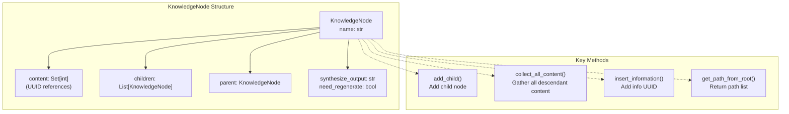
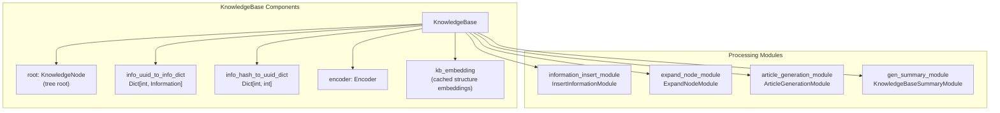
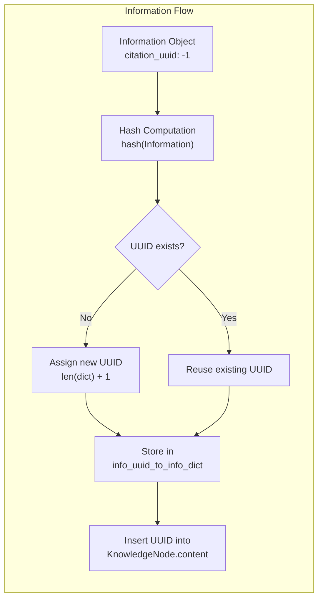
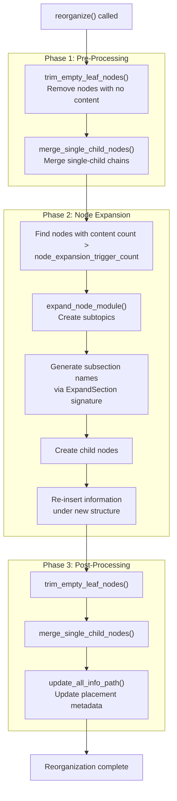
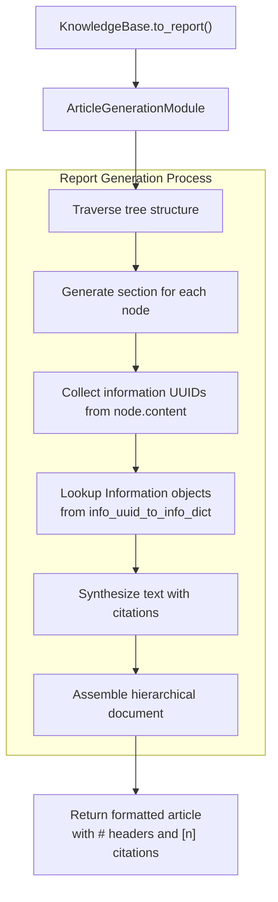
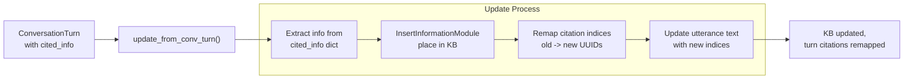

<!-- source: DeepWiki mcp.deepwiki.com · repo stanford-oval/storm · page 3.2 Knowledge Base System · fetched 2026-10-26 -->

# Knowledge Base System

<details>
<summary>Relevant source files</summary>

The following files were used as context for generating this wiki page:

- [knowledge_storm/collaborative_storm/engine.py](knowledge_storm/collaborative_storm/engine.py)
- [knowledge_storm/collaborative_storm/modules/information_insertion_module.py](knowledge_storm/collaborative_storm/modules/information_insertion_module.py)
- [knowledge_storm/dataclass.py](knowledge_storm/dataclass.py)

</details>


The Knowledge Base System is a dynamic, hierarchical mind map implementation used in Co-STORM to organize collected information as conversations progress. It serves as a shared conceptual space between the user and the system, continuously reorganizing information to maintain structure and reduce cognitive load.

For information about how agents interact with the Knowledge Base, see [Agent System](#3.3). For the overall Co-STORM workflow, see [CoStormRunner](#3.1).

## Overview

The Knowledge Base System consists of two main components: `KnowledgeBase` and `KnowledgeNode`. The system organizes information in a tree structure where each node represents a concept or topic, and edges represent parent-child relationships. Information retrieved during conversations is automatically placed under the most appropriate nodes based on semantic similarity and the questions/queries that led to its retrieval.

The system performs three key operations:
- **Information Insertion**: Places new information in the appropriate location in the tree
- **Node Expansion**: Automatically creates subtopics when nodes accumulate significant information
- **Knowledge Base Reorganization**: Maintains structure through bottom-up cleaning and top-down expansion

Sources: [knowledge_storm/dataclass.py:291-306]()

## Core Data Structures

### KnowledgeNode

`KnowledgeNode` represents a single concept or topic in the hierarchical structure. Each node maintains references to its parent, children, and the information associated with it.



**Key Attributes:**

| Attribute | Type | Description |
|-----------|------|-------------|
| `name` | `str` | The name/title of the concept |
| `content` | `Set[int]` | Set of information UUIDs associated with this node |
| `children` | `List[KnowledgeNode]` | List of child nodes (subtopics) |
| `parent` | `KnowledgeNode` | Reference to parent node |
| `synthesize_output` | `str` | Cached synthesized text for this section |
| `need_regenerate_synthesize_output` | `bool` | Flag indicating if synthesis needs regeneration |

**Key Methods:**

- `add_child(child_node_name, duplicate_handling)`: Adds a child node with specified duplicate handling behavior (`"skip"`, `"raise error"`)
- `collect_all_content()`: Recursively collects all information UUIDs from this node and all descendants
- `insert_information(information_index)`: Adds an information UUID to this node's content set
- `get_path_from_root()`: Returns a list of node names from root to current node
- `get_all_descendents()`: Returns list of all descendant nodes
- `get_all_predecessors()`: Returns list of all ancestor nodes up to root

Sources: [knowledge_storm/dataclass.py:86-289]()

### KnowledgeBase

`KnowledgeBase` manages the entire hierarchical structure and provides high-level operations for information management and organization.



**Key Attributes:**

| Attribute | Type | Description |
|-----------|------|-------------|
| `root` | `KnowledgeNode` | Root node of the tree (named "root") |
| `info_uuid_to_info_dict` | `Dict[int, Information]` | Maps citation UUIDs to Information objects |
| `info_hash_to_uuid_dict` | `Dict[int, int]` | Maps information hashes to UUIDs (deduplication) |
| `encoder` | `Encoder` | Text encoder for semantic similarity operations |
| `kb_embedding` | `Dict` | Cached embeddings of the KB structure |
| `_lock` | `threading.Lock` | Thread-safe lock for concurrent operations |

**Processing Modules:**

- `information_insert_module`: `InsertInformationModule` for placing information in appropriate nodes
- `expand_node_module`: `ExpandNodeModule` for creating subtopics when nodes grow large
- `article_generation_module`: `ArticleGenerationModule` for generating reports from the KB
- `gen_summary_module`: `KnowledgeBaseSummaryModule` for summarizing the KB

Sources: [knowledge_storm/dataclass.py:291-361]()

## Information Management

### UUID-Based Citation System

The Knowledge Base uses a UUID-based citation system to track and deduplicate information. Each piece of information is assigned a unique integer UUID that serves as its citation index.



The deduplication process prevents the same information from being stored multiple times:

1. Information object is hashed using `hash(information)`
2. System checks if hash exists in `info_hash_to_uuid_dict`
3. If new: assigns next available UUID (current dict length + 1)
4. If duplicate: reuses existing UUID
5. UUID is stored in node's `content` set and information object's `citation_uuid` field

Sources: [knowledge_storm/dataclass.py:696-714]()

### Information Object Storage

The `info_uuid_to_info_dict` stores the actual `Information` objects indexed by UUID. Each `Information` object contains:

- `url`: Source URL
- `title`: Document/page title  
- `snippets`: List of text snippets
- `citation_uuid`: Assigned UUID for citations
- `meta`: Dictionary with metadata including `"placement"` (path in KB), `"question"`, and `"query"`

The placement path is updated whenever information is inserted or the KB is reorganized:

```python
self.info_uuid_to_info_dict[citation_uuid].meta["placement"] = " -> ".join(node.get_path_from_root())
```

Sources: [knowledge_storm/dataclass.py:358-359](), [knowledge_storm/dataclass.py:710-713](), [knowledge_storm/dataclass.py:774-783]()

## Information Insertion System

The `InsertInformationModule` determines where to place new information in the knowledge base using two complementary strategies.

### Architecture

```mermaid
graph TB
    subgraph "InsertInformationModule"
        Module["InsertInformationModule<br/>(forward method)"]
        Intent["_info_list_to_intent_mapping<br/>Group by (question, query)"]
        
        subgraph "Strategy 1: Embedding Ranking"
            Embed["choose_candidate_from_embedding_ranking"]
            EncodeStruct["Encode KB structure"]
            EncodeQuery["Encode question+query"]
            CosineSim["Compute cosine similarity"]
            TopK["Select top-K candidates"]
            LLMChoose["LLM selects best from candidates"]
        end
        
        subgraph "Strategy 2: Layer-by-Layer Navigation"
            Navigate["layer_by_layer_navigation_placement"]
            NavChoice["_get_navigation_choice"]
            InsertSig["InsertInformation signature"]
            Actions["Parse action:<br/>insert | step | create"]
        end
        
        Module --> Intent
        Intent --> Embed
        Embed --> EncodeStruct
        EncodeStruct --> EncodeQuery
        EncodeQuery --> CosineSim
        CosineSim --> TopK
        TopK --> LLMChoose
        
        LLMChoose -->|Fallback| Navigate
        Intent -->|If skip_embedding| Navigate
        
        Navigate --> NavChoice
        NavChoice --> InsertSig
        InsertSig --> Actions
        
        Actions -->|"insert"| Return["Return placement path"]
        Actions -->|"step"| NavChoice
        Actions -->|"create"| Return
    end
```



### Strategy 1: Embedding-Based Ranking

This strategy uses semantic similarity to quickly identify candidate placements:

1. **Encode KB Structure**: Get embeddings of all node paths using `get_knowledge_base_structure_embedding()`
2. **Encode Query**: Combine question and query into a single string and encode
3. **Compute Similarity**: Calculate cosine similarity between query embedding and all node embeddings
4. **Rank Candidates**: Sort nodes by similarity and select top-N (default: 8)
5. **LLM Selection**: Present top candidates to LLM to choose best placement or reject all

The embedding cache is maintained in `KnowledgeBase.kb_embedding`:

```python
self.kb_embedding = {
    "hash": outline_string_hash,
    "encoded_structure": encoded_outline,
    "structure_string": outline_strings,
}
```

Sources: [knowledge_storm/collaborative_storm/modules/information_insertion_module.py:175-212](), [knowledge_storm/dataclass.py:399-423]()

### Strategy 2: Layer-by-Layer Navigation

When embedding ranking doesn't find a suitable placement, the system navigates the tree interactively:

1. **Present Current Node**: Show current node name, child names, and navigated path to LLM
2. **Get Action**: LLM decides to `insert`, `step: [child]`, or `create: [new_child]`
3. **Execute Action**:
   - `insert`: Return current node as placement location
   - `step`: Navigate to specified child node and repeat
   - `create`: Return path with new child name (created if `allow_create_new_node=True`)

The DSPy signature used for navigation decisions:

```
class InsertInformation(dspy.Signature):
    intent = dspy.InputField(prefix="Question and query leads to this info: ", format=str)
    structure = dspy.InputField(prefix="Tree structure: \n", format=str)
    choice = dspy.OutputField(prefix="Choice:\n", format=str)
```

Sources: [knowledge_storm/collaborative_storm/modules/information_insertion_module.py:16-37](), [knowledge_storm/collaborative_storm/modules/information_insertion_module.py:72-107](), [knowledge_storm/collaborative_storm/modules/information_insertion_module.py:108-148]()

### Multi-Threaded Processing

When `allow_create_new_node=False`, the module processes multiple information pieces in parallel using `ThreadPoolExecutor` since the KB structure remains static. When `allow_create_new_node=True`, processing is sequential to handle structure changes correctly.

Sources: [knowledge_storm/collaborative_storm/modules/information_insertion_module.py:273-313]()

## Knowledge Base Reorganization

The `reorganize()` method maintains KB structure through a two-phase process executed after certain conversation turns (when `TurnPolicySpec.should_reorganize_knowledge_base=True`).

### Reorganization Workflow



Sources: [knowledge_storm/dataclass.py:828-847]()

### Node Expansion

The `ExpandNodeModule` identifies nodes that have accumulated too many information pieces (threshold: `node_expansion_trigger_count`) and breaks them into subtopics.

**Expansion Process:**

1. **Find Node to Expand**: Traverse tree to find first node with `len(content) >= node_expansion_trigger_count` that hasn't been expanded yet
2. **Generate Subsection Names**: Use `ExpandSection` DSPy signature with LLM to generate subsection names based on questions/queries of information in the node
3. **Create Child Nodes**: Add new child nodes with generated names
4. **Re-insert Information**: Clear original node's content and use `InsertInformationModule` to redistribute information to new child nodes
5. **Repeat**: Continue until no more nodes need expansion

The DSPy signature for subsection generation:

```
class ExpandSection(dspy.Signature):
    section = dspy.InputField(prefix="The section you need to expand: ", format=str)
    info = dspy.InputField(prefix="The collected information:\n", format=str)
    output = dspy.OutputField(prefix="Now provide the expanded subsection names...", format=str)
```

Sources: [knowledge_storm/collaborative_storm/modules/information_insertion_module.py:316-332](), [knowledge_storm/collaborative_storm/modules/information_insertion_module.py:334-424]()

### Cleaning Operations

**Trimming Empty Leaf Nodes:**

Iteratively removes leaf nodes that have no content. This ensures every leaf node in the KB contains at least one information piece. The process repeats until no more nodes can be trimmed.

```python
def trim_node(node):
    if not node.children and not node.content:
        return True  # Mark for removal
    node.children = [child for child in node.children if not trim_node(child)]
    return not node.children and not node.content
```

Sources: [knowledge_storm/dataclass.py:715-733]()

**Merging Single-Child Nodes:**

Merges a node with its single child to simplify structure. The parent node absorbs the child's content, and the grandchildren become direct children of the parent.

```python
if len(node.children) == 1:
    single_child = node.children[0]
    node.content.update(single_child.content)
    node.children = single_child.children
    for grandchild in node.children:
        grandchild.parent = node
```

Sources: [knowledge_storm/dataclass.py:752-772]()

## Knowledge Base Traversal and Queries

### Tree Traversal Methods

The `KnowledgeBase` provides several methods for traversing and querying the tree structure:

| Method | Description | Use Case |
|--------|-------------|----------|
| `traverse_down(node)` | Depth-first traversal from node downward | Collecting all descendant nodes |
| `traverse_up(node)` | Traverse from node to root | Getting ancestor context |
| `collect_all_nodes()` | Get all nodes in the tree | Global operations on all nodes |
| `find_node(current_node, node_name)` | Find node by name | Locating specific concepts |
| `find_node_by_path(path, missing_node_handling)` | Find node by path string | Direct access to specific location |

Sources: [knowledge_storm/dataclass.py:425-460](), [knowledge_storm/dataclass.py:495-512](), [knowledge_storm/dataclass.py:638-678]()

### Structure Representation

The `get_node_hierarchy_string()` method generates a string representation of the KB structure with various options:

- `include_indent`: Add tab indentation for visual hierarchy
- `include_full_path`: Show full path from root instead of just node name
- `include_hash_tag`: Add markdown-style `#` symbols for hierarchy levels
- `include_node_content_count`: Show number of information pieces in parentheses
- `cited_indices`: Highlight paths containing specific citations with ⭐

Example output with full path enabled:
```
root -> History
root -> History -> Early History
root -> History -> Modern Era
root -> Technology
root -> Technology -> Applications
```

Sources: [knowledge_storm/dataclass.py:540-636]()

### Structure Embedding Cache

The KB maintains cached embeddings of its structure for efficient semantic similarity operations. The cache is invalidated when the structure changes (detected via hash comparison):

```python
outline_string_hash = hash(outline_string)
if outline_string_hash != self.kb_embedding["hash"]:
    # Re-encode structure
    encoded_outline = self.encoder.encode(cleaned_outline_strings)
    self.kb_embedding = {
        "hash": outline_string_hash,
        "encoded_structure": encoded_outline,
        "structure_string": outline_strings,
    }
```

Sources: [knowledge_storm/dataclass.py:399-423]()

## Report Generation

The Knowledge Base can generate a structured article from its organized information using the `to_report()` method, which internally calls the `ArticleGenerationModule`.



The generated report follows the KB hierarchy, where:
- Each `KnowledgeNode` becomes a section with `#` headers indicating depth
- Section content is synthesized from the information pieces in `node.content`
- Citations are formatted as `[n]` where `n` is the citation UUID
- The tree structure defines the article's outline and organization

Sources: [knowledge_storm/dataclass.py:848-849](), [knowledge_storm/dataclass.py:325-350]()

## Integration with Co-STORM

### Initialization in CoStormRunner

The `KnowledgeBase` is initialized as part of `CoStormRunner`:

```python
self.knowledge_base = KnowledgeBase(
    topic=self.runner_argument.topic,
    knowledge_base_lm=self.lm_config.knowledge_base_lm,
    node_expansion_trigger_count=self.runner_argument.node_expansion_trigger_count,
    encoder=self.encoder,
)
```

Configuration parameters:
- `topic`: The conversation topic (becomes root node name)
- `knowledge_base_lm`: LLM instance for KB operations (node expansion, insertion decisions)
- `node_expansion_trigger_count`: Threshold for triggering node expansion (default: 10)
- `encoder`: Encoder instance for semantic similarity operations

Sources: [knowledge_storm/collaborative_storm/engine.py:525-530]()

### Update from Conversation Turns

After each conversation turn, the KB is updated with new information via `update_from_conv_turn()`:



Parameters:
- `allow_create_new_node`: If `True`, allows creating new nodes during insertion
- `insert_under_root`: If `True` (RAG baseline mode), inserts all information directly under root without organization

The method also handles citation index remapping since information gets assigned new UUIDs when inserted into the KB. The utterance text is updated to reflect the new citation indices.

Sources: [knowledge_storm/dataclass.py:784-824](), [knowledge_storm/collaborative_storm/engine.py:747-753]()

### Warm Start Initialization

During the warm start phase, the KB is initialized with information from perspective-guided conversations:

1. `WarmStartModule` runs mini-STORM with multiple expert perspectives
2. Information from conversations is inserted into KB
3. KB is reorganized using `reorganize()` to establish initial structure
4. The organized KB serves as the foundation for the main conversation

Sources: [knowledge_storm/collaborative_storm/engine.py:582-621]()

### Serialization and Persistence

The `KnowledgeBase` supports serialization to/from dictionary format for persistence:

**Serialization** (`to_dict()`):
- Converts root node to dict (recursive tree serialization)
- Serializes `info_uuid_to_info_dict` with Information objects
- Serializes `info_hash_to_uuid_dict` for deduplication mapping
- Stores topic string

**Deserialization** (`from_dict()`):
- Reconstructs `KnowledgeNode` tree from nested dictionaries
- Reconstructs Information objects from stored data
- Rebuilds UUID and hash mappings
- Requires providing LM, encoder, and configuration parameters

Sources: [knowledge_storm/dataclass.py:362-397](), [knowledge_storm/collaborative_storm/engine.py:540-552](), [knowledge_storm/collaborative_storm/engine.py:554-580]()

### Thread Safety

The `KnowledgeBase` uses a `threading.Lock` (`self._lock`) to ensure thread-safe operations when inserting information. This is critical since multiple agents may attempt to update the KB concurrently during conversation turns.

Sources: [knowledge_storm/dataclass.py:360](), [knowledge_storm/dataclass.py:697]()

---

