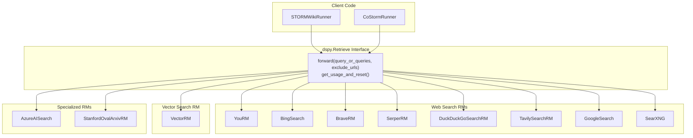
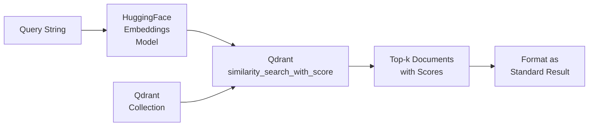
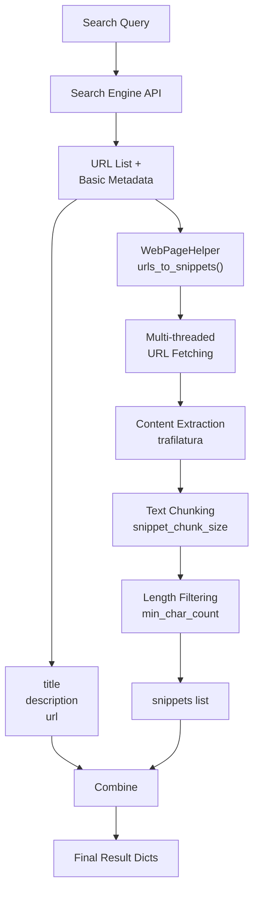
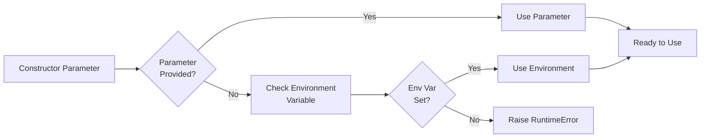
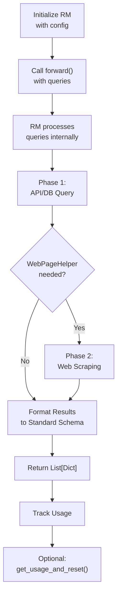

<!-- source: DeepWiki mcp.deepwiki.com · repo stanford-oval/storm · page 4.2 Retrieval Modules · fetched 2026-10-26 -->

# Retrieval Modules

<details>
<summary>Relevant source files</summary>

The following files were used as context for generating this wiki page:

- [MANIFEST.in](MANIFEST.in)
- [knowledge_storm/rm.py](knowledge_storm/rm.py)
- [requirements.txt](requirements.txt)

</details>


## Purpose and Scope

This document describes the retrieval module (RM) implementations in the STORM system. Retrieval modules are responsible for gathering external information from various sources including web search engines, vector databases, and specialized services. The system provides 11 different retrieval module implementations that share a unified interface, enabling both STORM and Co-STORM to work with multiple information sources without code changes.

For information about how retrieval modules are configured and used within STORM and Co-STORM pipelines, see [STORM Wiki Generation System](#2) and [Co-STORM Collaborative System](#3). For language model integration, see [Language Model Integration](#4.1).

---

## Unified Interface Architecture

All retrieval modules inherit from `dspy.Retrieve` and implement a common interface pattern, providing interoperability across the system.

### Core Interface Contract

Every retrieval module implements two primary methods:

**`forward(query_or_queries: Union[str, List[str]], exclude_urls: List[str]) -> List[Dict]`**
- Accepts single query string or list of queries
- Returns list of dictionaries with standardized keys
- Supports URL exclusion for deduplication

**`get_usage_and_reset() -> Dict[str, int]`**
- Returns API call count since last reset
- Resets internal counter to zero
- Used for cost tracking and monitoring



**Diagram: Retrieval Module Inheritance and Interface Hierarchy**

Sources: [knowledge_storm/rm.py:1-1238]()

### Standard Return Format

All retrieval modules return results in a consistent format:

| Field | Type | Description |
|-------|------|-------------|
| `url` | `str` | Unique identifier for the source document |
| `title` | `str` | Document or page title |
| `description` | `str` | Brief summary or metadata description |
| `snippets` | `List[str]` | List of text chunks extracted from the source |

This standardization allows STORM and Co-STORM to handle results uniformly regardless of the underlying retrieval backend.

Sources: [knowledge_storm/rm.py:48-49](), [knowledge_storm/rm.py:138-139](), [knowledge_storm/rm.py:314-315]()

---

## Web Search Retrieval Modules

Web search modules query public search engines and extract structured information from web pages.

### YouRM

Uses the You.com API for web search.

**Configuration:**
- API Key: `YDC_API_KEY` environment variable or constructor parameter
- Initialization: [knowledge_storm/rm.py:14-30]()

**Key Features:**
- Direct snippet extraction from You.com API
- Optional `is_valid_source` callback for URL filtering
- Simple response format without additional web scraping

**Usage Example:**
```python
rm = YouRM(ydc_api_key="...", k=3)
results = rm.forward("quantum computing")
```

Sources: [knowledge_storm/rm.py:13-74]()

### BingSearch

Uses the Microsoft Bing Web Search API with enhanced snippet extraction.

**Configuration:**
- API Key: `BING_SEARCH_API_KEY` environment variable
- Constructor parameters: [knowledge_storm/rm.py:78-113]()

| Parameter | Default | Description |
|-----------|---------|-------------|
| `min_char_count` | 150 | Minimum characters for valid article |
| `snippet_chunk_size` | 1000 | Maximum characters per snippet chunk |
| `webpage_helper_max_threads` | 10 | Concurrent web scraping threads |
| `mkt` | "en-US" | Market/region code |
| `language` | "en" | Language preference |

**Key Features:**
- Two-phase retrieval: API search + WebPageHelper scraping
- Extracts full page content beyond API snippets
- Supports Bing API query parameters

**Processing Flow:**
1. Query Bing Search API for URLs
2. Collect URL metadata (title, description)
3. Use WebPageHelper to scrape full page content
4. Chunk content into snippets

Sources: [knowledge_storm/rm.py:77-177]()

### BraveRM

Integrates with Brave Search API.

**Configuration:**
- API Key: `BRAVE_API_KEY` environment variable
- Initialization: [knowledge_storm/rm.py:571-589]()

**Key Features:**
- Uses `extra_snippets` field from Brave API
- Simple integration without additional scraping
- Supports `is_valid_source` filtering

Sources: [knowledge_storm/rm.py:570-641]()

### SerperRM

Uses Serper.dev Google Search API with extensive customization options.

**Configuration:**
- API Key: `SERPER_API_KEY` environment variable
- Query parameters: [knowledge_storm/rm.py:419-435]()

| Parameter | Description |
|-----------|-------------|
| `q` | Search query (auto-set) |
| `type` | Search type: search, images, video, maps, places |
| `gl` | Country focus |
| `location` | Search origin location |
| `autocorrect` | Enable query autocorrection |
| `results` | Results per page |
| `page` | Page number |
| `tbs` | Date range filter (qdr:h, qdr:d, qdr:w, qdr:m, qdr:y) |

**Key Features:**
- Optional extra snippet extraction via WebPageHelper
- Knowledge graph integration
- Flexible query parameter customization

Sources: [knowledge_storm/rm.py:406-567]()

### DuckDuckGoSearchRM

Uses DuckDuckGo search without requiring an API key.

**Configuration:**
- No API key required
- Constructor parameters: [knowledge_storm/rm.py:731-778]()

**Key Features:**
- Free to use (no API key)
- Backoff retry mechanism: [knowledge_storm/rm.py:788-800]()
- WebPageHelper integration for full content
- Configurable safe search and region

**Retry Configuration:**
- Exponential backoff up to 1000 seconds
- Maximum 8 retry attempts
- Handles transient failures gracefully

Sources: [knowledge_storm/rm.py:728-855]()

### TavilySearchRM

Integrates with Tavily.com search API optimized for AI applications.

**Configuration:**
- API Key: `TAVILY_API_KEY` environment variable
- Initialization: [knowledge_storm/rm.py:861-913]()

**Key Features:**
- Optional raw content extraction (`include_raw_content`)
- AI-optimized search results
- WebPageHelper for additional snippet extraction

Sources: [knowledge_storm/rm.py:858-981]()

### GoogleSearch

Uses Google Custom Search API.

**Configuration:**
- API Key: `GOOGLE_SEARCH_API_KEY` environment variable
- CSE ID: `GOOGLE_CSE_ID` environment variable
- Setup requires: [knowledge_storm/rm.py:997-1000]()

**Key Features:**
- Two-phase retrieval (API + WebPageHelper)
- Google Custom Search Engine integration
- Full page content extraction

Sources: [knowledge_storm/rm.py:984-1105]()

### SearXNG

Integrates with self-hosted SearXNG meta-search engine.

**Configuration:**
- Custom API URL required
- Optional API key
- Setup documentation: https://docs.searxng.org/index.html

**Key Features:**
- Self-hosted privacy-focused search
- Aggregates results from multiple engines
- No external API dependencies

Sources: [knowledge_storm/rm.py:644-725]()

### Web Search Module Comparison

| Module | API Key Required | Extra Scraping | Special Features |
|--------|------------------|----------------|------------------|
| YouRM | Yes | No | Direct API snippets |
| BingSearch | Yes | Yes (WebPageHelper) | Multi-threaded scraping |
| BraveRM | Yes | No | Extra snippets from API |
| SerperRM | Yes | Optional | Knowledge graph, extensive params |
| DuckDuckGoSearchRM | No | Yes (WebPageHelper) | Free, retry logic |
| TavilySearchRM | Yes | Yes (WebPageHelper) | AI-optimized, raw content |
| GoogleSearch | Yes (+ CSE ID) | Yes (WebPageHelper) | Custom search engine |
| SearXNG | Custom URL | No | Self-hosted meta-search |

---

## Vector Search Retrieval Module

### VectorRM

Retrieves information from custom document collections using Qdrant vector database and semantic similarity search.

**Configuration:**
- Collection name in Qdrant
- HuggingFace embedding model name
- Device: "mps", "cuda", or "cpu"
- Initialization: [knowledge_storm/rm.py:191-226]()

**Document Schema:**
Custom documents must contain these fields:
- `content`: Main text content
- `title`: Document title
- `url`: Unique identifier (used as document ID by STORM)
- `description`: Optional metadata description

**Setup Methods:**

| Method | Purpose | Parameters |
|--------|---------|------------|
| `init_online_vector_db()` | Connect to Qdrant cloud | `url`, `api_key` |
| `init_offline_vector_db()` | Use local Qdrant instance | `vector_store_path` |

**Key Features:**
- Semantic similarity search with embeddings
- Integration with LangChain and Qdrant
- HuggingFace embedding models
- Score-based relevance ranking

**Processing Flow:**


**Diagram: VectorRM Query Processing Flow**

Sources: [knowledge_storm/rm.py:179-337]()

---

## Specialized Retrieval Modules

### AzureAISearch

Retrieves information from Azure AI Search service.

**Configuration:**
- API Key: `AZURE_AI_SEARCH_API_KEY`
- URL: `AZURE_AI_SEARCH_URL`
- Index Name: `AZURE_AI_SEARCH_INDEX_NAME`
- Initialization: [knowledge_storm/rm.py:1115-1182]()

**Key Features:**
- Enterprise search service integration
- Chunk-based retrieval
- Direct integration with Azure infrastructure

**Result Mapping:**
- `url`: `metadata_storage_path`
- `title`: `title` field
- `snippets`: `chunk` field
- `description`: "N/A" (not provided by Azure AI Search)

Sources: [knowledge_storm/rm.py:1108-1238]()

### StanfordOvalArxivRM

Internal research paper retrieval module (Alpha status).

**Configuration:**
- Custom endpoint URL
- Optional reranking
- Not intended for public use: [knowledge_storm/rm.py:341]()

**Key Features:**
- Specialized for ArXiv papers
- Block-based retrieval
- Optional reranking capability
- Additional metadata in `meta` field

Sources: [knowledge_storm/rm.py:340-403]()

---

## WebPageHelper Pattern

Several retrieval modules use `WebPageHelper` from [knowledge_storm/utils.py]() to extract full page content beyond API-provided snippets.

### Modules Using WebPageHelper

| Module | Usage |
|--------|-------|
| BingSearch | Extract full page content after API search |
| SerperRM | Optional enhanced snippet extraction |
| DuckDuckGoSearchRM | Full content extraction |
| TavilySearchRM | Additional snippet extraction |
| GoogleSearch | Full page content after API search |

### WebPageHelper Configuration

| Parameter | Default | Purpose |
|-----------|---------|---------|
| `min_char_count` | 150 | Filter out pages with insufficient content |
| `snippet_chunk_size` | 1000 | Maximum characters per snippet chunk |
| `max_thread_num` | 10 | Concurrent scraping threads for performance |

### Two-Phase Retrieval Pattern



**Diagram: Two-Phase Retrieval with WebPageHelper**

This pattern enables retrieval modules to provide richer content than what search APIs return in their initial responses.

Sources: [knowledge_storm/rm.py:109-113](), [knowledge_storm/rm.py:167-174](), [knowledge_storm/rm.py:441-445]()

---

## Configuration and Usage Tracking

### API Key Management

All retrieval modules follow a consistent API key resolution pattern:



**Diagram: API Key Resolution Pattern**

This allows flexible configuration:
- Explicit keys for testing/development
- Environment variables for production
- Clear error messages when misconfigured

Sources: [knowledge_storm/rm.py:16-23](), [knowledge_storm/rm.py:99-106](), [knowledge_storm/rm.py:575-582]()

### Usage Tracking Pattern

Each module maintains an internal `usage` counter:

**Tracking Implementation:**
- Counter increments by query count: [knowledge_storm/rm.py:55](), [knowledge_storm/rm.py:145]()
- `get_usage_and_reset()` returns current count and resets
- Return format: `{"ModuleName": count}`

**Example Usage Tracking:**
```python
rm = BingSearch(k=3)
rm.forward(["query1", "query2", "query3"])  # usage += 3
usage = rm.get_usage_and_reset()  # {"BingSearch": 3}, usage now 0
rm.forward("query4")  # usage += 1
```

This enables cost monitoring and API quota management in production systems.

Sources: [knowledge_storm/rm.py:32-36](), [knowledge_storm/rm.py:122-126](), [knowledge_storm/rm.py:291-295]()

### Source Filtering Pattern

Many modules support the `is_valid_source` callback for custom URL filtering:

**Filter Function Signature:**
```python
is_valid_source: Callable[[str], bool]
```

**Application:**
- Applied before adding results: [knowledge_storm/rm.py:67]()
- Default: accept all sources: [knowledge_storm/rm.py:30]()
- Use cases: domain whitelisting, content policy enforcement

**URL Exclusion:**
- All modules support `exclude_urls` parameter
- Prevents duplicate results across multiple queries
- Applied in conjunction with `is_valid_source`

Sources: [knowledge_storm/rm.py:26-30](), [knowledge_storm/rm.py:116-120](), [knowledge_storm/rm.py:586-589]()

---

## Return Format Details

### Standard Dictionary Structure

All retrieval modules return `List[Dict[str, Any]]` with these keys:

**Required Fields:**

| Field | Type | Source | Example |
|-------|------|--------|---------|
| `url` | `str` | API or document ID | `"https://example.com/page"` |
| `title` | `str` | API or document metadata | `"Quantum Computing Basics"` |
| `description` | `str` | API snippet or metadata | `"An introduction to quantum computing..."` |
| `snippets` | `List[str]` | API or WebPageHelper | `["Text chunk 1...", "Text chunk 2..."]` |

**Optional Fields:**

Some modules include additional metadata:
- `meta` (StanfordOvalArxivRM): Extra document metadata
- VectorRM includes similarity scores internally

### Snippet Processing

Snippets are text chunks that STORM uses for citation and content generation:

**Snippet Sources:**
1. **API-provided**: Short summaries from search engines
2. **WebPageHelper-extracted**: Full content chunks from web pages
3. **Document content**: From vector database or custom stores

**Chunking Strategy:**
- Maximum chunk size: `snippet_chunk_size` (typically 1000 chars)
- Maintains readability and citation granularity
- Implementation in WebPageHelper: text splitting via langchain

Sources: [knowledge_storm/rm.py:328-335](), [knowledge_storm/rm.py:552-563](), [knowledge_storm/rm.py:1228-1233]()

---

## Implementation Summary

### Module Selection Guide

| Use Case | Recommended Module | Rationale |
|----------|-------------------|-----------|
| General web search (free) | DuckDuckGoSearchRM | No API key required, retry logic |
| General web search (quality) | BingSearch, GoogleSearch | Full content extraction, enterprise quality |
| Custom documents | VectorRM | Semantic search, private data |
| AI-optimized search | TavilySearchRM | Optimized for LLM applications |
| Self-hosted privacy | SearXNG | No external dependencies |
| Enterprise search | AzureAISearch | Integration with Azure ecosystem |

### Common Integration Pattern



**Diagram: Common Retrieval Module Execution Flow**

All retrieval modules follow this general pattern, with variations in the processing details based on their backend service.

Sources: [knowledge_storm/rm.py:1-1238]()

---

