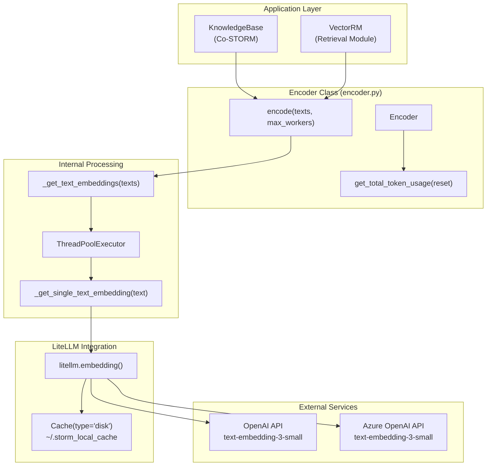
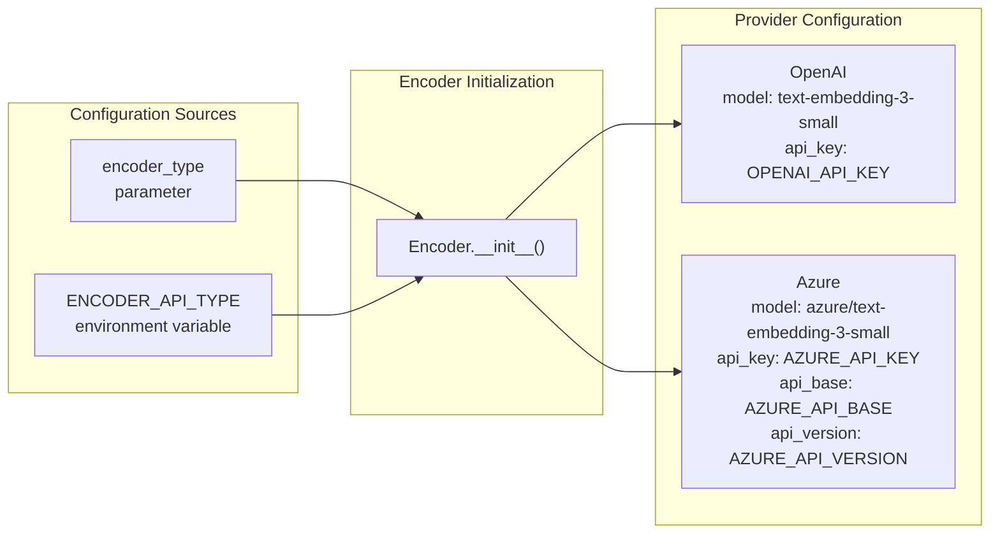
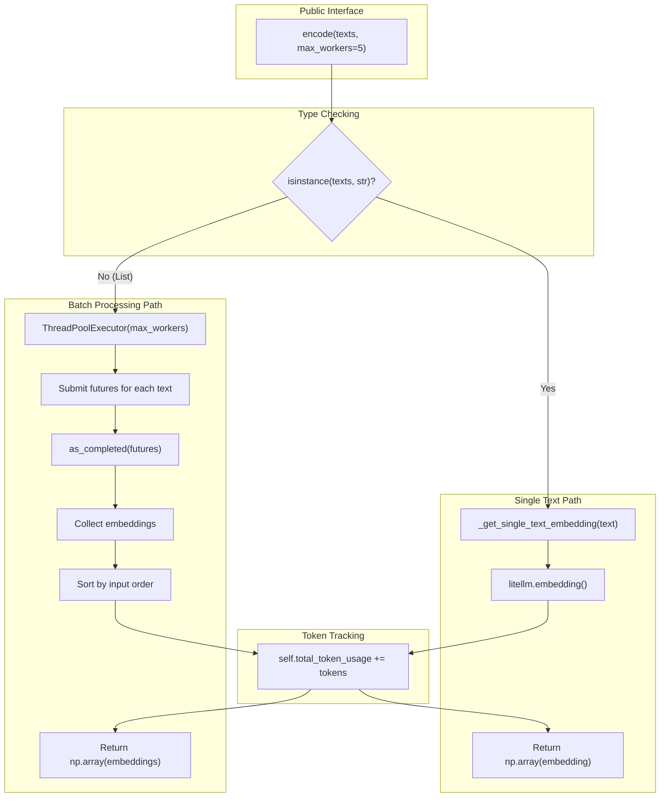
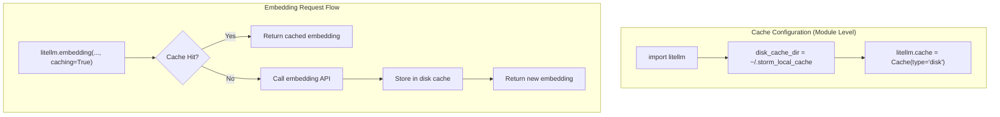
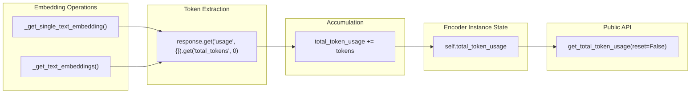
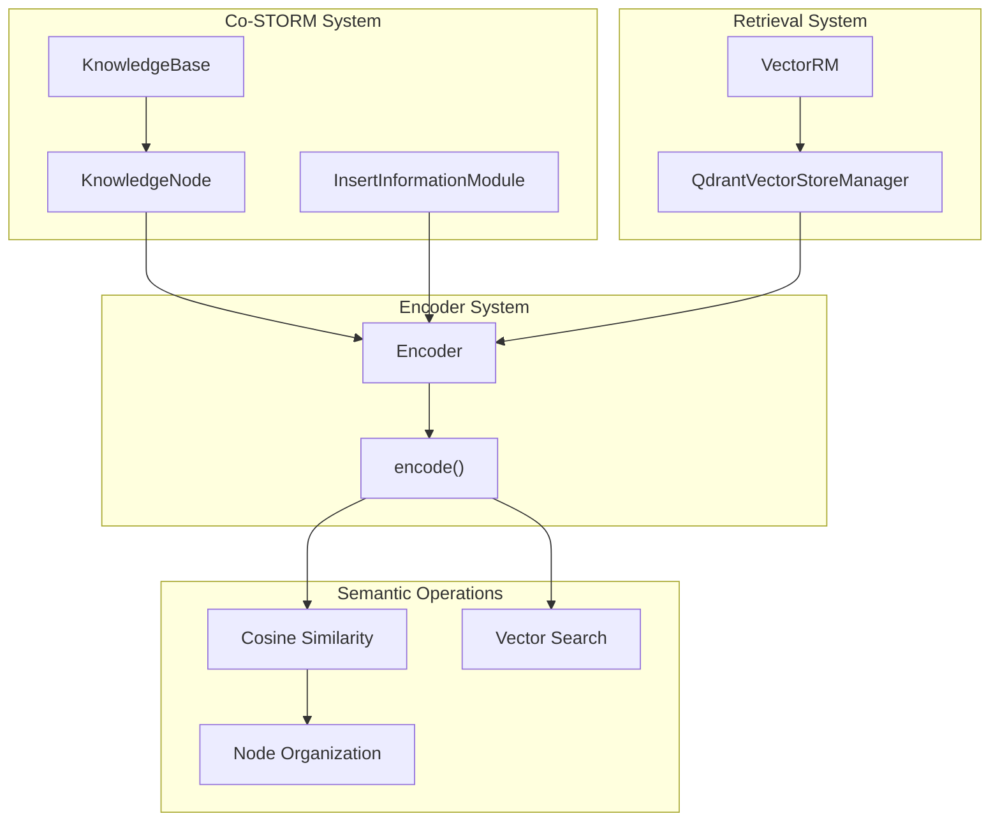
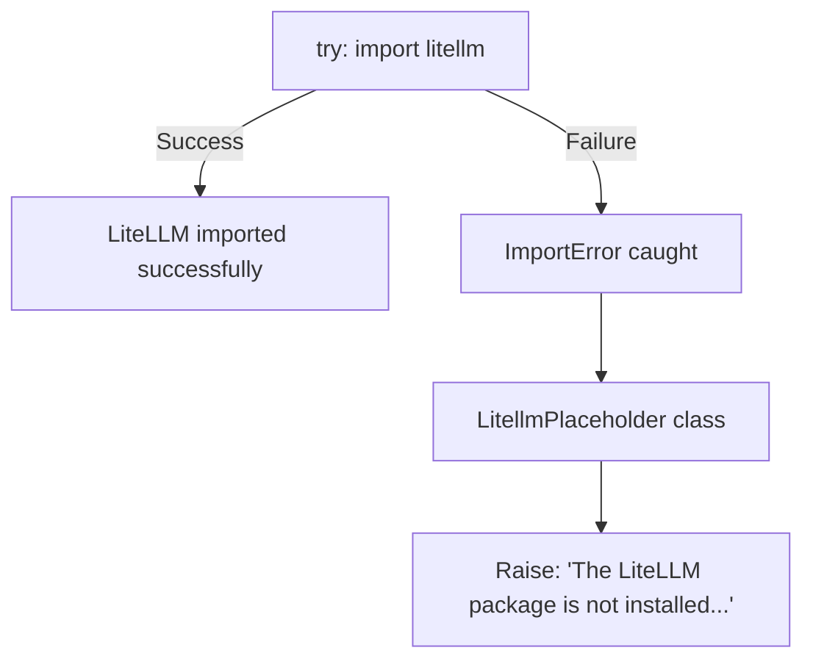

<!-- source: DeepWiki mcp.deepwiki.com · repo stanford-oval/storm · page 4.3 Encoder System · fetched 2026-10-26 -->

# Encoder System

<details>
<summary>Relevant source files</summary>

The following files were used as context for generating this wiki page:

- [knowledge_storm/encoder.py](knowledge_storm/encoder.py)

</details>


## Purpose and Scope

The Encoder System provides text embedding generation capabilities for the STORM codebase. It wraps LiteLLM's embedding functionality to produce vector representations of text, which are used for semantic similarity calculations and vector-based retrieval operations.

This system is primarily used by the Co-STORM Knowledge Base for organizing information nodes based on semantic similarity. For information about the Knowledge Base that uses these embeddings, see [Knowledge Base System](#3.2). For information about vector-based retrieval modules that also use embeddings, see [Retrieval Modules](#4.2).

**Sources:** [knowledge_storm/encoder.py:36-55]()

## Architecture Overview

The Encoder System consists of a single class, `Encoder`, which provides a unified interface to multiple embedding model providers through LiteLLM. The system includes built-in caching, parallel processing, and token usage tracking.



**Key Components:**

| Component | Location | Purpose |
|-----------|----------|---------|
| `Encoder` | [encoder.py:36]() | Main wrapper class for embedding generation |
| `encode()` | [encoder.py:112-122]() | Public method for generating embeddings |
| `_get_single_text_embedding()` | [encoder.py:124-130]() | Processes a single text string |
| `_get_text_embeddings()` | [encoder.py:132-178]() | Processes multiple texts with parallelization |
| `get_total_token_usage()` | [encoder.py:97-110]() | Returns token usage statistics |
| `litellm.cache` | [encoder.py:20-23]() | Disk-based caching system |

**Sources:** [knowledge_storm/encoder.py:1-179]()

## Initialization and Configuration

The `Encoder` class is initialized with provider-specific configuration. It supports multiple embedding model providers, with the provider type determined by the `encoder_type` parameter or the `ENCODER_API_TYPE` environment variable.

### Supported Providers



**Configuration Parameters:**

| Parameter | Type | Source | Description |
|-----------|------|--------|-------------|
| `encoder_type` | `Optional[str]` | Constructor or `ENCODER_API_TYPE` env var | Provider type ('openai' or 'azure') |
| `api_key` | `Optional[str]` | Constructor or provider-specific env var | API authentication key |
| `api_base` | `Optional[str]` | Constructor or `AZURE_API_BASE` env var | Base URL for Azure endpoints |
| `api_version` | `Optional[str]` | Constructor or `AZURE_API_VERSION` env var | API version for Azure |

### Initialization Example

The following initialization patterns are supported:

```python
# OpenAI provider
encoder = Encoder(encoder_type="openai", api_key="sk-...")

# Azure provider
encoder = Encoder(
    encoder_type="azure",
    api_key="...",
    api_base="https://....openai.azure.com/",
    api_version="2023-05-15"
)

# Using environment variables
encoder = Encoder()  # Reads from ENCODER_API_TYPE and provider-specific env vars
```

The initialization process:
1. Determines provider type from parameter or environment variable ([encoder.py:78-80]())
2. Sets `embedding_model_name` based on provider ([encoder.py:82-91]())
3. Configures `kargs` dictionary with provider-specific parameters ([encoder.py:84-91]())
4. Raises `ValueError` if provider type is unsupported or not specified ([encoder.py:79-95]())

**Sources:** [knowledge_storm/encoder.py:57-95]()

## Embedding Generation

The Encoder provides two modes of operation: single-text embedding and batch embedding with parallel processing.

### Processing Flow



### Single Text Embedding

For a single text string, the encoder directly calls LiteLLM's embedding function:

1. Call `litellm.embedding()` with configured model and parameters ([encoder.py:125-127]())
2. Extract embedding vector from response ([encoder.py:128]())
3. Extract token usage from response ([encoder.py:129]())
4. Update total token usage counter ([encoder.py:152]())
5. Return numpy array of embedding ([encoder.py:153]())

### Batch Embedding

For multiple texts, the encoder uses parallel processing with `ThreadPoolExecutor`:

1. Create thread pool with `max_workers` threads ([encoder.py:158]())
2. Submit embedding tasks for all texts ([encoder.py:159-162]())
3. Collect results as they complete ([encoder.py:164]())
4. Handle exceptions for individual texts ([encoder.py:169-171]())
5. Sort results to match input order ([encoder.py:174]())
6. Aggregate token usage ([encoder.py:168]())
7. Return 2D numpy array ([encoder.py:178]())

**Method Signatures:**

```python
def encode(self, texts: Union[str, List[str]], max_workers: int = 5) -> np.ndarray
```

Returns a 1D array for single text or 2D array for multiple texts, where each row is an embedding vector.

**Sources:** [knowledge_storm/encoder.py:112-178]()

## Caching Mechanism

The Encoder leverages LiteLLM's built-in disk caching to reduce redundant API calls and costs. Caching is configured at module initialization and applies to all `Encoder` instances.



### Cache Implementation Details

| Aspect | Implementation | Location |
|--------|---------------|----------|
| Cache Type | Disk cache | [encoder.py:23]() |
| Cache Directory | `~/.storm_local_cache` | [encoder.py:22]() |
| Cache Scope | Module-level (shared across instances) | [encoder.py:23]() |
| Cache Key | Generated by LiteLLM based on model + input | LiteLLM internal |
| Caching Flag | `caching=True` in embedding call | [encoder.py:126]() |

The cache is initialized once at module import time ([encoder.py:8-23]()), ensuring all `Encoder` instances share the same cache. This provides:

- **Cost Reduction**: Repeated embeddings for the same text are served from cache
- **Performance**: Eliminates API latency for cached embeddings
- **Persistence**: Cache survives across process restarts
- **Transparency**: No application-level cache management required

**Sources:** [knowledge_storm/encoder.py:8-23](), [knowledge_storm/encoder.py:126]()

## Token Usage Tracking

The Encoder tracks the total number of tokens processed across all embedding operations. This enables cost monitoring and usage analytics.

### Tracking Architecture



### Token Tracking Implementation

**Token Accumulation:**
- Tokens are extracted from LiteLLM response ([encoder.py:129]())
- Single text operation updates counter directly ([encoder.py:152]())
- Batch operation accumulates tokens from all threads ([encoder.py:168](), [encoder.py:176]())
- Counter is instance-level, initialized to 0 ([encoder.py:75]())

**Token Retrieval:**

```python
def get_total_token_usage(self, reset: bool = False) -> int
```

| Parameter | Type | Description |
|-----------|------|-------------|
| `reset` | `bool` | If `True`, resets counter to 0 after retrieval |

Returns the cumulative token count across all embedding operations on this `Encoder` instance ([encoder.py:97-110]()).

**Usage Pattern:**

```python
encoder = Encoder(encoder_type="openai")
embeddings = encoder.encode(["text1", "text2", "text3"])

# Get token usage
tokens_used = encoder.get_total_token_usage()  # Returns cumulative count
tokens_used = encoder.get_total_token_usage(reset=True)  # Returns and resets
```

**Sources:** [knowledge_storm/encoder.py:75](), [knowledge_storm/encoder.py:97-110](), [knowledge_storm/encoder.py:129](), [knowledge_storm/encoder.py:152](), [knowledge_storm/encoder.py:176]()

## Integration with STORM Systems

The Encoder is used by specific components within the STORM ecosystem that require semantic similarity calculations.

### Usage Map



### Primary Use Cases

| Component | Use Case | Purpose |
|-----------|----------|---------|
| Co-STORM KnowledgeBase | Node similarity calculation | Determines semantic relationships between knowledge nodes for organization |
| Co-STORM InsertInformationModule | Information placement | Finds most relevant node for new information based on embedding similarity |
| VectorRM | Document retrieval | Converts queries to embeddings for vector database search |
| QdrantVectorStoreManager | Vector store operations | Generates embeddings for documents stored in Qdrant |

### Co-STORM Integration Details

In Co-STORM's collaborative knowledge curation:
1. **Node Organization**: When inserting information into the knowledge base, the system embeds the information content and compares it to existing node embeddings to find the best placement
2. **Dynamic Reorganization**: As the knowledge base grows, nodes are reorganized based on semantic similarity of their embeddings
3. **Hierarchical Structure**: Parent-child relationships in the mind map are influenced by embedding similarities

### VectorRM Integration Details

In vector-based retrieval:
1. **Query Embedding**: User queries are embedded using the `Encoder`
2. **Similarity Search**: Query embeddings are compared against document embeddings in the vector store
3. **Retrieval**: Most similar documents are returned based on embedding distance

**Sources:** [knowledge_storm/encoder.py:1-179]()

## Error Handling

The Encoder implements defensive error handling for common failure scenarios:

### Import Error Handling

If LiteLLM is not installed, the module provides a placeholder class that raises informative errors:



**Implementation:** [encoder.py:8-33]()

### Configuration Validation

| Error Condition | Exception Type | Location |
|----------------|---------------|----------|
| No encoder type specified | `ValueError` | [encoder.py:79-80]() |
| Unsupported encoder type | `ValueError` | [encoder.py:93-95]() |

### Runtime Error Handling

During batch processing, individual text embedding failures are caught and logged:
- Exceptions are caught per-thread ([encoder.py:169-171]())
- Error message includes the failed text
- Processing continues for remaining texts
- Failed embeddings are omitted from results

**Sources:** [knowledge_storm/encoder.py:8-33](), [knowledge_storm/encoder.py:79-80](), [knowledge_storm/encoder.py:93-95](), [knowledge_storm/encoder.py:169-171]()

## LiteLLM Configuration

The Encoder configures LiteLLM with specific settings to optimize behavior for the STORM ecosystem:

| Configuration | Value | Purpose | Location |
|---------------|-------|---------|----------|
| `litellm.drop_params` | `True` | Ignore unsupported parameters rather than error | [encoder.py:17]() |
| `litellm.telemetry` | `False` | Disable telemetry data collection | [encoder.py:18]() |
| `LITELLM_LOCAL_MODEL_COST_MAP` | `"True"` | Use local cost mapping | [encoder.py:13-14]() |

These settings ensure:
- **Compatibility**: `drop_params` allows the same code to work across different embedding providers
- **Privacy**: Telemetry is disabled to prevent external data transmission
- **Cost Tracking**: Local cost maps enable accurate token usage accounting

**Sources:** [knowledge_storm/encoder.py:8-23]()

---

