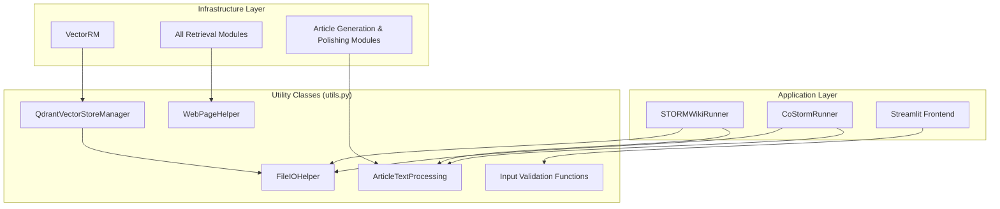
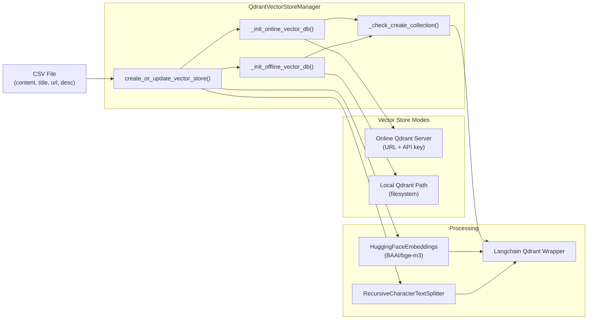
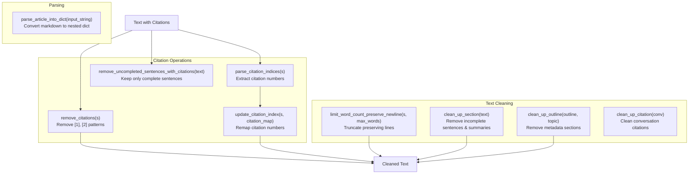
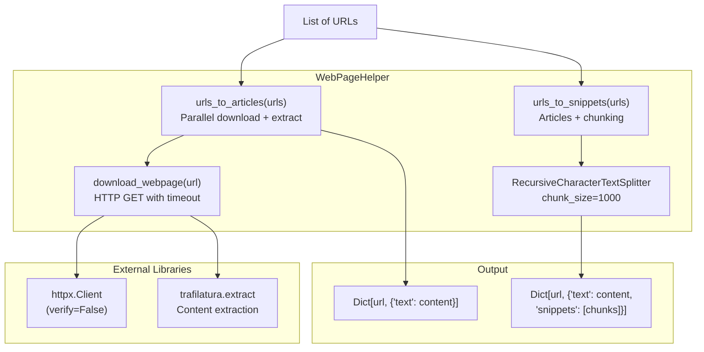
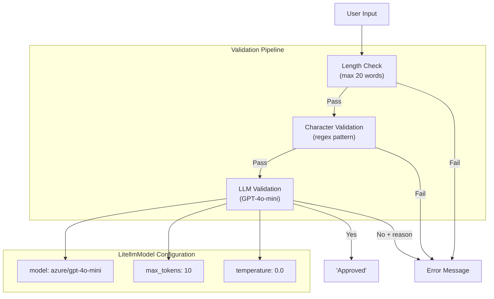
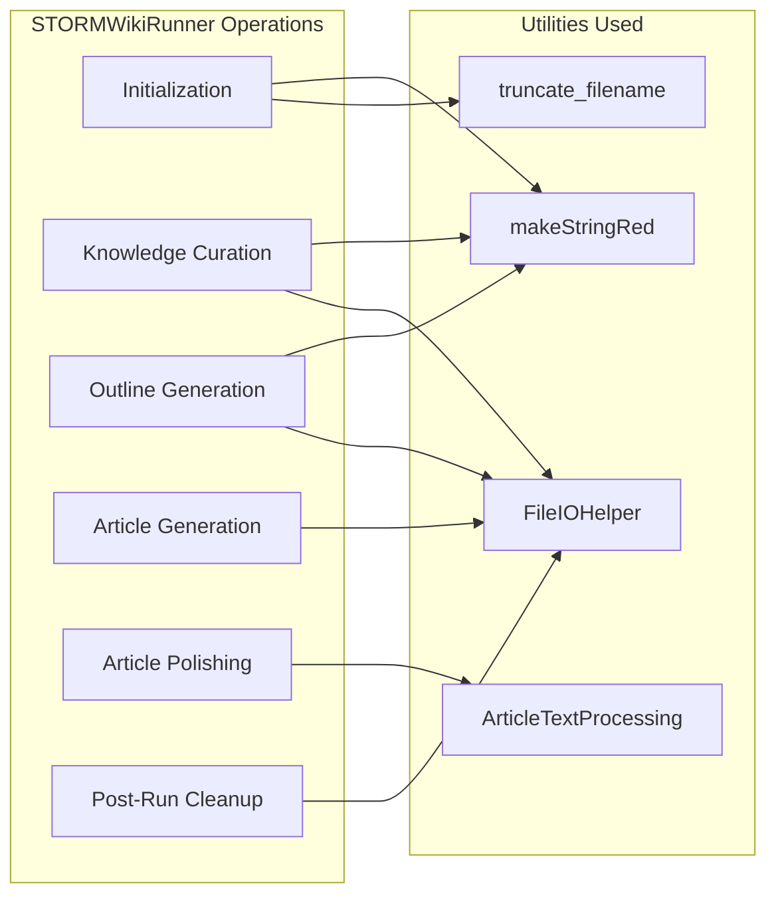

<!-- source: DeepWiki mcp.deepwiki.com · repo stanford-oval/storm · page 4.4 Utilities and Helpers · fetched 2026-10-26 -->

# Utilities and Helpers

<details>
<summary>Relevant source files</summary>

The following files were used as context for generating this wiki page:

- [knowledge_storm/storm_wiki/engine.py](knowledge_storm/storm_wiki/engine.py)
- [knowledge_storm/utils.py](knowledge_storm/utils.py)

</details>


This document covers utility classes and helper functions provided in the STORM framework. These utilities support core operations including vector store management, text processing, file I/O, web page retrieval, and input validation. For information about the abstract interfaces these utilities support, see [Abstract Interfaces](#4.5). For language model integration and retrieval modules that use these utilities, see [Language Model Integration](#4.1) and [Retrieval Modules](#4.2).

Sources: [knowledge_storm/utils.py:1-794]()

## Overview of Utility Components

The STORM framework provides utilities organized into several categories:

| Utility Class/Function | Purpose | Primary Users |
|------------------------|---------|---------------|
| `QdrantVectorStoreManager` | Manage Qdrant vector databases for document retrieval | `VectorRM` retrieval module |
| `ArticleTextProcessing` | Process and clean article text, citations, outlines | STORM and Co-STORM article generation modules |
| `FileIOHelper` | Handle JSON, pickle, and text file operations | `STORMWikiRunner`, `CoStormRunner`, all modules |
| `WebPageHelper` | Download and extract content from web pages | All retrieval modules |
| `user_input_appropriateness_check` | Validate user topic inputs | Frontend applications |
| `purpose_appropriateness_check` | Validate purpose descriptions | Co-STORM frontend |
| `truncate_filename` | Ensure filename length limits | File output operations |
| `load_api_key` | Load API keys from TOML configuration | Setup and initialization |
| `makeStringRed` | Format error messages with ANSI colors | Error reporting |

Sources: [knowledge_storm/utils.py:1-794]()



Sources: [knowledge_storm/utils.py:1-794](), [knowledge_storm/storm_wiki/engine.py:1-442]()

## QdrantVectorStoreManager

`QdrantVectorStoreManager` is a helper class for managing Qdrant vector stores, enabling document-based retrieval through the `VectorRM` retrieval module (see [Retrieval Modules](#4.2)).

### Core Functionality

The manager supports two deployment modes:
- **Offline mode**: Vector store persisted to local filesystem
- **Online mode**: Vector store hosted on a remote Qdrant server

Sources: [knowledge_storm/utils.py:60-299]()



Sources: [knowledge_storm/utils.py:60-299]()

### Vector Store Creation

The `create_or_update_vector_store` static method ingests documents from a CSV file into a Qdrant collection:

**Key Parameters:**
- `collection_name`: Name of the Qdrant collection
- `vector_db_mode`: Either `"online"` or `"offline"`
- `file_path`: Path to CSV file with document data
- `content_column`: Column name containing document text
- `title_column`, `url_column`, `desc_column`: Metadata columns
- `embedding_model`: HuggingFace model name (default: `"BAAI/bge-m3"`)
- `chunk_size`: Size of text chunks (default: 500)
- `chunk_overlap`: Overlap between chunks (default: 100)

**Processing Pipeline:**
1. Initialize Qdrant client (online or offline mode)
2. Create collection if it doesn't exist (1024-dimensional vectors, cosine distance)
3. Load CSV file into pandas DataFrame
4. Convert rows to `Document` objects with metadata
5. Split documents into chunks using `RecursiveCharacterTextSplitter`
6. Add documents to collection in batches

Sources: [knowledge_storm/utils.py:151-299]()

### Collection Management

The `_check_create_collection` method handles collection initialization:

```python
# Example usage pattern
from qdrant_client import QdrantClient
from langchain_qdrant import Qdrant

# Collection is created with:
# - Vector size: 1024
# - Distance metric: COSINE
# - Returns Langchain Qdrant wrapper
```

The method checks if a collection exists and creates it with proper vector configuration if needed. Uses Langchain's `Qdrant` wrapper for document operations.

Sources: [knowledge_storm/utils.py:68-100]()

### Text Splitting Configuration

Documents are split using `RecursiveCharacterTextSplitter` with language-aware separators:

```python
separators=[
    "\n\n",
    "\n",
    ".",
    "\uff0e",  # Fullwidth full stop
    "\u3002",  # Ideographic full stop
    ",",
    "\uff0c",  # Fullwidth comma
    "\u3001",  # Ideographic comma
    " ",
    "\u200B",  # Zero-width space
    "",
]
```

This configuration supports both Western and CJK (Chinese, Japanese, Korean) text processing.

Sources: [knowledge_storm/utils.py:266-284]()

## ArticleTextProcessing

`ArticleTextProcessing` provides static methods for manipulating article text, particularly for handling citations, cleaning generated content, and processing outlines.

### Citation Processing Methods



Sources: [knowledge_storm/utils.py:301-595]()

### Key Methods

**Citation Handling:**

| Method | Purpose | Input/Output |
|--------|---------|-------------|
| `remove_citations(s)` | Strip all `[1]`, `[2, 3]` style citations | String → String without citations |
| `parse_citation_indices(s)` | Extract citation numbers | String → List of integers |
| `remove_uncompleted_sentences_with_citations(text)` | Keep only complete sentences ending with punctuation | String → Truncated string |
| `update_citation_index(s, citation_map)` | Remap citation numbers using dictionary | String + Dict → String with updated citations |
| `clean_up_citation(conv)` | Clean citations in conversation history | Conversation → Cleaned conversation |

Sources: [knowledge_storm/utils.py:336-454]()

**Text Truncation:**

The `limit_word_count_preserve_newline` method truncates text while preserving line integrity:

```python
# Limits word count but ensures no partial lines
# Useful for context window management
limited_text = ArticleTextProcessing.limit_word_count_preserve_newline(
    input_string="...", 
    max_word_count=1000
)
```

Sources: [knowledge_storm/utils.py:302-334]()

**Outline Cleaning:**

`clean_up_outline` removes standard Wikipedia sections and metadata:
- Removes: "See also", "References", "External links", "Bibliography", "Further reading", "Summary", "Appendices"
- Converts bullet points to subsection headers
- Strips all citation markers
- Removes duplicate topic headers

Sources: [knowledge_storm/utils.py:456-503]()

**Section Cleanup:**

`clean_up_section` performs comprehensive section cleaning:
1. Removes uncompleted sentences
2. Deduplicates citation groups
3. Removes summary paragraphs starting with "Overall", "In summary", "In conclusion"
4. Removes "Summary" and "Conclusion" sections
5. Joins paragraphs with double newlines for markdown formatting

Sources: [knowledge_storm/utils.py:505-538]()

### Article Parsing

The `parse_article_into_dict` method converts markdown-structured text into a nested dictionary representation:

**Structure:**
```python
{
    "Section Title": {
        "content": "section text",
        "subsections": {
            "Subsection Title": {
                "content": "subsection text",
                "subsections": {...}
            }
        }
    }
}
```

The parser uses header levels (number of `#` symbols) to determine nesting depth.

Sources: [knowledge_storm/utils.py:552-595]()

## FileIOHelper

`FileIOHelper` provides static methods for common file I/O operations used throughout the STORM framework.

### Supported Operations

| Method | Purpose | File Format |
|--------|---------|-------------|
| `dump_json(obj, file_name)` | Write object to JSON file | JSON |
| `load_json(file_name)` | Read JSON file into object | JSON |
| `write_str(s, path)` | Write string to text file | Plain text |
| `load_str(path)` | Read text file into string | Plain text |
| `dump_pickle(obj, path)` | Serialize object with pickle | Pickle |
| `load_pickle(path)` | Deserialize pickled object | Pickle |

Sources: [knowledge_storm/utils.py:597-631]()

### JSON Handling

The `dump_json` method includes special handling for non-serializable objects:

```python
@staticmethod
def handle_non_serializable(obj):
    return "non-serializable contents"  # mark the non-serializable part
```

This prevents crashes when encountering objects that cannot be JSON-serialized, replacing them with a placeholder string.

Sources: [knowledge_storm/utils.py:599-605]()

### Usage Pattern

```python
# Used extensively in STORMWikiRunner and CoStormRunner
FileIOHelper.dump_json(
    conversation_log,
    os.path.join(output_dir, "conversation_log.json")
)

article_text = FileIOHelper.load_str(
    os.path.join(output_dir, "storm_gen_article.txt")
)
```

Sources: [knowledge_storm/storm_wiki/engine.py:228-231](), [knowledge_storm/storm_wiki/engine.py:335-336]()

## WebPageHelper

`WebPageHelper` downloads web pages and extracts their text content, used by all retrieval modules to process search results.

### Architecture



Sources: [knowledge_storm/utils.py:633-712]()

### Configuration

The helper is initialized with parameters controlling download behavior and text processing:

**Constructor Parameters:**
- `min_char_count`: Minimum character count for valid articles (default: 150)
- `snippet_chunk_size`: Maximum characters per snippet (default: 1000)
- `max_thread_num`: Maximum concurrent download threads (default: 10)

Sources: [knowledge_storm/utils.py:639-672]()

### Download Process

**`download_webpage(url)`:**
- Uses `httpx.Client` with SSL verification disabled
- 4-second timeout per request
- Returns raw HTML content or `None` on error
- Prints error messages for failed requests

**`urls_to_articles(urls)`:**
- Parallel downloads using `ThreadPoolExecutor`
- Extracts text using `trafilatura.extract` (tables and comments excluded)
- Filters articles below minimum character threshold
- Returns dictionary mapping URLs to article dictionaries

**`urls_to_snippets(urls)`:**
- Calls `urls_to_articles` first
- Splits each article into chunks using `RecursiveCharacterTextSplitter`
- Stores chunks in `snippets` key of article dictionary

Sources: [knowledge_storm/utils.py:674-712]()

### Text Splitting Configuration

The helper uses the same language-aware separators as `QdrantVectorStoreManager`, supporting both Western and CJK text:

```python
separators=[
    "\n\n", "\n", ".",
    "\uff0e",  # Fullwidth full stop
    "\u3002",  # Ideographic full stop
    ",",
    "\uff0c",  # Fullwidth comma
    "\u3001",  # Ideographic comma
    " ",
    "\u200B",  # Zero-width space
    "",
]
```

Sources: [knowledge_storm/utils.py:654-672]()

## Input Validation Functions

Two functions validate user inputs using GPT-4o-mini before processing:

### user_input_appropriateness_check

Validates topic inputs for STORM wiki generation, checking for:

1. **Length**: Rejects inputs exceeding 20 words
2. **Character set**: Only allows `a-z, A-Z, 0-9, space, -/",.?/'`
3. **Content appropriateness**: Uses LLM to detect:
   - Illegal, harmful, violent, racist, or sexual content
   - Non-English inputs (system supports English only)
   - Personal experience or personal information
   - Requests requiring execution (calculations, programming, searches)

**Return Values:**
- `"Approved"`: Input is acceptable
- Error string describing the issue

Sources: [knowledge_storm/utils.py:714-767]()

### purpose_appropriateness_check

Validates purpose descriptions for Co-STORM report generation:
- Checks if purpose is meaningful (not random words or sanity check bypass attempts)
- Uses less strict validation than topic checking
- Returns `"Approved"` or error message requesting more detail

Sources: [knowledge_storm/utils.py:769-794]()

### Implementation Details



Sources: [knowledge_storm/utils.py:714-794]()

Both functions instantiate a `LitellmModel` with minimal token allowance (10 tokens) since they only need a yes/no response. The validation prompt is carefully designed to categorize inappropriate inputs by type.

Sources: [knowledge_storm/utils.py:715-720](), [knowledge_storm/utils.py:771-775]()

## Other Utility Functions

### truncate_filename

Ensures filenames don't exceed filesystem limits by truncating to a maximum length:

**Parameters:**
- `filename`: String to potentially truncate
- `max_length`: Maximum allowed length (default: 125)

**Behavior:**
- Returns original filename if within limit
- Truncates and logs warning if too long
- Default limit of 125 assumes 255-character total path limit

Used by `STORMWikiRunner` when creating article output directories.

Sources: [knowledge_storm/utils.py:23-38](), [knowledge_storm/storm_wiki/engine.py:379-381]()

### load_api_key

Loads API keys from a TOML configuration file into environment variables:

```python
# Reads TOML file and sets each key-value pair as environment variable
load_api_key("secrets.toml")

# File format:
# OPENAI_API_KEY = "sk-..."
# QDRANT_API_KEY = "..."
```

**Error Handling:**
- Prints error to stderr if file not found
- Prints error if TOML parsing fails
- Returns silently on success

Sources: [knowledge_storm/utils.py:41-54]()

### makeStringRed

Formats error messages with ANSI color codes for terminal display:

```python
# Returns: "\033[91m {message}\033[00m"
error_msg = makeStringRed("Configuration error!")
```

Used throughout the codebase for assertion error messages and user-facing errors.

Sources: [knowledge_storm/utils.py:56-58](), [knowledge_storm/storm_wiki/engine.py:313-315]()

## Utility Integration Patterns

### Usage in STORMWikiRunner



Sources: [knowledge_storm/storm_wiki/engine.py:1-442]()

The `STORMWikiRunner` demonstrates typical utility usage patterns:

1. **Initialization**: `truncate_filename` for safe directory creation
2. **Research phase**: `FileIOHelper.dump_json` for conversation logs
3. **All phases**: `FileIOHelper` for loading/saving intermediate results
4. **Polishing**: `ArticleTextProcessing` methods for cleaning content
5. **Error handling**: `makeStringRed` for user-facing error messages

Sources: [knowledge_storm/storm_wiki/engine.py:228-231](), [knowledge_storm/storm_wiki/engine.py:297-310](), [knowledge_storm/storm_wiki/engine.py:379-381]()

### Usage in Retrieval Modules

All retrieval modules use `WebPageHelper` to process URLs returned by search engines:

```python
# Pattern used across YouRM, BingSearch, BraveRM, etc.
web_page_helper = WebPageHelper(
    min_char_count=150,
    snippet_chunk_size=1000,
    max_thread_num=10
)

# Download and extract articles
articles = web_page_helper.urls_to_articles([url1, url2, url3])

# Or get chunked snippets for context
snippets = web_page_helper.urls_to_snippets([url1, url2, url3])
```

This consistent pattern ensures uniform handling of web content across all retrieval backends.

Sources: [knowledge_storm/utils.py:633-712]()

---

