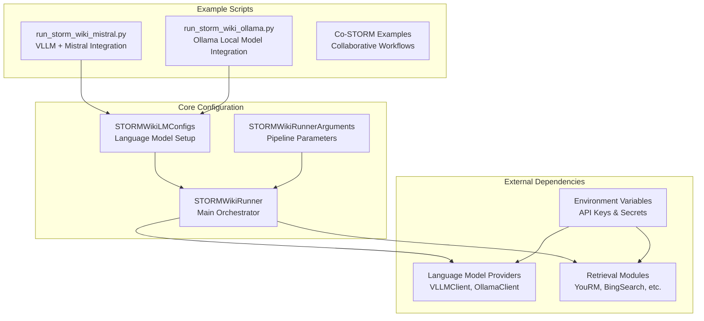
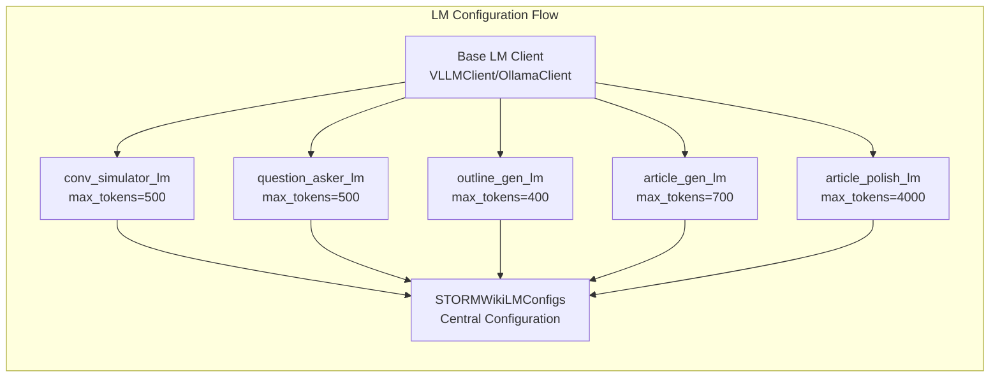
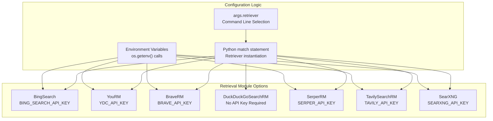
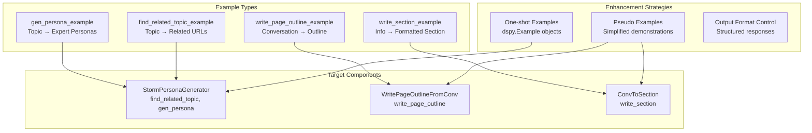
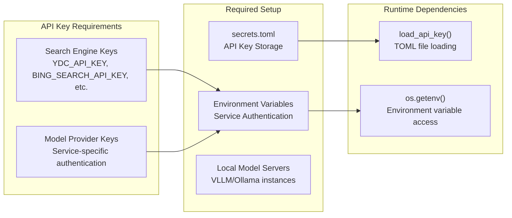

<!-- source: DeepWiki mcp.deepwiki.com · repo stanford-oval/storm · page 5 Usage and Examples · fetched 2026-10-26 -->

# Examples and Usage

Relevant source files

The following files were used as context for generating this wiki page:

- [examples/costorm_examples/run_costorm_gpt.py](examples/costorm_examples/run_costorm_gpt.py)
- [examples/storm_examples/run_storm_wiki_mistral.py](examples/storm_examples/run_storm_wiki_mistral.py)
- [examples/storm_examples/run_storm_wiki_ollama.py](examples/storm_examples/run_storm_wiki_ollama.py)

This document provides practical examples demonstrating how to use both STORM and Co-STORM systems for automated and collaborative knowledge curation. The examples show complete working implementations with different language model providers and retrieval modules.

For detailed information on the core system architecture, see [Architecture Overview](#1.2). For specific component documentation, see [STORM Wiki Generation System](#2) and [Co-STORM Collaborative System](#3).

## Overview of Example Structure

The STORM repository includes comprehensive command-line examples that demonstrate the full pipeline execution for both systems. These examples show how to configure language models, retrieval modules, and execution parameters for different use cases.

Sources: [examples/storm_examples/run_storm_wiki_mistral.py:1-273](), [examples/storm_examples/run_storm_wiki_ollama.py:1-277]()

## Example Output Structure

All STORM examples produce a standardized output directory structure that organizes the generated content and intermediate results:

| File | Description | Purpose |
|------|-------------|---------|
| `conversation_log.json` | Information-seeking conversation logs | Records simulated expert conversations |
| `raw_search_results.json` | Unprocessed search engine results | Raw retrieval module outputs |
| `direct_gen_outline.txt` | LLM parametric knowledge outline | Baseline outline without external information |
| `storm_gen_outline.txt` | Research-enhanced outline | Final outline incorporating retrieved information |
| `url_to_info.json` | Source reference mapping | Maps URLs to extracted information used in article |
| `storm_gen_article.txt` | Generated article | Complete article with citations |
| `storm_gen_article_polished.txt` | Polished final article | Refined version with summarization (optional) |

Sources: [examples/storm_examples/run_storm_wiki_mistral.py:7-16](), [examples/storm_examples/run_storm_wiki_ollama.py:7-16]()

## Language Model Configuration Pattern

The examples demonstrate a consistent pattern for configuring specialized language model instances for different pipeline stages:

Sources: [examples/storm_examples/run_storm_wiki_mistral.py:44-66](), [examples/storm_examples/run_storm_wiki_ollama.py:44-66]()

## Retrieval Module Selection

The examples implement a flexible retrieval module selection system supporting multiple search engines and APIs:

Sources: [examples/storm_examples/run_storm_wiki_mistral.py:77-112](), [examples/storm_examples/run_storm_wiki_ollama.py:77-112]()

## Pipeline Stage Control

The examples provide granular control over pipeline execution through boolean flags that enable selective stage execution:

| Stage Flag | Function | Default Behavior |
|------------|----------|------------------|
| `--do-research` | Execute knowledge curation | Skip if results exist |
| `--do-generate-outline` | Generate article outline | Skip if results exist |
| `--do-generate-article` | Generate article content | Skip if results exist |
| `--do-polish-article` | Polish and summarize | Optional refinement |

This design allows for:
- **Incremental execution**: Resume from any stage if previous results exist
- **Debugging**: Isolate specific pipeline stages
- **Resource management**: Skip expensive operations when testing

Sources: [examples/storm_examples/run_storm_wiki_mistral.py:179-185](), [examples/storm_examples/run_storm_wiki_ollama.py:179-185]()

## Open Model Enhancement Techniques

The examples demonstrate specific techniques for improving open-source language model performance through prompt engineering:

Sources: [examples/storm_examples/run_storm_wiki_mistral.py:116-176](), [examples/storm_examples/run_storm_wiki_ollama.py:116-176]()

## Command Line Interface Structure

The examples implement comprehensive argument parsing for flexible execution control:

### Global Configuration Parameters

| Parameter | Type | Default | Purpose |
|-----------|------|---------|---------|
| `--url` | str | `http://localhost` | Server URL for local LM |
| `--port` | int | Model-specific | Server port |
| `--model` | str | Model-specific | Model identifier |
| `--output-dir` | str | `./results/` | Output directory path |
| `--max-thread-num` | int | 3 | Parallel execution threads |
| `--retriever` | str | Required | Search engine selection |

### Pipeline Hyperparameters

| Parameter | Type | Default | Purpose |
|-----------|------|---------|---------|
| `--max-conv-turn` | int | 3 | Conversation question limit |
| `--max-perspective` | int | 3 | Perspective diversity limit |
| `--search-top-k` | int | 3 | Search results per query |
| `--retrieve-top-k` | int | 3 | References per section |

Sources: [examples/storm_examples/run_storm_wiki_mistral.py:192-273](), [examples/storm_examples/run_storm_wiki_ollama.py:192-277]()

## Environment Setup Requirements

The examples require specific environment configuration for external service integration:

Sources: [examples/storm_examples/run_storm_wiki_mistral.py:43](), [examples/storm_examples/run_storm_wiki_ollama.py:43]()

---

