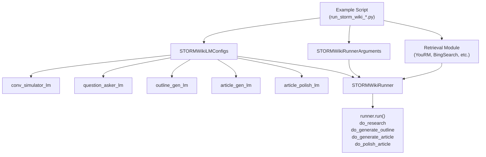
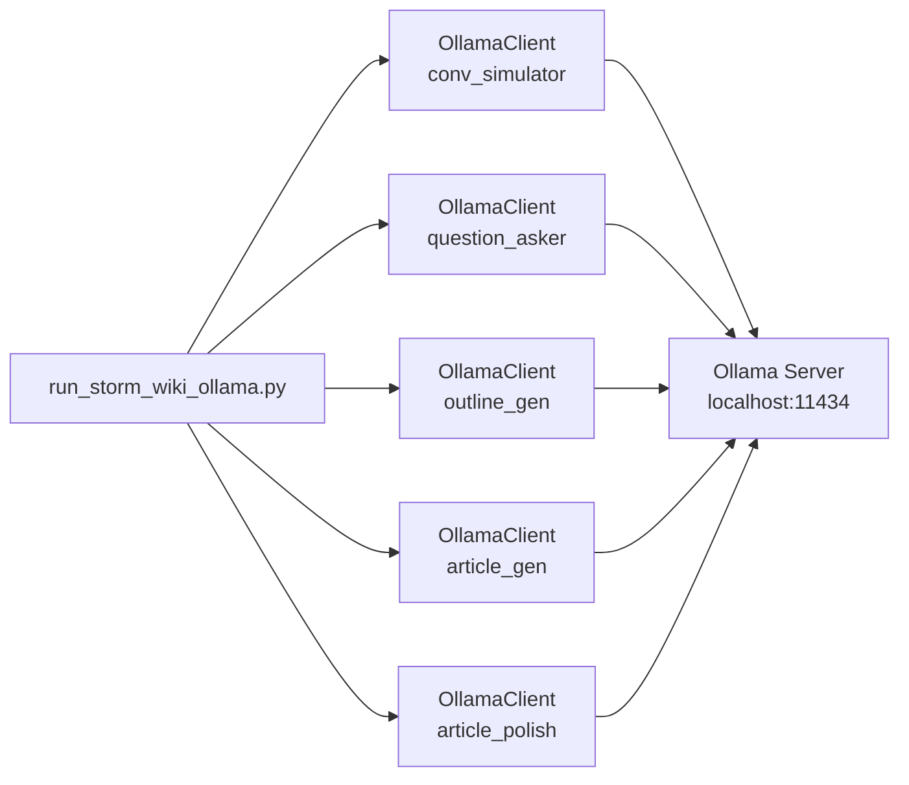
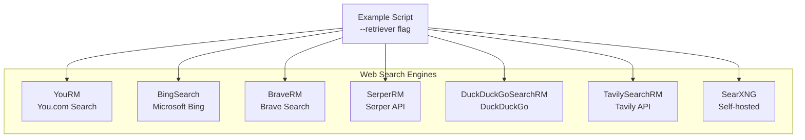
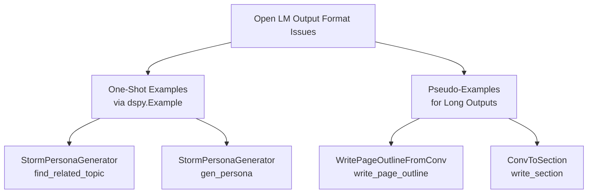

<!-- source: DeepWiki mcp.deepwiki.com · repo stanford-oval/storm · page 5.1 STORM Examples · fetched 2026-10-26 -->

# STORM Examples

<details>
<summary>Relevant source files</summary>

The following files were used as context for generating this wiki page:

- [README.md](README.md)
- [examples/storm_examples/run_storm_wiki_mistral.py](examples/storm_examples/run_storm_wiki_mistral.py)
- [examples/storm_examples/run_storm_wiki_ollama.py](examples/storm_examples/run_storm_wiki_ollama.py)
- [knowledge_storm/lm.py](knowledge_storm/lm.py)

</details>


This page documents the command-line example scripts for running the STORM Wiki generation pipeline. These scripts demonstrate how to configure and execute STORM with different language model providers (OpenAI, Ollama, VLLM) and retrieval modules (Bing, You.com, etc.). For Co-STORM collaborative examples, see [5.2](#5.2). For frontend demo usage, see [5.3](#5.3).

## Overview

The STORM repository provides ready-to-use example scripts in the `examples/storm_examples/` directory that demonstrate complete pipeline execution with different configurations:

| Example Script | Language Model | Use Case |
|----------------|----------------|----------|
| `run_storm_wiki_gpt.py` | OpenAI GPT-3.5/4 | Production-ready configuration with commercial models |
| `run_storm_wiki_ollama.py` | Ollama (local models) | Local deployment with open-source models |
| `run_storm_wiki_mistral.py` | VLLM (Mistral-7B) | Self-hosted inference server configuration |

All example scripts follow a common execution pattern:
1. Load API keys from `secrets.toml`
2. Configure language model instances for each pipeline stage
3. Initialize retrieval module with search engine API
4. Create and execute `STORMWikiRunner`
5. Save outputs to structured directory

Sources: [README.md:220-258](), [examples/storm_examples/run_storm_wiki_ollama.py:1-278](), [examples/storm_examples/run_storm_wiki_mistral.py:1-274]()

---

## Configuration Pattern

All STORM examples follow a consistent configuration pattern using three key classes:



**Configuration Components:**

- **`STORMWikiLMConfigs`**: Container for 5 specialized language model instances, each assigned to a specific pipeline stage
- **`STORMWikiRunnerArguments`**: Pipeline hyperparameters including `max_conv_turn`, `max_perspective`, `search_top_k`, `output_dir`
- **Retrieval Module**: Implementation of search engine API (7 options available)
- **`STORMWikiRunner`**: Main execution engine that orchestrates the 4-stage pipeline

Sources: [README.md:104-153](), [examples/storm_examples/run_storm_wiki_ollama.py:43-75]()

---

## Example 1: OpenAI GPT Models

The standard configuration uses OpenAI's GPT models with the `LitellmModel` wrapper:

```python
from knowledge_storm import STORMWikiRunnerArguments, STORMWikiRunner, STORMWikiLMConfigs
from knowledge_storm.lm import LitellmModel
from knowledge_storm.rm import YouRM

lm_configs = STORMWikiLMConfigs()
openai_kwargs = {
    'api_key': os.getenv("OPENAI_API_KEY"),
    'temperature': 1.0,
    'top_p': 0.9,
}

# Use cheaper model for conversation simulation
gpt_35 = LitellmModel(model='gpt-3.5-turbo', max_tokens=500, **openai_kwargs)
# Use more powerful model for article generation
gpt_4 = LitellmModel(model='gpt-4o', max_tokens=3000, **openai_kwargs)

lm_configs.set_conv_simulator_lm(gpt_35)
lm_configs.set_question_asker_lm(gpt_35)
lm_configs.set_outline_gen_lm(gpt_4)
lm_configs.set_article_gen_lm(gpt_4)
lm_configs.set_article_polish_lm(gpt_4)
```

**Key Design Decision**: STORM uses different models for different stages to balance cost and quality. Cheaper models handle conversation simulation and question asking, while more powerful models handle outline generation, article writing, and polishing.

**Execution**:
```bash
python examples/storm_examples/run_storm_wiki_gpt.py \
    --output-dir ./results/gpt \
    --retriever bing \
    --do-research \
    --do-generate-outline \
    --do-generate-article \
    --do-polish-article
```

Sources: [README.md:108-133](), [README.md:244-255]()

---

## Example 2: Ollama (Local Models)

The Ollama example demonstrates running STORM with locally-hosted open-source models:



**Configuration**:
```python
from knowledge_storm.lm import OllamaClient

ollama_kwargs = {
    "model": "llama3:latest",
    "port": 11434,
    "url": "http://localhost",
    "stop": ("\n\n---",),  # Prevent generating dspy example separator
}

conv_simulator_lm = OllamaClient(max_tokens=500, **ollama_kwargs)
question_asker_lm = OllamaClient(max_tokens=500, **ollama_kwargs)
outline_gen_lm = OllamaClient(max_tokens=400, **ollama_kwargs)
article_gen_lm = OllamaClient(max_tokens=700, **ollama_kwargs)
article_polish_lm = OllamaClient(max_tokens=4000, **ollama_kwargs)
```

**Execution**:
```bash
python examples/storm_examples/run_storm_wiki_ollama.py \
    --url http://localhost \
    --port 11434 \
    --model llama3:latest \
    --output-dir ./results/ollama \
    --retriever you \
    --do-research \
    --do-generate-outline \
    --do-generate-article \
    --do-polish-article
```

**Prerequisites**:
- Ollama server running locally
- Model downloaded via `ollama pull llama3:latest`

Sources: [examples/storm_examples/run_storm_wiki_ollama.py:1-17](), [examples/storm_examples/run_storm_wiki_ollama.py:43-66](), [examples/storm_examples/run_storm_wiki_ollama.py:191-202]()

---

## Example 3: VLLM Server (Mistral)

The VLLM example demonstrates using a self-hosted inference server with Mistral-7B-Instruct:

**Configuration**:
```python
from knowledge_storm.lm import VLLMClient

mistral_kwargs = {
    "model": "mistralai/Mistral-7B-Instruct-v0.2",
    "port": 8000,
    "url": "http://localhost",
    "stop": ("\n\n---",),
}

conv_simulator_lm = VLLMClient(max_tokens=500, **mistral_kwargs)
question_asker_lm = VLLMClient(max_tokens=500, **mistral_kwargs)
outline_gen_lm = VLLMClient(max_tokens=400, **mistral_kwargs)
article_gen_lm = VLLMClient(max_tokens=700, **mistral_kwargs)
article_polish_lm = VLLMClient(max_tokens=4000, **mistral_kwargs)
```

**VLLM Server Setup**:
```bash
# Start VLLM server
python -m vllm.entrypoints.openai.api_server \
    --model mistralai/Mistral-7B-Instruct-v0.2 \
    --port 8000
```

**Execution**:
```bash
python examples/storm_examples/run_storm_wiki_mistral.py \
    --url http://localhost \
    --port 8000 \
    --output-dir ./results/mistral_7b \
    --retriever bing \
    --do-research \
    --do-generate-outline \
    --do-generate-article \
    --do-polish-article
```

Sources: [examples/storm_examples/run_storm_wiki_mistral.py:1-17](), [examples/storm_examples/run_storm_wiki_mistral.py:42-65](), [examples/storm_examples/run_storm_wiki_mistral.py:190-198](), [knowledge_storm/lm.py:845-933]()

---

## Retrieval Module Configuration

All example scripts support 7 different retrieval module options via the `--retriever` flag:



**Retrieval Module Selection Pattern**:

| Retriever Flag | Class | API Key Required | Notes |
|----------------|-------|------------------|-------|
| `bing` | `BingSearch` | `BING_SEARCH_API_KEY` | Recommended for production |
| `you` | `YouRM` | `YDC_API_KEY` | Good results, free tier available |
| `brave` | `BraveRM` | `BRAVE_API_KEY` | Privacy-focused search |
| `serper` | `SerperRM` | `SERPER_API_KEY` | Google search proxy |
| `duckduckgo` | `DuckDuckGoSearchRM` | None | No API key needed |
| `tavily` | `TavilySearchRM` | `TAVILY_API_KEY` | Optimized for LLM queries |
| `searxng` | `SearXNG` | `SEARXNG_API_KEY` | Self-hosted metasearch |

**Configuration Example**:
```python
match args.retriever:
    case "bing":
        rm = BingSearch(
            bing_search_api=os.getenv("BING_SEARCH_API_KEY"),
            k=engine_args.search_top_k,
        )
    case "you":
        rm = YouRM(ydc_api_key=os.getenv("YDC_API_KEY"), k=engine_args.search_top_k)
    case "brave":
        rm = BraveRM(
            brave_search_api_key=os.getenv("BRAVE_API_KEY"),
            k=engine_args.search_top_k,
        )
    # ... additional cases
```

Sources: [examples/storm_examples/run_storm_wiki_ollama.py:78-113](), [examples/storm_examples/run_storm_wiki_mistral.py:77-112]()

---

## Pipeline Execution

The example scripts support granular control over pipeline stages via command-line flags:


**Stage Control Flags**:

| Flag | Stage | Action | Output Files |
|------|-------|--------|--------------|
| `--do-research` | Knowledge Curation | Simulate conversations, collect information | `conversation_log.json`, `raw_search_results.json` |
| `--do-generate-outline` | Outline Generation | Generate hierarchical outline | `direct_gen_outline.txt`, `storm_gen_outline.txt` |
| `--do-generate-article` | Article Generation | Write article sections | `storm_gen_article.txt`, `url_to_info.json` |
| `--do-polish-article` | Article Polishing | Add lead section, remove duplicates | `storm_gen_article_polished.txt` |

**Incremental Execution**: If a flag is omitted, the runner loads cached results from previous runs. This enables iterative refinement and debugging.

**Execution Pattern**:
```python
topic = input('Topic: ')
runner.run(
    topic=topic,
    do_research=args.do_research,
    do_generate_outline=args.do_generate_outline,
    do_generate_article=args.do_generate_article,
    do_polish_article=args.do_polish_article,
)
runner.post_run()
runner.summary()
```

Sources: [README.md:137-152](), [examples/storm_examples/run_storm_wiki_ollama.py:179-188](), [examples/storm_examples/run_storm_wiki_ollama.py:224-244]()

---

## Hyperparameter Configuration

The example scripts expose key hyperparameters via command-line arguments:

**Pipeline Arguments**:

| Argument | Default | Description | Impact |
|----------|---------|-------------|--------|
| `--max-conv-turn` | 3 | Questions per perspective in conversation | Higher = more thorough research, longer runtime |
| `--max-perspective` | 3 | Number of expert perspectives | Higher = broader coverage, more API calls |
| `--search-top-k` | 3 | Search results per query | Higher = more sources, better citations |
| `--max-thread-num` | 3 | Parallel threads for LM calls | Higher = faster execution, more API load |
| `--retrieve-top-k` | 3 | References per section during writing | Higher = more context, longer sections |
| `--remove-duplicate` | False | Enable duplicate content removal | May reduce article length |

**Configuration in Code**:
```python
engine_args = STORMWikiRunnerArguments(
    output_dir=args.output_dir,
    max_conv_turn=args.max_conv_turn,
    max_perspective=args.max_perspective,
    search_top_k=args.search_top_k,
    max_thread_num=args.max_thread_num,
)
```

Sources: [examples/storm_examples/run_storm_wiki_ollama.py:68-74](), [examples/storm_examples/run_storm_wiki_ollama.py:245-275]()

---

## Prompt Engineering for Open-Source Models

Open-source models often struggle with output format adherence. The Ollama and VLLM examples demonstrate adding one-shot examples to guide model behavior:



**Adding Examples to Persona Generator**:
```python
from dspy import Example

find_related_topic_example = Example(
    topic="Knowledge Curation",
    related_topics="https://en.wikipedia.org/wiki/Knowledge_management\n"
                  "https://en.wikipedia.org/wiki/Information_science\n"
                  "https://en.wikipedia.org/wiki/Library_science\n",
)

gen_persona_example = Example(
    topic="Knowledge Curation",
    examples="Title: Knowledge management\n"
            "Table of Contents: History\nResearch\n...",
    personas="1. Historian of Knowledge Systems: ...\n"
            "2. Information Science Professional: ...\n"
            "3. Digital Librarian: ...",
)

runner.storm_knowledge_curation_module.persona_generator\
    .create_writer_with_persona.find_related_topic.demos = [
        find_related_topic_example
    ]
runner.storm_knowledge_curation_module.persona_generator\
    .create_writer_with_persona.gen_persona.demos = [
        gen_persona_example
    ]
```

**Adding Pseudo-Examples for Complex Tasks**:
```python
write_page_outline_example = Example(
    topic="Example Topic",
    conv="Wikipedia Writer: ...\nExpert: ...",
    old_outline="# Section 1\n## Subsection 1\n...",
    outline="# New Section 1\n## New Subsection 1\n...",
)

write_section_example = Example(
    info="[1]\nInformation in document 1\n[2]\nInformation in document 2\n...",
    topic="Example Topic",
    section="Example Section",
    output="# Example Topic\n## Subsection 1\n"
           "This is an example sentence [1]. This is another [2][3].\n"
           "## Subsection 2\nThis is one more example [1].",
)

runner.storm_outline_generation_module.write_outline\
    .write_page_outline.demos = [write_page_outline_example]
runner.storm_article_generation.section_gen.write_section.demos = [
    write_section_example
]
```

**Trade-offs**:
- One-shot examples increase prompt length and token costs
- Pseudo-examples (short, simplified) work better for complex tasks
- Examples should match `InputField` and `OutputField` of the dspy.Signature

Sources: [examples/storm_examples/run_storm_wiki_ollama.py:117-177](), [examples/storm_examples/run_storm_wiki_mistral.py:116-176]()

---

## Output Structure

All example scripts generate a structured output directory:

```
args.output_dir/
└── topic_name/                          # Underscore-connected, no spaces/slashes
    ├── conversation_log.json            # Stage 1: Q&A conversation transcripts
    ├── raw_search_results.json          # Stage 1: Search engine responses
    ├── direct_gen_outline.txt           # Stage 2: LLM parametric knowledge outline
    ├── storm_gen_outline.txt            # Stage 2: Research-informed outline
    ├── url_to_info.json                 # Stage 3: Citation sources used
    ├── storm_gen_article.txt            # Stage 3: Generated article with citations
    └── storm_gen_article_polished.txt   # Stage 4: Final polished article
```

**Output File Descriptions**:

| File | Format | Contents |
|------|--------|----------|
| `conversation_log.json` | JSON | Array of `DialogueTurn` objects with questions, answers, and searches |
| `raw_search_results.json` | JSON | Raw API responses from search engine |
| `direct_gen_outline.txt` | Text | Baseline outline generated without research |
| `storm_gen_outline.txt` | Text | Hierarchical outline with section/subsection structure |
| `url_to_info.json` | JSON | Map of URLs to `Information` objects used as sources |
| `storm_gen_article.txt` | Markdown | Article with inline citations `[citation_index]` |
| `storm_gen_article_polished.txt` | Markdown | Final article with lead section added |

Sources: [examples/storm_examples/run_storm_wiki_ollama.py:7-17](), [examples/storm_examples/run_storm_wiki_mistral.py:7-17]()

---

## API Key Configuration

All examples use `secrets.toml` for API key management via `load_api_key()`:

**Create `secrets.toml` in repository root**:
```toml
# Language Model API Keys
OPENAI_API_KEY="your_openai_api_key"
OPENAI_API_TYPE="openai"  # or "azure"

# Azure OpenAI (optional)
AZURE_API_BASE="your_azure_api_base_url"
AZURE_API_VERSION="your_azure_api_version"

# Retrieval Module API Keys
BING_SEARCH_API_KEY="your_bing_key"
YDC_API_KEY="your_you_com_key"
BRAVE_API_KEY="your_brave_key"
SERPER_API_KEY="your_serper_key"
TAVILY_API_KEY="your_tavily_key"
SEARXNG_API_KEY="your_searxng_key"

# Encoder API (for embeddings)
ENCODER_API_TYPE="openai"
```

**Loading in Scripts**:
```python
from knowledge_storm.utils import load_api_key

load_api_key(toml_file_path="secrets.toml")
# API keys now available via os.getenv()
```

Sources: [README.md:224-240](), [examples/storm_examples/run_storm_wiki_ollama.py:44]()

---

## Command Reference Table

**Common Commands Across All Examples**:

| Example | Command |
|---------|---------|
| **GPT (Default)** | `python examples/storm_examples/run_storm_wiki_gpt.py --output-dir ./results/gpt --retriever bing --do-research --do-generate-outline --do-generate-article --do-polish-article` |
| **Ollama** | `python examples/storm_examples/run_storm_wiki_ollama.py --url http://localhost --port 11434 --model llama3:latest --output-dir ./results/ollama --retriever you --do-research --do-generate-outline --do-generate-article --do-polish-article` |
| **VLLM** | `python examples/storm_examples/run_storm_wiki_mistral.py --url http://localhost --port 8000 --output-dir ./results/mistral_7b --retriever bing --do-research --do-generate-outline --do-generate-article --do-polish-article` |

**Minimal Execution** (run all stages):
```bash
python examples/storm_examples/run_storm_wiki_gpt.py \
    --retriever bing \
    --do-research \
    --do-generate-outline \
    --do-generate-article \
    --do-polish-article
```

**Resuming from Stage 2** (skip research):
```bash
python examples/storm_examples/run_storm_wiki_gpt.py \
    --retriever bing \
    --do-generate-outline \
    --do-generate-article \
    --do-polish-article
```

Sources: [README.md:244-258]()

---

