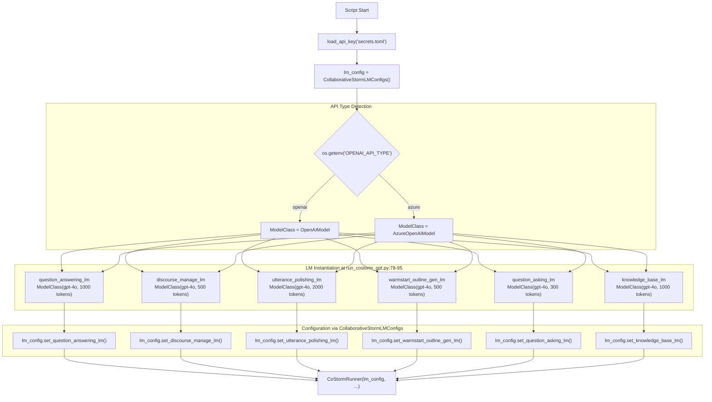
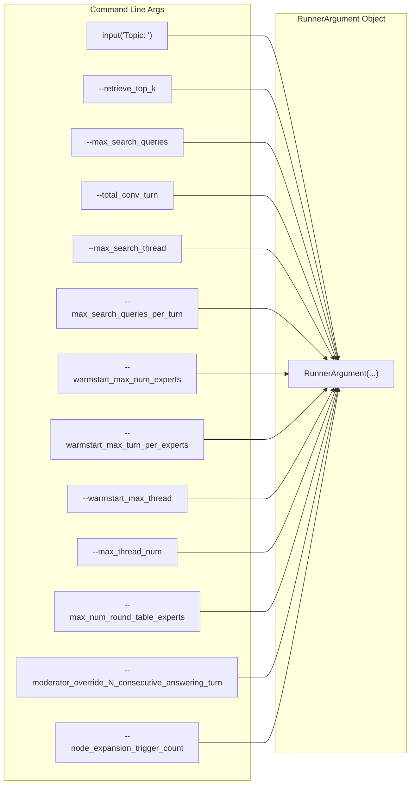
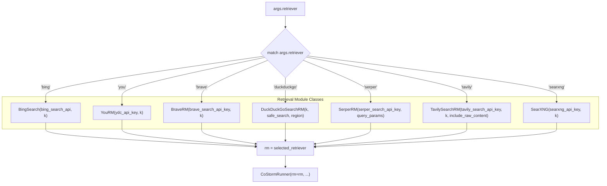
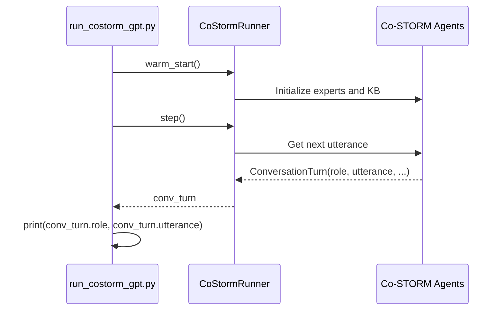
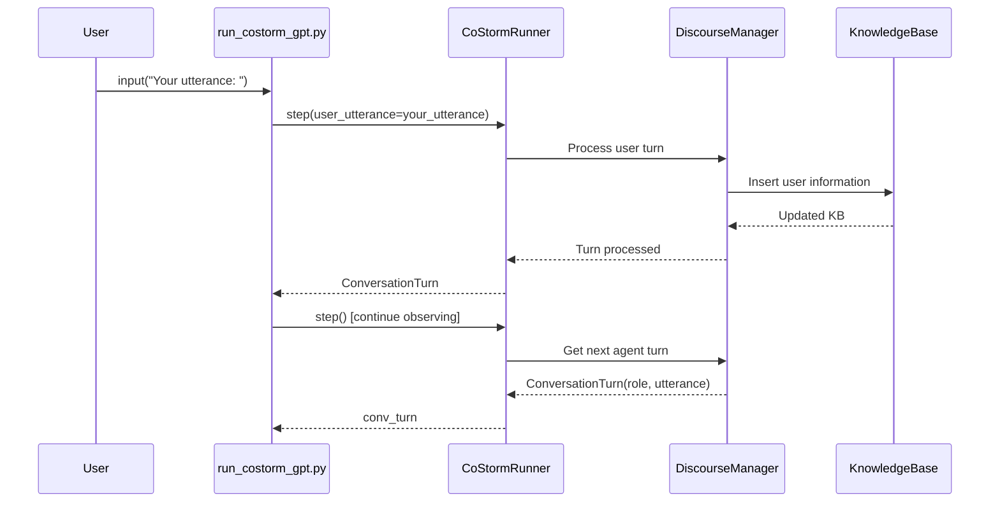
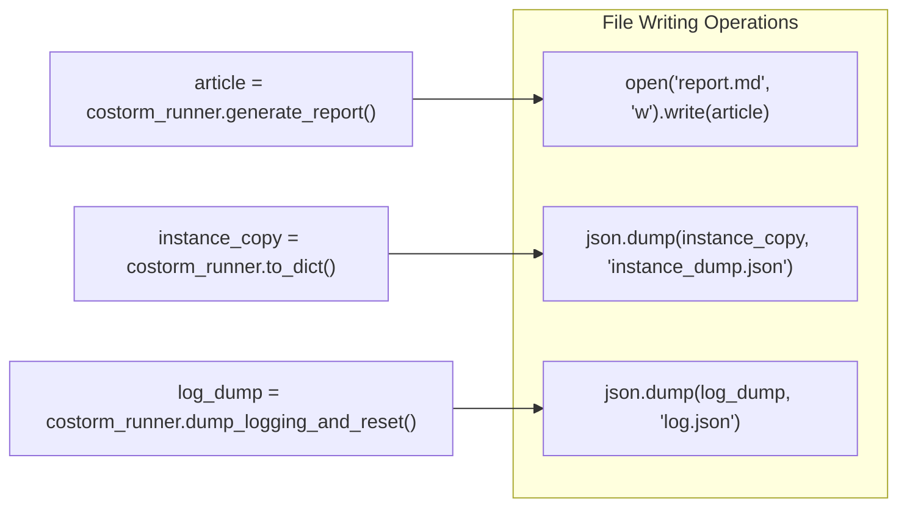

<!-- source: DeepWiki mcp.deepwiki.com · repo stanford-oval/storm · page 5.2 Co-STORM Examples · fetched 2026-10-26 -->

# Co-STORM Examples

<details>
<summary>Relevant source files</summary>

The following files were used as context for generating this wiki page:

- [README.md](README.md)
- [examples/costorm_examples/run_costorm_gpt.py](examples/costorm_examples/run_costorm_gpt.py)
- [knowledge_storm/lm.py](knowledge_storm/lm.py)

</details>


This page demonstrates how to use Co-STORM through command-line examples with the `run_costorm_gpt.py` script. Co-STORM enables collaborative knowledge curation through multi-agent discourse, allowing users to either observe AI agents or actively participate in information-seeking conversations.

For automated STORM examples, see [STORM Examples](#5.1). For Co-STORM system architecture details, see [Co-STORM Collaborative System](#3) and [CoStormRunner](#3.1).
</thinking>

Sources: [examples/costorm_examples/run_costorm_gpt.py:1-14](), [README.md:259-270]()

## Quick Start Example

The primary Co-STORM example script is located at `examples/costorm_examples/run_costorm_gpt.py`. This script demonstrates the complete Co-STORM workflow from initialization through collaborative discourse to report generation.

### Basic Execution with Bing Search

```bash
python examples/costorm_examples/run_costorm_gpt.py \
    --output-dir ./results/co-storm \
    --retriever bing
```

The script will prompt for a topic, run warm start, allow observation/interaction with AI agents, and generate a final report.

Sources: [README.md:261-269](), [examples/costorm_examples/run_costorm_gpt.py:1-14]()

## Environment Setup and Configuration

### API Keys and Environment Variables

Co-STORM requires API keys for language models and search engines. Create a `secrets.toml` file in the repository root with the following structure:

```toml
# Language model configuration
OPENAI_API_KEY="your_openai_api_key"
OPENAI_API_TYPE="openai"  # or "azure"

# For Azure OpenAI
AZURE_API_BASE="your_azure_api_base_url"
AZURE_API_VERSION="your_azure_api_version"

# Search engine API keys (choose one or more)
BING_SEARCH_API_KEY="your_bing_api_key"
YDC_API_KEY="your_you_api_key"
BRAVE_API_KEY="your_brave_api_key"
SERPER_API_KEY="your_serper_api_key"
TAVILY_API_KEY="your_tavily_api_key"
SEARXNG_API_KEY="your_searxng_api_key"

# Encoder configuration
ENCODER_API_TYPE="openai"
```

The script loads these using `load_api_key(toml_file_path="secrets.toml")` at [examples/costorm_examples/run_costorm_gpt.py:42]().

### Supported Retrieval Modules

| Retriever | API Key Required | Command Line Value |
|-----------|------------------|-------------------|
| Bing Search | `BING_SEARCH_API_KEY` | `--retriever bing` |
| You.com | `YDC_API_KEY` | `--retriever you` |
| Brave Search | `BRAVE_API_KEY` | `--retriever brave` |
| DuckDuckGo | None | `--retriever duckduckgo` |
| Serper | `SERPER_API_KEY` | `--retriever serper` |
| Tavily | `TAVILY_API_KEY` | `--retriever tavily` |
| SearXNG | `SEARXNG_API_KEY` | `--retriever searxng` |

Sources: [examples/costorm_examples/run_costorm_gpt.py:3-9](), [examples/costorm_examples/run_costorm_gpt.py:42](), [examples/costorm_examples/run_costorm_gpt.py:127-165](), [README.md:224-240]()

## Command Line Arguments Reference

The argument parser is defined at [examples/costorm_examples/run_costorm_gpt.py:217-316](). All arguments are optional except `--retriever`.

### Core System Arguments

| Argument | Type | Default | Description |
|----------|------|---------|-------------|
| `--output-dir` | str | `./results/co-storm` | Output directory for results |
| `--retriever` | str | **Required** | Search engine: `bing`, `you`, `brave`, `duckduckgo`, `serper`, `tavily`, or `searxng` |
| `--enable_log_print` | flag | False | Print conversation to console via `LocalConsolePrintCallBackHandler` |

### Retrieval Parameters

| Argument | Type | Default | Description |
|----------|------|---------|-------------|
| `--retrieve_top_k` | int | 10 | Number of search results per query |
| `--max_search_queries` | int | 2 | Max queries generated per question |
| `--max_search_thread` | int | 5 | Parallel threads for retrieval |
| `--max_search_queries_per_turn` | int | 3 | Max queries per conversation turn |

### Discourse Control Parameters

| Argument | Type | Default | Description |
|----------|------|---------|-------------|
| `--total_conv_turn` | int | 20 | Maximum conversation turns |
| `--max_num_round_table_experts` | int | 2 | Simultaneous active experts |
| `--moderator_override_N_consecutive_answering_turn` | int | 3 | Moderator intervention after N expert turns |
| `--max_thread_num` | int | 10 | Overall thread limit (reduce if hitting rate limits) |

### Warm Start Parameters

| Argument | Type | Default | Description |
|----------|------|---------|-------------|
| `--warmstart_max_num_experts` | int | 3 | Number of experts in initial perspective-guided QA |
| `--warmstart_max_turn_per_experts` | int | 2 | QA turns per expert during warm start |
| `--warmstart_max_thread` | int | 3 | Parallel threads for warm start |

### Knowledge Base Parameters

| Argument | Type | Default | Description |
|----------|------|---------|-------------|
| `--node_expansion_trigger_count` | int | 10 | Expand KB nodes when they contain >N snippets |

Sources: [examples/costorm_examples/run_costorm_gpt.py:217-316]()

## Example Script Components

### Language Model Configuration in run_costorm_gpt.py

**CollaborativeStormLMConfigs Setup Flow**


The script creates six specialized language model instances through `CollaborativeStormLMConfigs`. Each LM is configured with different `max_tokens` based on its role [examples/costorm_examples/run_costorm_gpt.py:78-95](), then assigned via setter methods [examples/costorm_examples/run_costorm_gpt.py:97-102]().

| LM Component | Max Tokens | Purpose |
|--------------|------------|---------|
| `question_answering_lm` | 1000 | Generate expert answers with citations |
| `discourse_manage_lm` | 500 | Turn policy and conversation flow |
| `utterance_polishing_lm` | 2000 | Refine agent utterances |
| `warmstart_outline_gen_lm` | 500 | Generate initial knowledge structure |
| `question_asking_lm` | 300 | Generate follow-up questions |
| `knowledge_base_lm` | 1000 | Organize information in KB |

Sources: [examples/costorm_examples/run_costorm_gpt.py:43-102]()

### RunnerArgument Configuration

**RunnerArgument Parameter Mapping**


The `RunnerArgument` object is created at [examples/costorm_examples/run_costorm_gpt.py:105-119]() with parameters from command-line arguments.

Sources: [examples/costorm_examples/run_costorm_gpt.py:104-119]()

### Retrieval Module Instantiation

**Retriever Selection via Match-Case Pattern**


The retrieval module is selected using a match-case statement at [examples/costorm_examples/run_costorm_gpt.py:127-165](). Each retriever is instantiated with API keys from environment variables and the `retrieve_top_k` parameter from `runner_argument`.

Sources: [examples/costorm_examples/run_costorm_gpt.py:127-165]()

## Complete Execution Flow Example

**run_costorm_gpt.py Execution Pipeline**

```mermaid
flowchart TD
    Start["main(args)"]
    LoadKeys["load_api_key('secrets.toml')<br/>Line 42"]
    
    subgraph "LM Configuration (Lines 43-102)"
        CreateLMConfig["lm_config = CollaborativeStormLMConfigs()"]
        SetupModels["Setup 6 OpenAIModel/AzureOpenAIModel instances"]
        ConfigureLMs["Configure via lm_config.set_* methods"]
    end
    
    subgraph "Runner Setup (Lines 104-173)"
        TopicInput["topic = input('Topic: ')"]
        CreateArgs["runner_argument = RunnerArgument(topic, ...)"]
        CreateLogging["logging_wrapper = LoggingWrapper(lm_config)"]
        CreateCallback["callback_handler = LocalConsolePrintCallBackHandler()"]
        CreateRM["rm = BingSearch/YouRM/BraveRM/etc."]
        CreateRunner["costorm_runner = CoStormRunner(<br/>lm_config, runner_argument,<br/>logging_wrapper, rm, callback_handler)"]
    end
    
    subgraph "Collaborative Discourse (Lines 176-193)"
        WarmStart["costorm_runner.warm_start()"]
        ObserveLoop["for _ in range(1):<br/>    conv_turn = costorm_runner.step()<br/>    print(conv_turn.role, conv_turn.utterance)"]
        UserInput["your_utterance = input('Your utterance: ')"]
        UserStep["costorm_runner.step(user_utterance=your_utterance)"]
        ContinueStep["conv_turn = costorm_runner.step()"]
    end
    
    subgraph "Report Generation (Lines 195-196)"
        Reorganize["costorm_runner.knowledge_base.reorganize()"]
        GenReport["article = costorm_runner.generate_report()"]
    end
    
    subgraph "Output Saving (Lines 199-213)"
        MakeDir["os.makedirs(args.output_dir, exist_ok=True)"]
        SaveReport["Write report.md"]
        SaveInstance["Write instance_dump.json"]
        SaveLog["Write log.json"]
    end
    
    Start --> LoadKeys
    LoadKeys --> CreateLMConfig
    CreateLMConfig --> SetupModels
    SetupModels --> ConfigureLMs
    ConfigureLMs --> TopicInput
    TopicInput --> CreateArgs
    CreateArgs --> CreateLogging
    CreateLogging --> CreateCallback
    CreateCallback --> CreateRM
    CreateRM --> CreateRunner
    CreateRunner --> WarmStart
    WarmStart --> ObserveLoop
    ObserveLoop --> UserInput
    UserInput --> UserStep
    UserStep --> ContinueStep
    ContinueStep --> Reorganize
    Reorganize --> GenReport
    GenReport --> MakeDir
    MakeDir --> SaveReport
    SaveReport --> SaveInstance
    SaveInstance --> SaveLog
```


The script follows a sequential pipeline from configuration through collaborative discourse to output generation. Key method calls on `CoStormRunner`:
- `warm_start()` initializes the knowledge base [examples/costorm_examples/run_costorm_gpt.py:176]()
- `step()` advances the conversation [examples/costorm_examples/run_costorm_gpt.py:183,188,191]()
- `step(user_utterance=...)` injects user input [examples/costorm_examples/run_costorm_gpt.py:188]()
- `knowledge_base.reorganize()` restructures the KB [examples/costorm_examples/run_costorm_gpt.py:195]()
- `generate_report()` produces final article [examples/costorm_examples/run_costorm_gpt.py:196]()

Sources: [examples/costorm_examples/run_costorm_gpt.py:41-214]()

## Conversation Interaction Patterns

Co-STORM supports two interaction modes: passive observation and active participation. The example script demonstrates both.

### Observation Mode

**Passive Observation Pattern**


The observation loop at [examples/costorm_examples/run_costorm_gpt.py:182-184]() calls `step()` without arguments:
```python
for _ in range(1):
    conv_turn = costorm_runner.step()
    print(f"**{conv_turn.role}**: {conv_turn.utterance}\n")
```

### Active Participation Mode

**User Injection Pattern**


User injection is implemented at [examples/costorm_examples/run_costorm_gpt.py:187-188]():
```python
your_utterance = input("Your utterance: ")
costorm_runner.step(user_utterance=your_utterance)
```

The `step()` method accepts optional `user_utterance` parameter to inject human input into the collaborative discourse.

Sources: [examples/costorm_examples/run_costorm_gpt.py:175-193]()

### ConversationTurn Data Structure

The `step()` method returns a `ConversationTurn` object with the following attributes:
- `role`: Agent role (e.g., "Expert", "Moderator", "User")
- `utterance`: The conversation text
- Additional metadata for logging and KB updates

Sources: [examples/costorm_examples/run_costorm_gpt.py:183-184,191-192]()

## Output Files and Format

Co-STORM generates three output files in the specified directory, created at [examples/costorm_examples/run_costorm_gpt.py:199-213]().

### Output Directory Structure

```
{output_dir}/
├── report.md           # Final article in markdown format
├── instance_dump.json  # Serialized CoStormRunner state
└── log.json           # Complete conversation and LM call logs
```

### File Generation Process

**Output Saving Flow**


| File | Source Method | Content | Line Reference |
|------|---------------|---------|----------------|
| `report.md` | `costorm_runner.generate_report()` | Final synthesized article | [202-203]() |
| `instance_dump.json` | `costorm_runner.to_dict()` | Complete system state including KB structure | [206-208]() |
| `log.json` | `costorm_runner.dump_logging_and_reset()` | LM calls, token usage, conversation turns | [211-213]() |

The output directory is created with `os.makedirs(args.output_dir, exist_ok=True)` at [examples/costorm_examples/run_costorm_gpt.py:199]().

Sources: [examples/costorm_examples/run_costorm_gpt.py:10-14](), [examples/costorm_examples/run_costorm_gpt.py:195-213]()

## Example Usage Commands

### Basic Co-STORM Execution with Bing Search

```bash
python examples/costorm_examples/run_costorm_gpt.py \
  --retriever bing \
  --output-dir ./my_results \
  --total_conv_turn 15 \
  --max_num_round_table_experts 3
```

### Advanced Configuration with Custom Parameters

```bash
python examples/costorm_examples/run_costorm_gpt.py \
  --retriever tavily \
  --output-dir ./detailed_analysis \
  --retrieve_top_k 15 \
  --max_search_queries 4 \
  --warmstart_max_num_experts 5 \
  --node_expansion_trigger_count 15 \
  --enable_log_print
```

### Using DuckDuckGo (No API Key Required)

```bash
python examples/costorm_examples/run_costorm_gpt.py \
  --retriever duckduckgo \
  --max_thread_num 5 \
  --total_conv_turn 25
```

Each execution will prompt for a topic interactively and guide the user through the collaborative discourse process before generating the final report.

Sources: [examples/costorm_examples/run_costorm_gpt.py:1-318]()

---

