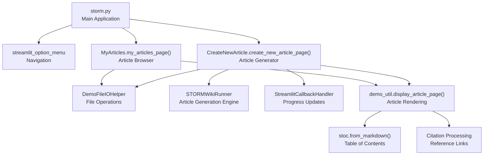
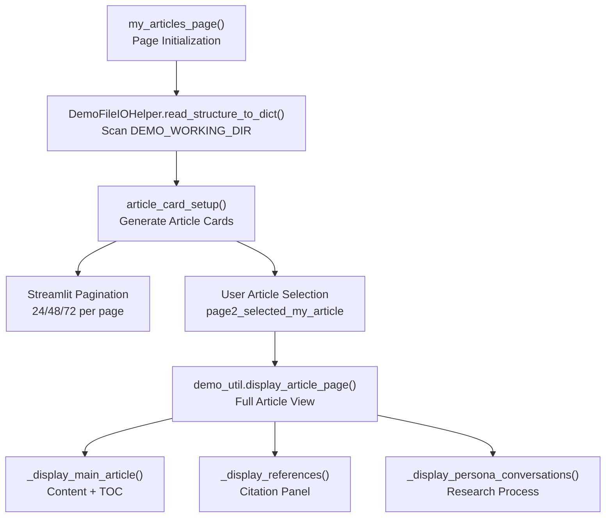
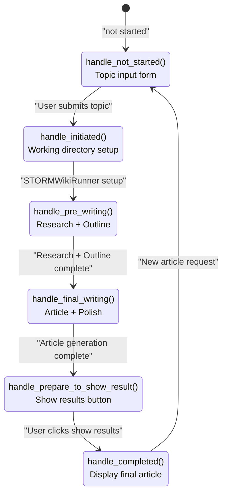
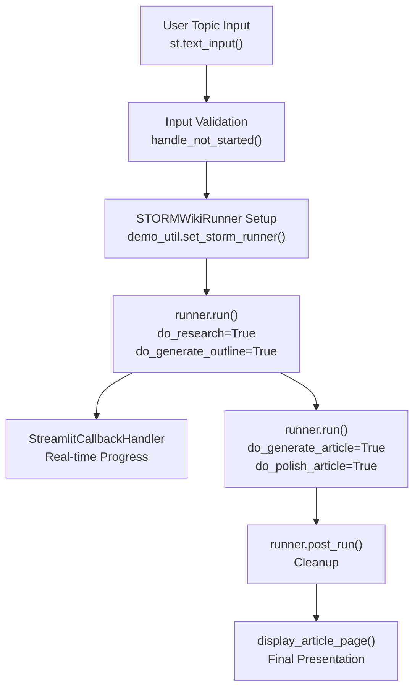
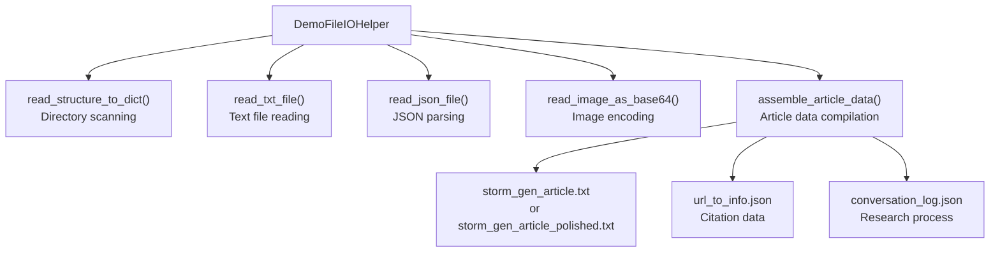
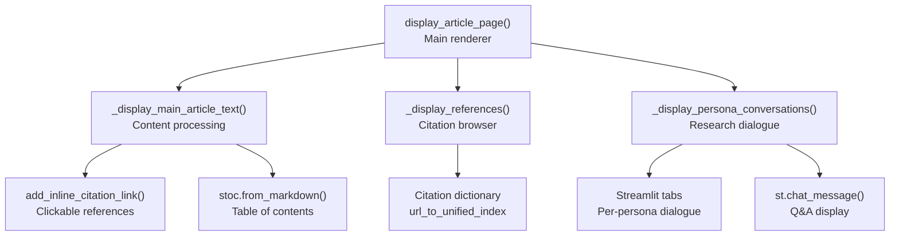
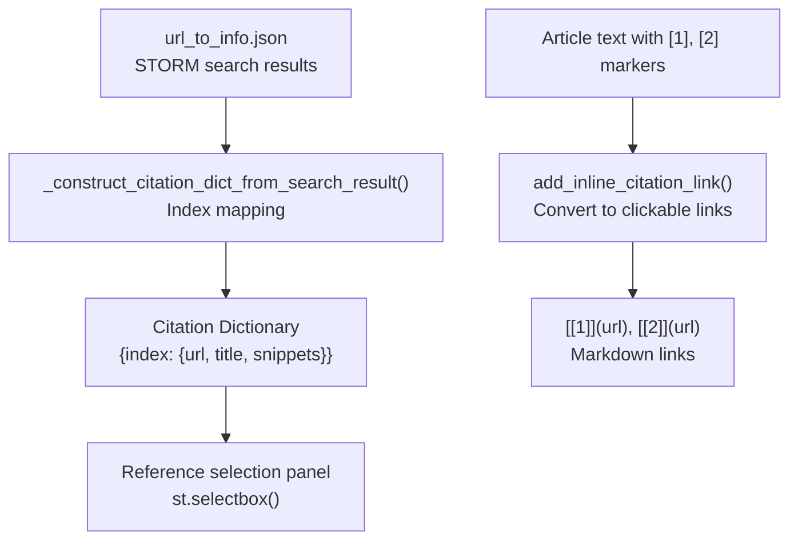

<!-- source: DeepWiki mcp.deepwiki.com · repo stanford-oval/storm · page 5.3 Streamlit Frontend Demo · fetched 2026-10-26 -->

# Frontend Demo

<details>
<summary>Relevant source files</summary>

The following files were used as context for generating this wiki page:

- [frontend/demo_light/README.md](frontend/demo_light/README.md)
- [frontend/demo_light/demo_util.py](frontend/demo_light/demo_util.py)
- [frontend/demo_light/pages_util/CreateNewArticle.py](frontend/demo_light/pages_util/CreateNewArticle.py)
- [frontend/demo_light/pages_util/MyArticles.py](frontend/demo_light/pages_util/MyArticles.py)
- [frontend/demo_light/stoc.py](frontend/demo_light/stoc.py)
- [frontend/demo_light/storm.py](frontend/demo_light/storm.py)

</details>


This document covers the Streamlit-based web interface for interacting with STORM's article generation capabilities. The frontend provides an intuitive user interface for creating new articles and managing previously generated content, with real-time progress tracking during the generation process.

For command-line usage examples, see [STORM Command Line Usage](#5.1) and [Co-STORM Command Line Usage](#5.2).

## Architecture Overview

The frontend demo is built as a multi-page Streamlit application with a state-driven architecture for managing the article generation workflow.

### Application Structure



**Sources:** [frontend/demo_light/storm.py:1-69](), [frontend/demo_light/pages_util/MyArticles.py:1-110](), [frontend/demo_light/pages_util/CreateNewArticle.py:1-168]()

### Session State Management

The application uses Streamlit's session state to manage page navigation and article generation workflow:

| State Key | Purpose | Values |
|-----------|---------|---------|
| `selected_page` | Navigation control | 0 (My Articles), 1 (Create New Article) |
| `page3_write_article_state` | Article generation workflow | "not started", "initiated", "pre_writing", "final_writing", "prepare_to_show_result", "completed" |
| `page3_topic` | User input topic | String |
| `page3_current_working_dir` | Output directory | File path |
| `runner` | STORM engine instance | `STORMWikiRunner` object |

**Sources:** [frontend/demo_light/storm.py:25-33](), [frontend/demo_light/pages_util/CreateNewArticle.py:154-156]()

## My Articles Page

### Article Discovery and Display



**Sources:** [frontend/demo_light/pages_util/MyArticles.py:22-29](), [frontend/demo_light/pages_util/MyArticles.py:31-44](), [frontend/demo_light/demo_util.py:30-53]()

### File Structure Processing

The system reads articles from a hierarchical directory structure:

```
DEMO_WORKING_DIR/
├── topic_name_1/
│   ├── storm_gen_article.txt
│   ├── storm_gen_article_polished.txt
│   ├── url_to_info.json
│   └── conversation_log.json
└── topic_name_2/
    └── ...
```

The `DemoFileIOHelper.read_structure_to_dict()` method creates a nested dictionary mapping article names to file paths for efficient access.

**Sources:** [frontend/demo_light/demo_util.py:30-53](), [frontend/demo_light/pages_util/MyArticles.py:23-28]()

## Create New Article Page

### State Machine Workflow



**Sources:** [frontend/demo_light/pages_util/CreateNewArticle.py:14-167]()

### Article Generation Pipeline

The article creation process integrates with `STORMWikiRunner` through a controlled execution flow:



**Sources:** [frontend/demo_light/pages_util/CreateNewArticle.py:72-98](), [frontend/demo_light/pages_util/CreateNewArticle.py:100-123](), [frontend/demo_light/demo_util.py:577-608]()

### Real-time Progress Tracking

The `StreamlitCallbackHandler` provides live updates during article generation:

| Callback Method | Description | UI Update |
|----------------|-------------|-----------|
| `on_identify_perspective_start()` | Begin perspective identification | Info message |
| `on_identify_perspective_end()` | Complete perspective list | Success with perspectives |
| `on_information_gathering_start()` | Start web browsing | Info message |
| `on_dialogue_turn_end()` | Complete search for URLs | URL links display |
| `on_information_gathering_end()` | Finish information collection | Success message |
| `on_information_organization_start()` | Begin outline creation | Info message |

**Sources:** [frontend/demo_light/demo_util.py:627-677]()

## Core Utility Components

### DemoFileIOHelper Class



**Sources:** [frontend/demo_light/demo_util.py:28-217]()

### Article Display System

The article rendering system processes STORM output files into a rich web interface:



**Sources:** [frontend/demo_light/demo_util.py:611-625](), [frontend/demo_light/demo_util.py:526-558](), [frontend/demo_light/demo_util.py:471-524]()

## Configuration and Setup

### STORM Runner Configuration

The frontend initializes `STORMWikiRunner` with specific settings optimized for the demo interface:

```python
# Key configuration in demo_util.set_storm_runner()
engine_args = STORMWikiRunnerArguments(
    output_dir=current_working_dir,
    max_conv_turn=3,
    max_perspective=3, 
    search_top_k=3,
    retrieve_top_k=5,
)
```

The system uses `OpenAIModel` for language model operations and `YouRM` for web search retrieval, with API keys managed through Streamlit secrets.

**Sources:** [frontend/demo_light/demo_util.py:582-608]()

### Environment Setup

The application requires:

- Streamlit and additional UI packages from `requirements.txt`
- API keys configuration in `.streamlit/secrets.toml`
- Automatic creation of `DEMO_WORKING_DIR` for output storage

**Sources:** [frontend/demo_light/README.md:17-28](), [frontend/demo_light/storm.py:19-24]()

## Text Processing and Citations

### Citation Processing Pipeline



**Sources:** [frontend/demo_light/demo_util.py:458-468](), [frontend/demo_light/demo_util.py:321-332](), [frontend/demo_light/demo_util.py:488-500]()

### Table of Contents Generation

The `stoc` module provides dynamic table of contents generation from Markdown headers, with automatic anchor link creation and sidebar placement.

**Sources:** [frontend/demo_light/stoc.py:89-116](), [frontend/demo_light/demo_util.py:484-485]()

---

