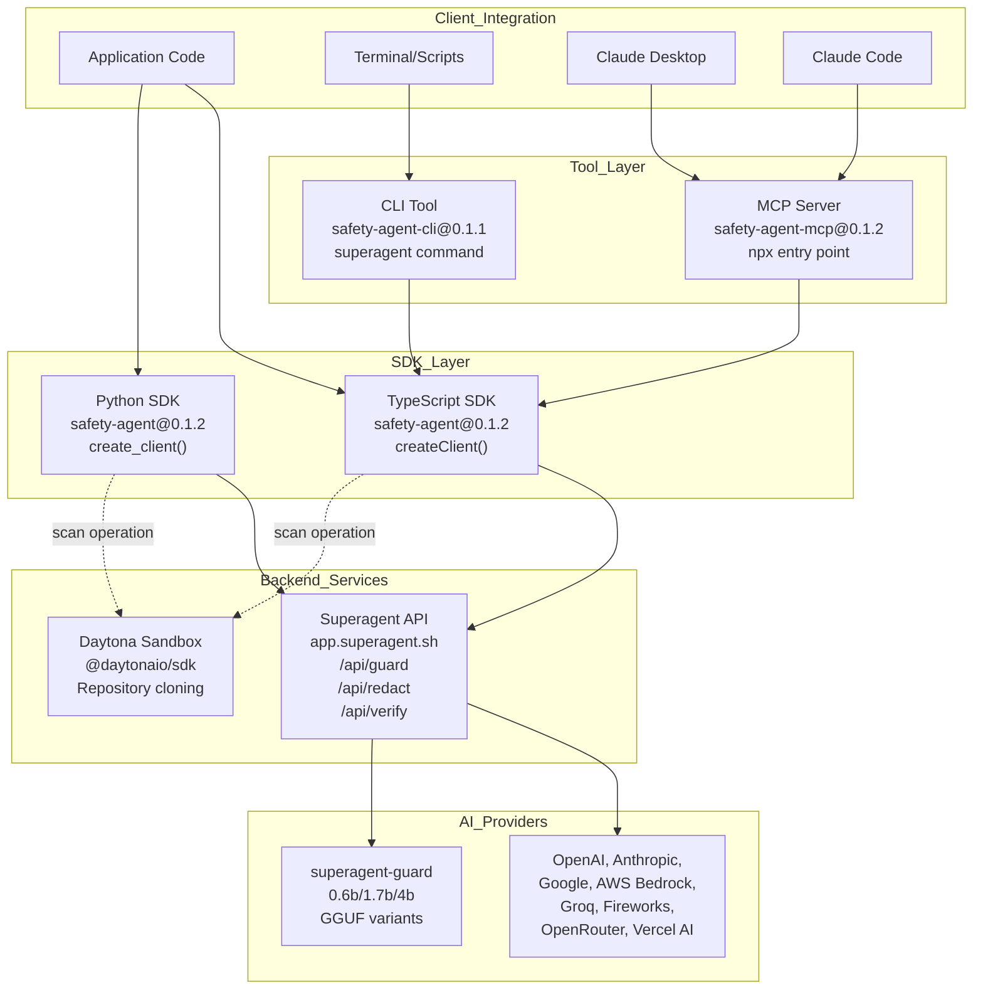
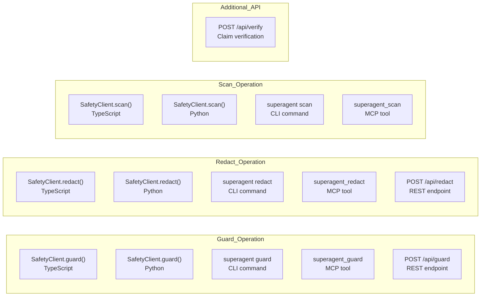
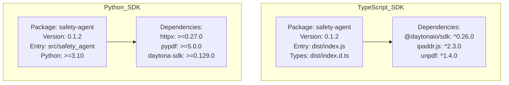
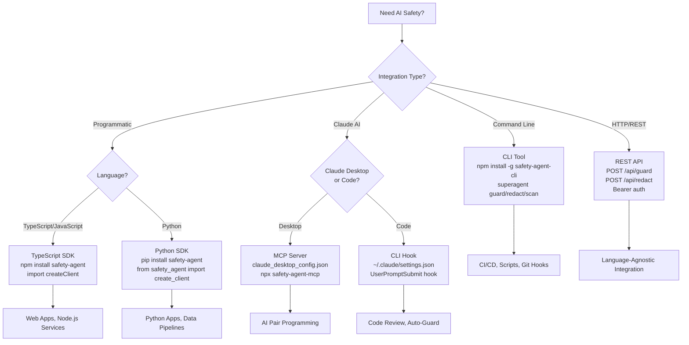

<!-- source: DeepWiki mcp.deepwiki.com · repo superagent-ai/superagent · page 1 Overview · fetched 2026-10-26 -->

# Overview

<details>
<summary>Relevant source files</summary>

The following files were used as context for generating this wiki page:

- [.gitignore](.gitignore)
- [CHANGELOG.md](CHANGELOG.md)
- [README.md](README.md)
- [sdk/python/pyproject.toml](sdk/python/pyproject.toml)
- [sdk/typescript/package.json](sdk/typescript/package.json)
- [sdk/typescript/src/index.ts](sdk/typescript/src/index.ts)

</details>


## Purpose and Scope

This document provides an overview of the Superagent safety system, an open-source SDK and API for securing AI agent applications. Superagent provides runtime protection against prompt injection attacks, automatic removal of sensitive data (PII/PHI), and repository scanning for AI-specific threats.

For detailed explanations of core concepts and terminology, see [Core Concepts](#1.1). For system architecture details, see [Architecture Overview](#1.2). For getting started, see [Quick Start](#1.3).

**Sources:** [README.md:1-28]()

## What is Superagent?

Superagent is an AI agent security toolkit that provides three primary safety operations:

| Operation | Purpose | Primary Use Case |
|-----------|---------|------------------|
| **Guard** | Security analysis and threat detection | Validate user inputs and agent outputs at runtime |
| **Redact** | PII/PHI removal and data sanitization | Remove sensitive information before logging or storage |
| **Scan** | Repository security analysis | Detect AI-targeted attacks in codebases and dependencies |

The system is designed for production use with low latency (50-100ms for guard operations) and supports any LLM provider through a unified interface. It is distributed under the MIT license and available at https://github.com/superagent-ai/superagent.

**Sources:** [README.md:26-127](), [sdk/typescript/package.json:1-8](), [sdk/python/pyproject.toml:1-8]()

## System Architecture

The following diagram shows the complete Superagent ecosystem and how its components relate:

**Ecosystem Component Map**



The system provides four integration pathways:

1. **Direct SDK Integration** - TypeScript and Python SDKs for embedding safety operations directly in applications
2. **Command-Line Interface** - `superagent` CLI tool for terminal automation and CI/CD pipelines
3. **MCP Server Integration** - Model Context Protocol server for Claude Desktop and Claude Code
4. **REST API Access** - Direct HTTP API for language-agnostic integration

All client-side components converge on the Superagent API, which routes requests to appropriate AI model providers.

**Sources:** [README.md:150-158](), [sdk/typescript/package.json:1-8](), [sdk/python/pyproject.toml:1-8](), [cli/README.md](), [mcp/README.md]()

## Core Operations

The following diagram maps each operation to its code entry points:

**Operation to Code Entity Mapping**



### Guard

Guard operations detect security threats including prompt injection, jailbreak attempts, data exfiltration, and code injection vulnerabilities (SQL injection, XSS, command injection, path traversal). The operation accepts text, URLs, PDFs, images, and returns a classification (`pass` or `block`) with identified violation types and CWE codes.

**Code Entry Points:**
- TypeScript: `SafetyClient.guard()` in [sdk/typescript/src/client.ts]()
- Python: `SafetyClient.guard()` in [sdk/python/src/safety_agent/client.py]()
- CLI: `superagent guard` command in [cli/]()
- MCP: `superagent_guard` tool in [mcp/]()

See [Guard Operation](#2.3) for complete reference.

### Redact

Redact operations automatically detect and remove sensitive information including emails, SSNs, phone numbers, credit card numbers, names, addresses, medical record numbers, IP addresses, account numbers, and API keys. The operation supports both placeholder replacement and AI-powered text rewriting.

**Code Entry Points:**
- TypeScript: `SafetyClient.redact()` in [sdk/typescript/src/client.ts]()
- Python: `SafetyClient.redact()` in [sdk/python/src/safety_agent/client.py]()
- CLI: `superagent redact` command in [cli/]()
- MCP: `superagent_redact` tool in [mcp/]()

See [Redact Operation](#2.4) for complete reference.

### Scan

Scan operations analyze Git repositories for AI agent-targeted attacks including repository poisoning, hidden prompt injections in code comments or documentation, and malicious instructions. The operation clones repositories in a Daytona sandbox environment and generates a comprehensive security report.

**Code Entry Points:**
- TypeScript: `SafetyClient.scan()` in [sdk/typescript/src/client.ts]()
- Python: `SafetyClient.scan()` in [sdk/python/src/safety_agent/client.py]()
- CLI: `superagent scan` command in [cli/]()
- MCP: `superagent_scan` tool in [mcp/]()

See [Scan Operation](#2.5) for complete reference.

**Sources:** [README.md:30-127](), [sdk/typescript/src/index.ts:7](), [sdk/typescript/src/types.ts]()

## SDK Architecture

Both TypeScript and Python SDKs maintain feature parity and parallel version numbers (currently 0.1.2). The following table shows the key components:

| Component | TypeScript | Python | Purpose |
|-----------|-----------|---------|---------|
| **Client Factory** | `createClient()` | `create_client()` | Initialize SafetyClient instances |
| **Main Client** | `SafetyClient` class | `SafetyClient` class | Provides guard(), redact(), scan() methods |
| **Type System** | `GuardInput`, `GuardOptions`, `RedactOptions`, `ScanOptions` | `GuardInput`, `GuardOptions`, `RedactOptions`, `ScanOptions` | Type definitions for inputs and options |
| **Response Types** | `GuardResponse`, `RedactResponse`, `ScanResponse` | `GuardResponse`, `RedactResponse`, `ScanResponse` | Structured response formats |
| **Provider Abstraction** | `providers`, `parseModel()`, `getProvider()` | Provider abstraction layer | Multi-model support infrastructure |
| **Input Processing** | `processInput()`, `isVisionModel()` | Input processing utilities | Handle text, URLs, files, images |
| **Prompt System** | `GUARD_SYSTEM_PROMPT`, `REDACT_SYSTEM_PROMPT` | Guard and redact prompts | System prompts for operations |
| **Response Schemas** | `GUARD_RESPONSE_FORMAT`, `REDACT_RESPONSE_FORMAT` | Schema definitions | Structured output formats |

**SDK Package Metadata:**



**Sources:** [sdk/typescript/package.json:1-52](), [sdk/python/pyproject.toml:1-51](), [sdk/typescript/src/index.ts:1-55]()

## Multi-Model Support

Superagent supports a provider/model format (e.g., `openai/gpt-4o`, `anthropic/claude-sonnet-4`) that abstracts multiple AI providers. The system automatically routes requests to the appropriate provider based on the model string.

**Supported Providers:**
- OpenAI (requires `OPENAI_API_KEY`)
- Anthropic (requires `ANTHROPIC_API_KEY`)
- Google (requires `GOOGLE_API_KEY`)
- AWS Bedrock (requires AWS credentials)
- Groq (requires `GROQ_API_KEY`)
- Fireworks (requires `FIREWORKS_API_KEY`)
- OpenRouter (requires `OPENROUTER_API_KEY`)
- Vercel AI SDK (requires `VERCEL_API_KEY`)

See [Model Provider Configuration](#2.6) for complete provider setup and configuration.

**Sources:** [README.md:161](), [sdk/typescript/src/providers/index.ts]()

## Open-Weight Models

Superagent provides three open-weight guard models for on-premise deployment:

| Model | Parameters | HuggingFace Repository | Use Case |
|-------|-----------|----------------------|----------|
| superagent-guard-0.6b | 600M | superagent-ai/superagent-guard-0.6b | Fast inference, edge deployment |
| superagent-guard-1.7b | 1.7B | superagent-ai/superagent-guard-1.7b | Balanced speed and accuracy |
| superagent-guard-4b | 4B | superagent-ai/superagent-guard-4b | Maximum accuracy |

GGUF-quantized versions are available for CPU inference at:
- superagent-ai/superagent-guard-0.6b-gguf
- superagent-ai/superagent-guard-1.7b-gguf
- superagent-ai/superagent-guard-4b-gguf

These models enable deployment scenarios where data cannot leave the infrastructure, with typical inference latency of 50-100ms.

See [Open-Weight Models](#2.8) for deployment guidance.

**Sources:** [README.md:166-177]()

## Integration Paths

**Integration Path Decision Tree**



### SDK Integration

Install via package managers and embed directly in application code:

- **TypeScript:** `npm install safety-agent`
- **Python:** `pip install safety-agent` or `uv add safety-agent`

See [SDK Reference](#2) for complete API documentation.

### CLI Integration

Install globally and use in scripts, CI/CD pipelines, or Git hooks:

```bash
npm install -g safety-agent-cli
superagent guard --input "user input text"
```

See [Command-Line Interface](#3) for complete CLI reference.

### MCP Server Integration

Configure for Claude Desktop or Claude Code:

- **Claude Desktop:** Add to `claude_desktop_config.json`
- **Claude Code:** Add UserPromptSubmit hook to `~/.claude/settings.json`

See [MCP Server](#4) for setup instructions.

### REST API Integration

Make HTTP requests directly to `https://app.superagent.sh`:

```http
POST /api/guard
Authorization: Bearer YOUR_API_KEY
Content-Type: application/json
```

See [REST API](#5) for endpoint documentation.

**Sources:** [README.md:150-158]()

## Authentication

All integration paths require a Superagent API key, obtained by signing up at https://superagent.sh. Set the key in your environment:

```bash
export SUPERAGENT_API_KEY=your-key-here
```

Additional API keys may be required for:
- **Scan operations:** `DAYTONA_API_KEY` for sandbox access
- **Specific model providers:** `OPENAI_API_KEY`, `ANTHROPIC_API_KEY`, etc.

See [Environment Configuration](#8.2) for complete environment variable reference.

**Sources:** [README.md:144-148](), [sdk/typescript/package.json:44-51](), [sdk/python/pyproject.toml:22-26]()

## Project Structure

The repository is organized as a monorepo:

```
superagent/
├── sdk/
│   ├── typescript/     # TypeScript SDK (safety-agent@0.1.2)
│   └── python/         # Python SDK (safety-agent@0.1.2)
├── cli/                # CLI tool (safety-agent-cli@0.1.1)
├── mcp/                # MCP server (safety-agent-mcp@0.1.2)
└── docs/               # Documentation site (Next.js + Fumadocs)
```

See [Project Structure](#7.1) for detailed directory layout.

**Sources:** [README.md:1-188](), [.gitignore:1-120]()

## License and Resources

Superagent is released under the MIT License. Key resources:

- **Documentation:** https://docs.superagent.sh
- **Repository:** https://github.com/superagent-ai/superagent
- **Discord Community:** https://discord.gg/spZ7MnqFT4
- **HuggingFace Models:** https://huggingface.co/superagent-ai
- **Website:** https://superagent.sh

**Sources:** [README.md:178-188](), [sdk/typescript/package.json:33](), [sdk/python/pyproject.toml:6]()

---

