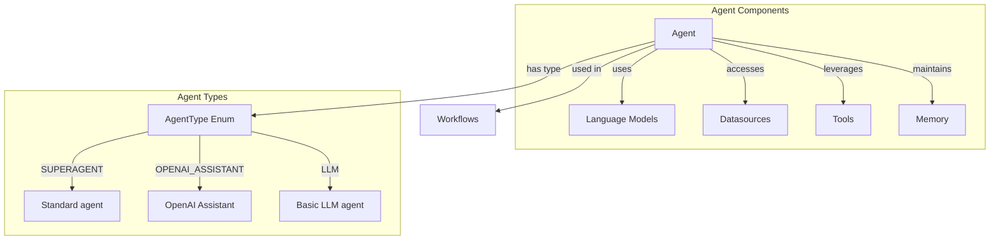
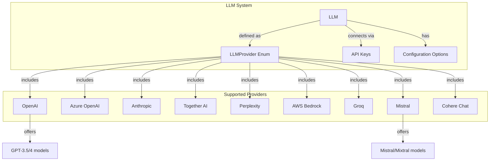
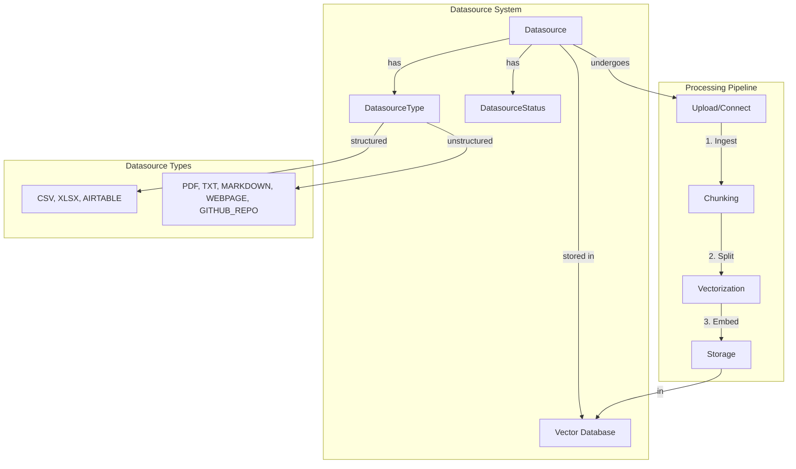
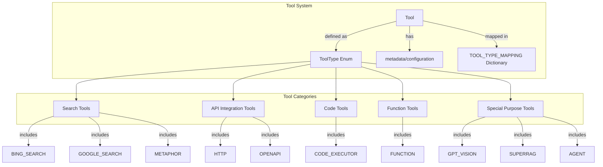
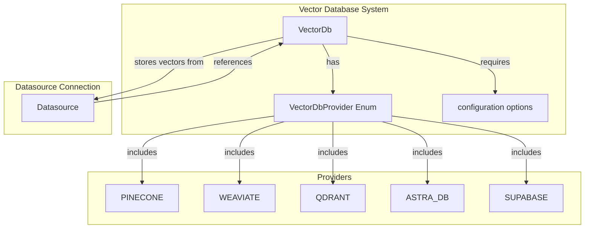
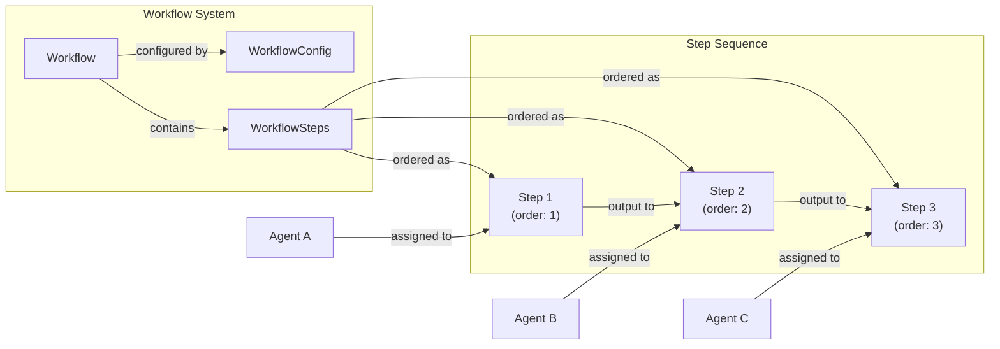
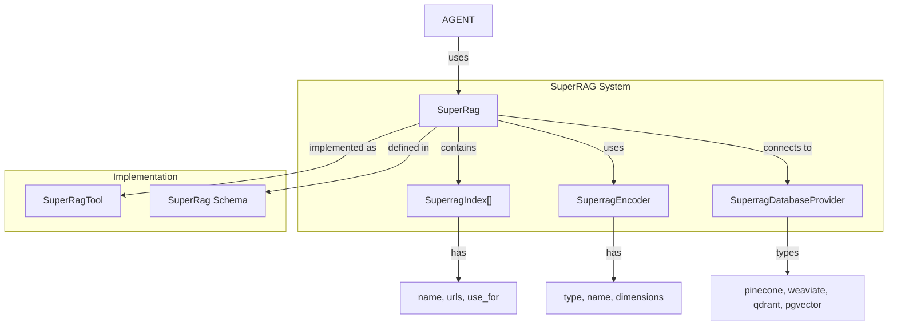
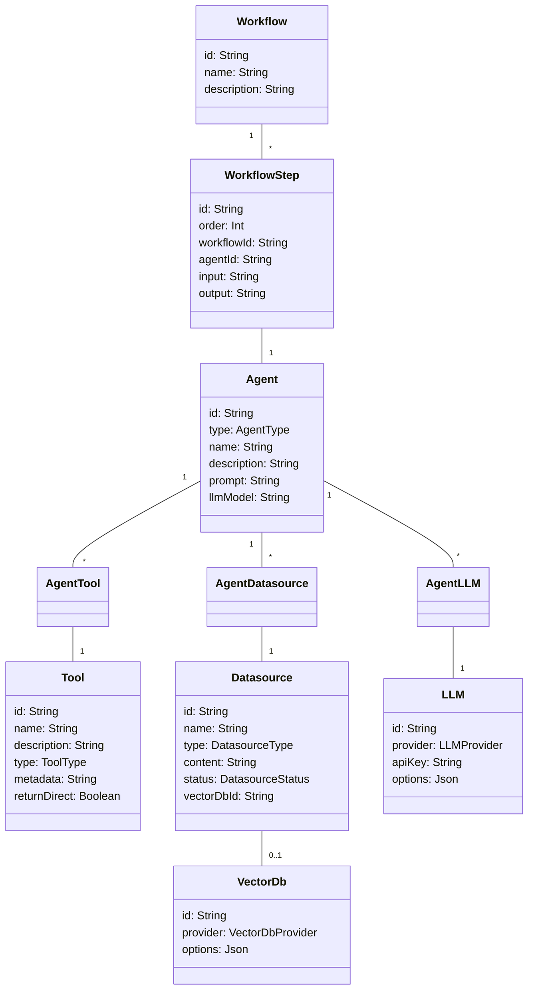

<!-- source: DeepWiki mcp.deepwiki.com · repo superagent-ai/superagent · page 1.1 Core Concepts · fetched 2026-10-26 -->

# Core Concepts

Relevant source files

The following files were used as context for generating this wiki page:

- [README.md](README.md)
- [docs/public/visual-prompt-injection-example.png](docs/public/visual-prompt-injection-example.png)
- [sdk/python/README.md](sdk/python/README.md)
- [sdk/typescript/README.md](sdk/typescript/README.md)

This document explains the three core operations of the Superagent safety system and key terminology used throughout the codebase. Understanding these concepts is essential for integrating security and privacy features into AI applications.

For information on the overall system architecture, see [Architecture Overview](#1.2). For installation and usage instructions, see [Quick Start](#1.3).

## Agents

Agents are the central entities in Superagent that perform tasks by leveraging language models, tools, and knowledge from datasources. An agent is an AI assistant configured for specific purposes, from answering questions to performing complex multi-step tasks.

The Agent model in the database schema stores configuration including prompt templates, associated tools, and datasources:

| Field | Type | Description |
|-------|------|-------------|
| id | String | Unique identifier |
| type | AgentType | SUPERAGENT, OPENAI_ASSISTANT, or LLM |
| name | String | Display name |
| description | String | Purpose description |
| prompt | String | Template for agent instructions |
| llmModel | String | Default model to use |
| tools | AgentTool[] | Tools this agent can access |
| datasources | AgentDatasource[] | Data sources this agent can query |
| metadata | Json | Additional configuration |

Sources: [libs/superagent/prisma/schema.prisma:142-163](), [libs/superagent/app/api/workflow_configs/saml_schema.py:113-141]()

## LLMs (Large Language Models)

LLMs provide the intelligence behind agents in Superagent. They generate responses, reason through problems, and determine when to use tools or access datasources.

Each LLM integration requires specific configuration parameters:

| Provider | Required Configuration |
|----------|------------------------|
| OpenAI | API Key |
| Azure OpenAI | API Key, Endpoint, API Version, Deployment |
| Anthropic | API Key |
| Together AI | API Key |
| Perplexity | API Key |
| AWS Bedrock | Access Key, Secret Key, Region |
| Groq | API Key |
| Mistral | API Key |
| Cohere | API Key |

Sources: [libs/superagent/prisma/schema.prisma:19-48](), [libs/ui/config/site.ts:470-612]()

## Datasources

Datasources allow agents to access and reason over external information. They enable retrieval augmented generation (RAG), where LLMs can reference specific knowledge rather than relying solely on their training data.

The system handles datasources differently based on their type:
- **Unstructured data** (PDFs, text, webpages): Split into chunks and vectorized
- **Structured data** (CSV, spreadsheets): Processed to allow querying specific fields

Datasource status tracking:
- IN_PROGRESS: Currently being processed
- DONE: Successfully processed and ready to use
- FAILED: Processing failed

Sources: [libs/superagent/prisma/schema.prisma:81-105](), [fern/mdx/concepts.mdx:18-43]()

## Tools

Tools extend an agent's capabilities by allowing it to interact with external services, execute code, search the web, and perform specialized functions.

Tool implementation shows how tools are registered and managed in the codebase:

| Tool Type | Implementation | Purpose |
|-----------|----------------|---------|
| HTTP | LCHttpTool | Makes API requests to external services |
| BROWSER | LCBrowser | Visits and extracts content from web pages |
| BING_SEARCH | LCBingSearch | Performs web searches using Bing |
| GOOGLE_SEARCH | GoogleSearch | Performs web searches using Google |
| CODE_EXECUTOR | CodeInterpreter | Executes Python code and returns results |
| FUNCTION | Function | Creates custom functions from JSON definitions |
| SUPERRAG | SuperRagTool | Advanced RAG capabilities |

Sources: [libs/superagent/app/tools/__init__.py:71-105](), [libs/superagent/app/models/tools.py:1-115](), [libs/superagent/app/tools/http.py:16-87]()

## Vector Databases

Vector databases store and index embeddings created from datasources, enabling semantic search capabilities for retrieving relevant information.

Each vector database provider requires specific configuration parameters stored in the database:

| Provider | Required Configuration |
|----------|------------------------|
| Pinecone | API Key, Environment, Index |
| Weaviate | API Key, URL, Index |
| Qdrant | API Key, Host, Index |
| Astra DB | DB ID, Region, Token, Collection, Keyspace |
| Supabase | DB URL, Table Name |

Sources: [libs/superagent/prisma/schema.prisma:107-114](), [libs/ui/config/site.ts:627-763]()

## Workflows

Workflows allow for orchestrating multiple agents in sequence, where the output of one agent becomes the input to the next. This enables complex multi-step tasks to be broken down into specialized components.

A workflow consists of:
- Multiple steps in a specific order
- Each step assigned to an agent
- Input/output configuration between steps
- Optional configuration parameters

The workflow system allows complex tasks to be broken down into specialized agents, each focused on a particular aspect of the process.

Sources: [libs/superagent/prisma/schema.prisma:243-277](), [libs/superagent/app/api/workflow_configs/saml_schema.py:159-183]()

## Superrag

SuperRAG is a specialized component of Superagent that provides advanced retrieval augmented generation capabilities.

SuperRAG provides enhanced retrieval capabilities with:
- Multiple indices for different purposes
- Encoder configuration for embeddings
- Integration with vector databases
- Advanced query capabilities

Sources: [libs/superagent/app/api/workflow_configs/saml_schema.py:11-59](), [libs/superagent/app/tools/__init__.py:99]()

## The Superagent Object Model

This diagram shows the core data model and relationships between the main entities in Superagent:

This data model shows how the core components relate to each other in the database schema. The join tables (AgentLLM, AgentTool, AgentDatasource) enable many-to-many relationships between the primary entities.

Sources: [libs/superagent/prisma/schema.prisma:13-288]()

## Tracing and Observability

Superagent provides integration with observability tools to monitor and debug agent behavior. This enables developers to track the execution flow, performance, and decision-making process of their agents.

| Service | Configuration | Type |
|---------|--------------|------|
| Langfuse | `LANGFUSE_PUBLIC_KEY`, `LANGFUSE_SECRET_KEY`, `LANGFUSE_HOST` | Open Source |
| LangSmith | `LANGCHAIN_TRACING_V2`, `LANGCHAIN_ENDPOINT`, `LANGSMITH_PROJECT_ID`, `LANGCHAIN_API_KEY` | Commercial |

These integrations provide:
- Tracing of agent execution paths
- Performance metrics
- Debugging capabilities
- Visualization of agent interactions

Sources: [fern/mdx/concepts.mdx:104-112]()

---

